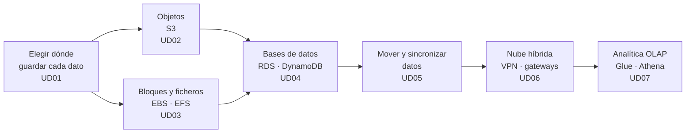

# Administración de bases de datos y almacenamiento en la nube

Apuntes y prácticas del módulo **5162 Administración de bases de datos y almacenamiento en la nube**, del **Curso de especialización de FP de grado superior en Recursos y servicios en la nube** (Real Decreto 145/2026), curso **2026/27**. El objetivo es que sepas **elegir, desplegar, proteger, vigilar y abaratar** el almacenamiento y las bases de datos de una organización en la nube: objetos, discos, sistemas de ficheros, bases de datos relacionales y NoSQL, transferencias, nube híbrida y analítica.

| Característica | Valor |
|---|---|
| **Duración** | **100 horas** · 12 ECTS (≈ 33 h de teoría y 67 h de prácticas) |
| **Resultados de aprendizaje** | 7 (RA1 a RA7). Consulta la [guía](/guia/ra-ce/) |
| **Proveedor de referencia** | AWS (AWS Academy Learner Lab), con equivalencias en Azure y Google Cloud |
| **Herramientas** | Consola web · AWS CLI v2 · OpenTofu (IaC) · Docker · PostgreSQL · rclone · WireGuard · DuckDB |
| **Proyecto común** | [TaquillaAlacant: los datos de una ticketera, de la oficina a la nube](/guia/proyecto-taquilla/) |

> [!NOTE]
> Todo el módulo sigue el mismo hilo, que es el de los criterios de evaluación del real decreto: **elegir la región y la clase → cifrar → controlar quién accede → vigilar y auditar → hacer copias y replicar → ajustar el coste**. Lo repites con cada tipo de almacenamiento; al final te sale solo.

## El hilo del módulo

## Unidades didácticas

Cada unidad tiene una página de **teoría** (conceptos, comparativas, ejemplos y autoevaluación) y una de **prácticas** clasificadas en **guiadas**, **autónomas**, **retos** y **tarea del proyecto**, con su ficha de duración, dificultad, RA/CE, software y entrega.

  
RA1 · 10 h<h3>UD01 · Elegir el almacenamiento</h3>
Objetos, bloques, ficheros y bases de datos; durabilidad, disponibilidad, regiones, residencia de datos y cálculo de costes.

<a href="ud01-seleccion-almacenamiento/ud01-teoria/">Teoría</a> · <a href="ud01-seleccion-almacenamiento/ud01-practicas/">Prácticas</a>

  
RA2 · 16 h<h3>UD02 · Almacenamiento de objetos</h3>
Buckets, clases, cifrado con KMS, políticas, acceso público con dominio y HTTPS, ciclo de vida, versionado y replicación.

<a href="ud02-almacenamiento-objetos/ud02-teoria/">Teoría</a> · <a href="ud02-almacenamiento-objetos/ud02-practicas/">Prácticas</a>

  
RA3 · 12 h<h3>UD03 · Bloques y ficheros en red</h3>
EBS, instantáneas, EFS y montaje NFS, modos de acceso, cambios de tamaño y clase, AWS Backup.

<a href="ud03-bloques-ficheros/ud03-teoria/">Teoría</a> · <a href="ud03-bloques-ficheros/ud03-practicas/">Prácticas</a>

  
RA4 · 24 h<h3>UD04 · Bases de datos administradas</h3>
RDS y Aurora, Multi-AZ y réplicas, copias y PITR, DynamoDB, monitorización del rendimiento y optimización sencilla.

<a href="ud04-bases-datos/ud04-teoria/">Teoría</a> · <a href="ud04-bases-datos/ud04-practicas/">Prácticas</a>

  
RA5 · 12 h<h3>UD05 · Transferir y sincronizar datos</h3>
CLI y rclone, DataSync, Transfer Family, DMS, transferencias físicas, sincronización desatendida y verificación de integridad.

<a href="ud05-transferencia-sincronizacion/ud05-teoria/">Teoría</a> · <a href="ud05-transferencia-sincronizacion/ud05-practicas/">Prácticas</a>

  
RA6 · 12 h<h3>UD06 · Nube híbrida</h3>
Conectividad (SSH, VPN, conexiones dedicadas), Storage Gateway, replicación desde la oficina y monitorización de extremo a extremo.

<a href="ud06-nube-hibrida/ud06-teoria/">Teoría</a> · <a href="ud06-nube-hibrida/ud06-practicas/">Prácticas</a>

  
RA7 · 14 h<h3>UD07 · Analítica de datos (OLAP)</h3>
Data lake, Parquet y particionado, Glue y Athena, Redshift, retención y compactación, supervisión de ETL y práctica final.

<a href="ud07-analitica-olap/ud07-teoria/">Teoría</a> · <a href="ud07-analitica-olap/ud07-practicas/">Prácticas</a>

## Relación entre unidades y resultados de aprendizaje

| Unidad | RA1 | RA2 | RA3 | RA4 | RA5 | RA6 | RA7 | Horas |
|---|:-:|:-:|:-:|:-:|:-:|:-:|:-:|--:|
| UD01 Elegir el almacenamiento | ● | ○ | ○ | | | | | 10 |
| UD02 Almacenamiento de objetos | ○ | ● | | | | | | 16 |
| UD03 Bloques y ficheros en red | ○ | | ● | | | | | 12 |
| UD04 Bases de datos administradas | | | | ● | | | | 24 |
| UD05 Transferir y sincronizar datos | | | | ○ | ● | | | 12 |
| UD06 Nube híbrida | | | | | ○ | ● | | 12 |
| UD07 Analítica de datos (OLAP) | | | | | | | ● | 14 |
| **Total** | | | | | | | | **100** |

● contribución principal · ○ contribución secundaria. El detalle por criterio está en [Resultados de aprendizaje y criterios de evaluación](/guia/ra-ce/).

## Cómo leer estos apuntes

> [!TIP]
> **Consejo.** Una forma más cómoda, más barata o más profesional de hacer algo.

> [!WARNING]
> **Atención.** Un error habitual o algo que puede costar dinero.

> [!IMPORTANT]
> **Clave.** Un concepto imprescindible para el resultado de aprendizaje.

> [!CAUTION]
> **Peligro.** Una operación que puede borrar datos de forma irrecuperable o dejar datos expuestos en Internet.

Las órdenes se escriben **sin indicador de prompt** para que puedas copiarlas tal cual. Las variables que tienes que cambiar van en mayúsculas (`$ALUMNO`, `$BUCKET`). Si se muestra la salida esperada, va en un bloque aparte marcado como `text`. Los precios que aparecen son **orientativos**: compruébalos siempre en la calculadora del proveedor, porque cambian.
