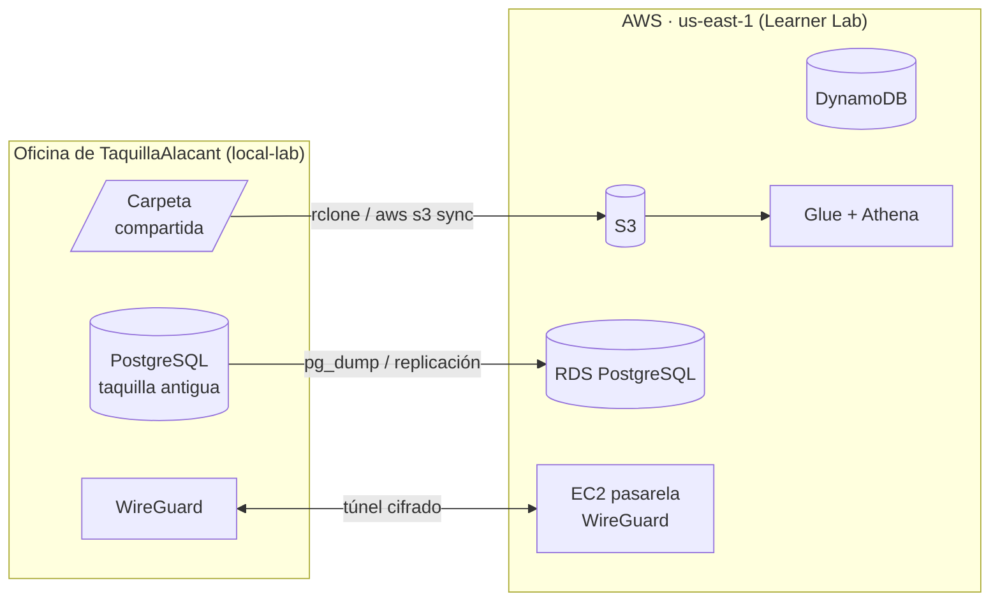

# Entorno de trabajo

Trabajas con **dos entornos** que se complementan:

| Entorno | Para qué | Coste |
|---|---|---|
| **AWS Academy Learner Lab** | Los servicios reales del proveedor: S3, EBS, EFS, RDS, DynamoDB, KMS, CloudWatch, Glue, Athena… | Crédito educativo limitado por alumno |
| **Máquina local `local-lab`** (Debian 13 en VirtualBox) | Simular «la oficina» de la empresa: PostgreSQL local, almacenamiento compatible con S3, VPN, sincronización y análisis local | Gratis |



## 1. AWS Academy Learner Lab

El docente te invita al curso de AWS Academy. Desde el curso abres **Modules → Learner Lab → Start Lab**; cuando el indicador se pone en verde, **AWS** abre la consola.

Lo que tienes que saber del laboratorio (léelo también en el documento *Learner Lab – Foundation Services* del propio curso, porque las restricciones cambian):

- **Regiones**: solo **`us-east-1`** (Norte de Virginia) y **`us-west-2`** (Oregón). Esto es un límite del laboratorio, no del proveedor: en un proyecto real para una empresa española elegirías normalmente una región europea (por ejemplo `eu-south-2`, España). Lo trabajarás en la UD01.
- **IAM muy limitado**: no puedes crear usuarios, grupos ni roles (salvo los vinculados a servicios). Cuando un servicio necesite un rol (replicación de S3, Glue, DataSync…) usarás el rol **`LabRole`** y, para EC2, el perfil **`LabInstanceProfile`**.
- **Límites de tamaño**: por ejemplo, volúmenes EBS de 100 GB como máximo y sin IOPS aprovisionadas; instancias pequeñas.
- **Sesiones**: cada sesión dura unas horas. Al terminar se paran las instancias EC2, pero **otros recursos siguen existiendo y consumiendo crédito** (bases de datos, puntos de enlace, NAT, almacenamiento). Al reiniciar la sesión, las **credenciales cambian**.

> [!CAUTION]
> Si agotas el crédito, la cuenta se bloquea y pierdes **todo** lo que tenías. Cada práctica termina con un apartado de **limpieza**: hazlo siempre.

### Credenciales para la línea de órdenes

En la página del laboratorio, **AWS Details → AWS CLI: Show** muestra un bloque como este. Cópialo en `~/.aws/credentials` cada vez que empieces sesión:

```ini
[default]
aws_access_key_id=ASIA...
aws_secret_access_key=...
aws_session_token=...
```

Y fija la región en `~/.aws/config`:

```ini
[default]
region = us-east-1
output = json
```

Comprueba que funciona:

```bash
aws sts get-caller-identity
```

```text
{
    "UserId": "AROA...:user1234567=Nombre_Apellido",
    "Account": "123456789012",
    "Arn": "arn:aws:sts::123456789012:assumed-role/voclabs/user1234567=Nombre_Apellido"
}
```

> [!TIP]
> También puedes trabajar desde **AWS CloudShell** (icono `>_` de la consola): ya trae la CLI con las credenciales cargadas y 1 GB persistente en `$HOME`. Es la opción más rápida para órdenes sueltas.

## 2. Herramientas en tu equipo

Instálalas en `local-lab` (o en tu equipo, si usas Linux):

```bash
sudo apt update
sudo apt install -y curl unzip jq git postgresql-client rclone wireguard-tools
# AWS CLI v2
curl -fsSL "https://awscli.amazonaws.com/awscli-exe-linux-x86_64.zip" -o awscliv2.zip
unzip -q awscliv2.zip && sudo ./aws/install && rm -rf aws awscliv2.zip
aws --version
# OpenTofu (infraestructura como código, compatible con Terraform)
curl -fsSL https://get.opentofu.org/install-opentofu.sh -o install-opentofu.sh
chmod +x install-opentofu.sh && sudo ./install-opentofu.sh --install-method deb && rm install-opentofu.sh
tofu version
```

Y **Docker Engine** desde el repositorio oficial (<https://docs.docker.com/engine/install/debian/>), que usarás para levantar PostgreSQL, un almacenamiento compatible con S3 y DuckDB sin ensuciar el sistema.

| Herramienta | Unidades | Uso |
|---|---|---|
| AWS CLI v2 | Todas | Administración por línea de órdenes y API |
| OpenTofu | UD02 – UD07 | Infraestructura como código: cifrado, buckets, volúmenes, bases de datos |
| `psql` / PostgreSQL 17 | UD04 – UD06 | Cliente de la base de datos y servidor local de la «oficina» |
| rclone | UD05 – UD06 | Sincronización de ficheros con S3 y otros proveedores |
| WireGuard | UD06 | VPN entre la oficina y la VPC |
| DuckDB | UD07 | Consultas analíticas locales sobre Parquet |
| Garage (Docker) | UD02, UD06 | Almacenamiento de objetos compatible con S3 en local |

> [!NOTE]
> Durante años el almacenamiento S3 local de referencia fue MinIO, pero su edición comunitaria dejó de mantenerse y su repositorio se archivó en 2026. Por eso aquí se usa **Garage** (licencia AGPL), y como alternativa puedes probar **SeaweedFS**. Por el mismo motivo no se usa LocalStack: desde marzo de 2026 exige cuenta y token.

## 3. Infraestructura como código con OpenTofu

Varios criterios piden configurar el cifrado «mediante IaC». Cada práctica que lo necesite tiene su carpeta con un `main.tf`. La cabecera común es esta:

```hcl
terraform {
  required_providers {
    aws = {
      source  = "hashicorp/aws"
      version = "~> 6.0"
    }
  }
}

provider "aws" {
  region = "us-east-1"
  default_tags {
    tags = {
      Proyecto = "TaquillaAlacant"
      Alumno   = var.alumno
      Modulo   = "5162"
    }
  }
}

variable "alumno" {
  description = "Tu usuario en minúsculas, sin espacios (ej.: lmartinez)"
  type        = string
}
```

El ciclo de trabajo siempre es el mismo:

```bash
tofu init
tofu plan -var alumno=$ALUMNO
tofu apply -var alumno=$ALUMNO
# ...comprobaciones...
tofu destroy -var alumno=$ALUMNO
```

> [!WARNING]
> El fichero `terraform.tfstate` guarda el estado y puede contener **contraseñas en claro**. No lo subas nunca a un repositorio: añade `*.tfstate*` y `.terraform/` a tu `.gitignore`.

## 4. Convenciones de nombres y etiquetas

| Recurso | Formato | Ejemplo |
|---|---|---|
| Bucket | `ta-<alumno>-<uso>-<sufijo>` | `ta-lmartinez-carteles-7f3a` |
| Base de datos | `ta-<alumno>-<motor>` | `ta-lmartinez-pg` |
| Volumen, EFS, tabla… | `ta-<alumno>-<uso>` | `ta-lmartinez-logs` |

Todos los recursos llevan las etiquetas **`Proyecto`**, **`Alumno`** y **`Modulo`** (OpenTofu las pone solas con `default_tags`). Con ellas filtras en la consola y en **Cost Explorer** lo que has creado tú.

## 5. Máquina local `local-lab`

| Parámetro | Valor |
|---|---|
| Sistema | Debian 13 (trixie), sin entorno gráfico |
| Recursos | 2 vCPU · 4 GB RAM · 40 GB de disco |
| Red | Adaptador NAT (salida a Internet) + red solo-anfitrión para administrar por SSH |
| Software | El de la sección 2, más Docker Engine |

Haz una **instantánea** de la máquina al terminar la instalación: la UD06 toca la red y es fácil dejarla inservible.

## 6. Normas para no gastar el crédito

1. **Etiqueta** todo y **destruye** al acabar (`tofu destroy` o el apartado de limpieza de la práctica).
2. Las bases de datos, en clase **`db.t3.micro`/`db.t4g.micro`**, **Single-AZ** salvo cuando la práctica pida Multi-AZ, y **detenlas** si vas a seguir otro día.
3. No crees **NAT Gateways** ni **puntos de enlace de interfaz** si la práctica no lo pide: cobran por hora aunque no los uses.
4. Antes de lanzar una consulta de Athena, mira cuántos datos va a leer: se paga por datos escaneados.
5. Revisa el gasto acumulado en la página del laboratorio al empezar cada sesión.
