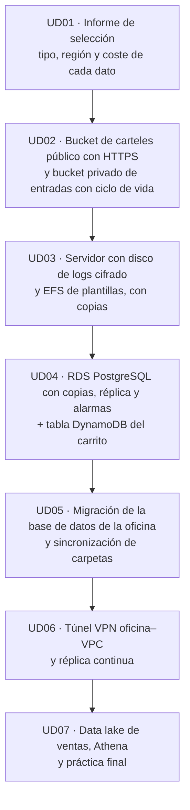

# Proyecto transversal: TaquillaAlacant

**TaquillaAlacant** es una empresa ficticia de Alicante que vende entradas para conciertos, teatro, partidos y actos de las fiestas. Empezó con una taquilla física y un servidor en la oficina; ahora quiere llevar sus datos a la nube sin perder el control de la seguridad ni del coste. Tú eres la persona que administra esos datos.

## Los datos de la empresa

| Dato | Volumen | Patrón de acceso | Dónde acabará | Unidad |
|---|---|---|---|---|
| Carteles e imágenes de los eventos | ~20 GB, crece 1 GB/mes | Lectura pública muy frecuente; casi nunca se modifican | S3 + dominio con HTTPS | UD02 |
| Entradas en PDF emitidas | ~2 millones de ficheros pequeños | Se descargan los días previos al evento; luego casi nunca | S3 con ciclo de vida | UD02 |
| Registros del servidor de aplicaciones | 5 GB/semana | Escritura continua, lectura ocasional | EBS + exportación a S3 | UD03 |
| Plantillas y documentos compartidos | 50 GB | Lectura/escritura desde varios servidores | EFS | UD03 |
| Ventas, eventos, recintos y clientes | 10 GB | Transaccional, muchas escrituras pequeñas | RDS PostgreSQL | UD04 |
| Carrito y cola de espera de cada evento | Picos de miles de peticiones por segundo | Clave-valor, caduca en minutos | DynamoDB | UD04 |
| Base de datos y carpetas de la oficina | 30 GB | Siguen usándose en la taquilla física | Sincronizadas con la nube | UD05 – UD06 |
| Histórico de ventas para análisis | 5 años | Consultas de agregación mensuales | Data lake (Parquet) + Athena | UD07 |

## Lo que haces en cada unidad



## Recursos del proyecto

El esquema de la base de datos y un generador de datos de ventas realistas (con eventos de Alicante, recintos y fechas de fiestas):





Uso del generador:

```bash
python3 generar_ventas.py --ventas 200000 --salida ventas.csv     # CSV para cargas y análisis
python3 generar_ventas.py --ventas 5000 --sql > datos.sql          # INSERT para PostgreSQL
```

> [!IMPORTANT]
> El proyecto se entrega **en un único repositorio Git privado por alumno** (`taquilla-<alumno>`), con una carpeta por unidad (`ud01/`, `ud02/`…) que contiene el código de OpenTofu, los scripts, el informe en Markdown y las capturas. El estado de OpenTofu y las credenciales **no** se suben.
