# Temporalización

El módulo dura **100 horas**. Con una distribución habitual de **4 horas semanales** son unas 25 semanas; con 5 horas semanales, 20 semanas. Ajusta las fechas a tu calendario escolar.

| Unidad | Teoría | Prácticas | Total | Semanas (4 h/sem) |
|---|--:|--:|--:|---|
| UD01 · Elegir el almacenamiento | 4 | 6 | **10** | 1 – 3 |
| UD02 · Almacenamiento de objetos | 5 | 11 | **16** | 3 – 6 |
| UD03 · Bloques y ficheros en red | 4 | 8 | **12** | 7 – 9 |
| UD04 · Bases de datos administradas | 8 | 16 | **24** | 10 – 15 |
| UD05 · Transferir y sincronizar datos | 4 | 8 | **12** | 16 – 18 |
| UD06 · Nube híbrida | 4 | 8 | **12** | 19 – 21 |
| UD07 · Analítica de datos (OLAP) | 4 | 10 | **14** | 22 – 25 |
| **Total** | **33** | **67** | **100** | |

Las horas de prácticas incluyen la **tarea del proyecto** de cada unidad y el tiempo de evaluación (defensas y pruebas prácticas).

```mermaid
gantt
    dateFormat  X
    axisFormat  %s
    title Horas acumuladas
    section Almacenamiento
    UD01 :0, 10
    UD02 :10, 26
    UD03 :26, 38
    section Bases de datos
    UD04 :38, 62
    section Movimiento de datos
    UD05 :62, 74
    UD06 :74, 86
    section Analítica
    UD07 :86, 100
```

> [!TIP]
> El crédito del Learner Lab es limitado. Las unidades que más gastan son la UD04 (instancias de base de datos) y la UD07 (consultas y trabajos de ETL). Planifica esas prácticas en sesiones seguidas y **destruye los recursos al terminar cada sesión**.
