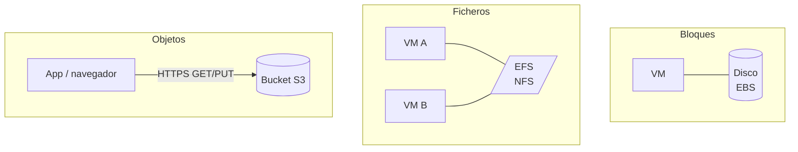
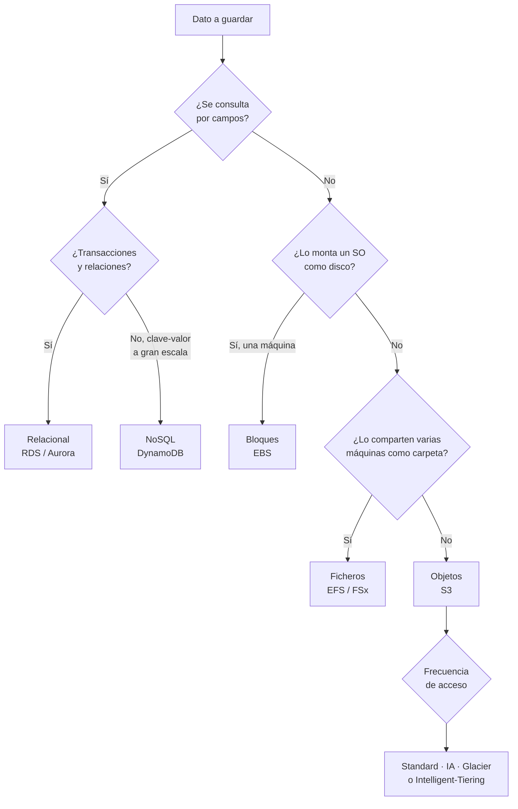

# UD01 · Elegir el almacenamiento

## Resumen del tema

En la nube no existe «el disco»: hay decenas de servicios de almacenamiento y cada uno tiene su forma de acceso, sus garantías y su forma de cobrar. Elegir mal sale caro de dos maneras: o el sistema no cumple (lento, sin disponibilidad, datos en un país que no toca) o cumple pagando mucho más de lo necesario. Esta unidad te da un método para decidir.



### Objetivos de aprendizaje

- Distinguir almacenamiento de **bloques**, de **ficheros**, de **objetos** y **bases de datos**, y saber qué servicio corresponde a cada uno en AWS, Azure y Google Cloud.
- Convertir una necesidad de la empresa en **requisitos funcionales y no funcionales** medibles.
- Diferenciar **durabilidad** y **disponibilidad** y leerlas en la documentación del proveedor.
- Tener en cuenta la **región**: latencia, servicios disponibles y **residencia de los datos** (RGPD).
- Estimar el **coste** completo: almacenamiento, peticiones, transferencia, recuperación, copias y replicación.

---

## 1. Cuatro formas de guardar datos

| Tipo | Cómo se accede | Unidad que manejas | Ejemplo típico | AWS | Azure | Google Cloud |
|---|---|---|---|---|---|---|
| **Bloques** | El sistema operativo lo ve como un disco (`/dev/nvme1n1`) y le pone un sistema de ficheros | Bloque de tamaño fijo | Disco de una máquina virtual o de una base de datos | EBS | Managed Disks | Persistent Disk / Hyperdisk |
| **Ficheros** | Se monta por red con NFS o SMB; varios clientes a la vez | Fichero dentro de carpetas | Carpeta compartida, contenido de un CMS | EFS, FSx | Azure Files | Filestore |
| **Objetos** | API HTTP (`PUT`, `GET`, `DELETE`) sobre claves | Objeto completo + metadatos | Imágenes, copias de seguridad, data lake | S3 | Blob Storage | Cloud Storage |
| **Bases de datos** | Un motor que entiende consultas (SQL, clave-valor, documentos…) | Fila, documento, elemento | Ventas, usuarios, carrito | RDS, Aurora, DynamoDB | Azure SQL, Cosmos DB | Cloud SQL, Firestore, Spanner |

### 1.1 Almacenamiento de bloques

Es lo más parecido a un disco físico: latencia muy baja (sub-milisegundo en SSD) y acceso aleatorio a cualquier byte. A cambio, **un volumen se conecta normalmente a una sola máquina** y vive en **una zona de disponibilidad**. Se mide por capacidad, **IOPS** (operaciones por segundo) y **rendimiento** (MB/s).

### 1.2 Almacenamiento de ficheros

Ofrece la semántica de un sistema de ficheros POSIX (permisos, bloqueos, renombrar) a **muchos clientes a la vez** por red. Es la opción cuando una aplicación «de toda la vida» necesita una carpeta compartida. Es más caro por GB que los bloques y que los objetos.

### 1.3 Almacenamiento de objetos

Cada objeto es un fichero completo con una **clave** (`carteles/2026/evento-0042.webp`) y **metadatos**, dentro de un **contenedor** (*bucket*). No se modifica un trozo: se sube el objeto entero otra vez. A cambio, la capacidad es prácticamente ilimitada, es el más barato por GB, se accede desde cualquier sitio por HTTPS y se replica automáticamente entre varias zonas.

### 1.4 Bases de datos

Cuando los datos tienen estructura y necesitas consultarlos, filtrarlos o actualizarlos con garantías (transacciones), el almacenamiento no es suficiente: necesitas un **motor**. En la nube lo normal es usarlo **administrado** (el proveedor parchea, hace copias y gestiona el hardware). Se verá en la UD04 (OLTP) y la UD07 (OLAP).

> [!IMPORTANT]
> Regla rápida: **¿lo monta un sistema operativo como disco?** → bloques. **¿Lo comparten varias máquinas como carpeta?** → ficheros. **¿Se sube y se descarga entero por HTTP?** → objetos. **¿Se consulta por campos?** → base de datos.

---

## 2. Requisitos: de «lo quiero rápido» a números

Un requisito **funcional** dice *qué* tiene que hacer el almacenamiento; uno **no funcional** dice *cómo de bien*. Sin números, no se puede comprobar si se cumple (CE RA1.a).

| Requisito | Pregunta | Ejemplo medible |
|---|---|---|
| Protocolo de acceso | ¿Cómo leerá la aplicación los datos? | API S3, NFSv4.1, disco de bloques, SQL |
| Concurrencia | ¿Cuántos clientes a la vez? ¿Escriben? | 3 servidores escriben en la misma carpeta |
| Tamaño y crecimiento | ¿Cuánto hay hoy y cuánto crece? | 20 GB + 1 GB/mes |
| Rendimiento | Latencia, IOPS, MB/s | < 10 ms; 3000 IOPS; 125 MB/s |
| Frecuencia de acceso | ¿Cada cuánto se lee cada dato? | Diaria el primer mes, después casi nunca |
| Durabilidad | ¿Qué probabilidad de perder un dato aceptas? | 99,999999999 % anual |
| Disponibilidad | ¿Cuánto tiempo puede estar inaccesible? | 99,9 % mensual (≈ 43 min/mes) |
| RPO / RTO | ¿Cuántos datos puedes perder? ¿Cuánto tardas en volver? | RPO 15 min · RTO 1 h |
| Seguridad | Cifrado, quién accede, auditoría | Cifrado con clave propia; solo la aplicación escribe |
| Residencia | ¿En qué país pueden estar los datos? | Dentro del Espacio Económico Europeo |
| Retención | ¿Cuánto tiempo hay que guardarlos? | 5 años (facturación) |

> [!TIP]
> **RPO** (*Recovery Point Objective*) es cuánto trabajo puedes perder: si haces copia cada noche, tu RPO es de hasta 24 h. **RTO** (*Recovery Time Objective*) es cuánto tardas en volver a dar servicio. Los dos condicionan las copias y la replicación de las unidades siguientes.

---

## 3. Durabilidad y disponibilidad

Son dos garantías distintas y se confunden mucho:

- **Durabilidad**: probabilidad de **no perder** un dato en un año. S3 Standard está diseñado para **99,999999999 %** («once nueves»): si guardas 10 millones de objetos, la expectativa es perder uno cada 10 000 años.
- **Disponibilidad**: porcentaje de tiempo en que **puedes acceder** al dato. S3 Standard está diseñado para el 99,99 %; S3 One Zone-IA, para el 99,5 %, porque guarda los datos en una sola zona.

| Disponibilidad | Caída máxima al mes | Caída máxima al año |
|---|---|---|
| 99 % | ≈ 7 h 18 min | ≈ 3 días 15 h |
| 99,9 % | ≈ 43 min | ≈ 8 h 46 min |
| 99,99 % | ≈ 4 min 23 s | ≈ 52 min |

Distingue también entre lo que el servicio está **diseñado** para dar y lo que el proveedor **compromete en su SLA** (acuerdo de nivel de servicio, con compensación económica si no se cumple). El SLA suele ser más bajo que el diseño (CE RA1.b).

### 3.1 Regiones y zonas de disponibilidad

Una **región** es un área geográfica (Norte de Virginia, Irlanda, Frankfurt, España…) con varias **zonas de disponibilidad** (AZ): centros de datos separados físicamente, con energía y red independientes, unidos por enlaces de baja latencia.

| Ámbito del servicio | Qué resiste | Ejemplos |
|---|---|---|
| **Zonal** (una AZ) | Fallo de un servidor o disco | EBS, S3 One Zone-IA, S3 Express One Zone, RDS Single-AZ |
| **Regional** (varias AZ) | Caída de una zona entera | S3 Standard, EFS Regional, DynamoDB, RDS Multi-AZ |
| **Multirregión** | Caída de una región | Replicación entre regiones de S3, tablas globales de DynamoDB, réplicas entre regiones |

> [!NOTE]
> La responsabilidad es **compartida**: el proveedor garantiza la durabilidad de la infraestructura, pero si borras un objeto por error o un ransomware cifra tus datos, el servicio los «conserva» perfectamente… cifrados. La protección frente a errores humanos (versionado, copias, bloqueo de objetos) es tuya.

---

## 4. La región: latencia, servicios y residencia de los datos

Al elegir región se valoran cuatro cosas:

1. **Residencia y cumplimiento normativo.** El RGPD permite tratar datos personales fuera del Espacio Económico Europeo solo con garantías adicionales (decisiones de adecuación, cláusulas contractuales tipo…). Para una empresa española con datos de clientes, lo prudente es una **región europea**: AWS tiene, entre otras, `eu-south-2` (España), `eu-west-1` (Irlanda) y `eu-central-1` (Frankfurt). Algunos sectores (sanidad, administración pública, Esquema Nacional de Seguridad) tienen exigencias adicionales.
2. **Latencia.** Cuanto más cerca de los usuarios, menor tiempo de respuesta. Para contenido estático muy leído se añade una **CDN** (CloudFront), que lo copia en ubicaciones cercanas al usuario.
3. **Disponibilidad de servicios y funciones.** No todos los servicios, clases de almacenamiento, tipos de instancia o versiones de motor están en todas las regiones. Hay que **descartar** lo que no esté (CE RA1.c). Se consulta en la página *AWS Services by Region* o con la API, como harás en la práctica 1.1.
4. **Precio.** El mismo servicio cuesta distinto según la región; `us-east-1` suele ser de las más baratas.

> [!WARNING]
> En el Learner Lab solo puedes usar `us-east-1` y `us-west-2`. En los informes del proyecto **justifica la región que usarías en producción** (normalmente europea) aunque hagas las pruebas en `us-east-1`.

---

## 5. Cómo cobra el almacenamiento en la nube

El precio no es solo «euros por GB». Para estimar el coste real (CE RA1.d y RA1.e) hay que sumar:

| Concepto | Qué se paga | Notas |
|---|---|---|
| **Capacidad** | GB-mes almacenados (o aprovisionados, en EBS y RDS) | En EBS pagas el tamaño del volumen aunque esté vacío |
| **Peticiones / operaciones** | Por cada 1000 `PUT`, `GET`, `LIST`… | Millones de objetos pequeños encarecen mucho |
| **Rendimiento aprovisionado** | IOPS y MB/s por encima del básico | gp3 incluye 3000 IOPS y 125 MB/s |
| **Recuperación** | GB leídos en clases de acceso poco frecuente o archivo | Además, algunas tardan horas |
| **Duración mínima** | Se cobra un mínimo de días aunque borres antes | 30 días (IA), 90 (Glacier) o 180 (Deep Archive) en S3 |
| **Transferencia de datos** | GB que **salen** a Internet o a otra región | La entrada suele ser gratis; la salida a Internet tiene una franja gratuita mensual |
| **Copias y replicación** | Instantáneas, copias de seguridad, segunda región | Duplicar datos es duplicar coste de capacidad + transferencia |
| **Funciones extra** | Claves KMS, inventario, análisis, monitorización detallada | Pequeño, pero suma |

### 5.1 Clases de almacenamiento de S3 (orientativo)

| Clase | Para qué | Zonas | Duración mínima | Recuperación |
|---|---|---|---|---|
| S3 Standard | Acceso frecuente | ≥ 3 | — | Inmediata |
| S3 Intelligent-Tiering | Patrón desconocido o cambiante | ≥ 3 | — | Inmediata (niveles de archivo opcionales) |
| S3 Standard-IA | Acceso poco frecuente pero rápido | ≥ 3 | 30 días | Inmediata, con cargo por GB |
| S3 One Zone-IA | Poco frecuente y fácil de regenerar | 1 | 30 días | Inmediata, con cargo por GB |
| S3 Glacier Instant Retrieval | Archivo que se consulta alguna vez al trimestre | ≥ 3 | 90 días | Milisegundos |
| S3 Glacier Flexible Retrieval | Archivo | ≥ 3 | 90 días | Minutos a horas |
| S3 Glacier Deep Archive | Archivo a largo plazo, obligaciones legales | ≥ 3 | 180 días | Hasta 12 – 48 h |
| S3 Express One Zone | Latencia de milisegundos de un dígito | 1 | — | Inmediata |

### 5.2 Un ejemplo de cálculo

Los **carteles** de TaquillaAlacant: 20 GB en S3 Standard, 3 millones de `GET` al mes, 1000 `PUT` al mes y 150 GB al mes descargados por los navegadores. Con precios orientativos de `us-east-1` (consúltalos siempre en la calculadora):

| Concepto | Cálculo | Coste/mes |
|---|---|---|
| Capacidad | 20 GB × 0,023 $ | 0,46 $ |
| `GET` | 3 000 000 / 1000 × 0,0004 $ | 1,20 $ |
| `PUT` | 1000 / 1000 × 0,005 $ | 0,01 $ |
| Salida a Internet | (150 − 100 GB gratuitos) × 0,09 $ | 4,50 $ |
| **Total** | | **≈ 6,17 $** |

Lo que más pesa **no es el almacenamiento sino la transferencia**. Servir los carteles a través de una CDN cambia la cuenta (la transferencia de S3 a CloudFront no se cobra y la de CloudFront tiene su propia tarifa y caché), y lo comprobarás en la práctica 1.2.

> [!TIP]
> La **AWS Pricing Calculator** (<https://calculator.aws/>) permite guardar y compartir la estimación con un enlace. Adjunta siempre ese enlace en tus informes.

---

## 6. Un método para decidir

1. **Clasifica** el dato con la regla rápida del apartado 1.
2. **Escribe los requisitos** con números (apartado 2).
3. **Comprueba en la documentación** que el servicio y la clase los cumplen: durabilidad, disponibilidad, rendimiento, límites (CE RA1.a, RA1.b).
4. **Descarta** lo que no esté disponible en la región elegida (CE RA1.c).
5. **Compara precios** de las opciones que quedan y elige la más económica que cumple (CE RA1.d).
6. **Ajusta los parámetros** que mueven el coste: tamaño, clase, ciclo de vida, réplicas, retención de copias (CE RA1.e).

---

## 7. Errores frecuentes

| Error | Consecuencia | Cómo evitarlo |
|---|---|---|
| Guardar ficheros de usuarios en el disco EBS de un servidor | Si se añade un segundo servidor no los ve; si se pierde la AZ, se pierden | Objetos (S3) o ficheros compartidos (EFS) |
| Pasar a Glacier datos que se leen cada semana | Los cargos de recuperación superan el ahorro | Analiza el patrón de acceso o usa Intelligent-Tiering |
| Elegir región solo por precio | Incumplir el RGPD o tener latencias altas | Primero cumplimiento, después latencia, después precio |
| Olvidar la transferencia de salida | La factura real multiplica la estimación | Inclúyela siempre; valora una CDN |
| Confundir disponibilidad con durabilidad | Pensar que un dato «disponible» está protegido de borrados | Versionado y copias independientes |

## 8. Resumen

- Bloques para discos, ficheros para carpetas compartidas, objetos para ficheros completos por HTTP, bases de datos para consultar por campos.
- Los requisitos se escriben con números: tamaño, rendimiento, frecuencia de acceso, durabilidad, disponibilidad, RPO/RTO, residencia y retención.
- Durabilidad es no perder datos; disponibilidad es poder acceder a ellos. Ninguna te protege de tus propios errores.
- La región se elige por cumplimiento, latencia, servicios disponibles y precio, en ese orden.
- El coste real incluye capacidad, peticiones, transferencia, recuperación, duración mínima, copias y replicación.

## 9. Autoevaluación


- q: "Una aplicación web de dos servidores necesita que ambos lean y escriban en la misma carpeta de documentos. ¿Qué tipo de almacenamiento encaja?"
  options: ["Bloques (EBS)", "Ficheros en red (EFS)", "Objetos (S3 Glacier)", "Una tabla DynamoDB"]
  answer: 1
  explain: "Varios clientes con semántica de sistema de ficheros: almacenamiento de ficheros compartido por NFS."
- q: "S3 Standard tiene una durabilidad diseñada del 99,999999999 %. ¿Qué significa?"
  options: ["Que está accesible el 99,999999999 % del tiempo", "Que la probabilidad anual de perder un objeto es ínfima", "Que nunca podrás borrar un objeto por error", "Que el SLA te compensa si pierdes un objeto"]
  answer: 1
  explain: "La durabilidad mide la pérdida de datos por fallos de la infraestructura, no el acceso ni los borrados del usuario."
- q: "¿Qué concepto suele pesar más en la factura de unos carteles públicos muy descargados?"
  options: ["La capacidad en GB-mes", "Las peticiones PUT", "La transferencia de salida a Internet", "El cifrado"]
  answer: 2
  explain: "Con pocos GB y muchas descargas, la salida a Internet domina el coste."
- q: "Guardas en S3 Glacier Flexible Retrieval un fichero y lo borras a los 10 días. ¿Qué pasa con el coste?"
  options: ["Pagas solo 10 días", "Pagas los 90 días de duración mínima", "No pagas nada porque lo has borrado", "Pagas un año entero"]
  answer: 1
  explain: "Las clases de acceso poco frecuente y archivo tienen una duración mínima facturable."
- q: "Una empresa de Alicante guarda datos personales de clientes. ¿Qué criterio va primero al elegir región?"
  options: ["El precio", "La latencia", "La residencia de los datos y el cumplimiento normativo", "La cantidad de zonas"]
  answer: 2
  explain: "El RGPD condiciona dónde se pueden tratar los datos personales; precio y latencia se optimizan después."
- q: "¿Qué servicio es zonal, es decir, no resiste por sí solo la caída de una zona de disponibilidad?"
  options: ["S3 Standard", "DynamoDB", "Un volumen EBS", "EFS Regional"]
  answer: 2
  explain: "Un volumen EBS vive en una AZ. Para protegerlo se usan instantáneas, que se guardan de forma regional."


## Referencias

- AWS: *Choosing an AWS storage service* — <https://docs.aws.amazon.com/decision-guides/latest/storage-on-aws-how-to-choose/choosing-aws-storage-service.html>
- Amazon S3: *Storage classes* — <https://aws.amazon.com/s3/storage-classes/>
- AWS: *Regions and Availability Zones* — <https://aws.amazon.com/about-aws/global-infrastructure/regions_az/>
- AWS Pricing Calculator — <https://calculator.aws/>
- Agencia Española de Protección de Datos: transferencias internacionales — <https://www.aepd.es/>
- Real Decreto 145/2026 (BOE-A-2026-4673) — <https://www.boe.es/buscar/act.php?id=BOE-A-2026-4673>
