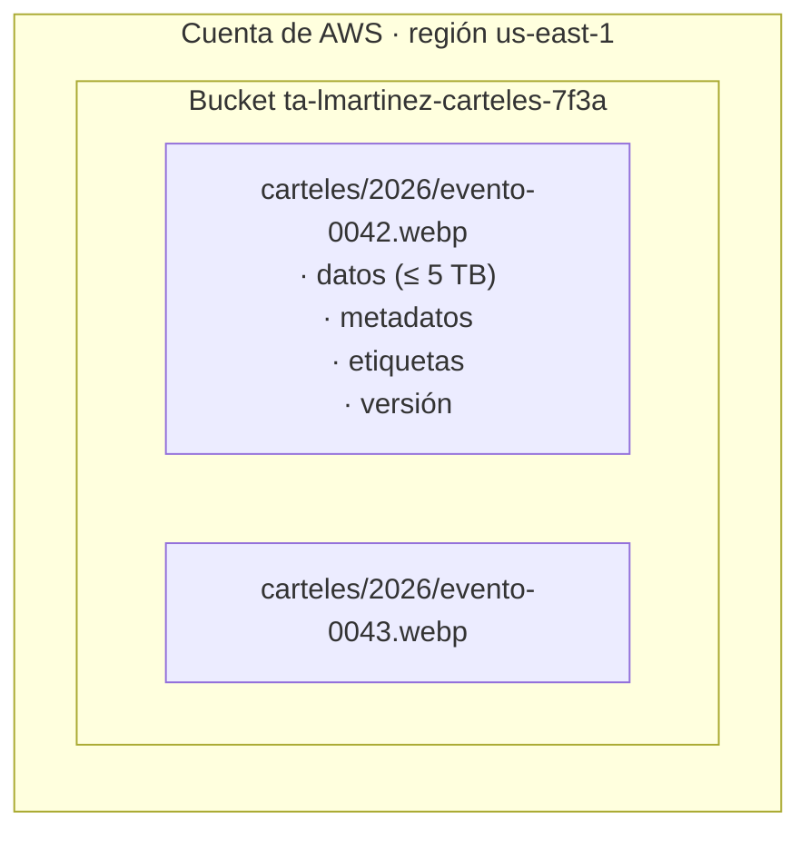
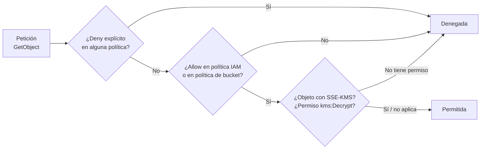
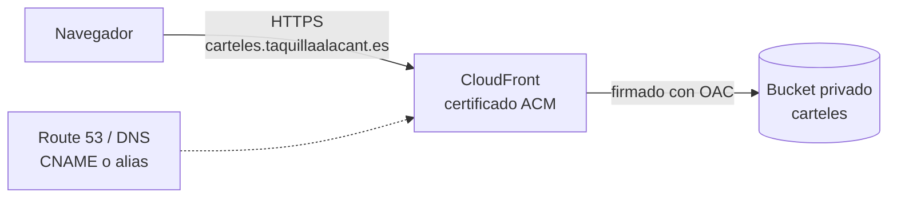
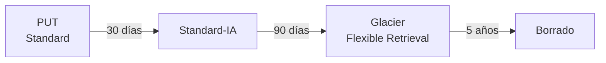

# UD02 · Almacenamiento de objetos

## Resumen del tema

Amazon S3 (y sus equivalentes Azure Blob Storage y Google Cloud Storage) guarda **objetos** dentro de **buckets** y los sirve por HTTPS. Administrarlo bien consiste en repetir siempre las mismas decisiones: **nombre y región → clase → cifrado → acceso → monitorización y auditoría → ciclo de vida → réplicas y copias**. Esta unidad las recorre en ese orden.



### Objetivos de aprendizaje

- Nombrar buckets y etiquetar objetos respetando los límites del servicio.
- Asignar la clase de almacenamiento adecuada al bucket y a cada objeto.
- Configurar el cifrado con claves gestionadas por el proveedor y con claves propias de KMS.
- Controlar el acceso con políticas, bloquear el acceso público y publicar contenido por HTTPS con un dominio propio.
- Automatizar el ciclo de vida de los objetos y protegerlos con versionado, bloqueo, replicación y copias.
- Monitorizar el uso y auditar quién accede a qué.

---

## 1. El modelo de S3



| Concepto | Descripción |
|---|---|
| **Bucket** | Contenedor de objetos. Vive en **una región** y su nombre es **único en todo el proveedor** |
| **Clave** | Nombre completo del objeto: `carteles/2026/evento-0042.webp`. No hay carpetas reales: la `/` forma **prefijos** que la consola muestra como carpetas |
| **Objeto** | Datos (de 0 bytes a 5 TB) + metadatos. Se sube y se reemplaza **entero** |
| **Metadatos de sistema** | `Content-Type`, `Content-Length`, `ETag`, `Last-Modified`, clase, cifrado… |
| **Metadatos de usuario** | Pares `x-amz-meta-*` que defines al subir; no se pueden cambiar sin volver a copiar el objeto |
| **Etiquetas** | Hasta 10 pares clave-valor por objeto; **sí** se cambian sin reescribir el objeto y sirven para políticas, ciclo de vida y costes |
| **Versión** | Si el versionado está activo, cada escritura crea una versión con su `VersionId` |

S3 ofrece **consistencia fuerte de lectura tras escritura**: en cuanto un `PUT` termina, cualquier `GET` o `LIST` posterior ve el objeto nuevo. Un `PUT` simple admite hasta 5 GB; por encima (y en la práctica desde unos 100 MB) se usa la **subida multiparte**, que la CLI hace sola.

### 1.1 Nombres de buckets (CE RA2.a)

Las reglas de los *general purpose buckets* de S3:

- Entre **3 y 63 caracteres**: minúsculas, números, puntos (`.`) y guiones (`-`).
- Empiezan y terminan por letra o número; no tienen dos puntos seguidos ni formato de dirección IP.
- No empiezan por `xn--`, `sthree-` ni `amzn-s3-demo-`, ni terminan en `-s3alias` ni `--ol-s3`.
- Son **únicos globalmente** y **no se pueden renombrar**: para cambiar el nombre hay que crear otro y copiar.

Buenas prácticas: **evita los puntos** (dan problemas con los certificados TLS en direcciones `bucket.s3.amazonaws.com`), no pongas datos personales ni secretos en el nombre (es visible en DNS y registros) y añade un **sufijo aleatorio** para no chocar con nombres ya usados por otros.

> [!TIP]
> Las **claves** de objeto admiten casi cualquier carácter UTF-8 hasta 1024 bytes, pero lo seguro es usar letras, números, `/`, `-`, `_` y `.`. Organiza los prefijos pensando en el ciclo de vida y en la analítica: `entradas/2026/06/venta-00000042.pdf` permite aplicar reglas por año o mes.

---

## 2. Región y clase de almacenamiento (CE RA2.b, RA2.c)

La **región** se fija al crear el bucket y no se puede cambiar. Se elige con los criterios de la UD01: residencia de los datos, latencia, servicios disponibles y precio.

La **clase** se asigna **por objeto**. El bucket no tiene una clase propia: lo que se configura es la clase por defecto con la que suben las aplicaciones y las **reglas de ciclo de vida** que la cambian después.

```bash
# Subir un objeto directamente a Standard-IA
aws s3 cp informe-2025.pdf s3://$BUCKET/informes/ --storage-class STANDARD_IA
# Ver la clase de cada objeto
aws s3api list-objects-v2 --bucket $BUCKET --query 'Contents[].[Key,StorageClass,Size]' --output table
```

**S3 Intelligent-Tiering** mueve los objetos solo entre niveles según el acceso (frecuente → poco frecuente a los 30 días → acceso instantáneo de archivo a los 90), con una pequeña cuota de monitorización por objeto. Es la opción cuando no conoces el patrón de acceso. Los objetos de menos de 128 KB no se monitorizan y se quedan siempre en el nivel frecuente.

---

## 3. Cifrado (CE RA2.d)

### 3.1 Cifrado en tránsito

S3 acepta HTTP y HTTPS. Se fuerza HTTPS con una **política de bucket** que deniega las peticiones con `aws:SecureTransport = false` (apartado 4.3).

### 3.2 Cifrado en reposo

Desde enero de 2023, **todos los objetos nuevos se cifran** por defecto. Las opciones del lado del servidor son:

| Opción | Quién gestiona la clave | Auditoría del uso de la clave | Cuándo usarla |
|---|---|---|---|
| **SSE-S3** | S3, totalmente transparente | No | Opción por defecto; datos no sensibles |
| **SSE-KMS** con la clave `aws/s3` | KMS, clave gestionada por AWS | Sí, en CloudTrail | Quieres trazabilidad sin gestionar claves |
| **SSE-KMS** con **clave del cliente** (CMK) | Tú: política, rotación, desactivación, borrado | Sí | Datos personales o sensibles; separación de funciones |
| **DSSE-KMS** | KMS, cifrado en dos capas | Sí | Normativas que exigen doble cifrado |
| **SSE-C** | Tú envías la clave en cada petición | No | Casos muy concretos; complica mucho la operación |

Con una **clave del cliente** (CMK) controlas **quién puede usarla** con su **política de clave**: aunque alguien tenga permiso para leer el bucket, si no puede usar la clave (`kms:Decrypt`), no lee los datos. Desactivar la clave deja **inaccesibles** todos los objetos cifrados con ella.

> [!TIP]
> Activa siempre la **S3 Bucket Key** con SSE-KMS: S3 genera una clave intermedia por bucket y reduce las llamadas a KMS (y su coste) hasta en un 99 %.

> [!CAUTION]
> Si programas el borrado de una clave de KMS (periodo de espera de 7 a 30 días) y se completa, **los datos cifrados con ella se pierden para siempre**. Antes de borrar una clave, desactívala y espera a ver qué falla.

### 3.3 Claves con IaC

```hcl
resource "aws_kms_key" "datos" {
  description             = "Clave de los datos de TaquillaAlacant (${var.alumno})"
  enable_key_rotation     = true        # rotación anual automática
  deletion_window_in_days = 7
}

resource "aws_kms_alias" "datos" {
  name          = "alias/ta-${var.alumno}-datos"
  target_key_id = aws_kms_key.datos.key_id
}

resource "aws_s3_bucket_server_side_encryption_configuration" "entradas" {
  bucket = aws_s3_bucket.entradas.id
  rule {
    apply_server_side_encryption_by_default {
      sse_algorithm     = "aws:kms"
      kms_master_key_id = aws_kms_key.datos.arn
    }
    bucket_key_enabled = true
  }
}
```

---

## 4. Control de acceso (CE RA2.e)

### 4.1 Privado por defecto

Un bucket nuevo es **privado**: solo la cuenta propietaria accede. Además, por defecto:

- **Bloqueo de acceso público** (*Block Public Access*) activado en el bucket (y configurable a nivel de cuenta). Impide que una política o ACL lo haga público aunque alguien se equivoque.
- **Propiedad de objetos** en modo *Bucket owner enforced*: las **ACL están desactivadas** y todo se controla con políticas. Es lo recomendado.

### 4.2 Quién decide el acceso



| Mecanismo | Se asocia a | Uso típico |
|---|---|---|
| **Política IAM** | Usuario, grupo o rol | «Este rol puede leer `entradas/*`» |
| **Política de bucket** | Bucket | Forzar HTTPS, permitir a CloudFront, dar acceso a otra cuenta |
| **Política de clave KMS** | Clave | Quién puede cifrar y descifrar |
| **Puntos de acceso** (*Access Points*) | Bucket | Un nombre y una política por aplicación o equipo |
| **URL prefirmadas** | Un objeto concreto | Descargar una entrada durante 15 minutos sin credenciales |
| **Punto de enlace de VPC** (*gateway endpoint*) | VPC | Acceso privado sin salir a Internet; se puede exigir en la política |

### 4.3 Política de bucket de ejemplo

Deniega todo lo que no venga por HTTPS y cualquier subida que no use la clave KMS del proyecto:

```json
{
  "Version": "2012-10-17",
  "Statement": [
    {
      "Sid": "SoloHTTPS",
      "Effect": "Deny",
      "Principal": "*",
      "Action": "s3:*",
      "Resource": ["arn:aws:s3:::ta-lmartinez-entradas-7f3a", "arn:aws:s3:::ta-lmartinez-entradas-7f3a/*"],
      "Condition": { "Bool": { "aws:SecureTransport": "false" } }
    },
    {
      "Sid": "SoloConMiClave",
      "Effect": "Deny",
      "Principal": "*",
      "Action": "s3:PutObject",
      "Resource": "arn:aws:s3:::ta-lmartinez-entradas-7f3a/*",
      "Condition": {
        "StringNotEqualsIfExists": {
          "s3:x-amz-server-side-encryption-aws-kms-key-id": "arn:aws:kms:us-east-1:123456789012:key/1111-2222"
        }
      }
    }
  ]
}
```

### 4.4 URL prefirmadas

Una URL prefirmada da acceso temporal a un objeto privado con las credenciales de quien la firma. Es como TaquillaAlacant entrega los PDF a cada cliente:

```bash
aws s3 presign s3://$BUCKET/entradas/2026/06/venta-00000042.pdf --expires-in 900
```

---

## 5. Acceso público por HTTPS con dominio propio (CE RA2.f)

S3 tiene un modo **sitio web estático**, pero su punto de enlace solo habla **HTTP** y obliga a hacer público el bucket. La arquitectura recomendada es otra:



1. El bucket sigue **privado** y con el bloqueo de acceso público activado.
2. Una distribución de **CloudFront** (la CDN) es el único que puede leer el bucket, gracias al **control de acceso de origen** (**OAC**) y a una política de bucket que solo permite a esa distribución.
3. El **certificado TLS** para el dominio propio se pide en **AWS Certificate Manager** (ACM), **en `us-east-1`** (obligatorio para CloudFront), validándolo por DNS.
4. En el DNS del dominio se crea un **CNAME** (o un alias, si usas Route 53) hacia la distribución.

Ventajas: HTTPS, caché cerca del usuario, menos coste de transferencia, y el bucket nunca es público.

---

## 6. Monitorización, observabilidad y auditoría (CE RA2.e)

| Herramienta | Qué te dice | Coste |
|---|---|---|
| **Métricas de almacenamiento** en CloudWatch | `BucketSizeBytes` y `NumberOfObjects` por clase, una vez al día | Gratis |
| **Métricas de peticiones** en CloudWatch | `GetRequests`, `4xxErrors`, `5xxErrors`, latencia… cada minuto | De pago, se activan por filtro |
| **S3 Storage Lens** | Panel de uso y buenas prácticas de toda la cuenta | Panel básico gratuito |
| **CloudTrail · eventos de administración** | Quién creó, cambió o borró buckets y políticas | Incluido (90 días en el historial) |
| **CloudTrail · eventos de datos** | Quién hizo `GetObject`/`PutObject`/`DeleteObject` | De pago por evento |
| **Registros de acceso al servidor** | Cada petición, en ficheros en otro bucket | Solo el almacenamiento |
| **IAM Access Analyzer para S3** | Buckets compartidos con el exterior o públicos | Gratis |
| **Notificaciones de eventos** | Avisar a Lambda/SQS/SNS/EventBridge cuando se crea o borra un objeto | Según destino |

> [!WARNING]
> Los registros de acceso **nunca** se guardan en el mismo bucket que registran: cada entrada de registro generaría otra escritura y otro registro, sin fin.

---

## 7. Ciclo de vida (CE RA2.g)

Las **reglas de ciclo de vida** cambian la clase o borran objetos automáticamente según su antigüedad. Se pueden filtrar por **prefijo**, **etiquetas** y **tamaño**.



```hcl
resource "aws_s3_bucket_lifecycle_configuration" "entradas" {
  bucket = aws_s3_bucket.entradas.id

  rule {
    id     = "entradas-a-archivo"
    status = "Enabled"
    filter { prefix = "entradas/" }

    transition {
      days          = 30
      storage_class = "STANDARD_IA"
    }
    transition {
      days          = 120
      storage_class = "GLACIER"
    }
    expiration { days = 1825 }                         # 5 años

    noncurrent_version_expiration { noncurrent_days = 30 }
  }

  rule {
    id     = "limpiar-multiparte"
    status = "Enabled"
    filter {}
    abort_incomplete_multipart_upload { days_after_initiation = 7 }
  }
}
```

Detalles que hay que conocer:

- Las transiciones respetan las **duraciones mínimas**: no se puede pasar a Standard-IA antes de 30 días.
- Por defecto, los objetos de **menos de 128 KB no cambian de clase** (no saldría a cuenta); se puede forzar con un filtro de tamaño.
- Las **subidas multiparte incompletas** ocupan espacio y se cobran aunque no las veas: limpia siempre.

### 7.1 Versionado

Con el **versionado** activado, sobrescribir crea una versión nueva y **borrar no borra**: añade un **marcador de borrado** que oculta el objeto. Recuperar es tan sencillo como borrar el marcador.

| Estado | Efecto |
|---|---|
| Sin versionar | Una sola versión; sobrescribir y borrar son definitivos |
| **Activado** | Se guardan todas las versiones. No se puede volver a «sin versionar», solo suspender |
| Suspendido | Las versiones existentes se conservan; las nuevas escrituras ya no crean versiones |

El versionado multiplica el espacio ocupado: combínalo **siempre** con una regla que expire las versiones antiguas (`noncurrent_version_expiration`).

### 7.2 Bloqueo de objetos (WORM)

**S3 Object Lock** impide borrar o sobrescribir una versión durante un periodo de retención. En modo **gobernanza** puede saltarlo quien tenga un permiso especial; en modo **cumplimiento** no puede nadie, ni la cuenta raíz. Protege las copias de seguridad frente a ransomware y cumple obligaciones legales de conservación.

---

## 8. Replicación y copias de seguridad (CE RA2.h)

### 8.1 Replicación

| Tipo | Destino | Para qué |
|---|---|---|
| **SRR** (*Same-Region Replication*) | Otro bucket de la misma región | Copia en otra cuenta, agregación de registros |
| **CRR** (*Cross-Region Replication*) | Bucket de otra región | Recuperación ante desastre, latencia, cumplimiento |

Requisitos: **versionado activado en origen y destino**, y un **rol IAM** que S3 asume para copiar (en el laboratorio, `LabRole`). Si los objetos van cifrados con KMS, el rol necesita usar la clave de origen y la de destino. La replicación es **asíncrona** (normalmente en minutos); con **S3 Replication Time Control** se garantiza que el 99,99 % de los objetos se copien en 15 minutos, con coste adicional. Solo replica los objetos **nuevos**: los anteriores se copian con **S3 Batch Replication**.

> [!IMPORTANT]
> Replicar **no es** hacer copias de seguridad: si borras o cifras un objeto en el origen, el cambio se replica. Para recuperarte de un error o un ataque necesitas **versiones**, **bloqueo de objetos** o **copias independientes**.

### 8.2 Copias de seguridad

**AWS Backup** protege buckets de S3 con dos tipos de copia: **continuas** (permiten restaurar a cualquier momento de los últimos 35 días) y **periódicas** (según un plan, con retención larga). Las copias se guardan en una **bóveda** (*vault*) que puede tener su propio bloqueo y estar en otra cuenta o región. Requiere el versionado activado.

---

## 9. Lo mismo en local: almacenamiento compatible con S3

La API de S3 es un estándar de facto. Servidores como **Garage**, **SeaweedFS** o **Ceph RGW** la implementan, y la CLI de AWS, rclone o cualquier SDK funcionan cambiando solo el punto de enlace:

```bash
aws --endpoint-url http://localhost:3900 s3 ls
```

En la UD06 usarás Garage como almacenamiento de la oficina de TaquillaAlacant.

---

## 10. Errores frecuentes

| Problema | Causa | Solución |
|---|---|---|
| `BucketAlreadyExists` | El nombre lo usa otra cuenta en el mundo | Sufijo aleatorio |
| `AccessDenied` al leer un objeto con permiso de S3 | Falta `kms:Decrypt` en la clave | Revisa la política de la clave |
| La política pública no se aplica | El bloqueo de acceso público está activo (y es lo correcto) | Publica a través de CloudFront con OAC |
| CloudFront devuelve `403` | Falta la política de bucket para la distribución o la clave KMS no permite a CloudFront | Política con `AWS:SourceArn` y permiso en la clave |
| El bucket ocupa el doble de lo esperado | Versiones antiguas o multiparte incompletas | Reglas de ciclo de vida |
| No se replican los objetos antiguos | La replicación solo copia los nuevos | S3 Batch Replication |
| `BucketNotEmpty` al destruir | Quedan objetos o versiones | Vacía todas las versiones (o `force_destroy` en el laboratorio) |

## 11. Resumen

- Un bucket vive en una región, tiene un nombre global e inmutable, y contiene objetos con clave, metadatos, etiquetas y versiones.
- La clase se asigna por objeto y se cambia con reglas de ciclo de vida.
- Cifrado en reposo siempre activo; usa SSE-KMS con clave propia y Bucket Key para los datos sensibles, y fuerza HTTPS.
- El bucket es privado; para publicarlo, CloudFront con OAC y un certificado de ACM.
- Ciclo de vida para abaratar, versionado y bloqueo para protegerte de errores, replicación para desastres, AWS Backup para copias independientes.
- CloudWatch, CloudTrail, registros de acceso y Access Analyzer te dicen qué pasa y quién lo hace.

## 12. Autoevaluación


- q: "¿Cuál de estos nombres de bucket es válido y recomendable?"
  options: ["`TA-Carteles`", "`ta.carteles.2026`", "`ta-lmartinez-carteles-7f3a`", "`192.168.1.10`"]
  answer: 2
  explain: "Solo minúsculas, números, puntos y guiones; los puntos son válidos pero dan problemas con TLS; una IP no es válida."
- q: "Un usuario tiene `s3:GetObject` en el bucket, pero recibe `AccessDenied` al descargar un objeto cifrado con una clave KMS del cliente. ¿Por qué?"
  options: ["El bucket es público", "Le falta permiso `kms:Decrypt` sobre la clave", "El objeto está en Standard-IA", "El versionado está activado"]
  answer: 1
  explain: "Con SSE-KMS hacen falta permisos sobre el bucket y sobre la clave."
- q: "¿Qué arquitectura sirve carteles por HTTPS con dominio propio sin hacer público el bucket?"
  options: ["Sitio web estático de S3", "CloudFront con OAC y certificado de ACM", "Desactivar el bloqueo de acceso público", "URL prefirmadas de 7 días"]
  answer: 1
  explain: "El punto de enlace web de S3 es solo HTTP y requiere bucket público. CloudFront con OAC mantiene el bucket privado."
- q: "Con el versionado activado, borras `cartel.webp`. ¿Qué ocurre?"
  options: ["Se borra definitivamente", "Se crea un marcador de borrado y las versiones anteriores siguen ahí", "Se mueve a Glacier", "Se replica el borrado y se pierde"]
  answer: 1
  explain: "Borrar sin indicar versión añade un marcador; eliminando el marcador recuperas el objeto."
- q: "¿Qué hace falta para configurar la replicación entre regiones?"
  options: ["Versionado en origen y destino, y un rol que S3 pueda asumir", "Solo un bucket en otra región", "Desactivar el cifrado", "Que el bucket sea público"]
  answer: 0
  explain: "La replicación exige versionado en ambos buckets y un rol con permisos (y acceso a las claves KMS si las hay)."
- q: "¿Qué regla de ciclo de vida evita pagar por subidas que nunca terminaron?"
  options: ["`expiration`", "`noncurrent_version_expiration`", "`abort_incomplete_multipart_upload`", "`transition`"]
  answer: 2
  explain: "Las partes de una subida multiparte incompleta se cobran hasta que se aborta la subida."
- q: "¿Qué herramienta registra quién descargó cada objeto de un bucket?"
  options: ["Métricas de almacenamiento de CloudWatch", "Eventos de datos de CloudTrail o registros de acceso al servidor", "S3 Storage Lens", "La calculadora de precios"]
  answer: 1
  explain: "Las métricas son agregadas; las operaciones sobre objetos se auditan con eventos de datos o registros de acceso."


## Referencias

- Amazon S3 User Guide — <https://docs.aws.amazon.com/AmazonS3/latest/userguide/>
- *Bucket naming rules* — <https://docs.aws.amazon.com/AmazonS3/latest/userguide/bucketnamingrules.html>
- *Protecting data with encryption* y *S3 Bucket Keys* — <https://docs.aws.amazon.com/AmazonS3/latest/userguide/UsingEncryption.html>
- *Restricting access to an Amazon S3 origin* (OAC) — <https://docs.aws.amazon.com/AmazonCloudFront/latest/DeveloperGuide/private-content-restricting-access-to-s3.html>
- *Managing the lifecycle of objects* — <https://docs.aws.amazon.com/AmazonS3/latest/userguide/object-lifecycle-mgmt.html>
- *Replicating objects* — <https://docs.aws.amazon.com/AmazonS3/latest/userguide/replication.html>
- Proveedor AWS de OpenTofu/Terraform — <https://search.opentofu.org/provider/hashicorp/aws/latest>
- Garage — <https://garagehq.deuxfleurs.fr/>
