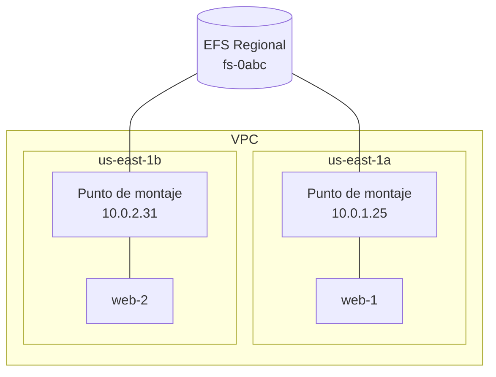
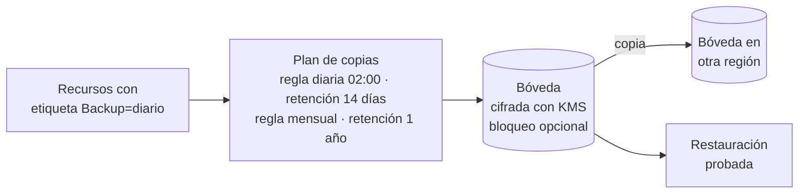

# UD03 · Bloques y ficheros en red

## Resumen del tema

Un **volumen de bloques** es un disco virtual que se conecta a una máquina; un **sistema de ficheros en red** es una carpeta que montan muchas máquinas a la vez. En AWS son **EBS** y **EFS** (y la familia **FSx** para casos especiales). Los dos se administran con el mismo esquema de la unidad anterior: clase y región, cifrado, acceso y auditoría, montaje, cambios durante su vida y copias.



### Objetivos de aprendizaje

- Elegir el tipo de volumen EBS o la clase de EFS según el rendimiento, el patrón de acceso, la durabilidad y el coste.
- Crear volúmenes y sistemas de ficheros **cifrados** con KMS mediante IaC.
- Montarlos correctamente (persistentes, en modo lectura o escritura, desde los orígenes autorizados).
- Ampliarlos, cambiar su tipo o clase, desmontarlos y borrarlos sin perder datos.
- Protegerlos con instantáneas, replicación y AWS Backup, y comprobar que se pueden restaurar.

---

## 1. Amazon EBS: discos para instancias

Un volumen EBS es un disco en red que se conecta a **una instancia EC2 de la misma zona de disponibilidad**. Los datos se replican dentro de la zona, de modo que sobreviven a un fallo de hardware, pero **no** a la pérdida de la zona: para eso están las instantáneas.

### 1.1 Tipos de volumen (CE RA3.a)

| Tipo | Medio | Pensado para | Rendimiento (orientativo) | Comentario |
|---|---|---|---|---|
| **gp3** | SSD | Casi todo: arranque, aplicaciones, bases de datos pequeñas y medianas | 3000 IOPS y 125 MB/s incluidos; ampliables por separado hasta 80 000 IOPS y 2000 MB/s | **Opción por defecto** |
| gp2 | SSD | Generación anterior | IOPS proporcionales al tamaño, con créditos de ráfaga | Migra a gp3: más barato y predecible |
| **io2 Block Express** | SSD | Bases de datos críticas, latencia muy baja y constante | Hasta 256 000 IOPS | IOPS aprovisionadas (no disponibles en el Learner Lab); admite Multi-Attach |
| **st1** | HDD | Lecturas secuenciales grandes: logs, big data | Hasta 500 MB/s | No sirve como disco de arranque |
| **sc1** | HDD | Datos fríos con acceso secuencial | Hasta 250 MB/s | El más barato por GB |

> [!NOTE]
> Además de EBS, algunas instancias tienen **almacén de instancia** (*instance store*): discos NVMe físicos del propio servidor, muy rápidos y **efímeros**. Se borran al parar la instancia. Solo para cachés y datos temporales.

### 1.2 Cifrado (CE RA3.c)

- Se decide **al crear** el volumen, con una clave de KMS (la gestionada `aws/ebs` o una propia).
- El cifrado cubre los datos en reposo, el tráfico entre la instancia y el volumen y las instantáneas.
- Un volumen sin cifrar **no se puede cifrar** directamente: se hace una instantánea, se **copia cifrándola** y se crea un volumen nuevo a partir de la copia.
- Se puede activar el **cifrado por defecto** de EBS en cada región de la cuenta, para que nadie cree volúmenes sin cifrar.

```hcl
resource "aws_ebs_encryption_by_default" "on" { enabled = true }

resource "aws_ebs_volume" "logs" {
  availability_zone = "us-east-1a"
  size              = 20
  type              = "gp3"
  iops              = 3000
  throughput        = 125
  encrypted         = true
  kms_key_id        = aws_kms_key.datos.arn
  tags              = { Name = "ta-${var.alumno}-logs" }
}
```

### 1.3 Montaje (CE RA3.e)

En las instancias modernas (Nitro) los volúmenes aparecen como dispositivos **NVMe** (`/dev/nvme1n1`), aunque en la consola los conectes como `/dev/sdf`. El proceso en Linux:

```bash
lsblk -o NAME,SIZE,TYPE,FSTYPE,MOUNTPOINT,SERIAL     # el SERIAL contiene el id del volumen (vol0abc...)
sudo mkfs.xfs /dev/nvme1n1                           # SOLO la primera vez: borra el contenido
sudo mkdir -p /datos/logs
sudo mount /dev/nvme1n1 /datos/logs
# Montaje persistente por UUID; nofail evita que la instancia no arranque si falta el volumen
echo "UUID=$(sudo blkid -s UUID -o value /dev/nvme1n1) /datos/logs xfs defaults,nofail 0 2" | sudo tee -a /etc/fstab
sudo mount -a && findmnt /datos/logs
```

El **modo** se elige al montar: `ro` para solo lectura (por ejemplo, un volumen restaurado que solo quieres consultar) o `rw`.

### 1.4 Cambios durante su vida (CE RA3.f)

Con **Elastic Volumes** se cambia el **tamaño**, el **tipo**, las **IOPS** y el **rendimiento** con el volumen conectado y en uso. Después de ampliar hay que **extender la partición y el sistema de ficheros**:

```bash
aws ec2 modify-volume --volume-id vol-0abc --size 30 --iops 4000
aws ec2 describe-volumes-modifications --volume-id vol-0abc     # optimizing → completed
sudo growpart /dev/nvme0n1 1          # solo si el sistema de ficheros está en una partición
sudo xfs_growfs -d /datos/logs        # XFS (o: sudo resize2fs /dev/nvme1n1 para ext4)
```

Limitaciones: **no se puede reducir** un volumen (hay que crear otro más pequeño y copiar) y entre dos modificaciones del mismo volumen hay que esperar unas horas. Para retirar un volumen: desmontarlo (`umount` y quitar la línea de `/etc/fstab`), **desconectarlo** (*detach*), hacer una instantánea final si procede y **borrarlo**.

### 1.5 Instantáneas (CE RA3.g)

Una **instantánea** (*snapshot*) es una copia puntual del volumen que se guarda de forma **regional** (en S3, gestionado por AWS). Son **incrementales**: la primera copia todo y las siguientes solo los bloques cambiados.

| Función | Para qué |
|---|---|
| Crear volumen desde instantánea | Restaurar, clonar, mover a otra AZ |
| Copiar a otra región (cifrando o cambiando de clave) | Recuperación ante desastre; cifrar un volumen que no lo estaba |
| **Data Lifecycle Manager** / **AWS Backup** | Programar instantáneas y su retención |
| **Papelera de reciclaje** (*Recycle Bin*) | Recuperar instantáneas borradas por error durante un tiempo |
| Nivel de archivo | Instantáneas que se guardan meses o años, más baratas |

> [!WARNING]
> Una instantánea de un disco **en uso** es *consistente ante fallos* (como si se hubiera ido la luz). Para una base de datos, para la escritura o usa los mecanismos del motor (UD04). Las instantáneas de varios volúmenes de una instancia se pueden coordinar con *multi-volume snapshots*.

---

## 2. Amazon EFS: carpetas compartidas por NFS

EFS es un sistema de ficheros **NFS v4.1** gestionado y **elástico**: crece y decrece solo, y pagas por lo que ocupa. Lo pueden montar **miles de clientes a la vez** (instancias EC2, contenedores, funciones Lambda, servidores locales a través de VPN).



### 2.1 Tipo, clases y rendimiento (CE RA3.a, RA3.b)

| Decisión | Opciones |
|---|---|
| **Tipo de sistema** | **Regional** (datos en varias AZ; resiste la caída de una zona) o **One Zone** (una AZ; ≈ 47 % más barato, para datos que se pueden regenerar) |
| **Clase de almacenamiento** | **Standard** (acceso frecuente), **Infrequent Access (IA)** y **Archive**, con cargo por lectura en las dos últimas |
| **Política de ciclo de vida** | Pasar a IA tras N días sin acceso, a Archive tras N días y volver a Standard al primer acceso |
| **Modo de rendimiento** | *General Purpose* (latencia más baja; recomendado) o *Max I/O* (generación anterior) |
| **Modo de throughput** | **Elastic** (escala solo y pagas lo que usas; recomendado), *Provisioned* o *Bursting* |

**Replicación de EFS**: copia continua a otro sistema de ficheros en otra región o en la misma, con un RPO de minutos. El destino es de **solo lectura** hasta que se rompe la replicación en una conmutación por error.

### 2.2 Acceso y seguridad (CE RA3.c, RA3.d, RA3.e)

EFS combina **cuatro capas**:

1. **Red**: cada **punto de montaje** (*mount target*, uno por AZ) tiene una IP en tu subred y un **grupo de seguridad**. Solo deben poder entrar por **TCP 2049** los grupos de seguridad de los clientes autorizados.
2. **Política del sistema de ficheros** (IAM): por ejemplo, **exigir TLS** o permitir solo lectura a un rol (`elasticfilesystem:ClientWrite`, `ClientRootAccess`, `ClientMount`).
3. **Puntos de acceso** (*access points*): fuerzan un **usuario/grupo POSIX** y un **directorio raíz** para cada aplicación. Es la forma de que la aplicación A solo vea `/plantillas` y lo haga como `uid=1001`.
4. **Permisos POSIX** dentro del sistema de ficheros, como en cualquier Linux.

El **cifrado en reposo** se elige al crear el sistema (no se puede activar después); el **cifrado en tránsito** se consigue montando con el asistente `amazon-efs-utils` y la opción `tls`:

```bash
sudo dnf install -y amazon-efs-utils          # Amazon Linux 2023
sudo mount -t efs -o tls,iam,accesspoint=fsap-0123 fs-0abc:/ /srv/plantillas
# /etc/fstab
fs-0abc:/ /srv/plantillas efs _netdev,noresvport,tls,iam,accesspoint=fsap-0123 0 0
```

Sin el asistente, con el cliente NFS estándar (sin TLS):

```bash
sudo mount -t nfs4 -o nfsvers=4.1,rsize=1048576,wsize=1048576,hard,timeo=600,retrans=2,noresvport \
  fs-0abc.efs.us-east-1.amazonaws.com:/ /srv/plantillas
```

### 2.3 EFS con OpenTofu

```hcl
resource "aws_efs_file_system" "plantillas" {
  creation_token   = "ta-${var.alumno}-plantillas"
  encrypted        = true
  kms_key_id       = aws_kms_key.datos.arn
  throughput_mode  = "elastic"
  lifecycle_policy { transition_to_ia = "AFTER_30_DAYS" }
  lifecycle_policy { transition_to_primary_storage_class = "AFTER_1_ACCESS" }
  tags = { Name = "ta-${var.alumno}-plantillas" }
}

resource "aws_efs_mount_target" "mt" {
  for_each        = toset(data.aws_subnets.default.ids)
  file_system_id  = aws_efs_file_system.plantillas.id
  subnet_id       = each.value
  security_groups = [aws_security_group.efs.id]
}

resource "aws_efs_access_point" "web" {
  file_system_id = aws_efs_file_system.plantillas.id
  posix_user {
    uid = 1001
    gid = 1001
  }
  root_directory {
    path = "/plantillas"
    creation_info {
      owner_uid   = 1001
      owner_gid   = 1001
      permissions = "750"
    }
  }
}
```

---

## 3. Amazon FSx: cuando NFS no basta

| Servicio | Protocolo | Caso de uso |
|---|---|---|
| FSx for Windows File Server | SMB, integración con Active Directory | Carpetas compartidas de Windows, perfiles de usuario |
| FSx for NetApp ONTAP | NFS, SMB, iSCSI | Migrar cabinas NetApp, entornos mixtos, instantáneas y clones eficientes |
| FSx for OpenZFS | NFS | Migrar servidores ZFS, latencia muy baja |
| FSx for Lustre | Lustre | Cálculo de altas prestaciones, aprendizaje automático, enlazado con S3 |

---

## 4. Monitorización, observabilidad y auditoría (CE RA3.d)

| Servicio | Métricas clave (CloudWatch) | Qué indican |
|---|---|---|
| EBS | `VolumeReadOps`, `VolumeWriteOps`, `VolumeQueueLength`, `VolumeThroughputPercentage`, `VolumeIdleTime`, `BurstBalance` (gp2) | Si el volumen se queda corto de IOPS o MB/s |
| EFS | `StorageBytes`, `ClientConnections`, `MeteredIOBytes`, `PercentIOLimit`, `BurstCreditBalance` | Ocupación, clientes y saturación |

> [!IMPORTANT]
> Ni EBS ni EFS te dicen **cuánto espacio libre** queda en el sistema de ficheros de un volumen: eso lo sabe el sistema operativo. Para alarmas de «disco lleno» instala el **agente de CloudWatch** en la instancia (métrica `disk_used_percent`).

La **auditoría** de las operaciones de administración (crear, modificar, conectar, borrar, cambiar políticas) queda en **CloudTrail**. Etiqueta cada volumen y sistema de ficheros para saber a quién pertenece y cuánto cuesta.

---

## 5. Copias de seguridad con AWS Backup (CE RA3.g)

**AWS Backup** centraliza las copias de EBS, EFS, RDS, DynamoDB, S3 y otros servicios:



- Un **plan** tiene **reglas** (frecuencia, ventana, retención, copia a otra región).
- La **asignación** selecciona recursos por **etiqueta** o por identificador.
- Las copias van a una **bóveda**, cifrada y, con **Vault Lock**, inmutable.
- Un plan que no se ha restaurado nunca **no es un plan de copias**: prueba la restauración y mide el tiempo (RTO).

> [!TIP]
> EFS crea por defecto un plan de **copias automáticas diarias** con retención de 35 días. Compruébalo y decide si lo mantienes o lo sustituyes por tu propio plan.

---

## 6. Errores frecuentes

| Problema | Causa | Solución |
|---|---|---|
| No puedo conectar el volumen a la instancia | Están en zonas de disponibilidad distintas | Instantánea → volumen nuevo en la AZ correcta |
| He ampliado el volumen pero `df` muestra lo mismo | Falta extender la partición y el sistema de ficheros | `growpart` + `xfs_growfs`/`resize2fs` |
| La instancia no arranca tras quitar un volumen | Línea en `/etc/fstab` sin `nofail` | Usa `nofail`; corrige desde la consola serie |
| `mount.nfs: Connection timed out` con EFS | El grupo de seguridad no permite TCP 2049 desde el cliente | Regla de entrada desde el grupo de seguridad del cliente |
| `access denied by server` con EFS | La política exige TLS o IAM y montas sin ellas | Monta con `-o tls,iam` |
| He formateado un volumen con datos | `mkfs` sobre un volumen restaurado | Comprueba con `lsblk -f` si ya tiene sistema de ficheros |
| La factura de EBS no baja tras borrar la instancia | Los volúmenes sin `DeleteOnTermination` y las instantáneas siguen existiendo | Revisa volúmenes *available* e instantáneas huérfanas |

## 7. Resumen

- EBS: disco de **una** instancia en **una** AZ. gp3 por defecto; cifrado al crear; se amplía en caliente pero no se reduce; instantáneas incrementales y regionales.
- EFS: carpeta NFS **compartida**, elástica y regional; clases Standard/IA/Archive con ciclo de vida; seguridad por grupo de seguridad, política, puntos de acceso y POSIX; TLS con `amazon-efs-utils`.
- FSx cubre SMB/Windows, NetApp, ZFS y Lustre.
- La ocupación del sistema de ficheros se mide desde dentro (agente de CloudWatch).
- AWS Backup programa copias por etiqueta, las guarda en bóvedas y las copia a otra región; restaurar es parte del plan.

## 8. Autoevaluación


- q: "Necesitas un disco de 200 GB para una base de datos con 6000 IOPS constantes y presupuesto ajustado. ¿Qué tipo eliges?"
  options: ["sc1", "gp3 con 6000 IOPS aprovisionadas", "st1", "Almacén de instancia"]
  answer: 1
  explain: "gp3 permite subir las IOPS por separado del tamaño y es más barato que io2 para este nivel."
- q: "Tienes un volumen EBS sin cifrar con datos. ¿Cómo lo cifras?"
  options: ["Con `modify-volume --encrypted`", "Instantánea → copia cifrada → volumen nuevo", "Activando el cifrado por defecto", "No se puede"]
  answer: 1
  explain: "El cifrado se fija al crear; el camino es copiar una instantánea cifrándola."
- q: "Amplías un volumen de 20 a 30 GB, pero `df -h` sigue mostrando 20 GB. ¿Qué falta?"
  options: ["Reiniciar la instancia", "Extender la partición y el sistema de ficheros", "Esperar 6 horas", "Crear una instantánea"]
  answer: 1
  explain: "El disco crece, pero el sistema de ficheros no se entera hasta que lo extiendes."
- q: "Dos instancias en zonas distintas necesitan escribir en la misma carpeta. ¿Qué servicio?"
  options: ["Un volumen gp3 compartido", "EFS Regional con un punto de montaje en cada zona", "EFS One Zone", "Una instantánea"]
  answer: 1
  explain: "EBS es zonal y de una instancia; EFS Regional se monta desde todas las AZ."
- q: "¿Qué puerto debe permitir el grupo de seguridad del punto de montaje de EFS?"
  options: ["TCP 22", "TCP 445", "TCP 2049", "UDP 111"]
  answer: 2
  explain: "NFS v4.1 usa TCP 2049."
- q: "¿Cómo haces que una aplicación vea solo `/plantillas` en EFS y escriba siempre como `uid=1001`?"
  options: ["Con un punto de acceso", "Con un grupo de seguridad", "Con una clave KMS", "Con el modo Max I/O"]
  answer: 0
  explain: "Los puntos de acceso fijan el directorio raíz y la identidad POSIX."
- q: "¿Qué métrica te avisa de que el sistema de ficheros de un volumen EBS está casi lleno?"
  options: ["VolumeQueueLength", "BurstBalance", "disk_used_percent del agente de CloudWatch", "StorageBytes"]
  answer: 2
  explain: "EBS no conoce el contenido del sistema de ficheros; hay que medirlo desde el sistema operativo."


## Referencias

- Amazon EBS User Guide — <https://docs.aws.amazon.com/ebs/latest/userguide/>
- *Amazon EBS volume types* — <https://docs.aws.amazon.com/ebs/latest/userguide/ebs-volume-types.html>
- Amazon EFS User Guide — <https://docs.aws.amazon.com/efs/latest/ug/>
- *Mounting EFS file systems with amazon-efs-utils* — <https://docs.aws.amazon.com/efs/latest/ug/mounting-fs-mount-helper.html>
- Amazon FSx — <https://aws.amazon.com/fsx/>
- AWS Backup Developer Guide — <https://docs.aws.amazon.com/aws-backup/latest/devguide/>
