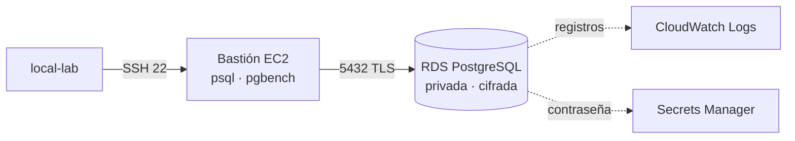

# UD04 · Prácticas



| Práctica | Tipo | Nivel | Horas | CE principales |
|---|---|---|--:|---|
| [4.1 RDS PostgreSQL con OpenTofu](#práctica-41--rds-postgresql-con-opentofu) | Guiada | ●●○ | 2,5 | RA4: a, b, c |
| [4.2 Usuarios, TLS y auditoría](#práctica-42--usuarios-tls-y-auditoría) | Guiada | ●●○ | 2 | RA4: b, c |
| [4.3 Copias, instantáneas y recuperación a un instante](#práctica-43--copias-instantáneas-y-recuperación-a-un-instante) | Guiada | ●●○ | 2 | RA4: e |
| [4.4 Réplicas de lectura y Multi-AZ](#práctica-44--réplicas-de-lectura-y-multi-az) | Guiada | ●●○ | 2 | RA4: a, d, e |
| [4.5 Medir y optimizar](#práctica-45--medir-y-optimizar) | Guiada | ●●● | 2,5 | RA4: d, f, g |
| [4.6 DynamoDB: el carrito](#práctica-46--dynamodb-el-carrito) | Guiada | ●●○ | 2 | RA4: a, b, c, e, f |
| [4.7 Aurora Serverless v2 frente a RDS](#práctica-47--aurora-serverless-v2-frente-a-rds) | Reto | ●●● | 1 | RA4: a, d, g |
| [4.8 Las bases de datos de TaquillaAlacant](#práctica-48--las-bases-de-datos-de-taquillaalacant) | Proyecto | ●●● | 2 | RA4: a – g |
| **Total** | | | **16 h** | |

---

## Práctica 4.1 · RDS PostgreSQL con OpenTofu



#### Objetivo

Desplegar con IaC la base de datos de ventas: **privada**, **cifrada** con clave propia, con **TLS obligatorio**, contraseña en **Secrets Manager**, copias automáticas, registros exportados a CloudWatch y un **bastión** para administrarla.



#### Desarrollo

{}

1. **Carpeta `ud04/lab/`** con este `main.tf`:

    ```hcl
    terraform {
      required_providers {
        aws = { source = "hashicorp/aws", version = "~> 6.0" }
      }
    }

    provider "aws" {
      region = "us-east-1"
      default_tags {
        tags = { Proyecto = "TaquillaAlacant", Alumno = var.alumno, Modulo = "5162" }
      }
    }

    variable "alumno" { type = string }
    variable "mi_ip" { type = string }

    data "aws_vpc" "default" { default = true }
    data "aws_subnets" "default" {
      filter {
        name   = "vpc-id"
        values = [data.aws_vpc.default.id]
      }
      filter {
        name   = "availability-zone"
        values = ["us-east-1a", "us-east-1b", "us-east-1c"]
      }
    }
    data "aws_ssm_parameter" "al2023" {
      name = "/aws/service/ami-amazon-linux-latest/al2023-ami-kernel-default-x86_64"
    }

    resource "aws_kms_key" "bd" {
      description             = "TaquillaAlacant ${var.alumno}: bases de datos"
      enable_key_rotation     = true
      deletion_window_in_days = 7
    }

    # --- Red ---
    resource "aws_security_group" "bastion" {
      name   = "ta-${var.alumno}-bastion"
      vpc_id = data.aws_vpc.default.id
      ingress {
        from_port   = 22
        to_port     = 22
        protocol    = "tcp"
        cidr_blocks = [var.mi_ip]
      }
      egress {
        from_port   = 0
        to_port     = 0
        protocol    = "-1"
        cidr_blocks = ["0.0.0.0/0"]
      }
    }

    resource "aws_security_group" "bd" {
      name   = "ta-${var.alumno}-bd"
      vpc_id = data.aws_vpc.default.id
      ingress {
        description     = "PostgreSQL solo desde el bastion"
        from_port       = 5432
        to_port         = 5432
        protocol        = "tcp"
        security_groups = [aws_security_group.bastion.id]
      }
    }

    resource "aws_db_subnet_group" "bd" {
      name       = "ta-${var.alumno}-bd"
      subnet_ids = data.aws_subnets.default.ids
    }

    # --- Configuración del motor ---
    resource "aws_db_parameter_group" "pg" {
      name   = "ta-${var.alumno}-pg17"
      family = "postgres17"
      parameter {
        name  = "rds.force_ssl"
        value = "1"
      }
      parameter {
        name  = "log_min_duration_statement"
        value = "500"            # registra las sentencias de más de 0,5 s
      }
      parameter {
        name  = "track_io_timing"
        value = "1"
      }
      parameter {
        name         = "shared_preload_libraries"
        value        = "pg_stat_statements,pgaudit"
        apply_method = "pending-reboot"
      }
      parameter {
        name  = "pgaudit.log"
        value = "ddl,role"
      }
    }

    # --- Base de datos ---
    resource "aws_db_instance" "ventas" {
      identifier                      = "ta-${var.alumno}-pg"
      engine                          = "postgres"
      engine_version                  = "17"
      instance_class                  = "db.t4g.micro"
      allocated_storage               = 20
      max_allocated_storage           = 40
      storage_type                    = "gp3"
      storage_encrypted               = true
      kms_key_id                      = aws_kms_key.bd.arn
      db_name                         = "taquilla"
      username                        = "taquilla_admin"
      manage_master_user_password     = true
      db_subnet_group_name            = aws_db_subnet_group.bd.name
      vpc_security_group_ids          = [aws_security_group.bd.id]
      publicly_accessible             = false
      parameter_group_name            = aws_db_parameter_group.pg.name
      multi_az                        = false
      backup_retention_period         = 7
      backup_window                   = "02:00-02:30"
      maintenance_window              = "sun:03:00-sun:04:00"
      auto_minor_version_upgrade      = true
      enabled_cloudwatch_logs_exports = ["postgresql"]
      copy_tags_to_snapshot           = true
      deletion_protection             = false
      skip_final_snapshot             = true
      apply_immediately               = true
    }

    # --- Bastión ---
    resource "aws_instance" "bastion" {
      ami                    = data.aws_ssm_parameter.al2023.value
      instance_type          = "t3.micro"
      key_name               = "vockey"
      iam_instance_profile   = "LabInstanceProfile"
      vpc_security_group_ids = [aws_security_group.bastion.id]
      user_data              = <<-EOF
        #!/bin/bash
        dnf install -y postgresql17 postgresql17-contrib jq
        curl -fsSL -o /etc/pki/rds-global-bundle.pem https://truststore.pki.rds.amazonaws.com/global/global-bundle.pem
      EOF
      tags = { Name = "ta-${var.alumno}-bastion" }
    }

    output "endpoint" { value = aws_db_instance.ventas.address }
    output "secreto" { value = aws_db_instance.ventas.master_user_secret[0].secret_arn }
    output "bastion" { value = aws_instance.bastion.public_ip }
    ```

2. **Despliega** (la base de datos tarda entre 5 y 10 minutos):

    ```bash
    tofu init
    tofu apply -var alumno=$ALUMNO -var mi_ip=$(curl -s ifconfig.me)/32
    ```

3. **Revisa lo creado** y relaciónalo con los criterios:

    ```bash
    aws rds describe-db-instances --db-instance-identifier ta-$ALUMNO-pg --query 'DBInstances[0].{
      Motor:EngineVersion, Clase:DBInstanceClass, AZ:AvailabilityZone, MultiAZ:MultiAZ,
      Cifrado:StorageEncrypted, Clave:KmsKeyId, Publica:PubliclyAccessible,
      Copias:BackupRetentionPeriod, Registros:EnabledCloudwatchLogsExports, Parametros:DBParameterGroups[0].ParameterApplyStatus}'
    ```

    Si `ParameterApplyStatus` es `pending-reboot`, reinicia para cargar `pgaudit`:

    ```bash
    aws rds reboot-db-instance --db-instance-identifier ta-$ALUMNO-pg
    aws rds wait db-instance-available --db-instance-identifier ta-$ALUMNO-pg
    ```

4. **Conéctate desde el bastión** recuperando la contraseña de Secrets Manager:

    ```bash
    ssh -i labsuser.pem ec2-user@$(tofu output -raw bastion)
    ```

    Dentro del bastión (sustituye `ENDPOINT` y `SECRETO` por las salidas de OpenTofu):

    ```bash
    export PGHOST=ENDPOINT PGDATABASE=taquilla PGUSER=taquilla_admin
    export PGPASSWORD=$(aws secretsmanager get-secret-value --region us-east-1 --secret-id 'SECRETO' \
                        --query SecretString --output text | jq -r .password)
    export PGSSLMODE=verify-full PGSSLROOTCERT=/etc/pki/rds-global-bundle.pem
    psql -c "select version();" -c "show ssl;" -c "show shared_preload_libraries;"
    ```

5. **Comprueba que sin TLS no entra**:

    ```bash
    PGSSLMODE=disable psql -c "select 1"
    ```

    ```text
    psql: error: ... no pg_hba.conf entry for host "172.31.x.x", user "taquilla_admin", database "taquilla", no encryption
    ```

6. **Carga el esquema y los datos** del proyecto:

    ```bash
    curl -fsSLO https://lorenalresusta.github.io/BBDD-Nube/recursos/taquilla/esquema.sql
    curl -fsSLO https://lorenalresusta.github.io/BBDD-Nube/recursos/taquilla/generar_ventas.py
    psql -f esquema.sql
    python3 generar_ventas.py --ventas 200000 --sql > datos.sql
    time psql -q -f datos.sql
    psql -c "select count(*) from venta;"
    ```

7. **Comprueba que no es accesible desde Internet**: desde `local-lab`, `nc -vz -w 5 ENDPOINT 5432` debe agotar el tiempo.

{}

#### Comprobación

- [ ] La instancia está cifrada con tu clave, no es pública y tiene 7 días de copias.
- [ ] Conectas con `verify-full` y sin TLS se rechaza.
- [ ] `shared_preload_libraries` incluye `pg_stat_statements` y `pgaudit`.
- [ ] La tabla `venta` tiene 200 000 filas.

#### Problemas habituales

| Síntoma | Causa | Solución |
|---|---|---|
| `InvalidParameterCombination` con la versión o la clase | La versión `17` o `db.t4g.micro` no está disponible | `aws rds describe-orderable-db-instance-options --engine postgres --engine-version 17 --query 'OrderableDBInstanceOptions[].DBInstanceClass'` |
| Error de permisos con `manage_master_user_password` | El laboratorio no permite Secrets Manager en ese momento | Sustitúyelo por `password = var.password` y pasa la contraseña con `TF_VAR_password` (nunca en el código) |
| `psql: command not found` en el bastión | `user_data` aún no ha terminado | Espera un par de minutos: `sudo cloud-init status --wait` |
| `server certificate ... does not match host name` | Conectas por IP o con un alias | Usa el nombre del punto de enlace |

> [!NOTE]
> **No destruyas** el laboratorio: lo usan las prácticas 4.2 a 4.5. Al acabar la sesión, **para** la base de datos: `aws rds stop-db-instance --db-instance-identifier ta-$ALUMNO-pg`.

---

## Práctica 4.2 · Usuarios, TLS y auditoría



#### Objetivo

Aplicar el **mínimo privilegio** dentro de la base de datos, auditar los cambios de esquema y de roles, y localizar las acciones de administración en CloudTrail.

#### Desarrollo

{}

1. **Crea los roles** de la aplicación y del analista (en el bastión, como `taquilla_admin`):

    ```sql
    CREATE EXTENSION IF NOT EXISTS pg_stat_statements;
    CREATE EXTENSION IF NOT EXISTS pgaudit;

    CREATE ROLE app_rw LOGIN PASSWORD 'Cambia-Esto-1';
    GRANT CONNECT ON DATABASE taquilla TO app_rw;
    GRANT USAGE ON SCHEMA public TO app_rw;
    GRANT SELECT, INSERT, UPDATE ON ALL TABLES IN SCHEMA public TO app_rw;
    GRANT USAGE ON ALL SEQUENCES IN SCHEMA public TO app_rw;

    CREATE ROLE analista LOGIN PASSWORD 'Cambia-Esto-2';
    GRANT CONNECT ON DATABASE taquilla TO analista;
    GRANT USAGE ON SCHEMA public TO analista;
    GRANT SELECT ON recinto, evento, venta TO analista;

    REVOKE CREATE ON SCHEMA public FROM PUBLIC;
    ```

2. **Comprueba los privilegios**:

    ```bash
    PGUSER=analista PGPASSWORD='Cambia-Esto-2' psql -c "select count(*) from venta;"      # OK
    PGUSER=analista PGPASSWORD='Cambia-Esto-2' psql -c "select email from cliente limit 1;" # permission denied
    PGUSER=app_rw PGPASSWORD='Cambia-Esto-1' psql -c "delete from venta where id_venta=1;" # permission denied
    PGUSER=app_rw PGPASSWORD='Cambia-Esto-1' psql -c "create table x(a int);"             # permission denied
    ```

3. **Comprueba el cifrado de las conexiones** activas:

    ```sql
    SELECT a.usename, s.ssl, s.version, s.cipher
    FROM pg_stat_ssl s JOIN pg_stat_activity a USING (pid)
    WHERE a.usename IS NOT NULL;
    ```

4. **Genera eventos auditables** y búscalos en CloudWatch Logs:

    ```sql
    CREATE TABLE prueba_auditoria (id int);
    ALTER ROLE analista CONNECTION LIMIT 5;
    DROP TABLE prueba_auditoria;
    ```

    ```bash
    aws logs filter-log-events --log-group-name /aws/rds/instance/ta-$ALUMNO-pg/postgresql \
      --filter-pattern AUDIT --query 'events[].message' --output text | tail -5
    ```

    ```text
    ... LOG:  AUDIT: SESSION,1,1,DDL,CREATE TABLE,,,CREATE TABLE prueba_auditoria (id int);,<not logged>
    ... LOG:  AUDIT: SESSION,2,1,ROLE,ALTER ROLE,,,ALTER ROLE analista CONNECTION LIMIT 5;,<not logged>
    ```

5. **Auditoría de administración**: modifica la ventana de copias y localiza el evento en CloudTrail.

    ```bash
    aws rds modify-db-instance --db-instance-identifier ta-$ALUMNO-pg --backup-window 03:00-03:30 --apply-immediately
    sleep 120
    aws cloudtrail lookup-events --lookup-attributes AttributeKey=EventName,AttributeValue=ModifyDBInstance \
      --max-results 3 --query 'Events[].[EventTime,Username,EventName]' --output table
    ```

6. **Suscríbete a los eventos** de la instancia (reinicios, conmutaciones, copias) con SNS:

    ```bash
    TOPIC=$(aws sns create-topic --name ta-$ALUMNO-bd-eventos --query TopicArn --output text)
    aws sns subscribe --topic-arn $TOPIC --protocol email --notification-endpoint TU_CORREO
    aws rds create-event-subscription --subscription-name ta-$ALUMNO-bd --sns-topic-arn $TOPIC \
      --source-type db-instance --source-ids ta-$ALUMNO-pg \
      --event-categories availability backup failover maintenance notification
    ```

    Confirma la suscripción desde tu correo y reinicia la instancia: recibirás el aviso.

{}

#### Comprobación

- [ ] `analista` no ve los datos personales y `app_rw` no puede borrar ni crear tablas.
- [ ] Todas las conexiones aparecen con `ssl = t`.
- [ ] Encuentras tus `CREATE`/`ALTER ROLE` en CloudWatch Logs y el `ModifyDBInstance` en CloudTrail.

---

## Práctica 4.3 · Copias, instantáneas y recuperación a un instante



#### Objetivo

Recuperarte de un **borrado accidental** con la recuperación a un instante (PITR), hacer instantáneas manuales y copias entre regiones, y una exportación lógica. Mide los tiempos.

#### Desarrollo

{}

1. **Instantánea manual** de referencia:

    ```bash
    aws rds create-db-snapshot --db-instance-identifier ta-$ALUMNO-pg --db-snapshot-identifier ta-$ALUMNO-pg-antes
    aws rds wait db-snapshot-available --db-snapshot-identifier ta-$ALUMNO-pg-antes
    ```

2. **Anota la hora** y provoca el desastre (en el bastión):

    ```bash
    date -u +%Y-%m-%dT%H:%M:%SZ | tee hora_buena.txt
    sleep 60
    psql -c "select count(*) from venta where canal='taquilla';"
    psql -c "delete from venta where canal='taquilla';"      # ¡ups!
    ```

3. **Consulta el último instante restaurable** y restaura **un minuto antes del borrado** en una instancia nueva:

    ```bash
    aws rds describe-db-instances --db-instance-identifier ta-$ALUMNO-pg --query 'DBInstances[0].LatestRestorableTime'
    time aws rds restore-db-instance-to-point-in-time \
      --source-db-instance-identifier ta-$ALUMNO-pg \
      --target-db-instance-identifier ta-$ALUMNO-pg-pitr \
      --restore-time $(cat hora_buena.txt) \
      --db-instance-class db.t4g.micro \
      --db-subnet-group-name ta-$ALUMNO-bd \
      --vpc-security-group-ids $(aws ec2 describe-security-groups --filters Name=group-name,Values=ta-$ALUMNO-bd --query 'SecurityGroups[0].GroupId' --output text) \
      --db-parameter-group-name ta-$ALUMNO-pg17 \
      --no-publicly-accessible
    aws rds wait db-instance-available --db-instance-identifier ta-$ALUMNO-pg-pitr
    ```

    > [!NOTE]
    > Las restauraciones de PITR solo están disponibles hasta unos 5 minutos antes del presente. Si `hora_buena.txt` es más reciente que `LatestRestorableTime`, espera.

4. **Recupera solo lo borrado** copiándolo de la instancia restaurada a la original:

    ```bash
    PITR=$(aws rds describe-db-instances --db-instance-identifier ta-$ALUMNO-pg-pitr --query 'DBInstances[0].Endpoint.Address' --output text)
    psql -h $PITR -c "select count(*) from venta where canal='taquilla';"
    psql -h $PITR -c "\copy (select * from venta where canal='taquilla') to 'recuperar.csv' csv"
    psql -c "\copy venta from 'recuperar.csv' csv"
    psql -c "select count(*) from venta where canal='taquilla';"
    ```

5. **Copia la instantánea a Oregón** (cambia de clave, porque las claves de KMS son regionales):

    ```bash
    CUENTA=$(aws sts get-caller-identity --query Account --output text)
    aws rds copy-db-snapshot --region us-west-2 \
      --source-db-snapshot-identifier arn:aws:rds:us-east-1:$CUENTA:snapshot:ta-$ALUMNO-pg-antes \
      --target-db-snapshot-identifier ta-$ALUMNO-pg-dr \
      --kms-key-id alias/aws/rds
    ```

6. **Exportación lógica** con `pg_dump` (formato personalizado, comprimido) y subida a S3:

    ```bash
    pg_dump -Fc -f taquilla_$(date +%F).dump
    pg_restore -l taquilla_*.dump | head
    aws s3 cp taquilla_*.dump s3://ta-$ALUMNO-entradas-SUFIJO/copias/bd/
    ```

7. **Limpia** la instancia restaurada y la copia de Oregón:

    ```bash
    aws rds delete-db-instance --db-instance-identifier ta-$ALUMNO-pg-pitr --skip-final-snapshot
    aws rds delete-db-snapshot --region us-west-2 --db-snapshot-identifier ta-$ALUMNO-pg-dr
    ```

{}

#### Comprobación

- [ ] Las ventas de taquilla vuelven a estar en la base de datos original.
- [ ] Has anotado cuánto tardó la restauración (RTO) y cuántos datos se podrían haber perdido (RPO).
- [ ] Hay un volcado `.dump` en S3 y sabes restaurarlo con `pg_restore`.

---

## Práctica 4.4 · Réplicas de lectura y Multi-AZ



#### Objetivo

Crear una **réplica de lectura**, medir su retraso y promocionarla; convertir la instancia en **Multi-AZ** y provocar una **conmutación por error**.

#### Desarrollo

{}

1. **Crea la réplica** en otra zona:

    ```bash
    aws rds create-db-instance-read-replica --db-instance-identifier ta-$ALUMNO-pg-r1 \
      --source-db-instance-identifier ta-$ALUMNO-pg --availability-zone us-east-1b \
      --db-instance-class db.t4g.micro
    aws rds wait db-instance-available --db-instance-identifier ta-$ALUMNO-pg-r1
    ```

2. **Comprueba que es de solo lectura** y mide el retraso:

    ```bash
    R1=$(aws rds describe-db-instances --db-instance-identifier ta-$ALUMNO-pg-r1 --query 'DBInstances[0].Endpoint.Address' --output text)
    psql -h $R1 -c "select pg_is_in_recovery(), now() - pg_last_xact_replay_timestamp() as retraso;"
    psql -h $R1 -c "insert into recinto(nombre,aforo) values ('X',1);"     # read-only transaction
    ```

    Genera escrituras en la primaria y observa `ReplicaLag` en CloudWatch:

    ```bash
    psql -c "insert into venta (id_evento,id_cliente,canal,entradas,importe)
             select 1+(random()*399)::int, 1+(random()*4999)::int, 'web', 2, 50 from generate_series(1,200000);"
    aws cloudwatch get-metric-statistics --namespace AWS/RDS --metric-name ReplicaLag \
      --dimensions Name=DBInstanceIdentifier,Value=ta-$ALUMNO-pg-r1 \
      --start-time $(date -u -d '-15 min' +%FT%TZ) --end-time $(date -u +%FT%TZ) \
      --period 60 --statistics Maximum --query 'Datapoints[].[Timestamp,Maximum]' --output text | sort
    ```

3. **Promociona la réplica** (simula que la primaria se ha perdido): pasa a ser una instancia independiente de lectura/escritura.

    ```bash
    aws rds promote-read-replica --db-instance-identifier ta-$ALUMNO-pg-r1
    aws rds wait db-instance-available --db-instance-identifier ta-$ALUMNO-pg-r1
    psql -h $R1 -c "select pg_is_in_recovery();"      # f
    aws rds delete-db-instance --db-instance-identifier ta-$ALUMNO-pg-r1 --skip-final-snapshot
    ```

4. **Convierte la primaria en Multi-AZ** (en OpenTofu: `multi_az = true` y `tofu apply`) y comprueba la zona de la standby:

    ```bash
    aws rds describe-db-instances --db-instance-identifier ta-$ALUMNO-pg \
      --query 'DBInstances[0].[MultiAZ,AvailabilityZone,SecondaryAvailabilityZone]'
    ```

5. **Provoca la conmutación** y mide el corte con un bucle de consultas en el bastión:

    ```bash
    while true; do printf "%s " "$(date +%T)"; psql -tAc "select inet_server_addr();" 2>&1 | head -1; sleep 1; done
    ```

    En otra terminal:

    ```bash
    aws rds reboot-db-instance --db-instance-identifier ta-$ALUMNO-pg --force-failover
    ```

    Observa cuántos segundos fallan las consultas y cómo cambia la IP del servidor detrás del mismo punto de enlace.

6. **Vuelve a Single-AZ** (`multi_az = false`) para ahorrar crédito.

{}

#### Comprobación

- [ ] Has medido el `ReplicaLag` y explicado por qué la réplica es asíncrona.
- [ ] La conmutación Multi-AZ ha cambiado de zona sin cambiar el punto de enlace; has medido el corte.
- [ ] Sabes en qué caso usarías cada mecanismo (tabla del apartado 3 de la teoría).

---

## Práctica 4.5 · Medir y optimizar



#### Objetivo

Medir el rendimiento de inserciones, actualizaciones y consultas de TaquillaAlacant, encontrar el cuello de botella y comprobar con números el efecto de un índice, de un parámetro y de un cambio de clase de instancia.

#### Desarrollo

{}

1. **Escribe la carga de trabajo** de la aplicación en ficheros de `pgbench` (en el bastión):

    ```bash
    cat > venta.sql <<'EOF'
    \set ev random(1, 400)
    \set cli random(1, 5000)
    INSERT INTO venta (id_evento, id_cliente, canal, entradas, importe) VALUES (:ev, :cli, 'web', 2, 45.00);
    EOF
    cat > actualiza.sql <<'EOF'
    \set v random(1, 200000)
    UPDATE venta SET entradas = entradas WHERE id_venta = :v;
    EOF
    cat > informe.sql <<'EOF'
    \set d random(0, 1400)
    SELECT canal, count(*), sum(importe) FROM venta
    WHERE fecha_venta >= date '2022-01-01' + :d AND fecha_venta < date '2022-01-01' + :d + 1
    GROUP BY canal;
    EOF
    ```

2. **Línea base**: 4 clientes durante 60 s con el peso de cada operación.

    ```bash
    psql -c "select pg_stat_statements_reset();"
    pgbench -n -c 4 -j 2 -T 60 -P 10 -f venta.sql@5 -f actualiza.sql@3 -f informe.sql@2 | tee base.txt
    ```

    Anota TPS y latencia media.

3. **Busca la sentencia culpable**:

    ```sql
    SELECT calls, round(mean_exec_time::numeric, 2) AS ms_media, round(total_exec_time::numeric) AS ms_total,
           left(query, 60) AS sentencia
    FROM pg_stat_statements WHERE dbid = (SELECT oid FROM pg_database WHERE datname = 'taquilla')
    ORDER BY total_exec_time DESC LIMIT 5;
    ```

    Y su plan:

    ```sql
    EXPLAIN (ANALYZE, BUFFERS)
    SELECT canal, count(*), sum(importe) FROM venta
    WHERE fecha_venta >= '2024-06-20' AND fecha_venta < '2024-06-21' GROUP BY canal;
    ```

    Verás un `Seq Scan on venta` que lee toda la tabla.

4. **Optimización de esquema**: crea el índice sin bloquear las escrituras y repite.

    ```sql
    CREATE INDEX CONCURRENTLY ix_venta_fecha ON venta (fecha_venta) INCLUDE (canal, importe);
    ANALYZE venta;
    ```

    ```bash
    psql -c "select pg_stat_statements_reset();"
    pgbench -n -c 4 -j 2 -T 60 -P 10 -f venta.sql@5 -f actualiza.sql@3 -f informe.sql@2 | tee indice.txt
    ```

    Compara el plan (`Index Only Scan`), la latencia del informe y el TPS. ¿Han empeorado las inserciones? ¿Por qué?

5. **Observa la carga** en **CloudWatch → Database Insights** (o en la pestaña *Monitoring* de la instancia): carga de la base de datos, esperas principales y sentencias más costosas durante cada prueba. Haz una captura de cada una.

6. **Optimización de configuración**: crea un parámetro dinámico más generoso para las ordenaciones y compara un informe con ordenación:

    ```bash
    aws rds modify-db-parameter-group --db-parameter-group-name ta-$ALUMNO-pg17 \
      --parameters "ParameterName=work_mem,ParameterValue=16384,ApplyMethod=immediate"
    ```

    ```sql
    EXPLAIN (ANALYZE) SELECT * FROM venta ORDER BY importe DESC LIMIT 1000 OFFSET 50000;
    -- Busca "Sort Method: external merge  Disk" antes y "quicksort  Memory" después
    ```

7. **Cambio de ciclo de vida**: escala la instancia a `db.t4g.small`, mide cuánto dura el corte y repite la prueba de carga.

    ```bash
    aws rds modify-db-instance --db-instance-identifier ta-$ALUMNO-pg --db-instance-class db.t4g.small --apply-immediately
    ```

    Después vuelve a `db.t4g.micro`.

{}

#### Comprobación

- [ ] Tienes una tabla con TPS y latencia de: línea base, con índice y con la clase mayor.
- [ ] El plan del informe pasa de `Seq Scan` a `Index Only Scan`.
- [ ] Sabes justificar cuál de los tres cambios tiene mejor relación mejora/coste.

---

## Práctica 4.6 · DynamoDB: el carrito



#### Objetivo

Crear la tabla del carrito con IaC (cifrado con clave propia, bajo demanda, TTL y PITR), trabajar con elementos y consultas, y recuperar la tabla tras un error.

#### Desarrollo

{}

1. **Añade la tabla** al `main.tf` del laboratorio (el bloque `aws_dynamodb_table` de la teoría, apartado 10) y aplícalo.

2. **Inserta elementos** (la caducidad, en tiempo Unix, dentro de 30 minutos):

    ```bash
    T=ta-$ALUMNO-carrito; CADUCA=$(( $(date +%s) + 1800 ))
    for ev in 0042 0107; do
      aws dynamodb put-item --table-name $T --item '{
        "PK":{"S":"CARRITO#s-abc"}, "SK":{"S":"EVENTO#'$ev'"},
        "entradas":{"N":"2"}, "precio":{"N":"45.00"}, "caduca":{"N":"'$CADUCA'"}}'
    done
    ```

3. **Consulta** el carrito de una sesión y compara la consistencia y el consumo:

    ```bash
    aws dynamodb query --table-name $T --key-condition-expression "PK = :pk" \
      --expression-attribute-values '{":pk":{"S":"CARRITO#s-abc"}}' --return-consumed-capacity TOTAL
    aws dynamodb query --table-name $T --key-condition-expression "PK = :pk" --consistent-read \
      --expression-attribute-values '{":pk":{"S":"CARRITO#s-abc"}}' --return-consumed-capacity TOTAL
    ```

4. **Actualización condicional** (no se puede bajar de 0 entradas):

    ```bash
    aws dynamodb update-item --table-name $T --key '{"PK":{"S":"CARRITO#s-abc"},"SK":{"S":"EVENTO#0042"}}' \
      --update-expression "SET entradas = entradas - :uno" --condition-expression "entradas >= :uno" \
      --expression-attribute-values '{":uno":{"N":"1"}}' --return-values UPDATED_NEW
    ```

5. **Carga masiva** con un pequeño script y observa las métricas `ConsumedWriteCapacityUnits` y `SuccessfulRequestLatency` en CloudWatch:

    ```bash
    sudo dnf install -y python3-boto3
    export ALUMNO=lmartinez        # en el bastión también
    python3 - <<'EOF'
    import boto3, time, random, os
    t = boto3.resource("dynamodb", region_name="us-east-1").Table(f"ta-{os.environ['ALUMNO']}-carrito")
    with t.batch_writer() as b:
        for i in range(5000):
            b.put_item(Item={"PK": f"CARRITO#s-{i:05d}", "SK": f"EVENTO#{random.randint(1,400):04d}",
                             "entradas": random.randint(1, 6), "caduca": int(time.time()) + 1800})
    print("ok")
    EOF
    ```

6. **Recuperación a un instante**: anota la hora, borra los elementos de una sesión y restaura la tabla en otra nueva.

    ```bash
    HORA=$(date -u +%s); sleep 60
    aws dynamodb delete-item --table-name $T --key '{"PK":{"S":"CARRITO#s-abc"},"SK":{"S":"EVENTO#0107"}}'
    aws dynamodb describe-continuous-backups --table-name $T \
      --query 'ContinuousBackupsDescription.PointInTimeRecoveryDescription'
    aws dynamodb restore-table-to-point-in-time --source-table-name $T \
      --target-table-name $T-restaurada --restore-date-time $HORA
    aws dynamodb wait table-exists --table-name $T-restaurada
    aws dynamodb get-item --table-name $T-restaurada --key '{"PK":{"S":"CARRITO#s-abc"},"SK":{"S":"EVENTO#0107"}}'
    ```

    > [!NOTE]
    > La tabla restaurada **no** hereda la configuración de TTL, las etiquetas, las alarmas ni las políticas: hay que volver a aplicarlas. Con IaC es inmediato.

7. **Limpia** la tabla restaurada: `aws dynamodb delete-table --table-name $T-restaurada`.

{}

#### Comprobación

- [ ] La tabla usa tu clave KMS, modo bajo demanda, TTL y PITR (`describe-table` y `describe-continuous-backups`).
- [ ] La lectura fuertemente consistente consume el doble de capacidad que la eventual.
- [ ] Has recuperado el elemento borrado desde la tabla restaurada.

#### Ampliación

Convierte la tabla en **tabla global** con una réplica en `us-west-2` y comprueba el tiempo que tarda en aparecer allí un elemento escrito en `us-east-1`.

---

## Práctica 4.7 · Aurora Serverless v2 frente a RDS



#### Enunciado

Crea un clúster **Aurora PostgreSQL Serverless v2** (capacidad mínima 0,5 ACU y máxima 2 ACU, o la que permita el laboratorio), cifrado con tu clave, y carga los mismos datos que en RDS.

1. Repite la prueba de `pgbench` de la práctica 4.5 y observa la métrica `ServerlessDatabaseCapacity`.
2. Añade una instancia lectora y comprueba el retraso de réplica (`AuroraReplicaLag`). Compáralo con el `ReplicaLag` de RDS.
3. Estima el coste mensual de los dos modelos para TaquillaAlacant, sabiendo que hay picos de carga muy fuertes al abrir la venta de los grandes conciertos y poca actividad el resto del tiempo.
4. Concluye qué modelo recomendarías y por qué.

Destruye el clúster al terminar: consume crédito aunque no lo uses si la capacidad mínima es mayor que 0.

---

## Práctica 4.8 · Las bases de datos de TaquillaAlacant



#### Requisitos

- **RDS PostgreSQL** desplegada con OpenTofu, con las decisiones justificadas de **región de producción**, **Multi-AZ** y **réplica** (en el laboratorio puedes dejarlas desactivadas, pero el código debe permitir activarlas con una variable).
- Cifrado con clave propia, TLS obligatorio, contraseña en Secrets Manager, red privada.
- Roles `app_rw`, `analista` y `copias` (solo lectura para `pg_dump`) creados con un script SQL idempotente.
- `pgaudit` para DDL y roles; registros exportados a CloudWatch Logs con retención de 30 días.
- **Alarmas** de CloudWatch con notificación por SNS: CPU > 80 % durante 10 minutos, `FreeStorageSpace` < 2 GB y `DatabaseConnections` > 50.
- **Copias**: retención de 7 días, instantánea semanal copiada a otra región y volcado `pg_dump` semanal a S3 con un script.
- **Optimización**: la tabla `venta` **particionada por mes** (`PARTITION BY RANGE (fecha_venta)`) con su índice, y una comparación con `EXPLAIN` frente a la tabla sin particionar.
- **DynamoDB** del carrito con TTL, PITR y cifrado con clave propia.
- **Informe** con: tabla de criterios RA4.a – g y cómo se cumplen; RPO y RTO medidos; coste mensual estimado en producción.

#### Comprobación

- [ ] `tofu apply` crea todo desde cero, incluidas las alarmas.
- [ ] Una restauración PITR documentada y cronometrada.
- [ ] Las alarmas se disparan en una prueba controlada (por ejemplo, abriendo 60 conexiones con `pgbench -c 60`).
