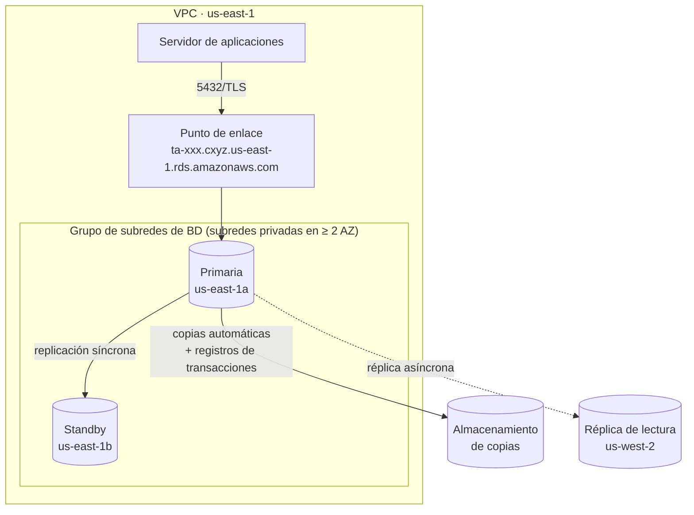

# UD04 · Bases de datos administradas

## Resumen del tema

En un centro de datos propio, administrar una base de datos es instalar el motor, parchearlo, vigilar los discos, programar copias y montar la alta disponibilidad. En la nube el proveedor se encarga de buena parte de ese trabajo, pero **no de todo**: tú sigues decidiendo la región, el tamaño, el cifrado, quién accede, cuánto tiempo se guardan las copias, cómo se vigila y cómo se optimiza. Esta unidad trata exactamente de eso.



### Objetivos de aprendizaje

- Elegir entre base de datos autogestionada, administrada o *serverless*, y entre motor relacional y NoSQL.
- Desplegar una base de datos con IaC con la región, la replicación y el cifrado adecuados.
- Controlar la red, los usuarios, los privilegios y la auditoría.
- Aplicar cambios de tamaño, de configuración y de versión con el mínimo corte.
- Configurar copias automáticas, instantáneas y recuperación a un instante, y probarlas.
- Medir el rendimiento de inserciones, actualizaciones y consultas, y aplicar optimizaciones sencillas.

---

## 1. Tres formas de tener una base de datos en la nube

| | **Autogestionada** (en EC2) | **Administrada** (RDS, Aurora) | **Serverless** (DynamoDB, Aurora Serverless v2, Aurora DSQL) |
|---|---|---|---|
| Instalar y parchear el SO y el motor | Tú | Proveedor (tú eliges la ventana) | Proveedor |
| Copias, PITR, réplicas | Tú | Configuras; el proveedor ejecuta | Configuras; el proveedor ejecuta |
| Alta disponibilidad | Tú la montas | Una opción (Multi-AZ) | Incluida |
| Capacidad | Eliges la máquina | Eliges la clase de instancia | Escala sola; pagas por uso |
| Control total del motor | Sí | Limitado (sin acceso al SO) | Muy limitado |
| Cuándo | Motor o versión no soportados, requisitos muy especiales | La mayoría de bases de datos relacionales | Carga variable o imprevisible; escala masiva |

### 1.1 Motores disponibles

| Familia | AWS | Azure | Google Cloud |
|---|---|---|---|
| Relacional estándar | **RDS** para PostgreSQL, MySQL, MariaDB, Oracle, SQL Server, Db2 | Azure Database for PostgreSQL/MySQL, Azure SQL | Cloud SQL |
| Relacional nativa de la nube | **Aurora** (compatible con MySQL y PostgreSQL), Aurora DSQL | Azure SQL Hyperscale | AlloyDB, Spanner |
| Clave-valor y documentos | **DynamoDB**, DocumentDB | Cosmos DB | Firestore, Bigtable |
| En memoria | ElastiCache / MemoryDB (Valkey, Redis OSS) | Azure Cache for Redis | Memorystore |
| Grafos, series temporales… | Neptune, Timestream, Keyspaces | Cosmos DB (API Gremlin, Cassandra) | — |

> [!NOTE]
> **Aurora** separa el cómputo del almacenamiento: los datos se guardan en un volumen distribuido con **seis copias en tres zonas** que crece solo, y las réplicas leen del mismo volumen, por lo que el retraso de réplica es muy bajo. Es más cara por hora que RDS, pero ofrece más rendimiento y disponibilidad.

---

## 2. Anatomía de una instancia de RDS



| Elemento | Qué decides |
|---|---|
| **Motor y versión** | PostgreSQL 17, MySQL 8.4… y si se actualizan solas las versiones menores |
| **Clase de instancia** | CPU y memoria: `db.t4g.micro` (pruebas), `db.m7g.large` (producción)… |
| **Almacenamiento** | gp3 o io2, tamaño, IOPS y **autoescalado de almacenamiento** |
| **Grupo de subredes** | En qué subredes (y zonas) puede vivir la instancia |
| **Grupo de parámetros** | La configuración del motor (`postgresql.conf`) |
| **Grupo de opciones** | Funciones extra en algunos motores (Oracle, SQL Server, MySQL) |
| **Punto de enlace** | El nombre DNS al que se conecta la aplicación; no cambia aunque cambie la máquina |

---

## 3. Región y replicación (CE RA4.a)

| Opción | Cómo funciona | Protege de | RPO / RTO típicos | Se puede leer de la copia |
|---|---|---|---|---|
| **Single-AZ** | Una instancia | Fallo de disco (el almacenamiento está replicado en la AZ) | Copias: minutos / restaurar: 10 – 30 min o más | — |
| **Multi-AZ (instancia)** | Standby **síncrona** en otra AZ; conmutación automática del DNS | Caída de la instancia o de la AZ | 0 / 1 – 2 min | No |
| **Multi-AZ (clúster de BD)** | Escritora + **dos** standby legibles en tres AZ | Igual, conmutación más rápida | 0 / < 1 min | Sí |
| **Réplica de lectura** | Copia **asíncrona**, en la misma u otra región; se puede **promocionar** | Sobrecarga de lecturas; desastre regional (si es entre regiones) | Segundos de retraso / minutos al promocionar | Sí |
| **Aurora Global Database** | Clúster secundario en otra región con retraso típico < 1 s | Desastre regional | ≈ 1 s / ≈ 1 min | Sí |

Criterios para decidir: **residencia** (las réplicas entre regiones mueven datos personales a otro país), **latencia** de los usuarios, **RPO/RTO** exigidos y **coste** (Multi-AZ duplica, aproximadamente, el precio de la instancia y del almacenamiento; las réplicas entre regiones añaden transferencia).

---

## 4. Cifrado (CE RA4.b)

- **En reposo**: con una clave de KMS que se elige **al crear** la instancia. Cifra el almacenamiento, las copias automáticas, las instantáneas, los registros y las réplicas. Para cifrar una base de datos que no lo estaba: instantánea → **copia cifrada** → restaurar en una instancia nueva → cambiar la aplicación de punto de enlace.
- **En tránsito**: TLS entre el cliente y la base de datos. En RDS para PostgreSQL se **obliga** con el parámetro `rds.force_ssl = 1` (activado por defecto desde PostgreSQL 15). El cliente debe validar el certificado del servidor con el **paquete de CA de RDS** (`sslmode=verify-full`).
- **Secretos**: la contraseña del usuario maestro no debe estar en el código ni en el estado de IaC. RDS puede **gestionarla en AWS Secrets Manager** y rotarla.

```hcl
resource "aws_db_instance" "ventas" {
  identifier                  = "ta-${var.alumno}-pg"
  engine                      = "postgres"
  engine_version              = "17"
  instance_class              = "db.t4g.micro"
  allocated_storage           = 20
  max_allocated_storage       = 50           # autoescalado de almacenamiento
  storage_type                = "gp3"
  storage_encrypted           = true
  kms_key_id                  = aws_kms_key.bd.arn
  username                    = "taquilla_admin"
  manage_master_user_password = true         # contraseña en Secrets Manager
  db_name                     = "taquilla"
  db_subnet_group_name        = aws_db_subnet_group.bd.name
  vpc_security_group_ids      = [aws_security_group.bd.id]
  publicly_accessible         = false
  parameter_group_name        = aws_db_parameter_group.pg.name
  multi_az                    = false
  backup_retention_period     = 7
  backup_window               = "02:00-02:30"
  maintenance_window          = "sun:03:00-sun:04:00"
  enabled_cloudwatch_logs_exports = ["postgresql"]
  deletion_protection         = false        # true en producción
  skip_final_snapshot         = true         # false en producción
}
```

---

## 5. Acceso, seguridad, monitorización y auditoría (CE RA4.c)

### 5.1 Red

- La base de datos va en **subredes privadas** y con `publicly_accessible = false`.
- Su **grupo de seguridad** solo acepta el puerto del motor (5432, 3306…) **desde el grupo de seguridad de la aplicación**, nunca desde `0.0.0.0/0`.
- Para administrarla desde fuera: un **bastión** con túnel SSH, **AWS Systems Manager Session Manager** o una VPN (UD06).

### 5.2 Usuarios y privilegios

El usuario maestro es para administrar, **no** para la aplicación. Se crean roles con el **mínimo privilegio**:

```sql
CREATE ROLE app_rw LOGIN PASSWORD '...';
GRANT CONNECT ON DATABASE taquilla TO app_rw;
GRANT USAGE ON SCHEMA public TO app_rw;
GRANT SELECT, INSERT, UPDATE ON ALL TABLES IN SCHEMA public TO app_rw;
GRANT USAGE ON ALL SEQUENCES IN SCHEMA public TO app_rw;

CREATE ROLE analista LOGIN PASSWORD '...';
GRANT CONNECT ON DATABASE taquilla TO analista;
GRANT USAGE ON SCHEMA public TO analista;
GRANT SELECT ON evento, recinto, venta TO analista;     -- sin acceso a cliente (datos personales)
```

Alternativa a las contraseñas: **autenticación de IAM**, en la que la aplicación pide un token temporal con su rol (`aws rds generate-db-auth-token`) y el usuario de la base de datos tiene el rol `rds_iam`.

### 5.3 Monitorización y observabilidad

| Herramienta | Qué da |
|---|---|
| **Métricas de CloudWatch** | `CPUUtilization`, `FreeableMemory`, `FreeStorageSpace`, `DatabaseConnections`, `ReadIOPS`/`WriteIOPS`, `ReadLatency`/`WriteLatency`, `ReplicaLag` |
| **CloudWatch Database Insights** | Carga de la base de datos por esperas, consultas SQL y usuarios. Sustituye a la consola de Performance Insights, retirada en 2026 |
| **Supervisión mejorada** (*Enhanced Monitoring*) | Métricas del sistema operativo cada pocos segundos (requiere un rol IAM) |
| **Registros del motor** exportados a CloudWatch Logs | Errores, consultas lentas (`log_min_duration_statement`), conexiones |
| **Eventos de RDS** | Conmutaciones, copias, reinicios, almacenamiento casi lleno; se pueden enviar a SNS |

### 5.4 Auditoría

- **CloudTrail**: quién creó, modificó, paró o borró la instancia, cambió parámetros o restauró copias.
- **Dentro del motor**: en PostgreSQL, la extensión **`pgaudit`** registra sentencias DDL, cambios de roles o lecturas de tablas concretas; en MySQL/MariaDB, el plugin de auditoría. Los registros se exportan a CloudWatch Logs.
- En Aurora (y en Oracle y SQL Server) existe además **Database Activity Streams**, un flujo de auditoría que ni siquiera el administrador de la base de datos puede manipular.

---

## 6. Ciclo de vida (CE RA4.d)

| Cambio | Cómo | Impacto |
|---|---|---|
| Ampliar almacenamiento | Modificar tamaño (o autoescalado) | Sin corte; **no** se puede reducir |
| Cambiar clase de instancia | Modificar → aplicar ya o en la ventana de mantenimiento | Corte de minutos; con Multi-AZ, solo la conmutación |
| Cambiar parámetros | Grupo de parámetros | Dinámicos: al momento; estáticos: tras reiniciar (`pending-reboot`) |
| Actualizar versión menor | Automático en la ventana o manual | Reinicio breve |
| Actualizar versión mayor | Manual; mejor con **Blue/Green Deployments** | Con Blue/Green, corte de menos de un minuto al cambiar |
| Parar | `stop-db-instance` | Pagas solo almacenamiento; **se vuelve a arrancar sola a los 7 días** |
| Borrar | Con instantánea final y sin protección contra borrado | Las copias automáticas se borran salvo que las conserves |

> [!TIP]
> Los cambios hechos con `--apply-immediately` se aplican al momento; sin esa opción esperan a la **ventana de mantenimiento**. En producción, programa los cambios en la ventana y comunícalos.

---

## 7. Copias de seguridad y recuperación (CE RA4.e)

| Mecanismo | Qué es | Retención | Restauración |
|---|---|---|---|
| **Copias automáticas** | Instantánea diaria en la ventana de copias + registros de transacciones cada pocos minutos | 1 – 35 días | **A cualquier instante** (PITR) del periodo, con granularidad de segundos y hasta ≈ 5 min antes del presente |
| **Instantáneas manuales** | Copia completa bajo demanda | Hasta que las borras | Al momento de la instantánea |
| **Copia de instantáneas / réplica de copias automáticas entre regiones** | Copias en otra región (o cuenta) | La que fijes | En la otra región |
| **AWS Backup** | Planes centralizados (UD03) | La del plan | Igual que las anteriores |
| **Exportación lógica** (`pg_dump`, `mysqldump`) | Fichero SQL o personalizado | La que fijes | En cualquier PostgreSQL, también fuera de AWS |
| **Exportar instantánea a S3** | Ficheros Parquet | La del bucket | Para analítica (UD07), no para restaurar |

> [!IMPORTANT]
> **Restaurar siempre crea una instancia nueva** con otro punto de enlace. La recuperación completa incluye apuntar la aplicación a la nueva instancia (o renombrar instancias) y comprobar los datos. Mide cuánto tarda todo: ese es tu RTO real.

---

## 8. Monitorizar el rendimiento (CE RA4.f)

Para medir **inserciones, actualizaciones y consultas** se combinan tres niveles:

1. **Infraestructura** (CloudWatch): ¿la instancia está al límite de CPU, memoria, IOPS o conexiones? ¿La latencia de escritura sube?
2. **Base de datos** (Database Insights): ¿en qué espera la base de datos? ¿Qué sentencias generan más carga?
3. **Sentencia** (motor): `pg_stat_statements` y `EXPLAIN (ANALYZE, BUFFERS)`.

```sql
-- Las 5 sentencias que más tiempo total consumen
SELECT calls, round(total_exec_time) AS ms_total, round(mean_exec_time, 2) AS ms_media,
       rows, left(query, 70) AS sentencia
FROM pg_stat_statements
ORDER BY total_exec_time DESC
LIMIT 5;
```

Para generar carga reproducible se usa **`pgbench`**, que mide transacciones por segundo (TPS) y latencia media con un número dado de clientes. Medir antes y después de cada cambio es la única forma de saber si una optimización ha funcionado.

---

## 9. Optimizaciones sencillas (CE RA4.g)

| Nivel | Optimización | Ejemplo |
|---|---|---|
| **Consulta / esquema** | Crear el índice que falta | `CREATE INDEX CONCURRENTLY ix_venta_fecha ON venta (fecha_venta);` |
| | Tipos de datos adecuados | `NUMERIC(8,2)` para importes, `timestamptz` para fechas, `smallint` para contadores pequeños |
| | Particionado por fecha de tablas muy grandes | `venta` particionada por mes: las consultas de un mes leen una partición y borrar un año es `DROP` |
| **Distribución de los datos** | Separar lecturas | Informes contra una **réplica de lectura** |
| | Datos calientes fuera de la BD | Sesiones y carritos en DynamoDB o ElastiCache |
| **Configuración** | Parámetros de memoria | `work_mem` para ordenaciones, `shared_buffers`, `effective_cache_size` |
| | Conexiones | **RDS Proxy** o PgBouncer para reutilizar conexiones |
| **Infraestructura** | Escalar | Clase de instancia mayor; más IOPS en gp3; Graviton (`t4g`, `m7g`) por precio/rendimiento |

> [!WARNING]
> Escalar la máquina es lo más fácil y lo más caro. Antes, mira si el problema es una consulta sin índice: a menudo un índice convierte una consulta de segundos en milisegundos sin coste extra.

---

## 10. DynamoDB: NoSQL serverless

DynamoDB es una base de datos **clave-valor y de documentos**, totalmente gestionada, con latencia de milisegundos de un dígito a cualquier escala. No hay instancias: hay **tablas**.

| Concepto | Descripción |
|---|---|
| **Elemento** | Una «fila» con atributos libres; máximo 400 KB |
| **Clave de partición** (PK) | Decide en qué partición física va el elemento; debe repartir bien la carga |
| **Clave de ordenación** (SK) | Opcional; ordena los elementos de una misma PK y permite consultas por rango |
| **Índices secundarios** | GSI (otra PK/SK, consistencia eventual) y LSI (misma PK, otra SK) |
| **Modo de capacidad** | **Bajo demanda** (pagas por petición; recomendado para empezar) o **aprovisionado** (RCU/WCU con autoescalado) |
| **TTL** | Atributo con una fecha de caducidad; DynamoDB borra el elemento sin coste |
| **Lecturas** | Eventualmente consistentes (por defecto, mitad de precio) o fuertemente consistentes |

Diseño para el carrito de TaquillaAlacant:

| PK | SK | Atributos |
|---|---|---|
| `CARRITO#<id_sesion>` | `EVENTO#0042` | `entradas = 2`, `precio = 45.00`, `caduca = 1795000000` (TTL) |
| `CARRITO#<id_sesion>` | `EVENTO#0107` | `entradas = 1`, … |
| `COLA#0042` | `2026-06-19T20:00:01.123#<id_sesion>` | `estado = esperando` |

Administración según los criterios del RA4:

- **Región y replicación**: una tabla es regional (datos en tres AZ). Las **tablas globales** la replican en varias regiones con escritura en todas.
- **Cifrado**: siempre activo; con clave propiedad de AWS, gestionada por AWS o **del cliente** (KMS).
- **Acceso**: políticas IAM que pueden limitar por clave (`dynamodb:LeadingKeys`); puntos de enlace de VPC; auditoría con CloudTrail (eventos de datos opcionales).
- **Copias**: **PITR** (recuperación a cualquier segundo de los últimos 1 a 35 días, configurable) y copias bajo demanda o con AWS Backup. Restaurar crea una tabla nueva.
- **Monitorización**: `ConsumedReadCapacityUnits`, `ConsumedWriteCapacityUnits`, `ThrottledRequests`, `SuccessfulRequestLatency`; **Contributor Insights** muestra las claves más usadas (particiones calientes).

```hcl
resource "aws_dynamodb_table" "carrito" {
  name         = "ta-${var.alumno}-carrito"
  billing_mode = "PAY_PER_REQUEST"
  hash_key     = "PK"
  range_key    = "SK"

  attribute {
    name = "PK"
    type = "S"
  }
  attribute {
    name = "SK"
    type = "S"
  }

  ttl {
    attribute_name = "caduca"
    enabled        = true
  }
  point_in_time_recovery { enabled = true }
  server_side_encryption {
    enabled     = true
    kms_key_arn = aws_kms_key.bd.arn
  }
}
```

---

## 11. Errores frecuentes

| Problema | Causa | Solución |
|---|---|---|
| `could not connect to server: Connection timed out` | Grupo de seguridad o base de datos no pública (como debe ser) | Conecta desde la VPC, por bastión o VPN |
| `no pg_hba.conf entry ... no encryption` | `rds.force_ssl = 1` y el cliente no usa TLS | `sslmode=require` o, mejor, `verify-full` con el paquete de CA |
| La instancia se ha vuelto a encender sola | Una instancia parada arranca a los 7 días | Destrúyela si no la necesitas |
| El cambio de parámetro no se aplica | Parámetro estático: `pending-reboot` | Reinicia en la ventana de mantenimiento |
| He restaurado y la aplicación sigue viendo los datos malos | La restauración crea **otra** instancia | Cambia el punto de enlace de la aplicación |
| `ProvisionedThroughputExceededException` en DynamoDB | Capacidad insuficiente o partición caliente | Bajo demanda, autoescalado o mejor clave de partición |
| La factura incluye copias que no esperaba | Instantáneas manuales antiguas | Política de retención y limpieza |

## 12. Resumen

- RDS y Aurora para lo relacional; DynamoDB para clave-valor a gran escala. El proveedor opera, pero tú decides y configuras.
- Multi-AZ da alta disponibilidad (síncrona); las réplicas de lectura dan escalado de lecturas y recuperación ante desastres (asíncronas).
- Cifrado al crear con KMS, TLS obligatorio y contraseñas en Secrets Manager.
- Red privada, mínimo privilegio, auditoría con CloudTrail y `pgaudit`, métricas, registros y Database Insights.
- Copias automáticas con PITR, instantáneas manuales y copias entre regiones; restaurar crea una instancia nueva.
- Mide con `pg_stat_statements`, `EXPLAIN` y `pgbench` antes de optimizar; primero índices y esquema, después configuración, y la máquina, lo último.

## 13. Autoevaluación


- q: "Necesitas que la base de datos de ventas siga funcionando si cae una zona de disponibilidad, sin perder transacciones. ¿Qué configuras?"
  options: ["Una réplica de lectura en otra región", "Multi-AZ", "Copias automáticas de 35 días", "Una clase de instancia mayor"]
  answer: 1
  explain: "Multi-AZ mantiene una standby síncrona en otra AZ y conmuta automáticamente (RPO 0)."
- q: "¿Cómo cifras una instancia de RDS que se creó sin cifrar?"
  options: ["Modificando `storage_encrypted`", "Instantánea → copia cifrada → restaurar en una instancia nueva", "Activando `rds.force_ssl`", "No se puede"]
  answer: 1
  explain: "El cifrado en reposo se decide al crear; se migra a través de una copia cifrada de una instantánea."
- q: "A las 11:47 alguien ejecuta un `DELETE` sin `WHERE`. Tienes copias automáticas de 7 días. ¿Qué haces?"
  options: ["Restaurar la última instantánea diaria sobre la instancia actual", "Restaurar a las 11:46 (PITR) en una instancia nueva y recuperar los datos", "Promocionar la standby de Multi-AZ", "Nada: Multi-AZ lo evita"]
  answer: 1
  explain: "PITR permite volver a un instante concreto; crea una instancia nueva. Multi-AZ replica también el DELETE."
- q: "¿Qué herramienta muestra qué sentencias SQL consumen más tiempo en PostgreSQL?"
  options: ["`pg_stat_statements`", "`FreeStorageSpace`", "CloudTrail", "El grupo de subredes"]
  answer: 0
  explain: "pg_stat_statements acumula llamadas, tiempo total y medio por sentencia normalizada."
- q: "Una consulta por `fecha_venta` hace un `Seq Scan` sobre 5 millones de filas. ¿Cuál es la optimización más sencilla y barata?"
  options: ["Pasar a una instancia el doble de grande", "Crear un índice sobre `fecha_venta`", "Activar Multi-AZ", "Aumentar la retención de copias"]
  answer: 1
  explain: "Un índice adecuado suele resolverlo sin coste de infraestructura."
- q: "En DynamoDB quieres que los carritos se borren solos a los 30 minutos. ¿Qué usas?"
  options: ["Un trabajo programado que borre", "TTL sobre un atributo con la fecha de caducidad", "PITR", "Una réplica global"]
  answer: 1
  explain: "TTL borra los elementos caducados sin consumir capacidad de escritura."
- q: "Paras una instancia de RDS para ahorrar y te olvidas. ¿Qué pasa?"
  options: ["Queda parada indefinidamente", "Se borra a los 7 días", "Se vuelve a arrancar sola a los 7 días", "Se convierte en Serverless"]
  answer: 2
  explain: "RDS arranca automáticamente las instancias paradas a los 7 días para aplicar el mantenimiento."


## Referencias

- Amazon RDS User Guide — <https://docs.aws.amazon.com/AmazonRDS/latest/UserGuide/>
- *Multi-AZ deployments* y *Read replicas* — <https://docs.aws.amazon.com/AmazonRDS/latest/UserGuide/Concepts.MultiAZ.html>
- *Using SSL/TLS to encrypt a connection to a DB instance* — <https://docs.aws.amazon.com/AmazonRDS/latest/UserGuide/UsingWithRDS.SSL.html>
- *Backing up, restoring and exporting data* — <https://docs.aws.amazon.com/AmazonRDS/latest/UserGuide/CHAP_CommonTasks.BackupRestore.html>
- CloudWatch Database Insights — <https://docs.aws.amazon.com/AmazonCloudWatch/latest/monitoring/Database-Insights.html>
- PostgreSQL: `pg_stat_statements`, `EXPLAIN`, `pgbench` — <https://www.postgresql.org/docs/current/>
- Amazon DynamoDB Developer Guide — <https://docs.aws.amazon.com/amazondynamodb/latest/developerguide/>
