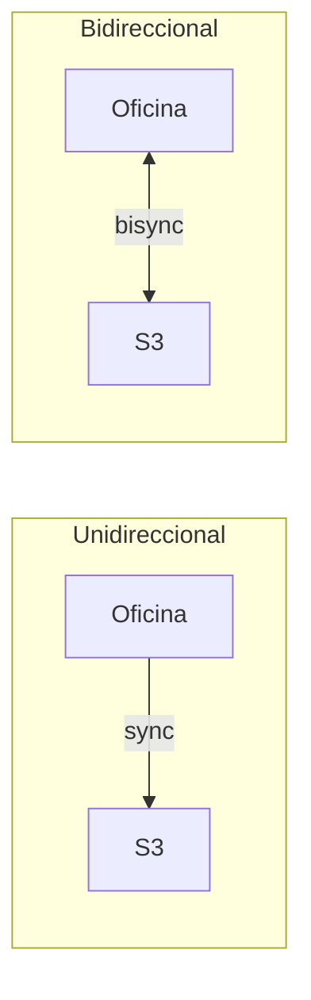

# UD05 · Transferir y sincronizar datos

## Resumen del tema

Mover datos parece trivial (`cp` y listo) hasta que son 30 GB por una línea de oficina, millones de ficheros pequeños, una base de datos que no puede pararse o un socio que solo sabe usar SFTP. Esta unidad te da el catálogo de opciones y un método para elegir, asegurar, automatizar y vigilar cada transferencia.



### Objetivos de aprendizaje

- Elegir la opción de transferencia o sincronización según el volumen, la latencia, la frecuencia y la seguridad.
- Calcular todos los costes de una transferencia.
- Configurar conexiones cifradas, privadas y eficientes.
- Preparar una transferencia fuera de línea con cifrado y control de integridad.
- Sincronizar en uno o en los dos sentidos de forma automática y desatendida.
- Importar y exportar bases de datos y comprobar que el resultado es íntegro.

---

## 1. Cuatro situaciones distintas

| Situación | Ejemplo en TaquillaAlacant | Qué importa |
|---|---|---|
| **Migración inicial** (una vez, mucho volumen) | Subir los 30 GB de la carpeta de la oficina y la base de datos antigua | Tiempo total, coste, verificación |
| **Sincronización continua** | Lo que se escanea en la taquilla debe estar en S3 en menos de 15 minutos | Automatización, latencia, conflictos |
| **Intercambio con terceros** | La promotora de un concierto envía cada día un CSV por SFTP | Protocolo, credenciales, aislamiento |
| **Base de datos** | Pasar de PostgreSQL local a RDS con el mínimo corte | Consistencia, tiempo de parada, validación |

---

## 2. El catálogo (CE RA5.a)

| Herramienta | Tipo | Sentido | Cuándo |
|---|---|---|---|
| **AWS CLI** (`aws s3 cp/sync`) | Por red, cliente | Uni | Volúmenes pequeños y medianos; scripts |
| **rclone** | Por red, cliente | Uni y **bidireccional** (`bisync`) | Sincronizar con S3 y con más de 70 proveedores; cifrado del lado del cliente |
| **S3 Transfer Acceleration** | Por red, red global de AWS | Uni | Clientes lejos de la región del bucket |
| **AWS DataSync** | Servicio gestionado con agente | Uni (por tarea) | Grandes volúmenes desde NFS, SMB, HDFS, otros buckets u otras nubes; programado y verificado |
| **AWS Transfer Family** | Servidor SFTP/FTPS/FTP/AS2 gestionado | Entrada y salida | Socios que usan protocolos clásicos; escribe en S3 o EFS |
| **AWS Storage Gateway** | Pasarela híbrida | Continuo | Aplicaciones locales que ven una carpeta o un disco respaldado en la nube (UD06) |
| **AWS DMS** | Migración de bases de datos | Carga completa + **CDC** | Migrar o replicar bases de datos con poco corte, incluso entre motores distintos |
| **Herramientas del motor** | `pg_dump`/`pg_restore`, `\copy`, replicación lógica, `mysqldump` | Uni | Exportar e importar bases de datos |
| **Importación/exportación de S3** | `aws_s3` en RDS PostgreSQL, *Import from S3* de DynamoDB, *Export to S3* | Uni | Cargar CSV/Parquet desde S3 o volcar a S3 |
| **AWS Data Transfer Terminal** | **Física**: llevas tus discos a una instalación de AWS | Entrada | Decenas de TB o más con poco ancho de banda |

> [!NOTE]
> Durante años la opción física de AWS fueron los dispositivos **Snowball**, que te enviaban por mensajería. Desde noviembre de 2025 **Snowball Edge ya no está disponible para clientes nuevos**; AWS recomienda DataSync por red, los **Data Transfer Terminal** o soluciones de socios.

### 2.1 ¿Por red o en disco?

El tiempo por red es fácil de estimar:

```text
horas ≈ (GB × 8) / (Mbps × uso × 3,6)          uso = fracción de la línea disponible (0,8 = 80 %)
```

| Volumen | 100 Mbps al 80 % | 1 Gbps al 80 % |
|---|---|---|
| 30 GB | ≈ 50 min | ≈ 5 min |
| 1 TB | ≈ 28 h | ≈ 2,8 h |
| 50 TB | ≈ 58 días | ≈ 6 días |

Si la transferencia por red tarda más de una semana o satura la línea que usa el negocio, valora la vía física o una conexión dedicada (UD06).

---

## 3. Lo que cuesta mover datos (CE RA5.b)

| Concepto | Regla general en AWS (consulta siempre las tarifas) |
|---|---|
| Entrada desde Internet | **Gratis** |
| Salida a Internet | Se paga por GB, con una franja gratuita mensual |
| Entre regiones | Se paga por GB en el origen |
| Entre zonas de la misma región | Se paga por GB en cada sentido |
| Dentro de la misma AZ por IP privada | Gratis |
| Peticiones a S3 | `sync` hace `LIST` y `HEAD`/`PUT` por objeto: millones de ficheros pequeños = millones de peticiones |
| Servicios | DataSync (por GB copiado), Transfer Family (por hora de servidor y por GB), DMS (por hora de instancia), Transfer Acceleration (por GB) |
| Puntos de enlace de interfaz y NAT Gateway | Por hora y por GB procesado |

> [!TIP]
> El **punto de enlace de VPC de tipo gateway para S3** es **gratis** y evita que el tráfico de tus instancias hacia S3 pase por un NAT Gateway, que cobra por GB. Es de lo primero que se configura en una VPC con mucho tráfico a S3.

---

## 4. Conexiones seguras y eficientes (CE RA5.c)

**Seguras**:

- Todo por **TLS** (HTTPS, SFTP, FTPS, TLS de la base de datos). Fuerza HTTPS con la política del bucket (UD02).
- Credenciales **temporales** y de **mínimo privilegio**: un rol que solo puede `s3:PutObject` en `oficina/*` es mejor que unas claves de administrador en un script.
- Tráfico **privado** cuando el origen está en AWS: puntos de enlace de VPC; desde la oficina, VPN o conexión dedicada (UD06).

**Eficientes**:

| Ajuste | Herramienta | Efecto |
|---|---|---|
| Peticiones en paralelo | `aws configure set default.s3.max_concurrent_requests 20` · `rclone --transfers 16` | Aprovecha el ancho de banda con muchos ficheros |
| Tamaño de parte en multiparte | `default.s3.multipart_chunksize 64MB` | Menos peticiones con ficheros grandes |
| Empaquetar ficheros pequeños | `tar` + `zstd` antes de subir | Menos peticiones y menos coste |
| Comprimir | `zstd`, `gzip` | Menos GB transferidos (si los datos no están ya comprimidos) |
| Limitar el ancho de banda | `rclone --bwlimit "08:00,10M 20:00,off"` · límite de la tarea de DataSync | No saturar la línea en horario laboral |
| Transferir solo lo que cambia | `sync` en lugar de `cp` | Menos tiempo y peticiones |

---

## 5. Transferencias fuera de línea (CE RA5.d)

Cuando los datos viajan en un disco, la seguridad depende de ti:

1. **Cifra** el disco o el contenedor (LUKS en Linux, BitLocker en Windows, VeraCrypt multiplataforma) con una clave robusta que **no viaja con el disco**.
2. Genera un **manifiesto de integridad** con el hash de cada fichero (`sha256sum`) antes de salir; se comprueba al llegar.
3. Documenta la **cadena de custodia**: quién lo entrega, cuándo, a quién, con qué precinto.
4. Al terminar, **borra de forma segura** el disco (o destrúyelo) y conserva el registro.

```bash
find datos/ -type f -print0 | sort -z | xargs -0 sha256sum > MANIFIESTO.sha256
sha256sum -c MANIFIESTO.sha256 --quiet && echo "Integridad correcta"
```

---

## 6. Visibilidad, acceso, monitorización y auditoría (CE RA5.e, RA5.h)

| Necesidad | Cómo |
|---|---|
| Quién puede transferir | Roles/usuarios dedicados por proceso; políticas limitadas a un prefijo; en Transfer Family, un usuario por socio con su directorio |
| Qué se ha transferido | Registros de la herramienta (`rclone --log-file`, informes de tarea de DataSync), eventos de datos de CloudTrail, registros de acceso de S3 |
| Si ha ido bien | Código de salida del proceso, métricas (`BytesTransferred`, `FilesVerified` en DataSync), alarmas |
| Que los datos son idénticos | Sumas de comprobación (*checksums*) de extremo a extremo |

### 6.1 Integridad

- S3 calcula y guarda una **suma de comprobación** de cada objeto. La CLI y los SDK recientes envían por defecto una suma **CRC** que S3 verifica al recibir; puedes pedir otras (`--checksum-algorithm SHA256`) y consultarlas después con `get-object-attributes`.
- El **ETag** solo coincide con el MD5 del fichero en subidas de una sola parte sin cifrado KMS: **no** lo uses como suma de comprobación general.
- `rclone check` y `rclone sync --checksum` comparan por hash; **DataSync** verifica los datos transferidos al final de cada tarea.
- En bases de datos: recuento de filas por tabla, sumas de control (`sum(importe)`), comparación de un `md5` de las filas ordenadas.

> [!IMPORTANT]
> Una sincronización **desatendida** debe **avisar cuando falla**. Si nadie mira los registros, el día que se necesiten los datos descubrirás que llevan tres semanas sin copiarse. Toda tarea programada termina con una comprobación y una alarma.

---

## 7. Sincronización (CE RA5.f)

| Modo | Herramienta | Comportamiento |
|---|---|---|
| **Copiar** | `aws s3 cp --recursive`, `rclone copy` | Sube lo nuevo o cambiado; nunca borra en el destino |
| **Espejo unidireccional** | `aws s3 sync --delete`, `rclone sync` | El destino queda **igual** que el origen, **borrando** lo que sobra |
| **Bidireccional** | `rclone bisync` | Los cambios de cada lado pasan al otro; hay que resolver **conflictos** |



> [!CAUTION]
> `sync --delete` y `rclone sync` **borran** en el destino. Si el origen se vacía por error (un disco que no se ha montado, una ruta mal escrita), el destino se vaciará también. Prueba siempre antes con `--dryrun`/`--dry-run`, ten **versionado** en el bucket y usa límites como `rclone --max-delete 50`.

**Automatizar** se hace con el planificador del sistema (`cron` o, mejor, **temporizadores de systemd**, que registran la salida en el diario y permiten ver la última ejecución), con la programación de DataSync o con eventos (una subida a S3 que lanza un proceso). Un buen script desatendido:

- Usa un **bloqueo** para no ejecutarse dos veces a la vez (`flock`).
- Registra el inicio, el fin, lo transferido y los errores.
- Devuelve un **código de salida** distinto de 0 si algo falla.
- **Avisa** (correo, SNS, métrica personalizada en CloudWatch) cuando falla o cuando lleva demasiado tiempo sin ejecutarse.

---

## 8. Importar y exportar bases de datos (CE RA5.g)

| Necesidad | Herramienta | Notas |
|---|---|---|
| Copia lógica completa | `pg_dump -Fc` → `pg_restore -j 4` | Funciona entre versiones y fuera de AWS; necesita corte o consistencia de una transacción |
| Tablas sueltas en CSV | `\copy tabla TO/FROM 'fichero.csv' CSV HEADER` | Desde el cliente, sin permisos de servidor |
| CSV desde S3 a RDS PostgreSQL | Extensión `aws_s3` (`aws_s3.table_import_from_s3`) | La instancia necesita un rol con acceso al bucket |
| Migración con poco corte | **AWS DMS** (carga completa + CDC) o **replicación lógica** de PostgreSQL | Se cambia la aplicación cuando el destino está al día |
| Volcar instantánea a S3 | *Export snapshot to S3* | Parquet, para analítica |
| DynamoDB | *Import from S3* (crea tabla nueva) y *Export to S3* (usa PITR) | Sin consumir capacidad de la tabla |

El procedimiento supervisado de una migración siempre tiene las mismas fases: **preparar** (esquema, roles, extensiones en el destino) → **congelar** o capturar cambios → **exportar** → **transferir** → **importar** → **validar** (recuentos, sumas, consultas de prueba) → **cambiar** la aplicación → **vigilar**.

---

## 9. Errores frecuentes

| Problema | Causa | Solución |
|---|---|---|
| El destino se ha vaciado | `sync --delete` con el origen vacío o mal montado | `--dryrun`, `--max-delete`, versionado, comprobar el origen antes |
| La sincronización es lentísima | Millones de ficheros pequeños, poca concurrencia | Más concurrencia, empaquetar, DataSync |
| La factura de peticiones se dispara | `sync` cada minuto sobre un árbol enorme | Menos frecuencia, sincronización por eventos o DataSync incremental |
| `bisync` se niega a continuar | Demasiados cambios o borrados desde la última ejecución (protección) | Revisar y forzar con `--resync` solo cuando sepas por qué |
| `pg_restore` falla con errores de propietario | Roles que no existen en RDS | `--no-owner --no-privileges` y aplicar los permisos después |
| El script programado lleva días fallando | Nadie mira los registros | Alarma por fallo y por «no ha terminado bien en 24 h» |

## 10. Resumen

- Elige la herramienta por la situación: CLI y rclone para lo habitual, DataSync para volúmenes grandes y programados, Transfer Family para socios, DMS o las herramientas del motor para bases de datos y transferencia física cuando la red no da.
- La entrada es gratis; la salida, entre regiones y entre zonas, no. Las peticiones también cuentan.
- TLS, credenciales mínimas y temporales, tráfico privado; concurrencia, multiparte, compresión y límites de ancho de banda.
- En los discos: cifrado, manifiesto de hashes y cadena de custodia.
- Sincronizar desatendido exige bloqueo, registros, código de salida, comprobación de integridad y alarma.

## 11. Autoevaluación


- q: "Tienes que subir 40 TB con una línea de 100 Mbps que la oficina necesita en horario laboral. ¿Qué opción valoras primero?"
  options: ["`aws s3 sync` sin límites", "Una transferencia física (Data Transfer Terminal o socio) o una conexión dedicada", "Transfer Acceleration", "rclone bisync"]
  answer: 1
  explain: "40 TB a 100 Mbps son más de 40 días de línea saturada; la vía física o un enlace dedicado son más razonables."
- q: "¿Qué tráfico **no** se cobra normalmente en AWS?"
  options: ["Salida a Internet", "Entrada desde Internet", "Entre regiones", "Entre zonas de disponibilidad"]
  answer: 1
  explain: "La entrada de datos es gratuita; la salida y el tráfico entre regiones o zonas, no."
- q: "¿Qué orden deja el bucket idéntico a la carpeta local, borrando lo que sobra?"
  options: ["`aws s3 cp --recursive`", "`aws s3 sync --delete`", "`rclone copy`", "`aws s3 mv`"]
  answer: 1
  explain: "sync --delete hace un espejo; por eso hay que probarlo antes con --dryrun."
- q: "¿Por qué no debes usar el ETag como suma de comprobación general?"
  options: ["Porque cambia cada día", "Porque en subidas multiparte o con SSE-KMS no es el MD5 del fichero", "Porque S3 no lo devuelve", "Porque es secreto"]
  answer: 1
  explain: "Usa las sumas de comprobación de S3 (CRC, SHA) o herramientas como rclone check."
- q: "Una promotora solo puede enviar ficheros por SFTP. ¿Qué servicio usas?"
  options: ["DataSync", "AWS Transfer Family", "DMS", "Storage Gateway"]
  answer: 1
  explain: "Transfer Family ofrece SFTP/FTPS/FTP/AS2 gestionados sobre S3 o EFS."
- q: "Al restaurar un `pg_dump` en RDS aparecen errores de propietario. ¿Qué haces?"
  options: ["Restaurar como superusuario `postgres`", "Usar `--no-owner --no-privileges` y asignar permisos después", "Cambiar a MySQL", "Desactivar TLS"]
  answer: 1
  explain: "En RDS no eres superusuario; se restaura sin propietarios y se aplican los permisos con tus roles."


## Referencias

- AWS CLI: *s3 sync* y configuración de S3 — <https://docs.aws.amazon.com/cli/latest/topic/s3-config.html>
- rclone: S3 y bisync — <https://rclone.org/s3/> · <https://rclone.org/bisync/>
- AWS DataSync — <https://docs.aws.amazon.com/datasync/latest/userguide/>
- AWS Transfer Family — <https://docs.aws.amazon.com/transfer/latest/userguide/>
- AWS Data Transfer Terminal — <https://aws.amazon.com/data-transfer-terminal/>
- *Checking object integrity in Amazon S3* — <https://docs.aws.amazon.com/AmazonS3/latest/userguide/checking-object-integrity.html>
- *Importing data from Amazon S3 into RDS for PostgreSQL* — <https://docs.aws.amazon.com/AmazonRDS/latest/UserGuide/USER_PostgreSQL.S3Import.html>
- AWS DMS — <https://docs.aws.amazon.com/dms/latest/userguide/>
