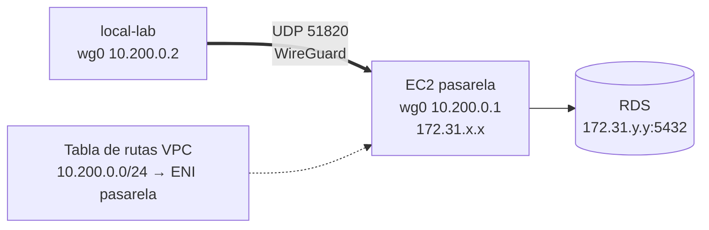

# UD06 · Prácticas



| Práctica | Tipo | Nivel | Horas | CE principales |
|---|---|---|--:|---|
| [6.1 Túneles SSH](#práctica-61--túneles-ssh) | Guiada | ●○○ | 1 | RA6: c |
| [6.2 VPN WireGuard entre la oficina y la VPC](#práctica-62--vpn-wireguard-entre-la-oficina-y-la-vpc) | Guiada | ●●● | 2,5 | RA6: b, c, d |
| [6.3 Replicación lógica de la nube a la oficina](#práctica-63--replicación-lógica-de-la-nube-a-la-oficina) | Guiada | ●●● | 2 | RA6: e, g |
| [6.4 S3 en la oficina con Garage](#práctica-64--s3-en-la-oficina-con-garage) | Guiada | ●●○ | 1 | RA6: e, f |
| [6.5 Infraestructura híbrida verificada](#práctica-65--infraestructura-híbrida-verificada) | Proyecto | ●●● | 1,5 | RA6: a – g |
| **Total** | | | **8 h** | |

> [!NOTE]
> Necesitas la base de datos RDS y el bastión de la UD04 (`ud04/lab/`). Plan de direccionamiento de las prácticas:
>
> | Red | Rango |
> |---|---|
> | VPC por defecto | `172.31.0.0/16` |
> | Túnel WireGuard | `10.200.0.0/24` (pasarela `.1`, oficina `.2`) |
> | Docker en `local-lab` | `172.17.0.0/16` (no se anuncia: sale por NAT de la propia máquina) |

---

## Práctica 6.1 · Túneles SSH



#### Objetivo

Acceder a la base de datos privada desde la oficina **sin abrirla a Internet**, con un reenvío de puertos SSH, y entender sus límites.

#### Desarrollo

{}

1. **Reenvío local**: el puerto 15432 de `local-lab` llega al 5432 de RDS a través del bastión.

    ```bash
    BASTION=$(cd ud04/lab && tofu output -raw bastion)
    RDS=$(cd ud04/lab && tofu output -raw endpoint)
    ssh -i labsuser.pem -N -L 15432:$RDS:5432 ec2-user@$BASTION &
    ```

2. **Conéctate** como si la base de datos estuviera en local. Con `verify-full` hay que indicar el nombre real del servidor; como conectas a `localhost`, usa `require` y entiende por qué es menos seguro:

    ```bash
    curl -fsSLo rds-ca.pem https://truststore.pki.rds.amazonaws.com/global/global-bundle.pem
    PGPASSWORD=... psql "host=localhost port=15432 dbname=taquilla user=analista sslmode=require" -c "select count(*) from venta;"
    ```

3. **Comprueba** desde el bastión que la conexión a RDS sale de su IP privada (`select inet_client_addr();`).

4. **Cierra** el túnel (`kill %1`) y comprueba que la conexión deja de funcionar.

5. **Reflexiona** en tus notas: ¿qué pasa si se cae la sesión SSH? ¿Sirve para una replicación continua? ¿Quién puede usar el puerto 15432 de `local-lab`?

{}

#### Comprobación

- [ ] Has consultado RDS desde `local-lab` sin que RDS sea pública.
- [ ] Sabes explicar por qué un túnel SSH sirve para administrar pero no como enlace permanente.

---

## Práctica 6.2 · VPN WireGuard entre la oficina y la VPC



#### Objetivo

Unir la red de la oficina (`local-lab`) con la VPC mediante una **VPN cifrada y enrutada** (sin NAT), de forma que `local-lab` llegue a la IP privada de RDS y los recursos de la VPC lleguen a la oficina.



#### Desarrollo

{}

1. **Genera las claves** de los dos extremos en `local-lab`:

    ```bash
    mkdir -p ~/wg && cd ~/wg && umask 077
    wg genkey | tee oficina.key | wg pubkey > oficina.pub
    wg genkey | tee nube.key    | wg pubkey > nube.pub
    ```

2. **Añade la pasarela** al laboratorio de la UD04 (`ud04/lab/vpn.tf`):

    ```hcl
    variable "wg_nube_key" {
      type      = string
      sensitive = true
    }
    variable "wg_oficina_pub" { type = string }

    data "aws_route_table" "principal" {
      vpc_id = data.aws_vpc.default.id
      filter {
        name   = "association.main"
        values = ["true"]
      }
    }

    resource "aws_security_group" "vpn" {
      name   = "ta-${var.alumno}-vpn"
      vpc_id = data.aws_vpc.default.id
      ingress {
        description = "WireGuard desde la oficina"
        from_port   = 51820
        to_port     = 51820
        protocol    = "udp"
        cidr_blocks = [var.mi_ip]
      }
      ingress {
        description = "Trafico de la VPC hacia la oficina"
        from_port   = 0
        to_port     = 0
        protocol    = "-1"
        cidr_blocks = [data.aws_vpc.default.cidr_block]
      }
      egress {
        from_port   = 0
        to_port     = 0
        protocol    = "-1"
        cidr_blocks = ["0.0.0.0/0"]
      }
    }

    resource "aws_instance" "vpn" {
      ami                    = data.aws_ssm_parameter.al2023.value
      instance_type          = "t3.micro"
      key_name               = "vockey"
      vpc_security_group_ids = [aws_security_group.vpn.id]
      source_dest_check      = false            # imprescindible para enrutar
      user_data              = <<-EOF
        #!/bin/bash
        dnf install -y wireguard-tools
        echo "net.ipv4.ip_forward = 1" > /etc/sysctl.d/90-wg.conf && sysctl --system
        cat > /etc/wireguard/wg0.conf <<WG
        [Interface]
        Address = 10.200.0.1/24
        ListenPort = 51820
        PrivateKey = ${var.wg_nube_key}

        [Peer]
        # oficina
        PublicKey = ${var.wg_oficina_pub}
        AllowedIPs = 10.200.0.2/32
        WG
        chmod 600 /etc/wireguard/wg0.conf
        systemctl enable --now wg-quick@wg0
      EOF
      tags = { Name = "ta-${var.alumno}-vpn" }
    }

    # La VPC envía a la pasarela el tráfico destinado a la oficina
    resource "aws_route" "a_oficina" {
      route_table_id         = data.aws_route_table.principal.id
      destination_cidr_block = "10.200.0.0/24"
      network_interface_id   = aws_instance.vpn.primary_network_interface_id
    }

    # RDS acepta conexiones desde la oficina
    resource "aws_vpc_security_group_ingress_rule" "bd_desde_oficina" {
      security_group_id = aws_security_group.bd.id
      cidr_ipv4         = "10.200.0.0/24"
      from_port         = 5432
      to_port           = 5432
      ip_protocol       = "tcp"
      description       = "PostgreSQL desde la oficina por la VPN"
    }

    output "vpn_ip" { value = aws_instance.vpn.public_ip }
    ```

    ```bash
    cd ud04/lab
    tofu apply -var alumno=$ALUMNO -var mi_ip=$(curl -s ifconfig.me)/32 \
      -var wg_nube_key="$(cat ~/wg/nube.key)" -var wg_oficina_pub="$(cat ~/wg/oficina.pub)"
    ```

    > [!WARNING]
    > La clave privada de la pasarela queda en el estado de OpenTofu y en los datos de usuario de la instancia. En producción se guardaría en Secrets Manager o en Parameter Store y la instancia la leería al arrancar.

3. **Configura la oficina** (`/etc/wireguard/wg0.conf` en `local-lab`):

    ```ini
    [Interface]
    Address = 10.200.0.2/24
    PrivateKey = <contenido de ~/wg/oficina.key>
    MTU = 1380

    [Peer]
    # pasarela en AWS
    PublicKey = <contenido de ~/wg/nube.pub>
    Endpoint = <vpn_ip>:51820
    AllowedIPs = 10.200.0.0/24, 172.31.0.0/16
    PersistentKeepalive = 25
    ```

    ```bash
    sudo chmod 600 /etc/wireguard/wg0.conf
    sudo systemctl enable --now wg-quick@wg0
    ```

4. **Verifica la disponibilidad** del enlace (CE RA6.b):

    ```bash
    sudo wg show                       # latest handshake: hace pocos segundos; transfer: datos en ambos sentidos
    ping -c 3 10.200.0.1
    ip route get 172.31.0.10           # sale por wg0
    ```

5. **Llega a RDS por su IP privada**, ahora con `verify-full` porque usas el nombre real:

    ```bash
    getent hosts $RDS                  # IP 172.31.x.x
    psql "host=$RDS dbname=taquilla user=analista sslmode=verify-full sslrootcert=rds-ca.pem" -c "select inet_client_addr();"
    ```

    `inet_client_addr()` devuelve `10.200.0.2`: no hay NAT, la VPC ve la IP real de la oficina.

6. **Comprueba el sentido contrario**: desde el bastión, `ping -c 3 10.200.0.2`. (Si `local-lab` tiene cortafuegos, permite ICMP desde `wg0`).

7. **Observa el tráfico** con los **registros de flujo de VPC** de la interfaz de la pasarela (CloudWatch Logs o S3) y localiza las conexiones UDP 51820 y las de `10.200.0.2` hacia el 5432.

8. **Prueba un fallo**: para WireGuard en la oficina (`sudo systemctl stop wg-quick@wg0`), comprueba qué pasa con `psql` y vuelve a levantarlo.

{}

#### Comprobación

- [ ] `wg show` muestra un *handshake* reciente y tráfico en los dos sentidos.
- [ ] `psql` desde la oficina a RDS funciona con `verify-full` y RDS ve `10.200.0.2`.
- [ ] El bastión hace `ping` a la oficina.

#### Problemas habituales

| Síntoma | Causa | Solución |
|---|---|---|
| Sin *handshake* | Puerto UDP 51820 cerrado o tu IP pública ha cambiado | Revisa el grupo de seguridad y `mi_ip` |
| *Handshake* pero sin llegar a RDS | Falta la ruta en la VPC, `source_dest_check` activo o regla del grupo de seguridad | Revisa los tres recursos |
| `psql` se queda colgado al hacer consultas grandes | MTU | Baja `MTU` a 1340 en los dos extremos |
| Tras reiniciar la sesión del laboratorio no hay túnel | La IP pública de la pasarela cambia al parar y arrancar | Actualiza `Endpoint` o usa una IP elástica |

---

## Práctica 6.3 · Replicación lógica de la nube a la oficina



#### Objetivo

Que la taquilla física tenga en su PostgreSQL local una **copia de solo lectura** de recintos, eventos y ventas con **segundos** de retraso, sin los datos personales de los clientes, y **vigilar** el retraso.

#### Desarrollo

{}

1. **Activa la replicación lógica** en RDS (parámetro estático: requiere reinicio):

    ```bash
    aws rds modify-db-parameter-group --db-parameter-group-name ta-$ALUMNO-pg17 \
      --parameters "ParameterName=rds.logical_replication,ParameterValue=1,ApplyMethod=pending-reboot"
    aws rds reboot-db-instance --db-instance-identifier ta-$ALUMNO-pg
    aws rds wait db-instance-available --db-instance-identifier ta-$ALUMNO-pg
    ```

    (Añade también el parámetro a `aws_db_parameter_group` en el código para no crear deriva.)

2. **En RDS** (como `taquilla_admin`), crea el usuario de replicación y la publicación **sin la tabla de clientes**:

    ```sql
    SHOW wal_level;                                   -- logical
    CREATE ROLE repl_oficina LOGIN PASSWORD 'Repl-Oficina-1';
    GRANT rds_replication TO repl_oficina;
    GRANT SELECT ON recinto, evento, venta TO repl_oficina;
    CREATE PUBLICATION pub_taquilla FOR TABLE recinto, evento, venta;
    ```

3. **En la oficina**, crea el suscriptor con el esquema vacío (sin los datos de ejemplo de `esquema.sql`):

    ```bash
    docker run -d --name taquilla-local -e POSTGRES_PASSWORD=local -p 127.0.0.1:5434:5432 postgres:17
    sleep 5
    pg_dump "host=$RDS dbname=taquilla user=taquilla_admin sslmode=verify-full sslrootcert=rds-ca.pem" \
      --schema-only --no-owner -t recinto -t evento -t cliente -t venta > esquema_rds.sql
    psql "host=127.0.0.1 port=5434 user=postgres password=local" -c "create database taquilla;"
    psql "host=127.0.0.1 port=5434 dbname=taquilla user=postgres password=local" -f esquema_rds.sql
    ```

    > [!NOTE]
    > Se crea también `cliente` (vacía) porque `venta` tiene una clave ajena hacia ella. Los procesos de replicación no comprueban esas claves en el suscriptor, así que las ventas llegan aunque los clientes no.

4. **Suscríbete** (la conexión sale del contenedor, cruza la VPN y llega a la IP privada de RDS):

    ```sql
    -- en taquilla-local
    CREATE SUBSCRIPTION sub_taquilla
      CONNECTION 'host=RDS_ENDPOINT dbname=taquilla user=repl_oficina password=Repl-Oficina-1 sslmode=require'
      PUBLICATION pub_taquilla;
    SELECT count(*) FROM venta;
    ```

5. **Mide la latencia** de replicación: inserta en RDS y mira cuándo llega (exporta antes `PGPASSWORD` con la contraseña de `taquilla_admin`).

    ```bash
    for i in 1 2 3 4 5; do
      psql "host=$RDS dbname=taquilla user=taquilla_admin sslmode=require" -qtAc \
        "insert into venta(id_evento,id_cliente,canal,entradas,importe) values (1,1,'web',1,10) returning id_venta" > /tmp/id
      t0=$(date +%s.%N)
      until [ "$(psql 'host=127.0.0.1 port=5434 dbname=taquilla user=postgres password=local' -qtAc \
               "select count(*) from venta where id_venta=$(cat /tmp/id)")" = "1" ]; do sleep 0.1; done
      echo "venta $(cat /tmp/id): $(awk "BEGIN{print $(date +%s.%N) - $t0}") s"
    done
    ```

6. **Monitoriza** en los dos extremos:

    ```sql
    -- RDS (publicador): retraso de cada ranura
    SELECT slot_name, active,
           pg_size_pretty(pg_wal_lsn_diff(pg_current_wal_lsn(), confirmed_flush_lsn)) AS retraso_wal
    FROM pg_replication_slots;
    -- oficina (suscriptor)
    SELECT subname, received_lsn, latest_end_lsn, last_msg_receipt_time FROM pg_stat_subscription;
    ```

    Y en CloudWatch, la métrica **`OldestReplicationSlotLag`** de la instancia. Crea una alarma si supera 100 MB.

7. **Simula un corte** de la VPN 5 minutos mientras haces inserciones en RDS. Observa cómo crece el retraso de la ranura y cómo se pone al día al volver el túnel.

8. **Limpia** correctamente (¡orden importante!):

    ```sql
    -- oficina
    DROP SUBSCRIPTION sub_taquilla;          -- borra también la ranura en RDS si hay conexión
    -- RDS: comprueba que no queda ninguna ranura
    SELECT slot_name FROM pg_replication_slots;
    -- si quedara: SELECT pg_drop_replication_slot('sub_taquilla');
    ```

{}

#### Comprobación

- [ ] La oficina recibe ventas nuevas en segundos y **no** tiene datos de clientes.
- [ ] Has medido la latencia y el retraso durante un corte.
- [ ] Al terminar no queda ninguna ranura de replicación en RDS.

---

## Práctica 6.4 · S3 en la oficina con Garage



#### Objetivo

Montar en la oficina un almacenamiento de objetos **compatible con S3** y sincronizarlo con el bucket de AWS usando la misma herramienta en los dos lados.

#### Desarrollo

{}

1. **Configura y arranca Garage** (consulta la versión más reciente en su web y ajusta la etiqueta):

    ```bash
    mkdir -p ~/garage && cd ~/garage
    cat > garage.toml <<EOF
    metadata_dir = "/var/lib/garage/meta"
    data_dir = "/var/lib/garage/data"
    db_engine = "sqlite"
    replication_factor = 1
    rpc_bind_addr = "[::]:3901"
    rpc_public_addr = "127.0.0.1:3901"
    rpc_secret = "$(openssl rand -hex 32)"

    [s3_api]
    s3_region = "garage"
    api_bind_addr = "[::]:3900"
    root_domain = ".s3.garage.localhost"

    [admin]
    api_bind_addr = "[::]:3903"
    admin_token = "$(openssl rand -base64 32)"
    EOF
    docker run -d --name garage --restart unless-stopped -p 127.0.0.1:3900:3900 \
      -v $PWD/garage.toml:/etc/garage.toml -v garage-meta:/var/lib/garage/meta -v garage-data:/var/lib/garage/data \
      dxflrs/garage:v2.3.0
    ```

2. **Inicializa** el nodo, crea el bucket y una clave de acceso:

    ```bash
    alias garage="docker exec garage /garage"
    NODO=$(garage status | awk '/NO ROLE ASSIGNED/ {print $1}')
    garage layout assign -z oficina -c 20G $NODO
    garage layout apply --version 1
    garage bucket create escaneos
    garage key create oficina-sync
    garage bucket allow --read --write --owner escaneos --key oficina-sync
    garage key info oficina-sync --show-secret        # apunta Key ID y Secret key
    ```

3. **Úsalo con las herramientas de siempre**:

    ```bash
    cat >> ~/.config/rclone/rclone.conf <<'EOF'

    [garage]
    type = s3
    provider = Other
    endpoint = http://127.0.0.1:3900
    region = garage
    access_key_id = GKxxxxxxxx
    secret_access_key = xxxxxxxx
    EOF
    rclone copy ~/oficina/escaneos garage:escaneos -P
    AWS_ACCESS_KEY_ID=GKxxxx AWS_SECRET_ACCESS_KEY=xxxx aws --endpoint-url http://127.0.0.1:3900 --region garage s3 ls s3://escaneos | head
    ```

4. **Sincroniza la oficina con la nube** de servidor S3 a servidor S3:

    ```bash
    rclone sync garage:escaneos aws:$BUCKET/oficina/garage-escaneos --checksum --transfers 16 -P
    rclone check garage:escaneos aws:$BUCKET/oficina/garage-escaneos
    ```

5. **Exportación manual supervisada** (CE RA6.f): exporta un listado firmado de lo transferido para el registro de la oficina.

    ```bash
    rclone lsjson aws:$BUCKET/oficina/garage-escaneos --hash --files-only > exportacion_$(date +%F).json
    sha256sum exportacion_*.json > exportacion.sha256
    ```

{}

#### Comprobación

- [ ] La CLI de AWS y rclone funcionan contra Garage cambiando solo el punto de enlace.
- [ ] `rclone check` entre Garage y S3 no encuentra diferencias.

---

## Práctica 6.5 · Infraestructura híbrida verificada



#### Requisitos

1. **Documentación de referencia** en `ud06/README.md`: diagrama (Mermaid), plan de direccionamiento, inventario, puertos y protocolos, flujos de datos con su latencia máxima y los parámetros de seguridad.
2. **Script `verificar.sh`** que compruebe **automáticamente** que la realidad coincide con la documentación y devuelva un resumen OK/KO y un código de salida. Como mínimo:
    - `tofu plan -detailed-exitcode` sin cambios (sin deriva).
    - Túnel WireGuard con *handshake* de menos de 3 minutos.
    - RDS accesible por la VPN con TLS y **no** accesible desde Internet.
    - Grupo de seguridad de RDS sin `0.0.0.0/0`.
    - Suscripción de replicación activa y retraso menor que el documentado.
    - Última sincronización Garage → S3 correcta hace menos de lo documentado.
3. **Monitorización centralizada**: las métricas personalizadas (`SyncOK`, retraso de replicación, estado del túnel) publicadas en CloudWatch desde la oficina y un **panel** (*dashboard*) con todas ellas, más las alarmas correspondientes.
4. **Procedimientos** escritos y probados de importación/exportación manual para cuando la sincronización automática no esté disponible.
5. **Comparativa razonada** con una Site-to-Site VPN gestionada y con Direct Connect para la oficina real de TaquillaAlacant (disponibilidad en Alicante/Madrid, coste mensual, ancho de banda).

#### Comprobación

- [ ] `verificar.sh` devuelve todo OK y detecta un fallo provocado (por ejemplo, abrir el grupo de seguridad a `0.0.0.0/0` a mano).
- [ ] El panel de CloudWatch muestra los tres indicadores con datos reales.
- [ ] La documentación coincide con lo desplegado.

#### Limpieza

Elimina la suscripción y la ranura (práctica 6.3), para WireGuard en la oficina y destruye la pasarela: `tofu destroy` del laboratorio si has terminado con las bases de datos.
