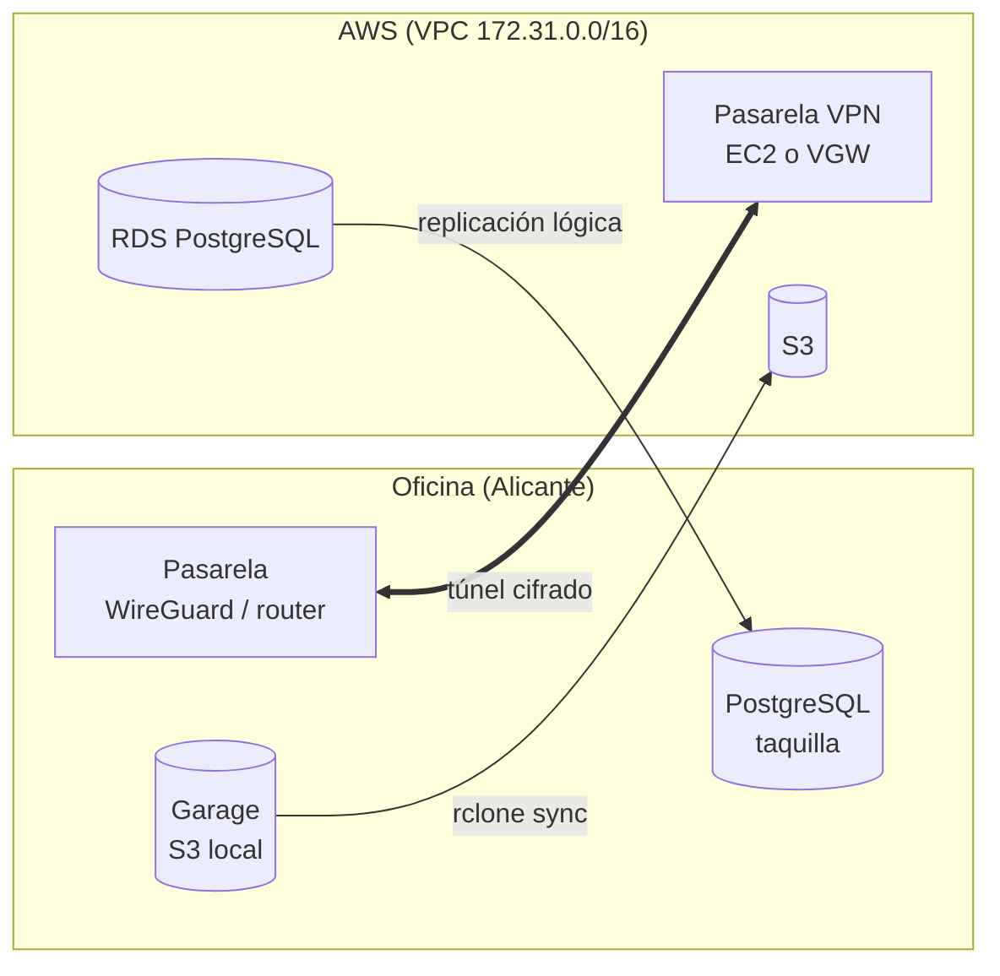

# UD06 · Nube híbrida

## Resumen del tema

Una **infraestructura de datos híbrida** combina sistemas locales (la oficina, un centro de datos propio) con servicios del proveedor, conectados de forma segura y con los datos sincronizados. Administrarla es más difícil que administrar cada parte por separado: hay más piezas, más red, más puntos de fallo y más sitios donde una configuración puede no coincidir con lo que dice la documentación.



### Objetivos de aprendizaje

- Describir arquitecturas híbridas de datos y sus motivos.
- Verificar que una configuración desplegada coincide con su documentación de referencia.
- Comprobar la disponibilidad de conexiones seguras avanzadas y configurar SSH, VPN o redes privadas.
- Elegir el mecanismo de sincronización según la latencia exigida.
- Monitorizar y auditar el recorrido completo de los datos, de la oficina a la nube y vuelta.

---

## 1. ¿Por qué híbrida?

| Motivo | Ejemplo |
|---|---|
| **Latencia local** | La taquilla física debe vender aunque se caiga Internet |
| **Normativa o contratos** | Ciertos datos deben quedarse en las instalaciones |
| **Inversión existente** | Servidores y cabinas amortizándose |
| **Migración gradual** | Mover un sistema cada trimestre en lugar de todo de golpe |
| **Recuperación ante desastres** | Copias de lo local en la nube, o de la nube en local |
| **Proceso en el borde** | Sensores o cámaras que generan más datos de los que se pueden subir |

---

## 2. Documentación de referencia y verificación (CE RA6.a)

Una infraestructura híbrida debe estar **documentada** y la documentación debe **coincidir con la realidad**. La documentación de referencia incluye:

- **Diagrama** de red y de flujos de datos (qué va de dónde a dónde, con qué protocolo y cada cuánto).
- **Plan de direccionamiento**: rangos de la oficina y de la VPC **sin solaparse**.
- **Inventario**: recursos, versiones, puertos, responsables.
- **Parámetros de seguridad**: algoritmos de cifrado, puertos abiertos, quién accede.
- **Requisitos de sincronización**: latencia máxima, RPO, ventanas.

Formas de **verificar** que lo implementado coincide:

| Método | Qué detecta |
|---|---|
| `tofu plan` sobre la IaC | **Deriva** (*drift*): cambios hechos a mano fuera del código |
| **AWS Config** con reglas | Recursos que incumplen una regla (volumen sin cifrar, grupo de seguridad abierto…) |
| Scripts de verificación | Comparan valores reales (`describe-*`, `wg show`, `psql`) con los esperados y devuelven OK/KO |
| Listas de comprobación | Lo que no se puede automatizar (precintos, accesos físicos) |
| Pruebas funcionales | Que los datos llegan de verdad de un lado a otro en el tiempo previsto |

> [!TIP]
> Trata la documentación como código: guárdala en el mismo repositorio que la IaC y los scripts de verificación, y revísala en cada cambio. Un script `verificar.sh` que se ejecuta cada día y avisa si algo ha cambiado vale más que un PDF perfecto que nadie lee.

---

## 3. Conectividad (CE RA6.b, RA6.c)

| Opción | Cifrado | Ancho de banda | Coste | Cuándo |
|---|---|---|---|---|
| **Túnel SSH** (reenvío de puertos) | Sí (SSH) | Limitado | Casi nulo | Administración puntual, pruebas |
| **VPN de software** (WireGuard, OpenVPN, strongSwan en una instancia) | Sí | Lo que dé la instancia | Instancia + transferencia | Laboratorios, oficinas pequeñas, cuando el proveedor gestionado no está disponible |
| **AWS Site-to-Site VPN** | Sí (IPsec, **dos túneles** redundantes) | Del orden de 1,25 Gbps por túnel | Por hora de conexión + transferencia | Lo estándar para unir una sede con la VPC |
| **AWS Client VPN** | Sí (TLS) | Por usuario | Por hora y por conexión | Usuarios remotos individuales |
| **AWS Direct Connect** | **No por defecto** (enlace privado); se añade MACsec o VPN encima | 1, 10, 100 Gbps (o menos con conexiones alojadas de socios) | Puerto + transferencia (más barata) | Mucho volumen, latencia estable, requisitos de red privada |
| **PrivateLink / puntos de enlace de VPC** | Tráfico privado dentro de AWS | — | Por hora y por GB (interfaz) | Acceder a servicios (S3, KMS…) sin salir a Internet, también desde la oficina a través de la VPN |

### 3.1 Verificar la disponibilidad (CE RA6.b)

Antes de diseñar con una conexión «avanzada» hay que comprobar que **existe y funciona**:

- **Direct Connect**: ¿hay una **ubicación** cerca? (en España hay ubicaciones en Madrid) ¿Algún socio ofrece una conexión alojada hasta la oficina? ¿Plazos de instalación?
- **Site-to-Site VPN**: ¿la oficina tiene una **IP pública fija** y un equipo compatible con IPsec/IKEv2? En la consola, el **estado de cada túnel** (`UP`/`DOWN`) y la métrica `TunnelState` de CloudWatch.
- **VPN de software**: `wg show` (último *handshake*), `ping`/`mtr` a través del túnel, MTU correcta.
- Siempre: **rangos IP sin solapamiento** y rutas en ambos sentidos.

> [!NOTE]
> En el Learner Lab, `local-lab` está detrás del NAT de VirtualBox y de tu router, sin IP pública fija. Por eso en las prácticas el túnel lo inicia **la oficina** hacia una instancia EC2 con WireGuard: es la misma idea que una Site-to-Site VPN, pero funcionando desde cualquier red.

### 3.2 Enrutamiento

Para que los dos lados se vean **sin NAT**, cada lado necesita una **ruta** hacia el rango del otro a través de la pasarela:

- En la VPC: una entrada en la **tabla de rutas** `10.200.0.0/24 → interfaz de la instancia VPN` (y desactivar la **comprobación de origen/destino** de esa instancia).
- En la oficina: la ruta hacia `172.31.0.0/16` por el túnel (WireGuard la crea con `AllowedIPs`).
- Los **grupos de seguridad** de los recursos de AWS deben aceptar el tráfico desde el rango de la oficina, solo en los puertos necesarios.

---

## 4. Almacenamiento híbrido

| Servicio | Lo que ve la oficina | Dónde están los datos | Uso |
|---|---|---|---|
| **S3 File Gateway** | Carpeta NFS o SMB, con caché local | Objetos en S3 | Llevar ficheros a S3 sin cambiar las aplicaciones; copias |
| **Volume Gateway** | Disco iSCSI (en caché o almacenado) | S3 + instantáneas de EBS | Copias de servidores locales |
| **Tape Gateway** | Biblioteca de cintas virtual | S3 / Glacier | Sustituir cintas sin cambiar el software de copias |
| **AWS Outposts** | Bastidores de AWS en tu centro de datos | Local | Servicios de AWS con latencia local |
| **Almacenamiento S3 local** (Garage, Ceph…) | API S3 en la oficina | Local, sincronizable con S3 | Mismas herramientas en los dos lados |

Equivalentes en otros proveedores: Azure File Sync, Azure Arc y Azure Local; Google Distributed Cloud.

---

## 5. Bases de datos híbridas

| Mecanismo | Latencia | Sentido | Notas |
|---|---|---|---|
| **Replicación lógica de PostgreSQL** (publicación/suscripción) | Segundos | Elegido por tablas | Nativa; RDS puede publicar o suscribirse (`rds.logical_replication = 1`) |
| **Replicación de MySQL/MariaDB** (binlog) | Segundos | Origen → réplica | Réplica externa de RDS o RDS como réplica |
| **AWS DMS con CDC** | Segundos a minutos | Origen → destino, incluso entre motores | Necesita una instancia de replicación |
| **Exportación/importación programada** | Horas | Uno | `pg_dump`, CSV, la UD05 |

> [!WARNING]
> Una **ranura de replicación** (*replication slot*) que nadie consume **retiene el WAL** en el origen y llena el almacenamiento. Si apagas la oficina o borras la suscripción, **elimina la ranura** en el publicador y vigila la métrica `OldestReplicationSlotLag` de RDS.

---

## 6. Seguridad, monitorización y auditoría de extremo a extremo (CE RA6.d)

| Capa | Seguridad | Monitorización | Auditoría |
|---|---|---|---|
| Red | Cifrado del túnel; grupos de seguridad mínimos; rangos concretos | Estado del túnel, latencia, pérdida | Registros de flujo de VPC (*VPC Flow Logs*) |
| Acceso | Credenciales por proceso, mínimo privilegio, rotación | Fallos de autenticación | CloudTrail, registros del motor |
| Datos | TLS además del túnel (defensa en profundidad), cifrado en reposo en los dos lados | Retraso de replicación, última sincronización | `pgaudit`, registros de rclone/DataSync |
| Sistemas locales | Parches, copias, acceso físico | **Agente de CloudWatch** en los servidores locales para centralizar métricas y registros | Registro centralizado |

---

## 7. Sincronización según la latencia (CE RA6.e, RA6.f, RA6.g)

| Requisito de latencia | Mecanismo recomendado |
|---|---|
| Segundos | Replicación de la base de datos (lógica, binlog, DMS CDC) |
| Minutos | Sincronización programada frecuente (rclone, DataSync cada hora), eventos de S3 |
| Horas | Exportación/importación nocturna supervisada |
| Bajo demanda | Importación o exportación manual con su procedimiento y validación |

Cada mecanismo necesita su **monitorización**: retraso de la réplica (`pg_stat_subscription`, `ReplicaLag`), hora de la última sincronización correcta (métrica personalizada, como en la UD05), resultado de cada importación manual (registro firmado por quien la hace) y una alarma si se supera la latencia comprometida.

---

## 8. Errores frecuentes

| Problema | Causa | Solución |
|---|---|---|
| El túnel está levantado pero no hay tráfico | Falta la ruta de vuelta en la VPC o la comprobación de origen/destino está activa | Ruta en la tabla de la VPC y `source_dest_check = false` |
| Funciona `ping` pero no `psql` | El grupo de seguridad de RDS no admite el rango de la oficina | Regla 5432 desde `10.200.0.0/24` |
| Conexiones que se cuelgan con paquetes grandes | MTU del túnel | Bajar la MTU de la interfaz del túnel (1380 – 1420) |
| Los rangos se solapan | La oficina usa `172.31.x.x` como la VPC por defecto | Planificar el direccionamiento antes; re-numerar un lado |
| El almacenamiento de RDS se llena solo | Ranura de replicación sin consumidor | Eliminar la ranura; alarma sobre `OldestReplicationSlotLag` |
| La documentación dice una cosa y la consola otra | Cambios manuales | `tofu plan` y scripts de verificación periódicos |

## 9. Resumen

- Híbrido = local + nube, conectados y sincronizados. Más piezas, más necesidad de documentación verificable.
- Conectividad: SSH para lo puntual, VPN (gestionada o de software) para unir sedes, Direct Connect para volumen y estabilidad; siempre cifrado y con rutas en ambos sentidos.
- Pasarelas de almacenamiento y S3 local para ficheros; replicación lógica o DMS para bases de datos.
- Elige la sincronización por la latencia exigida y vigila cada mecanismo con su métrica y su alarma.
- Verifica la configuración contra la referencia de forma automática y periódica.

## 10. Autoevaluación


- q: "¿Qué opción de conectividad **no** cifra el tráfico por sí misma?"
  options: ["Site-to-Site VPN", "WireGuard", "Direct Connect", "Túnel SSH"]
  answer: 2
  explain: "Direct Connect es un enlace privado; para cifrar se usa MACsec o una VPN por encima."
- q: "El túnel WireGuard está activo, la oficina llega a la instancia VPN pero no a RDS. ¿Qué es lo más probable?"
  options: ["El certificado de RDS", "Falta la ruta hacia la oficina en la VPC o la regla del grupo de seguridad de RDS", "La clave KMS", "El tamaño de la instancia"]
  answer: 1
  explain: "RDS tiene que poder responder (ruta de vuelta) y aceptar el origen (grupo de seguridad)."
- q: "¿Cómo detectas que alguien ha cambiado a mano un grupo de seguridad definido en OpenTofu?"
  options: ["Con `tofu plan`", "Con `pg_dump`", "Con `rclone check`", "No se puede"]
  answer: 0
  explain: "plan compara el estado real con el código y muestra la deriva."
- q: "La taquilla necesita ver las ventas de la web con menos de 10 segundos de retraso. ¿Qué mecanismo eliges?"
  options: ["Exportación nocturna", "rclone cada hora", "Replicación lógica de PostgreSQL", "Transferencia física"]
  answer: 2
  explain: "Solo la replicación de la base de datos da latencias de segundos."
- q: "Has borrado la suscripción en la oficina pero no la ranura en RDS. ¿Qué pasará?"
  options: ["Nada", "RDS retendrá WAL y el almacenamiento irá creciendo", "Se borrará la base de datos", "Se desactivará el cifrado"]
  answer: 1
  explain: "La ranura impide liberar el WAL que el suscriptor no ha confirmado."


## Referencias

- AWS Site-to-Site VPN — <https://docs.aws.amazon.com/vpn/latest/s2svpn/>
- AWS Direct Connect y ubicaciones — <https://aws.amazon.com/directconnect/locations/>
- AWS Storage Gateway — <https://docs.aws.amazon.com/storagegateway/>
- WireGuard — <https://www.wireguard.com/quickstart/>
- PostgreSQL: *Logical Replication* — <https://www.postgresql.org/docs/current/logical-replication.html>
- *Logical replication for RDS for PostgreSQL* — <https://docs.aws.amazon.com/AmazonRDS/latest/UserGuide/PostgreSQL.Concepts.General.FeatureSupport.LogicalReplication.html>
- AWS Config — <https://docs.aws.amazon.com/config/latest/developerguide/>
