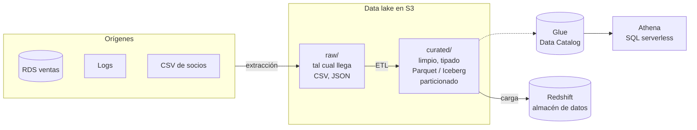

# UD07 · Analítica de datos (OLAP)

## Resumen del tema

Una base de datos **OLTP** (la de ventas) está pensada para muchas transacciones pequeñas: insertar una venta, consultar un evento. Un sistema **OLAP** está pensado para pocas consultas enormes: sumar cinco años de ventas por mes, canal y recinto. En la nube, lo habitual es separar los dos mundos: los datos se **extraen**, se **transforman** y se **cargan** (ETL) en un *data lake* o en un almacén de datos, y allí se analizan. Tu trabajo como administrador es el de siempre: región, cifrado, acceso, retención y organización de los datos, supervisión de los procesos, copias y rendimiento.



### Objetivos de aprendizaje

- Distinguir OLTP y OLAP, data lake, almacén de datos y *lakehouse*.
- Conocer los formatos y servicios analíticos: Parquet, Iceberg, Glue, Athena, Redshift.
- Configurar el cifrado y los permisos de un sistema analítico mediante IaC.
- Configurar la retención, el particionado y la compactación equilibrando disponibilidad y coste.
- Supervisar las cargas y transformaciones, y monitorizar el rendimiento y el espacio.
- Proteger los datos analíticos con replicación y copias.

---

## 1. OLTP frente a OLAP

| | OLTP (RDS, DynamoDB) | OLAP (Athena, Redshift, BigQuery…) |
|---|---|---|
| Operaciones | Muchas, pequeñas, de lectura y escritura | Pocas, enormes, casi solo lectura |
| Datos por consulta | Unas filas | Millones o miles de millones de filas |
| Modelo | Normalizado (3FN) | Desnormalizado: **hechos** y **dimensiones** (estrella) |
| Almacenamiento | Por filas | **Por columnas** |
| Objetivo | Latencia baja y consistencia | Rendimiento de lectura y coste por consulta |

Ejecutar informes pesados sobre la base de datos OLTP compite con las ventas. Por eso los datos se copian a un sistema analítico, con un retraso aceptable (horas, minutos).

### 1.1 Data lake, almacén de datos y lakehouse



| Concepto | Qué es | En AWS |
|---|---|---|
| **Data lake** | Ficheros en almacenamiento de objetos, en bruto y transformados, con un catálogo | S3 + Glue Data Catalog |
| **Almacén de datos** (*data warehouse*) | Base de datos columnar con almacenamiento propio, muy optimizada | Redshift |
| **Lakehouse** | Data lake con **formatos de tabla** (Iceberg) que añaden transacciones, borrados y versiones | S3 + Iceberg (S3 Tables) + Athena/Redshift |

Equivalentes: Azure Data Lake Storage + Synapse/Fabric; Google Cloud Storage + BigQuery.

---

## 2. Formatos: por qué Parquet

| Formato | Organización | Compresión | Lee solo las columnas necesarias | Tipos |
|---|---|---|---|---|
| CSV | Filas, texto | Ninguna o del fichero entero | No | No |
| JSON | Filas, texto | Ídem | No | Parciales |
| **Parquet** | **Columnas**, binario, por bloques | Por columna (Snappy, ZSTD) | **Sí** | Sí, con estadísticas min/máx por bloque |

Con Parquet, una consulta que suma `importe` por `canal` lee **dos columnas** de doce, y puede **saltarse** bloques enteros gracias a las estadísticas. En servicios que cobran por datos leídos (Athena), eso es dinero.

**Apache Iceberg** es un **formato de tabla** por encima de Parquet: guarda metadatos con la lista de ficheros de cada versión de la tabla. Aporta `INSERT`, `UPDATE`, `DELETE` y `MERGE` transaccionales, **viaje en el tiempo** (consultar la tabla como estaba ayer), evolución del esquema y del particionado, y operaciones de **compactación** y **limpieza** de versiones. **S3 Tables** es un tipo de bucket de S3 que gestiona tablas Iceberg y hace la compactación automáticamente.

---

## 3. Los servicios analíticos

| Servicio | Qué hace | Cómo cobra (orientativo) |
|---|---|---|
| **Glue Data Catalog** | Metadatos: bases de datos, tablas, columnas, particiones, ubicación en S3 | Por objeto almacenado y petición (franja gratuita amplia) |
| **Glue Crawler** | Recorre S3 e infiere tablas y particiones | Por tiempo de ejecución (DPU-hora) |
| **Glue ETL** | Trabajos Spark o Python para transformar | Por DPU-hora |
| **Athena** | SQL *serverless* (motor Trino) sobre S3 | Por **TB escaneado** (con mínimo por consulta) o capacidad reservada |
| **Redshift** | Almacén de datos: aprovisionado (nodos RA3) o *Serverless* (RPU) | Por hora de nodo o por RPU-hora; almacenamiento gestionado aparte |
| **Lake Formation** | Permisos finos (tabla, columna, fila) sobre el catálogo | Sin coste adicional por los permisos |

---

## 4. Región y replicación (CE RA7.a)

- El lago, el catálogo, el grupo de trabajo de Athena y su bucket de **resultados** deben estar en la **misma región**: consultar datos de otra región añade latencia y coste de transferencia.
- La residencia de los datos personales aplica igual que en OLTP: si el lago tiene códigos postales o correos de clientes, va en una región europea.
- **Replicación**: el lago (S3) con CRR; Redshift con **copia de instantáneas entre regiones**; el catálogo, recreándolo con IaC o exportándolo.

---

## 5. Cifrado (CE RA7.b)

| Elemento | Cómo se cifra |
|---|---|
| Datos del lago (S3) | SSE-KMS con clave propia en los buckets `raw` y `curated` (UD02) |
| **Resultados de Athena** | Configuración del **grupo de trabajo** (`SSE_KMS` + clave), **forzada** para que nadie la cambie |
| Glue Data Catalog | *Data Catalog settings*: cifrado de metadatos y de contraseñas de conexiones con KMS |
| Trabajos de Glue | *Security configuration*: cifrado de lo que escriben en S3, de los registros de CloudWatch y de los marcadores |
| Redshift | Cifrado del clúster o del espacio de nombres con KMS; TLS obligatorio (`require_ssl`) |

```hcl
resource "aws_athena_workgroup" "analistas" {
  name = "ta-${var.alumno}-analistas"
  configuration {
    enforce_workgroup_configuration    = true
    publish_cloudwatch_metrics_enabled = true
    bytes_scanned_cutoff_per_query     = 1073741824        # 1 GB por consulta como máximo
    result_configuration {
      output_location = "s3://${aws_s3_bucket.resultados.bucket}/athena/"
      encryption_configuration {
        encryption_option = "SSE_KMS"
        kms_key_arn       = aws_kms_key.lago.arn
      }
    }
  }
  force_destroy = true
}
```

---

## 6. Visibilidad, acceso, monitorización y auditoría (CE RA7.c)

**Perfiles** típicos y qué pueden hacer:

| Perfil | Permisos |
|---|---|
| Ingeniería de datos | Escribir en `raw/` y `curated/`, crear tablas, ejecutar trabajos de ETL |
| Analistas | Consultar `curated` desde **su grupo de trabajo**, sin columnas de datos personales |
| Dirección | Ver los paneles (QuickSight u otra herramienta) |
| Auditoría | Leer registros de CloudTrail y del lago |

Herramientas:

- **Políticas IAM** sobre S3, Glue y Athena (por ejemplo, `athena:StartQueryExecution` solo en el grupo de trabajo `analistas`).
- **Lake Formation** para dar permisos a nivel de **columna** o **fila** sin crear vistas ni copias.
- **Grupos de trabajo de Athena**: separan usuarios, fuerzan el cifrado de resultados, limitan los datos escaneados por consulta y publican métricas.
- **CloudTrail** registra quién ejecutó cada consulta (`StartQueryExecution`) y quién cambió el catálogo; Redshift tiene su propio **registro de auditoría** (conexiones, usuarios, sentencias).

---

## 7. Retención, particionado y compactación (CE RA7.d)

### 7.1 Particionado

Particionar es organizar los ficheros en carpetas según una columna, para que las consultas **solo lean** las carpetas necesarias:

```text
s3://ta-lmartinez-lago-7f3a/curated/ventas/anio=2024/mes=6/part-00000.zstd.parquet
s3://ta-lmartinez-lago-7f3a/curated/ventas/anio=2024/mes=7/part-00000.zstd.parquet
```

```sql
-- Lee solo junio de 2024 (poda de particiones)
SELECT canal, sum(importe) FROM ventas_parquet WHERE anio = 2024 AND mes = 6 GROUP BY canal;
```

Reglas: particiona por las columnas por las que **más se filtra** (normalmente la fecha); evita particiones demasiado pequeñas (muchos ficheros de pocos KB) o demasiadas (decenas de miles). Con **proyección de particiones** Athena calcula las particiones sin consultar el catálogo; con Iceberg el particionado es **oculto** (`PARTITIONED BY (month(fecha_venta))`) y no hace falta poner `anio`/`mes` en las consultas.

### 7.2 Compactación

Las cargas frecuentes generan **muchos ficheros pequeños**, que hacen las consultas lentas (cada fichero es una petición y un arranque) y caras. **Compactar** es reescribirlos en pocos ficheros grandes (de 128 MB a 1 GB):

- Tablas Iceberg en Athena: `OPTIMIZE tabla REWRITE DATA USING BIN_PACK`.
- Tablas Hive/Parquet: reescribir la partición con `INSERT`/CTAS o con un trabajo de Glue.
- S3 Tables: automática.

### 7.3 Retención

Equilibrar **disponibilidad de los datos** y **coste**:

| Zona | Retención típica | Mecanismo |
|---|---|---|
| `raw/` | 30 – 90 días (se puede regenerar desde el origen) | Ciclo de vida de S3: borrado o paso a Glacier |
| `curated/` | Los años que exija el negocio o la ley | Borrar particiones antiguas; Glacier Instant Retrieval para años poco consultados |
| Versiones de Iceberg | Días | `VACUUM` con `vacuum_max_snapshot_age_seconds` |
| Resultados de Athena | Días | Ciclo de vida del bucket de resultados |
| Instantáneas de Redshift | Según el RPO | Retención de instantáneas automáticas y manuales |

---

## 8. Supervisar la ETL (CE RA7.e)

Una carga que falla en silencio produce **informes equivocados**, que es peor que no tener informes. Supervisar es:

| Qué | Dónde |
|---|---|
| Estado de cada ejecución (correcta, fallida, tiempo agotado) | Consola de Glue (*Job runs*), historial de consultas de Athena, `aws glue get-job-runs`, `aws athena get-query-execution` |
| Tiempo de ejecución y datos procesados | Métricas de Glue y Athena en CloudWatch (`TotalExecutionTime`, `ProcessedBytes`) |
| Registros y errores | CloudWatch Logs (`/aws-glue/jobs/output`, `/aws-glue/jobs/error`) |
| Alertas | Reglas de **EventBridge** sobre el cambio de estado (`FAILED`, `TIMEOUT`) → SNS |
| Calidad de los datos | Recuentos y sumas de control antes y después (como en la UD05); **Glue Data Quality** |

Y en la configuración de cada proceso: **tiempo máximo** (*timeout*), **reintentos** limitados, **marcadores** (*job bookmarks*) para procesar solo lo nuevo, y una ejecución **idempotente** (repetirla no duplica datos).

---

## 9. Replicación y copias (CE RA7.f)

| Elemento | Protección |
|---|---|
| Ficheros del lago | **Versionado** de S3, **replicación** a otra región, AWS Backup para S3 |
| Tablas Iceberg | **Viaje en el tiempo** (hasta que `VACUUM` borra las versiones) + versionado de S3 |
| Catálogo de Glue | Definido en **IaC** (se recrea) o exportado periódicamente (`get-tables`) |
| Redshift | Instantáneas automáticas (retención configurable), manuales y **copia entre regiones** |
| Código de ETL y consultas | Repositorio Git |

---

## 10. Rendimiento y espacio (CE RA7.g)

- **Athena**: datos escaneados y tiempo de cada consulta (historial y métricas del grupo de trabajo); `EXPLAIN ANALYZE` muestra qué fases tardan y cuánto leen. Si una consulta escanea mucho: ¿Parquet? ¿filtra por la partición? ¿selecciona solo las columnas necesarias?
- **Espacio**: tamaño de cada prefijo del lago (S3 Storage Lens, `aws s3 ls --summarize`), número de ficheros por partición (ficheros pequeños), crecimiento mensual.
- **Redshift**: `PercentageDiskSpaceUsed`, duración de las consultas, colas de WLM, tablas sin ordenar o con estadísticas antiguas (`SVV_TABLE_INFO`).

> [!TIP]
> En local, **DuckDB** lee Parquet (y CSV) con SQL y es ideal para probar el particionado y la compresión antes de pagar por escanear datos en la nube.

---

## 11. Errores frecuentes

| Problema | Causa | Solución |
|---|---|---|
| La consulta de Athena escanea todo el lago | CSV, sin particiones o sin filtrar por ellas | Parquet, particionado y `WHERE` sobre la partición |
| `HIVE_PARTITION_SCHEMA_MISMATCH` o tabla vacía | Particiones no registradas en el catálogo | `MSCK REPAIR TABLE`, rastreador o proyección de particiones |
| Consultas cada vez más lentas | Ficheros pequeños por cargas frecuentes | Compactar |
| Un analista ve correos de clientes | Permisos por tabla, no por columna | Lake Formation o una tabla/vista sin esas columnas |
| La ETL «funciona» pero faltan datos | Sin validación ni alertas | Recuentos de control y regla de EventBridge |
| El lago crece sin control | `raw/` sin retención, versiones de Iceberg sin `VACUUM` | Ciclo de vida y `VACUUM` programado |

## 12. Resumen

- OLTP para operar, OLAP para analizar; se separan para no competir.
- Data lake (S3 + Glue + Athena) o almacén de datos (Redshift); Iceberg une ambos mundos.
- Parquet y particionado reducen datos leídos, tiempo y coste; compactar evita los ficheros pequeños.
- Cifrado del lago, de los resultados y del catálogo con KMS mediante IaC; permisos por perfil con IAM, grupos de trabajo y Lake Formation.
- Supervisar la ETL: estado, tiempo, registros, alertas y validación de datos.
- Copias: versionado y replicación del lago, catálogo como código, instantáneas de Redshift.

## 13. Autoevaluación


- q: "¿Por qué una consulta sobre Parquet suele escanear muchos menos datos que sobre CSV?"
  options: ["Porque Parquet no guarda todas las filas", "Porque es columnar, comprimido y tiene estadísticas por bloque", "Porque Athena no cobra por Parquet", "Porque está cifrado"]
  answer: 1
  explain: "Solo lee las columnas que necesita y puede saltarse bloques gracias a las estadísticas."
- q: "Las ventas están particionadas por `anio` y `mes`. ¿Qué consulta aprovecha el particionado?"
  options: ["`WHERE year(fecha_venta) = 2024`", "`WHERE anio = 2024 AND mes = 6`", "`ORDER BY fecha_venta`", "`SELECT *`"]
  answer: 1
  explain: "El filtro debe ir sobre las columnas de partición (en tablas Hive) para podar carpetas."
- q: "¿Dónde se fuerza que los resultados de Athena se guarden cifrados con tu clave?"
  options: ["En cada consulta", "En la configuración del grupo de trabajo, con la opción de forzarla", "En Glue Crawler", "En CloudTrail"]
  answer: 1
  explain: "El grupo de trabajo define la ubicación y el cifrado de los resultados y puede impedir que los usuarios los cambien."
- q: "Una tabla Iceberg recibe un INSERT cada 5 minutos y las consultas son cada vez más lentas. ¿Qué haces?"
  options: ["Pasar a CSV", "`OPTIMIZE ... REWRITE DATA USING BIN_PACK` y `VACUUM` periódicos", "Quitar el particionado", "Cambiar de región"]
  answer: 1
  explain: "Compactar reúne los ficheros pequeños; VACUUM elimina versiones antiguas."
- q: "¿Cómo te enteras de que un trabajo de Glue ha fallado esta noche?"
  options: ["Mirando la consola por la mañana", "Regla de EventBridge sobre el estado FAILED que avisa por SNS", "Con S3 Storage Lens", "No hace falta"]
  answer: 1
  explain: "Las alertas automáticas son parte de la supervisión de la ETL."
- q: "¿Qué protege el catálogo de Glue frente a un borrado accidental?"
  options: ["El versionado de S3", "Tenerlo definido en IaC o exportado periódicamente", "Las instantáneas de Redshift", "Nada"]
  answer: 1
  explain: "El catálogo son metadatos fuera de S3: se protege recreándolo desde el código o desde una exportación."


## Referencias

- Amazon Athena User Guide — <https://docs.aws.amazon.com/athena/latest/ug/>
- *Partitioning data in Athena* y *Partition projection* — <https://docs.aws.amazon.com/athena/latest/ug/partitions.html>
- *Using Apache Iceberg tables* en Athena (`OPTIMIZE`, `VACUUM`) — <https://docs.aws.amazon.com/athena/latest/ug/querying-iceberg.html>
- AWS Glue — <https://docs.aws.amazon.com/glue/latest/dg/>
- Amazon S3 Tables — <https://docs.aws.amazon.com/AmazonS3/latest/userguide/s3-tables.html>
- Amazon Redshift Management Guide — <https://docs.aws.amazon.com/redshift/latest/mgmt/>
- AWS Lake Formation — <https://docs.aws.amazon.com/lake-formation/latest/dg/>
- Apache Parquet — <https://parquet.apache.org/> · Apache Iceberg — <https://iceberg.apache.org/> · DuckDB — <https://duckdb.org/docs/>
