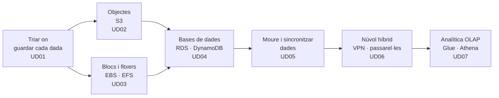

# Administració de bases de dades i emmagatzematge en el núvol

Apunts i pràctiques del mòdul **5162 Administració de bases de dades i emmagatzematge en el núvol**, del **Curs d'especialització d'FP de grau superior en Recursos i serveis en el núvol** (Reial decret 145/2026), curs **2026/27**. L'objectiu és que sàpies **triar, desplegar, protegir, vigilar i abaratir** l'emmagatzematge i les bases de dades d'una organització en el núvol: objectes, discos, sistemes de fitxers, bases de dades relacionals i NoSQL, transferències, núvol híbrid i analítica.

| Característica | Valor |
|---|---|
| **Durada** | **100 hores** · 12 ECTS (≈ 33 h de teoria i 67 h de pràctiques) |
| **Resultats d'aprenentatge** | 7 (RA1 a RA7). Consulta la [guia](/guia/ra-ce/) |
| **Proveïdor de referència** | AWS (AWS Academy Learner Lab), amb equivalències en Azure i Google Cloud |
| **Ferramentes** | Consola web · AWS CLI v2 · OpenTofu (IaC) · Docker · PostgreSQL · rclone · WireGuard · DuckDB |
| **Projecte comú** | [TaquillaAlacant: les dades d'una venedora d'entrades, de l'oficina al núvol](/guia/proyecto-taquilla/) |

> [!NOTE]
> Tot el mòdul seguix el mateix fil, que és el dels criteris d'avaluació del reial decret: **triar la regió i la classe → xifrar → controlar qui hi accedix → vigilar i auditar → fer còpies i replicar → ajustar el cost**. Ho repetixes amb cada tipus d'emmagatzematge; al final et ix a soles.

## El fil del mòdul

## Unitats didàctiques

Cada unitat té una pàgina de **teoria** (conceptes, comparatives, exemples i autoavaluació) i una de **pràctiques** classificades en **guiades**, **autònomes**, **reptes** i **tasca del projecte**, amb la fitxa de durada, dificultat, RA/CA, programari i lliurament.

  
RA1 · 10 h<h3>UD01 · Triar l'emmagatzematge</h3>
Objectes, blocs, fitxers i bases de dades; durabilitat, disponibilitat, regions, residència de dades i càlcul de costos.

<a href="ud01-seleccion-almacenamiento/ud01-teoria/">Teoria</a> · <a href="ud01-seleccion-almacenamiento/ud01-practicas/">Pràctiques</a>

  
RA2 · 16 h<h3>UD02 · Emmagatzematge d'objectes</h3>
Buckets, classes, xifratge amb KMS, polítiques, accés públic amb domini i HTTPS, cicle de vida, versionat i replicació.

<a href="ud02-almacenamiento-objetos/ud02-teoria/">Teoria</a> · <a href="ud02-almacenamiento-objetos/ud02-practicas/">Pràctiques</a>

  
RA3 · 12 h<h3>UD03 · Blocs i fitxers en xarxa</h3>
EBS, instantànies, EFS i muntatge NFS, modes d'accés, canvis de grandària i classe, AWS Backup.

<a href="ud03-bloques-ficheros/ud03-teoria/">Teoria</a> · <a href="ud03-bloques-ficheros/ud03-practicas/">Pràctiques</a>

  
RA4 · 24 h<h3>UD04 · Bases de dades administrades</h3>
RDS i Aurora, Multi-AZ i rèpliques, còpies i PITR, DynamoDB, monitorització del rendiment i optimització senzilla.

<a href="ud04-bases-datos/ud04-teoria/">Teoria</a> · <a href="ud04-bases-datos/ud04-practicas/">Pràctiques</a>

  
RA5 · 12 h<h3>UD05 · Transferir i sincronitzar dades</h3>
CLI i rclone, DataSync, Transfer Family, DMS, transferències físiques, sincronització desatesa i verificació d'integritat.

<a href="ud05-transferencia-sincronizacion/ud05-teoria/">Teoria</a> · <a href="ud05-transferencia-sincronizacion/ud05-practicas/">Pràctiques</a>

  
RA6 · 12 h<h3>UD06 · Núvol híbrid</h3>
Connectivitat (SSH, VPN, connexions dedicades), Storage Gateway, replicació des de l'oficina i monitorització d'extrem a extrem.

<a href="ud06-nube-hibrida/ud06-teoria/">Teoria</a> · <a href="ud06-nube-hibrida/ud06-practicas/">Pràctiques</a>

  
RA7 · 14 h<h3>UD07 · Analítica de dades (OLAP)</h3>
Data lake, Parquet i particionament, Glue i Athena, Redshift, retenció i compactació, supervisió d'ETL i pràctica final.

<a href="ud07-analitica-olap/ud07-teoria/">Teoria</a> · <a href="ud07-analitica-olap/ud07-practicas/">Pràctiques</a>

## Relació entre unitats i resultats d'aprenentatge

| Unitat | RA1 | RA2 | RA3 | RA4 | RA5 | RA6 | RA7 | Hores |
|---|:-:|:-:|:-:|:-:|:-:|:-:|:-:|--:|
| UD01 Triar l'emmagatzematge | ● | ○ | ○ | | | | | 10 |
| UD02 Emmagatzematge d'objectes | ○ | ● | | | | | | 16 |
| UD03 Blocs i fitxers en xarxa | ○ | | ● | | | | | 12 |
| UD04 Bases de dades administrades | | | | ● | | | | 24 |
| UD05 Transferir i sincronitzar dades | | | | ○ | ● | | | 12 |
| UD06 Núvol híbrid | | | | | ○ | ● | | 12 |
| UD07 Analítica de dades (OLAP) | | | | | | | ● | 14 |
| **Total** | | | | | | | | **100** |

● contribució principal · ○ contribució secundària. El detall per criteri és en [Resultats d'aprenentatge i criteris d'avaluació](/guia/ra-ce/).

## Com llegir estos apunts

> [!TIP]
> **Consell.** Una manera més còmoda, més barata o més professional de fer alguna cosa.

> [!WARNING]
> **Atenció.** Un error habitual o alguna cosa que pot costar diners.

> [!IMPORTANT]
> **Clau.** Un concepte imprescindible per al resultat d'aprenentatge.

> [!CAUTION]
> **Perill.** Una operació que pot esborrar dades de manera irrecuperable o deixar dades exposades a Internet.

Les ordres s'escriuen **sense indicador de prompt** perquè les pugues copiar tal qual. Les variables que has de canviar van en majúscules (`$ALUMNO`, `$BUCKET`). Si es mostra l'eixida esperada, va en un bloc a banda marcat com a `text`. Els preus que apareixen són **orientatius**: comprova'ls sempre en la calculadora del proveïdor, perquè canvien.
