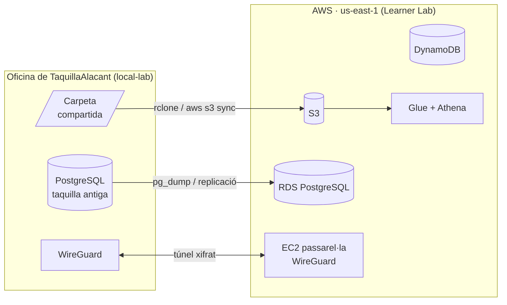

# Entorn de treball

Treballes amb **dos entorns** que es complementen:

| Entorn | Per a què | Cost |
|---|---|---|
| **AWS Academy Learner Lab** | Els serveis reals del proveïdor: S3, EBS, EFS, RDS, DynamoDB, KMS, CloudWatch, Glue, Athena… | Crèdit educatiu limitat per alumne |
| **Màquina local `local-lab`** (Debian 13 en VirtualBox) | Simular «l'oficina» de l'empresa: PostgreSQL local, emmagatzematge compatible amb S3, VPN, sincronització i anàlisi local | Gratis |



## 1. AWS Academy Learner Lab

El docent et convida al curs d'AWS Academy. Des del curs obris **Modules → Learner Lab → Start Lab**; quan l'indicador es posa en verd, **AWS** obri la consola.

El que has de saber del laboratori (llig-ho també en el document *Learner Lab – Foundation Services* del mateix curs, perquè les restriccions canvien):

- **Regions**: només **`us-east-1`** (Virgínia del Nord) i **`us-west-2`** (Oregon). És un límit del laboratori, no del proveïdor: en un projecte real per a una empresa valenciana triaries normalment una regió europea (per exemple `eu-south-2`, Espanya). Ho treballaràs en la UD01.
- **IAM molt limitat**: no pots crear usuaris, grups ni rols (llevat dels vinculats a serveis). Quan un servei necessite un rol (replicació de S3, Glue, DataSync…) usaràs el rol **`LabRole`** i, per a EC2, el perfil **`LabInstanceProfile`**.
- **Límits de grandària**: per exemple, volums EBS de 100 GB com a màxim i sense IOPS aprovisionades; instàncies xicotetes.
- **Sessions**: cada sessió dura unes hores. En acabar s'aturen les instàncies EC2, però **altres recursos continuen existint i consumint crèdit** (bases de dades, punts d'enllaç, NAT, emmagatzematge). En reiniciar la sessió, les **credencials canvien**.

> [!CAUTION]
> Si esgotes el crèdit, el compte es bloqueja i perds **tot** el que tenies. Cada pràctica acaba amb un apartat de **neteja**: fes-lo sempre.

### Credencials per a la línia d'ordres

En la pàgina del laboratori, **AWS Details → AWS CLI: Show** mostra un bloc com este. Copia'l en `~/.aws/credentials` cada vegada que comences sessió:

```ini
[default]
aws_access_key_id=ASIA...
aws_secret_access_key=...
aws_session_token=...
```

I fixa la regió en `~/.aws/config`:

```ini
[default]
region = us-east-1
output = json
```

Comprova que funciona:

```bash
aws sts get-caller-identity
```

```text
{
    "UserId": "AROA...:user1234567=Nombre_Apellido",
    "Account": "123456789012",
    "Arn": "arn:aws:sts::123456789012:assumed-role/voclabs/user1234567=Nombre_Apellido"
}
```

> [!TIP]
> També pots treballar des d'**AWS CloudShell** (icona `>_` de la consola): ja porta la CLI amb les credencials carregades i 1 GB persistent en `$HOME`. És l'opció més ràpida per a ordres soltes.

## 2. Ferramentes en el teu equip

Instal·la-les en `local-lab` (o en el teu equip, si uses Linux):

```bash
sudo apt update
sudo apt install -y curl unzip jq git postgresql-client rclone wireguard-tools
# AWS CLI v2
curl -fsSL "https://awscli.amazonaws.com/awscli-exe-linux-x86_64.zip" -o awscliv2.zip
unzip -q awscliv2.zip && sudo ./aws/install && rm -rf aws awscliv2.zip
aws --version
# OpenTofu (infraestructura como código, compatible con Terraform)
curl -fsSL https://get.opentofu.org/install-opentofu.sh -o install-opentofu.sh
chmod +x install-opentofu.sh && sudo ./install-opentofu.sh --install-method deb && rm install-opentofu.sh
tofu version
```

I **Docker Engine** des del repositori oficial (<https://docs.docker.com/engine/install/debian/>), que usaràs per a alçar PostgreSQL, un emmagatzematge compatible amb S3 i DuckDB sense embrutar el sistema.

| Ferramenta | Unitats | Ús |
|---|---|---|
| AWS CLI v2 | Totes | Administració per línia d'ordres i API |
| OpenTofu | UD02 – UD07 | Infraestructura com a codi: xifratge, buckets, volums, bases de dades |
| `psql` / PostgreSQL 17 | UD04 – UD06 | Client de la base de dades i servidor local de «l'oficina» |
| rclone | UD05 – UD06 | Sincronització de fitxers amb S3 i altres proveïdors |
| WireGuard | UD06 | VPN entre l'oficina i la VPC |
| DuckDB | UD07 | Consultes analítiques locals sobre Parquet |
| Garage (Docker) | UD02, UD06 | Emmagatzematge d'objectes compatible amb S3 en local |

> [!NOTE]
> Durant anys l'emmagatzematge S3 local de referència va ser MinIO, però la seua edició comunitària va deixar de mantindre's i el seu repositori es va arxivar en 2026. Per això ací s'usa **Garage** (llicència AGPL), i com a alternativa pots provar **SeaweedFS**. Pel mateix motiu no s'usa LocalStack: des de març de 2026 exigix compte i token.

## 3. Infraestructura com a codi amb OpenTofu

Diversos criteris demanen configurar el xifratge «mitjançant IaC». Cada pràctica que ho necessite té la seua carpeta amb un `main.tf`. La capçalera comuna és esta:

```hcl
terraform {
  required_providers {
    aws = {
      source  = "hashicorp/aws"
      version = "~> 6.0"
    }
  }
}

provider "aws" {
  region = "us-east-1"
  default_tags {
    tags = {
      Proyecto = "TaquillaAlacant"
      Alumno   = var.alumno
      Modulo   = "5162"
    }
  }
}

variable "alumno" {
  description = "Tu usuario en minúsculas, sin espacios (ej.: lmartinez)"
  type        = string
}
```

El cicle de treball sempre és el mateix:

```bash
tofu init
tofu plan -var alumno=$ALUMNO
tofu apply -var alumno=$ALUMNO
# ...comprobaciones...
tofu destroy -var alumno=$ALUMNO
```

> [!WARNING]
> El fitxer `terraform.tfstate` guarda l'estat i pot contindre **contrasenyes en clar**. No el pugues mai a un repositori: afig `*.tfstate*` i `.terraform/` al teu `.gitignore`.

## 4. Convencions de noms i etiquetes

| Recurs | Format | Exemple |
|---|---|---|
| Bucket | `ta-<alumne>-<ús>-<sufix>` | `ta-lmartinez-carteles-7f3a` |
| Base de dades | `ta-<alumne>-<motor>` | `ta-lmartinez-pg` |
| Volum, EFS, taula… | `ta-<alumne>-<ús>` | `ta-lmartinez-logs` |

Tots els recursos porten les etiquetes **`Proyecto`**, **`Alumno`** i **`Modulo`** (OpenTofu les posa a soles amb `default_tags`). Amb elles filtres en la consola i en **Cost Explorer** el que has creat tu.

## 5. Màquina local `local-lab`

| Paràmetre | Valor |
|---|---|
| Sistema | Debian 13 (trixie), sense entorn gràfic |
| Recursos | 2 vCPU · 4 GB RAM · 40 GB de disc |
| Xarxa | Adaptador NAT (eixida a Internet) + xarxa només amfitrió per a administrar per SSH |
| Programari | El de la secció 2, més Docker Engine |

Fes una **instantània** de la màquina en acabar la instal·lació: la UD06 toca la xarxa i és fàcil deixar-la inservible.

## 6. Normes per a no gastar el crèdit

1. **Etiqueta** tot i **destruïx-ho** en acabar (`tofu destroy` o l'apartat de neteja de la pràctica).
2. Les bases de dades, en classe **`db.t3.micro`/`db.t4g.micro`**, **Single-AZ** llevat que la pràctica demane Multi-AZ, i **atura-les** si vas a continuar un altre dia.
3. No creïs **NAT Gateways** ni **punts d'enllaç d'interfície** si la pràctica no ho demana: cobren per hora encara que no els uses.
4. Abans de llançar una consulta d'Athena, mira quantes dades llegirà: es paga per dades escanejades.
5. Revisa la despesa acumulada en la pàgina del laboratori en començar cada sessió.
