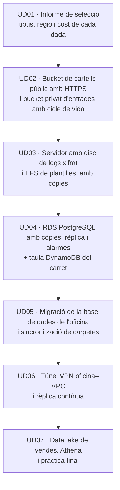

# Projecte transversal: TaquillaAlacant

**TaquillaAlacant** és una empresa fictícia d'Alacant que ven entrades per a concerts, teatre, partits i actes de les festes. Va començar amb una taquilla física i un servidor en l'oficina; ara vol portar les seues dades al núvol sense perdre el control de la seguretat ni del cost. Tu eres la persona que administra eixes dades.

## Les dades de l'empresa

| Dada | Volum | Patró d'accés | On acabarà | Unitat |
|---|---|---|---|---|
| Cartells i imatges dels esdeveniments | ~20 GB, creix 1 GB/mes | Lectura pública molt freqüent; quasi mai es modifiquen | S3 + domini amb HTTPS | UD02 |
| Entrades en PDF emeses | ~2 milions de fitxers xicotets | Es descarreguen els dies previs a l'esdeveniment; després quasi mai | S3 amb cicle de vida | UD02 |
| Registres del servidor d'aplicacions | 5 GB/setmana | Escriptura contínua, lectura ocasional | EBS + exportació a S3 | UD03 |
| Plantilles i documents compartits | 50 GB | Lectura/escriptura des de diversos servidors | EFS | UD03 |
| Vendes, esdeveniments, recintes i clients | 10 GB | Transaccional, moltes escriptures xicotetes | RDS PostgreSQL | UD04 |
| Carret i cua d'espera de cada esdeveniment | Pics de milers de peticions per segon | Clau-valor, caduca en minuts | DynamoDB | UD04 |
| Base de dades i carpetes de l'oficina | 30 GB | Encara s'usen en la taquilla física | Sincronitzades amb el núvol | UD05 – UD06 |
| Històric de vendes per a anàlisi | 5 anys | Consultes d'agregació mensuals | Data lake (Parquet) + Athena | UD07 |

## El que fas en cada unitat



## Recursos del projecte

L'esquema de la base de dades i un generador de dades de vendes realistes (amb esdeveniments d'Alacant, recintes i dates de festes):





Ús del generador:

```bash
python3 generar_ventas.py --ventas 200000 --salida ventas.csv     # CSV per a càrregues i anàlisi
python3 generar_ventas.py --ventas 5000 --sql > datos.sql          # INSERT per a PostgreSQL
```

> [!IMPORTANT]
> El projecte es lliura **en un únic repositori Git privat per alumne** (`taquilla-<alumne>`), amb una carpeta per unitat (`ud01/`, `ud02/`…) que conté el codi d'OpenTofu, els scripts, l'informe en Markdown i les captures. L'estat d'OpenTofu i les credencials **no** es pugen.
