# Temporització

El mòdul dura **100 hores**. Amb una distribució habitual de **4 hores setmanals** són unes 25 setmanes; amb 5 hores setmanals, 20 setmanes. Ajusta les dates al teu calendari escolar.

| Unitat | Teoria | Pràctiques | Total | Setmanes (4 h/set.) |
|---|--:|--:|--:|---|
| UD01 · Triar l'emmagatzematge | 4 | 6 | **10** | 1 – 3 |
| UD02 · Emmagatzematge d'objectes | 5 | 11 | **16** | 3 – 6 |
| UD03 · Blocs i fitxers en xarxa | 4 | 8 | **12** | 7 – 9 |
| UD04 · Bases de dades administrades | 8 | 16 | **24** | 10 – 15 |
| UD05 · Transferir i sincronitzar dades | 4 | 8 | **12** | 16 – 18 |
| UD06 · Núvol híbrid | 4 | 8 | **12** | 19 – 21 |
| UD07 · Analítica de dades (OLAP) | 4 | 10 | **14** | 22 – 25 |
| **Total** | **33** | **67** | **100** | |

Les hores de pràctiques inclouen la **tasca del projecte** de cada unitat i el temps d'avaluació (defenses i proves pràctiques).

```mermaid
gantt
    dateFormat  X
    axisFormat  %s
    title Hores acumulades
    section Emmagatzematge
    UD01 :0, 10
    UD02 :10, 26
    UD03 :26, 38
    section Bases de dades
    UD04 :38, 62
    section Moviment de dades
    UD05 :62, 74
    UD06 :74, 86
    section Analítica
    UD07 :86, 100
```

> [!TIP]
> El crèdit del Learner Lab és limitat. Les unitats que més gasten són la UD04 (instàncies de base de dades) i la UD07 (consultes i treballs d'ETL). Planifica eixes pràctiques en sessions seguides i **destruïx els recursos en acabar cada sessió**.
