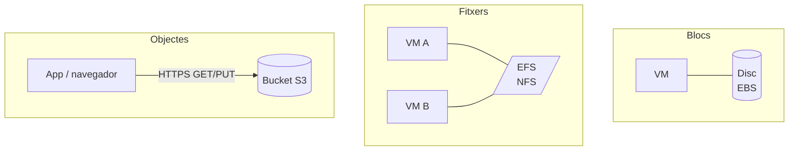
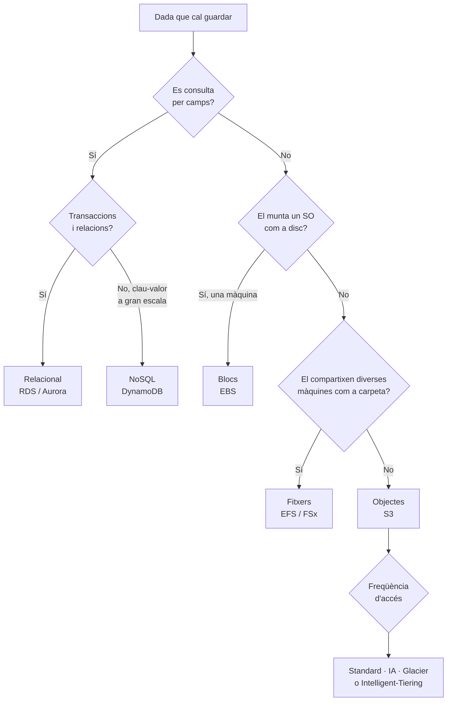

# UD01 · Triar l'emmagatzematge

## Resum del tema

En el núvol no existix «el disc»: hi ha desenes de serveis d'emmagatzematge i cadascun té la seua manera d'accés, les seues garanties i la seua manera de cobrar. Triar malament ix car de dues maneres: o el sistema no compleix (lent, sense disponibilitat, dades en un país que no toca) o compleix pagant molt més del necessari. Esta unitat et dona un mètode per a decidir.



### Objectius d'aprenentatge

- Distingir emmagatzematge de **blocs**, de **fitxers**, d'**objectes** i **bases de dades**, i saber quin servei correspon a cadascun en AWS, Azure i Google Cloud.
- Convertir una necessitat de l'empresa en **requisits funcionals i no funcionals** mesurables.
- Diferenciar **durabilitat** i **disponibilitat** i llegir-les en la documentació del proveïdor.
- Tindre en compte la **regió**: latència, serveis disponibles i **residència de les dades** (RGPD).
- Estimar el **cost** complet: emmagatzematge, peticions, transferència, recuperació, còpies i replicació.

---

## 1. Quatre maneres de guardar dades

| Tipus | Com s'hi accedix | Unitat que manegues | Exemple típic | AWS | Azure | Google Cloud |
|---|---|---|---|---|---|---|
| **Blocs** | El sistema operatiu el veu com un disc (`/dev/nvme1n1`) i li posa un sistema de fitxers | Bloc de grandària fixa | Disc d'una màquina virtual o d'una base de dades | EBS | Managed Disks | Persistent Disk / Hyperdisk |
| **Fitxers** | Es munta per xarxa amb NFS o SMB; diversos clients alhora | Fitxer dins de carpetes | Carpeta compartida, contingut d'un CMS | EFS, FSx | Azure Files | Filestore |
| **Objectes** | API HTTP (`PUT`, `GET`, `DELETE`) sobre claus | Objecte complet + metadades | Imatges, còpies de seguretat, data lake | S3 | Blob Storage | Cloud Storage |
| **Bases de dades** | Un motor que entén consultes (SQL, clau-valor, documents…) | Fila, document, element | Vendes, usuaris, carret | RDS, Aurora, DynamoDB | Azure SQL, Cosmos DB | Cloud SQL, Firestore, Spanner |

### 1.1 Emmagatzematge de blocs

És el més paregut a un disc físic: latència molt baixa (submil·lisegon en SSD) i accés aleatori a qualsevol byte. A canvi, **un volum es connecta normalment a una sola màquina** i viu en **una zona de disponibilitat**. Es mesura per capacitat, **IOPS** (operacions per segon) i **rendiment** (MB/s).

### 1.2 Emmagatzematge de fitxers

Oferix la semàntica d'un sistema de fitxers POSIX (permisos, bloquejos, canviar el nom) a **molts clients alhora** per xarxa. És l'opció quan una aplicació «de tota la vida» necessita una carpeta compartida. És més car per GB que els blocs i que els objectes.

### 1.3 Emmagatzematge d'objectes

Cada objecte és un fitxer complet amb una **clau** (`carteles/2026/evento-0042.webp`) i **metadades**, dins d'un **contenidor** (*bucket*). No es modifica un tros: es puja l'objecte sencer una altra vegada. A canvi, la capacitat és pràcticament il·limitada, és el més barat per GB, s'hi accedix des de qualsevol lloc per HTTPS i es replica automàticament entre diverses zones.

### 1.4 Bases de dades

Quan les dades tenen estructura i necessites consultar-les, filtrar-les o actualitzar-les amb garanties (transaccions), l'emmagatzematge no és suficient: necessites un **motor**. En el núvol el normal és usar-lo **administrat** (el proveïdor aplica pegats, fa còpies i gestiona el maquinari). Es veurà en la UD04 (OLTP) i la UD07 (OLAP).

> [!IMPORTANT]
> Regla ràpida: **el munta un sistema operatiu com a disc?** → blocs. **El compartixen diverses màquines com a carpeta?** → fitxers. **Es puja i es descarrega sencer per HTTP?** → objectes. **Es consulta per camps?** → base de dades.

---

## 2. Requisits: de «el vull ràpid» a números

Un requisit **funcional** diu *què* ha de fer l'emmagatzematge; un de **no funcional** diu *com de bé*. Sense números, no es pot comprovar si es compleix (CA RA1.a).

| Requisit | Pregunta | Exemple mesurable |
|---|---|---|
| Protocol d'accés | Com llegirà l'aplicació les dades? | API S3, NFSv4.1, disc de blocs, SQL |
| Concurrència | Quants clients alhora? Escriuen? | 3 servidors escriuen en la mateixa carpeta |
| Grandària i creixement | Quant n'hi ha hui i quant creix? | 20 GB + 1 GB/mes |
| Rendiment | Latència, IOPS, MB/s | < 10 ms; 3000 IOPS; 125 MB/s |
| Freqüència d'accés | Cada quant es llig cada dada? | Diària el primer mes, després quasi mai |
| Durabilitat | Quina probabilitat de perdre una dada acceptes? | 99,999999999 % anual |
| Disponibilitat | Quant de temps pot estar inaccessible? | 99,9 % mensual (≈ 43 min/mes) |
| RPO / RTO | Quantes dades pots perdre? Quant tardes a tornar? | RPO 15 min · RTO 1 h |
| Seguretat | Xifratge, qui hi accedix, auditoria | Xifratge amb clau pròpia; només l'aplicació escriu |
| Residència | En quin país poden estar les dades? | Dins de l'Espai Econòmic Europeu |
| Retenció | Quant de temps cal guardar-les? | 5 anys (facturació) |

> [!TIP]
> El **RPO** (*Recovery Point Objective*) és quant de treball pots perdre: si fas còpia cada nit, el teu RPO és de fins a 24 h. El **RTO** (*Recovery Time Objective*) és quant tardes a tornar a donar servei. Tots dos condicionen les còpies i la replicació de les unitats següents.

---

## 3. Durabilitat i disponibilitat

Són dues garanties distintes i es confonen molt:

- **Durabilitat**: probabilitat de **no perdre** una dada en un any. S3 Standard està dissenyat per a **99,999999999 %** («onze nous»): si guardes 10 milions d'objectes, l'expectativa és perdre'n un cada 10 000 anys.
- **Disponibilitat**: percentatge de temps en què **pots accedir** a la dada. S3 Standard està dissenyat per al 99,99 %; S3 One Zone-IA, per al 99,5 %, perquè guarda les dades en una sola zona.

| Disponibilitat | Caiguda màxima al mes | Caiguda màxima a l'any |
|---|---|---|
| 99 % | ≈ 7 h 18 min | ≈ 3 dies 15 h |
| 99,9 % | ≈ 43 min | ≈ 8 h 46 min |
| 99,99 % | ≈ 4 min 23 s | ≈ 52 min |

Distingix també entre el que el servei està **dissenyat** per a donar i el que el proveïdor **compromet en el seu SLA** (acord de nivell de servei, amb compensació econòmica si no es compleix). L'SLA sol ser més baix que el disseny (CA RA1.b).

### 3.1 Regions i zones de disponibilitat

Una **regió** és una àrea geogràfica (Virgínia del Nord, Irlanda, Frankfurt, Espanya…) amb diverses **zones de disponibilitat** (AZ): centres de dades separats físicament, amb energia i xarxa independents, units per enllaços de baixa latència.

| Àmbit del servei | Què resistix | Exemples |
|---|---|---|
| **Zonal** (una AZ) | Fallada d'un servidor o disc | EBS, S3 One Zone-IA, S3 Express One Zone, RDS Single-AZ |
| **Regional** (diverses AZ) | Caiguda d'una zona sencera | S3 Standard, EFS Regional, DynamoDB, RDS Multi-AZ |
| **Multiregió** | Caiguda d'una regió | Replicació entre regions de S3, taules globals de DynamoDB, rèpliques entre regions |

> [!NOTE]
> La responsabilitat és **compartida**: el proveïdor garantix la durabilitat de la infraestructura, però si esborres un objecte per error o un ransomware xifra les teues dades, el servei les «conserva» perfectament… xifrades. La protecció davant d'errors humans (versionat, còpies, bloqueig d'objectes) és cosa teua.

---

## 4. La regió: latència, serveis i residència de les dades

En triar regió es valoren quatre coses:

1. **Residència i compliment normatiu.** L'RGPD permet tractar dades personals fora de l'Espai Econòmic Europeu només amb garanties addicionals (decisions d'adequació, clàusules contractuals tipus…). Per a una empresa valenciana amb dades de clients, el prudent és una **regió europea**: AWS té, entre altres, `eu-south-2` (Espanya), `eu-west-1` (Irlanda) i `eu-central-1` (Frankfurt). Alguns sectors (sanitat, administració pública, Esquema Nacional de Seguretat) tenen exigències addicionals.
2. **Latència.** Com més prop dels usuaris, menor temps de resposta. Per a contingut estàtic molt llegit s'afig una **CDN** (CloudFront), que el copia en ubicacions pròximes a l'usuari.
3. **Disponibilitat de serveis i funcions.** No tots els serveis, classes d'emmagatzematge, tipus d'instància o versions de motor estan en totes les regions. Cal **descartar** el que no hi estiga (CA RA1.c). Es consulta en la pàgina *AWS Services by Region* o amb l'API, com faràs en la pràctica 1.1.
4. **Preu.** El mateix servei costa diferent segons la regió; `us-east-1` sol ser de les més barates.

> [!WARNING]
> En el Learner Lab només pots usar `us-east-1` i `us-west-2`. En els informes del projecte **justifica la regió que usaries en producció** (normalment europea) encara que faces les proves en `us-east-1`.

---

## 5. Com cobra l'emmagatzematge en el núvol

El preu no és només «euros per GB». Per a estimar el cost real (CA RA1.d i RA1.e) cal sumar:

| Concepte | Què es paga | Notes |
|---|---|---|
| **Capacitat** | GB-mes emmagatzemats (o aprovisionats, en EBS i RDS) | En EBS pagues la grandària del volum encara que estiga buit |
| **Peticions / operacions** | Per cada 1000 `PUT`, `GET`, `LIST`… | Milions d'objectes xicotets encarixen molt |
| **Rendiment aprovisionat** | IOPS i MB/s per damunt del bàsic | gp3 inclou 3000 IOPS i 125 MB/s |
| **Recuperació** | GB llegits en classes d'accés poc freqüent o arxiu | A més, algunes tarden hores |
| **Durada mínima** | Es cobra un mínim de dies encara que esborres abans | 30 dies (IA), 90 (Glacier) o 180 (Deep Archive) en S3 |
| **Transferència de dades** | GB que **ixen** a Internet o a una altra regió | L'entrada sol ser gratis; l'eixida a Internet té una franja gratuïta mensual |
| **Còpies i replicació** | Instantànies, còpies de seguretat, segona regió | Duplicar dades és duplicar el cost de capacitat + transferència |
| **Funcions extra** | Claus KMS, inventari, anàlisi, monitorització detallada | Xicotet, però suma |

### 5.1 Classes d'emmagatzematge de S3 (orientatiu)

| Classe | Per a què | Zones | Durada mínima | Recuperació |
|---|---|---|---|---|
| S3 Standard | Accés freqüent | ≥ 3 | — | Immediata |
| S3 Intelligent-Tiering | Patró desconegut o canviant | ≥ 3 | — | Immediata (nivells d'arxiu opcionals) |
| S3 Standard-IA | Accés poc freqüent però ràpid | ≥ 3 | 30 dies | Immediata, amb càrrec per GB |
| S3 One Zone-IA | Poc freqüent i fàcil de regenerar | 1 | 30 dies | Immediata, amb càrrec per GB |
| S3 Glacier Instant Retrieval | Arxiu que es consulta alguna vegada al trimestre | ≥ 3 | 90 dies | Mil·lisegons |
| S3 Glacier Flexible Retrieval | Arxiu | ≥ 3 | 90 dies | Minuts a hores |
| S3 Glacier Deep Archive | Arxiu a llarg termini, obligacions legals | ≥ 3 | 180 dies | Fins a 12 – 48 h |
| S3 Express One Zone | Latència de mil·lisegons d'un dígit | 1 | — | Immediata |

### 5.2 Un exemple de càlcul

Els **cartells** de TaquillaAlacant: 20 GB en S3 Standard, 3 milions de `GET` al mes, 1000 `PUT` al mes i 150 GB al mes descarregats pels navegadors. Amb preus orientatius d'`us-east-1` (consulta'ls sempre en la calculadora):

| Concepte | Càlcul | Cost/mes |
|---|---|---|
| Capacitat | 20 GB × 0,023 $ | 0,46 $ |
| `GET` | 3 000 000 / 1000 × 0,0004 $ | 1,20 $ |
| `PUT` | 1000 / 1000 × 0,005 $ | 0,01 $ |
| Eixida a Internet | (150 − 100 GB gratuïts) × 0,09 $ | 4,50 $ |
| **Total** | | **≈ 6,17 $** |

El que més pesa **no és l'emmagatzematge sinó la transferència**. Servir els cartells a través d'una CDN canvia el compte (la transferència de S3 a CloudFront no es cobra i la de CloudFront té la seua pròpia tarifa i memòria cau), i ho comprovaràs en la pràctica 1.2.

> [!TIP]
> L'**AWS Pricing Calculator** (<https://calculator.aws/>) permet guardar i compartir l'estimació amb un enllaç. Adjunta sempre eixe enllaç en els teus informes.

---

## 6. Un mètode per a decidir

1. **Classifica** la dada amb la regla ràpida de l'apartat 1.
2. **Escriu els requisits** amb números (apartat 2).
3. **Comprova en la documentació** que el servei i la classe els complixen: durabilitat, disponibilitat, rendiment, límits (CA RA1.a, RA1.b).
4. **Descarta** el que no estiga disponible en la regió triada (CA RA1.c).
5. **Compara preus** de les opcions que queden i tria la més econòmica que compleix (CA RA1.d).
6. **Ajusta els paràmetres** que mouen el cost: grandària, classe, cicle de vida, rèpliques, retenció de còpies (CA RA1.e).

---

## 7. Errors freqüents

| Error | Conseqüència | Com evitar-ho |
|---|---|---|
| Guardar fitxers d'usuaris en el disc EBS d'un servidor | Si s'afig un segon servidor no els veu; si es perd l'AZ, es perden | Objectes (S3) o fitxers compartits (EFS) |
| Passar a Glacier dades que es llegixen cada setmana | Els càrrecs de recuperació superen l'estalvi | Analitza el patró d'accés o usa Intelligent-Tiering |
| Triar regió només pel preu | Incomplir l'RGPD o tindre latències altes | Primer compliment, després latència, després preu |
| Oblidar la transferència d'eixida | La factura real multiplica l'estimació | Inclou-la sempre; valora una CDN |
| Confondre disponibilitat amb durabilitat | Pensar que una dada «disponible» està protegida d'esborraments | Versionat i còpies independents |

## 8. Resum

- Blocs per a discos, fitxers per a carpetes compartides, objectes per a fitxers complets per HTTP, bases de dades per a consultar per camps.
- Els requisits s'escriuen amb números: grandària, rendiment, freqüència d'accés, durabilitat, disponibilitat, RPO/RTO, residència i retenció.
- Durabilitat és no perdre dades; disponibilitat és poder accedir-hi. Cap de les dues et protegix dels teus propis errors.
- La regió es tria per compliment, latència, serveis disponibles i preu, en eixe orde.
- El cost real inclou capacitat, peticions, transferència, recuperació, durada mínima, còpies i replicació.

## 9. Autoavaluació


- q: "Una aplicació web de dos servidors necessita que tots dos lligen i escriguen en la mateixa carpeta de documents. Quin tipus d'emmagatzematge encaixa?"
  options: ["Blocs (EBS)", "Fitxers en xarxa (EFS)", "Objectes (S3 Glacier)", "Una taula DynamoDB"]
  answer: 1
  explain: "Diversos clients amb semàntica de sistema de fitxers: emmagatzematge de fitxers compartit per NFS."
- q: "S3 Standard té una durabilitat dissenyada del 99,999999999 %. Què significa?"
  options: ["Que està accessible el 99,999999999 % del temps", "Que la probabilitat anual de perdre un objecte és ínfima", "Que mai podràs esborrar un objecte per error", "Que l'SLA et compensa si perds un objecte"]
  answer: 1
  explain: "La durabilitat mesura la pèrdua de dades per fallades de la infraestructura, no l'accés ni els esborraments de l'usuari."
- q: "Quin concepte sol pesar més en la factura d'uns cartells públics molt descarregats?"
  options: ["La capacitat en GB-mes", "Les peticions PUT", "La transferència d'eixida a Internet", "El xifratge"]
  answer: 2
  explain: "Amb pocs GB i moltes descàrregues, l'eixida a Internet domina el cost."
- q: "Guardes en S3 Glacier Flexible Retrieval un fitxer i l'esborres als 10 dies. Què passa amb el cost?"
  options: ["Pagues només 10 dies", "Pagues els 90 dies de durada mínima", "No pagues res perquè l'has esborrat", "Pagues un any sencer"]
  answer: 1
  explain: "Les classes d'accés poc freqüent i d'arxiu tenen una durada mínima facturable."
- q: "Una empresa d'Alacant guarda dades personals de clients. Quin criteri va primer en triar regió?"
  options: ["El preu", "La latència", "La residència de les dades i el compliment normatiu", "La quantitat de zones"]
  answer: 2
  explain: "L'RGPD condiciona on es poden tractar les dades personals; el preu i la latència s'optimitzen després."
- q: "Quin servei és zonal, és a dir, no resistix per si sol la caiguda d'una zona de disponibilitat?"
  options: ["S3 Standard", "DynamoDB", "Un volum EBS", "EFS Regional"]
  answer: 2
  explain: "Un volum EBS viu en una AZ. Per a protegir-lo s'usen instantànies, que es guarden de manera regional."


## Referències

- AWS: *Choosing an AWS storage service* — <https://docs.aws.amazon.com/decision-guides/latest/storage-on-aws-how-to-choose/choosing-aws-storage-service.html>
- Amazon S3: *Storage classes* — <https://aws.amazon.com/s3/storage-classes/>
- AWS: *Regions and Availability Zones* — <https://aws.amazon.com/about-aws/global-infrastructure/regions_az/>
- AWS Pricing Calculator — <https://calculator.aws/>
- Agència Espanyola de Protecció de Dades: transferències internacionals — <https://www.aepd.es/>
- Reial decret 145/2026 (BOE-A-2026-4673) — <https://www.boe.es/buscar/act.php?id=BOE-A-2026-4673>
