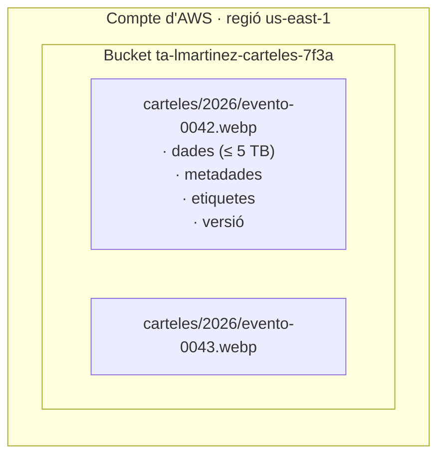
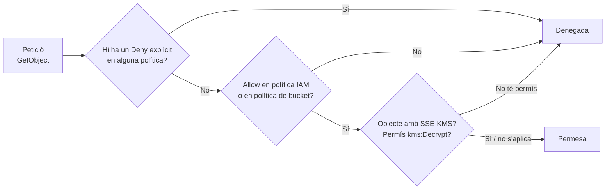
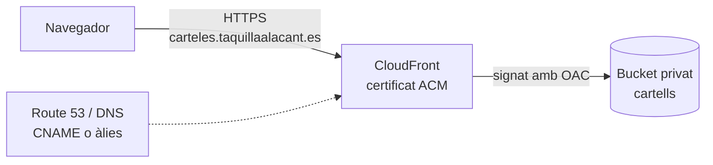
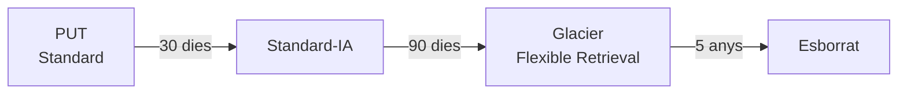

# UD02 · Emmagatzematge d'objectes

## Resum del tema

Amazon S3 (i els seus equivalents Azure Blob Storage i Google Cloud Storage) guarda **objectes** dins de **buckets** i els servix per HTTPS. Administrar-lo bé consistix a repetir sempre les mateixes decisions: **nom i regió → classe → xifratge → accés → monitorització i auditoria → cicle de vida → rèpliques i còpies**. Esta unitat les recorre en eixe orde.



### Objectius d'aprenentatge

- Donar nom als buckets i etiquetar objectes respectant els límits del servei.
- Assignar la classe d'emmagatzematge adequada al bucket i a cada objecte.
- Configurar el xifratge amb claus gestionades pel proveïdor i amb claus pròpies de KMS.
- Controlar l'accés amb polítiques, bloquejar l'accés públic i publicar contingut per HTTPS amb un domini propi.
- Automatitzar el cicle de vida dels objectes i protegir-los amb versionat, bloqueig, replicació i còpies.
- Monitoritzar l'ús i auditar qui accedix a què.

---

## 1. El model de S3



| Concepte | Descripció |
|---|---|
| **Bucket** | Contenidor d'objectes. Viu en **una regió** i el seu nom és **únic en tot el proveïdor** |
| **Clau** | Nom complet de l'objecte: `carteles/2026/evento-0042.webp`. No hi ha carpetes reals: la `/` forma **prefixos** que la consola mostra com a carpetes |
| **Objecte** | Dades (de 0 bytes a 5 TB) + metadades. Es puja i es reemplaça **sencer** |
| **Metadades de sistema** | `Content-Type`, `Content-Length`, `ETag`, `Last-Modified`, classe, xifratge… |
| **Metadades d'usuari** | Parells `x-amz-meta-*` que defines en pujar; no es poden canviar sense tornar a copiar l'objecte |
| **Etiquetes** | Fins a 10 parells clau-valor per objecte; **sí** que es canvien sense reescriure l'objecte i servixen per a polítiques, cicle de vida i costos |
| **Versió** | Si el versionat està actiu, cada escriptura crea una versió amb el seu `VersionId` |

S3 oferix **consistència forta de lectura després d'escriptura**: tan prompte com un `PUT` acaba, qualsevol `GET` o `LIST` posterior veu l'objecte nou. Un `PUT` simple admet fins a 5 GB; per damunt (i en la pràctica des d'uns 100 MB) s'usa la **pujada multipart**, que la CLI fa a soles.

### 1.1 Noms de buckets (CA RA2.a)

Les regles dels *general purpose buckets* de S3:

- Entre **3 i 63 caràcters**: minúscules, números, punts (`.`) i guions (`-`).
- Comencen i acaben per lletra o número; no tenen dos punts seguits ni format d'adreça IP.
- No comencen per `xn--`, `sthree-` ni `amzn-s3-demo-`, ni acaben en `-s3alias` ni `--ol-s3`.
- Són **únics globalment** i **no se'ls pot canviar el nom**: per a canviar-lo cal crear-ne un altre i copiar.

Bones pràctiques: **evita els punts** (donen problemes amb els certificats TLS en adreces `bucket.s3.amazonaws.com`), no poses dades personals ni secrets en el nom (és visible en DNS i registres) i afig un **sufix aleatori** per a no xocar amb noms que ja usen altres.

> [!TIP]
> Les **claus** d'objecte admeten quasi qualsevol caràcter UTF-8 fins a 1024 bytes, però el segur és usar lletres, números, `/`, `-`, `_` i `.`. Organitza els prefixos pensant en el cicle de vida i en l'analítica: `entradas/2026/06/venta-00000042.pdf` permet aplicar regles per any o mes.

---

## 2. Regió i classe d'emmagatzematge (CA RA2.b, RA2.c)

La **regió** es fixa en crear el bucket i no es pot canviar. Es tria amb els criteris de la UD01: residència de les dades, latència, serveis disponibles i preu.

La **classe** s'assigna **per objecte**. El bucket no té una classe pròpia: el que es configura és la classe per defecte amb què pugen les aplicacions i les **regles de cicle de vida** que la canvien després.

```bash
# Subir un objeto directamente a Standard-IA
aws s3 cp informe-2025.pdf s3://$BUCKET/informes/ --storage-class STANDARD_IA
# Ver la clase de cada objeto
aws s3api list-objects-v2 --bucket $BUCKET --query 'Contents[].[Key,StorageClass,Size]' --output table
```

**S3 Intelligent-Tiering** mou els objectes a soles entre nivells segons l'accés (freqüent → poc freqüent als 30 dies → accés instantani d'arxiu als 90), amb una xicoteta quota de monitorització per objecte. És l'opció quan no coneixes el patró d'accés. Els objectes de menys de 128 KB no es monitoritzen i es queden sempre en el nivell freqüent.

---

## 3. Xifratge (CA RA2.d)

### 3.1 Xifratge en trànsit

S3 accepta HTTP i HTTPS. Es força HTTPS amb una **política de bucket** que denega les peticions amb `aws:SecureTransport = false` (apartat 4.3).

### 3.2 Xifratge en repòs

Des de gener de 2023, **tots els objectes nous es xifren** per defecte. Les opcions del costat del servidor són:

| Opció | Qui gestiona la clau | Auditoria de l'ús de la clau | Quan usar-la |
|---|---|---|---|
| **SSE-S3** | S3, totalment transparent | No | Opció per defecte; dades no sensibles |
| **SSE-KMS** amb la clau `aws/s3` | KMS, clau gestionada per AWS | Sí, en CloudTrail | Vols traçabilitat sense gestionar claus |
| **SSE-KMS** amb **clau del client** (CMK) | Tu: política, rotació, desactivació, esborrament | Sí | Dades personals o sensibles; separació de funcions |
| **DSSE-KMS** | KMS, xifratge en dues capes | Sí | Normatives que exigixen doble xifratge |
| **SSE-C** | Tu envies la clau en cada petició | No | Casos molt concrets; complica molt l'operació |

Amb una **clau del client** (CMK) controles **qui pot usar-la** amb la seua **política de clau**: encara que algú tinga permís per a llegir el bucket, si no pot usar la clau (`kms:Decrypt`), no llig les dades. Desactivar la clau deixa **inaccessibles** tots els objectes xifrats amb ella.

> [!TIP]
> Activa sempre la **S3 Bucket Key** amb SSE-KMS: S3 genera una clau intermèdia per bucket i reduïx les crides a KMS (i el seu cost) fins a un 99 %.

> [!CAUTION]
> Si programes l'esborrament d'una clau de KMS (període d'espera de 7 a 30 dies) i es completa, **les dades xifrades amb ella es perden per sempre**. Abans d'esborrar una clau, desactiva-la i espera a veure què falla.

### 3.3 Claus amb IaC

```hcl
resource "aws_kms_key" "datos" {
  description             = "Clave de los datos de TaquillaAlacant (${var.alumno})"
  enable_key_rotation     = true        # rotación anual automática
  deletion_window_in_days = 7
}

resource "aws_kms_alias" "datos" {
  name          = "alias/ta-${var.alumno}-datos"
  target_key_id = aws_kms_key.datos.key_id
}

resource "aws_s3_bucket_server_side_encryption_configuration" "entradas" {
  bucket = aws_s3_bucket.entradas.id
  rule {
    apply_server_side_encryption_by_default {
      sse_algorithm     = "aws:kms"
      kms_master_key_id = aws_kms_key.datos.arn
    }
    bucket_key_enabled = true
  }
}
```

---

## 4. Control d'accés (CA RA2.e)

### 4.1 Privat per defecte

Un bucket nou és **privat**: només el compte propietari hi accedix. A més, per defecte:

- **Bloqueig d'accés públic** (*Block Public Access*) activat en el bucket (i configurable a nivell de compte). Impedix que una política o ACL el faça públic encara que algú s'equivoque.
- **Propietat d'objectes** en mode *Bucket owner enforced*: les **ACL estan desactivades** i tot es controla amb polítiques. És el recomanat.

### 4.2 Qui decidix l'accés



| Mecanisme | S'associa a | Ús típic |
|---|---|---|
| **Política IAM** | Usuari, grup o rol | «Este rol pot llegir `entradas/*`» |
| **Política de bucket** | Bucket | Forçar HTTPS, permetre a CloudFront, donar accés a un altre compte |
| **Política de clau KMS** | Clau | Qui pot xifrar i desxifrar |
| **Punts d'accés** (*Access Points*) | Bucket | Un nom i una política per aplicació o equip |
| **URL presignades** | Un objecte concret | Descarregar una entrada durant 15 minuts sense credencials |
| **Punt d'enllaç de VPC** (*gateway endpoint*) | VPC | Accés privat sense eixir a Internet; es pot exigir en la política |

### 4.3 Política de bucket d'exemple

Denega tot el que no vinga per HTTPS i qualsevol pujada que no use la clau KMS del projecte:

```json
{
  "Version": "2012-10-17",
  "Statement": [
    {
      "Sid": "SoloHTTPS",
      "Effect": "Deny",
      "Principal": "*",
      "Action": "s3:*",
      "Resource": ["arn:aws:s3:::ta-lmartinez-entradas-7f3a", "arn:aws:s3:::ta-lmartinez-entradas-7f3a/*"],
      "Condition": { "Bool": { "aws:SecureTransport": "false" } }
    },
    {
      "Sid": "SoloConMiClave",
      "Effect": "Deny",
      "Principal": "*",
      "Action": "s3:PutObject",
      "Resource": "arn:aws:s3:::ta-lmartinez-entradas-7f3a/*",
      "Condition": {
        "StringNotEqualsIfExists": {
          "s3:x-amz-server-side-encryption-aws-kms-key-id": "arn:aws:kms:us-east-1:123456789012:key/1111-2222"
        }
      }
    }
  ]
}
```

### 4.4 URL presignades

Una URL presignada dona accés temporal a un objecte privat amb les credencials de qui la signa. És com TaquillaAlacant lliura els PDF a cada client:

```bash
aws s3 presign s3://$BUCKET/entradas/2026/06/venta-00000042.pdf --expires-in 900
```

---

## 5. Accés públic per HTTPS amb domini propi (CA RA2.f)

S3 té un mode **lloc web estàtic**, però el seu punt d'enllaç només parla **HTTP** i obliga a fer públic el bucket. L'arquitectura recomanada és una altra:



1. El bucket continua **privat** i amb el bloqueig d'accés públic activat.
2. Una distribució de **CloudFront** (la CDN) és l'única que pot llegir el bucket, gràcies al **control d'accés d'origen** (**OAC**) i a una política de bucket que només permet eixa distribució.
3. El **certificat TLS** per al domini propi es demana en **AWS Certificate Manager** (ACM), **en `us-east-1`** (obligatori per a CloudFront), validant-lo per DNS.
4. En el DNS del domini es crea un **CNAME** (o un àlies, si uses Route 53) cap a la distribució.

Avantatges: HTTPS, memòria cau prop de l'usuari, menys cost de transferència, i el bucket mai és públic.

---

## 6. Monitorització, observabilitat i auditoria (CA RA2.e)

| Ferramenta | Què et diu | Cost |
|---|---|---|
| **Mètriques d'emmagatzematge** en CloudWatch | `BucketSizeBytes` i `NumberOfObjects` per classe, una vegada al dia | Gratis |
| **Mètriques de peticions** en CloudWatch | `GetRequests`, `4xxErrors`, `5xxErrors`, latència… cada minut | De pagament, s'activen per filtre |
| **S3 Storage Lens** | Tauler d'ús i bones pràctiques de tot el compte | Tauler bàsic gratuït |
| **CloudTrail · esdeveniments d'administració** | Qui va crear, canviar o esborrar buckets i polítiques | Inclòs (90 dies en l'historial) |
| **CloudTrail · esdeveniments de dades** | Qui va fer `GetObject`/`PutObject`/`DeleteObject` | De pagament per esdeveniment |
| **Registres d'accés al servidor** | Cada petició, en fitxers en un altre bucket | Només l'emmagatzematge |
| **IAM Access Analyzer per a S3** | Buckets compartits amb l'exterior o públics | Gratis |
| **Notificacions d'esdeveniments** | Avisar Lambda/SQS/SNS/EventBridge quan es crea o s'esborra un objecte | Segons la destinació |

> [!WARNING]
> Els registres d'accés **mai** es guarden en el mateix bucket que registren: cada entrada de registre generaria una altra escriptura i un altre registre, sense fi.

---

## 7. Cicle de vida (CA RA2.g)

Les **regles de cicle de vida** canvien la classe o esborren objectes automàticament segons la seua antiguitat. Es poden filtrar per **prefix**, **etiquetes** i **grandària**.



```hcl
resource "aws_s3_bucket_lifecycle_configuration" "entradas" {
  bucket = aws_s3_bucket.entradas.id

  rule {
    id     = "entradas-a-archivo"
    status = "Enabled"
    filter { prefix = "entradas/" }

    transition {
      days          = 30
      storage_class = "STANDARD_IA"
    }
    transition {
      days          = 120
      storage_class = "GLACIER"
    }
    expiration { days = 1825 }                         # 5 años

    noncurrent_version_expiration { noncurrent_days = 30 }
  }

  rule {
    id     = "limpiar-multiparte"
    status = "Enabled"
    filter {}
    abort_incomplete_multipart_upload { days_after_initiation = 7 }
  }
}
```

Detalls que cal conéixer:

- Les transicions respecten les **durades mínimes**: no es pot passar a Standard-IA abans de 30 dies.
- Per defecte, els objectes de **menys de 128 KB no canvien de classe** (no eixiria a compte); es pot forçar amb un filtre de grandària.
- Les **pujades multipart incompletes** ocupen espai i es cobren encara que no les veges: neteja sempre.

### 7.1 Versionat

Amb el **versionat** activat, sobreescriure crea una versió nova i **esborrar no esborra**: afig un **marcador d'esborrament** que oculta l'objecte. Recuperar és tan senzill com esborrar el marcador.

| Estat | Efecte |
|---|---|
| Sense versionar | Una sola versió; sobreescriure i esborrar són definitius |
| **Activat** | Es guarden totes les versions. No es pot tornar a «sense versionar», només suspendre |
| Suspés | Les versions existents es conserven; les noves escriptures ja no creen versions |

El versionat multiplica l'espai ocupat: combina'l **sempre** amb una regla que faça caducar les versions antigues (`noncurrent_version_expiration`).

### 7.2 Bloqueig d'objectes (WORM)

**S3 Object Lock** impedix esborrar o sobreescriure una versió durant un període de retenció. En mode **governança** pot saltar-lo qui tinga un permís especial; en mode **compliment** no pot ningú, ni el compte arrel. Protegix les còpies de seguretat davant del ransomware i compleix obligacions legals de conservació.

---

## 8. Replicació i còpies de seguretat (CA RA2.h)

### 8.1 Replicació

| Tipus | Destinació | Per a què |
|---|---|---|
| **SRR** (*Same-Region Replication*) | Un altre bucket de la mateixa regió | Còpia en un altre compte, agregació de registres |
| **CRR** (*Cross-Region Replication*) | Bucket d'una altra regió | Recuperació davant de desastres, latència, compliment |

Requisits: **versionat activat en origen i destinació**, i un **rol IAM** que S3 assumix per a copiar (en el laboratori, `LabRole`). Si els objectes van xifrats amb KMS, el rol necessita usar la clau d'origen i la de destinació. La replicació és **asíncrona** (normalment en minuts); amb **S3 Replication Time Control** es garantix que el 99,99 % dels objectes es copien en 15 minuts, amb cost addicional. Només replica els objectes **nous**: els anteriors es copien amb **S3 Batch Replication**.

> [!IMPORTANT]
> Replicar **no és** fer còpies de seguretat: si esborres o xifres un objecte en l'origen, el canvi es replica. Per a recuperar-te d'un error o d'un atac necessites **versions**, **bloqueig d'objectes** o **còpies independents**.

### 8.2 Còpies de seguretat

**AWS Backup** protegix buckets de S3 amb dos tipus de còpia: **contínues** (permeten restaurar a qualsevol moment dels últims 35 dies) i **periòdiques** (segons un pla, amb retenció llarga). Les còpies es guarden en una **volta** (*vault*) que pot tindre el seu propi bloqueig i estar en un altre compte o regió. Requerix el versionat activat.

---

## 9. El mateix en local: emmagatzematge compatible amb S3

L'API de S3 és un estàndard de facto. Servidors com **Garage**, **SeaweedFS** o **Ceph RGW** la implementen, i la CLI d'AWS, rclone o qualsevol SDK funcionen canviant només el punt d'enllaç:

```bash
aws --endpoint-url http://localhost:3900 s3 ls
```

En la UD06 usaràs Garage com a emmagatzematge de l'oficina de TaquillaAlacant.

---

## 10. Errors freqüents

| Problema | Causa | Solució |
|---|---|---|
| `BucketAlreadyExists` | El nom l'usa un altre compte en el món | Sufix aleatori |
| `AccessDenied` en llegir un objecte amb permís de S3 | Falta `kms:Decrypt` en la clau | Revisa la política de la clau |
| La política pública no s'aplica | El bloqueig d'accés públic està actiu (i és el correcte) | Publica a través de CloudFront amb OAC |
| CloudFront retorna `403` | Falta la política de bucket per a la distribució o la clau KMS no permet CloudFront | Política amb `AWS:SourceArn` i permís en la clau |
| El bucket ocupa el doble de l'esperat | Versions antigues o pujades multipart incompletes | Regles de cicle de vida |
| No es repliquen els objectes antics | La replicació només copia els nous | S3 Batch Replication |
| `BucketNotEmpty` en destruir | Queden objectes o versions | Buida totes les versions (o `force_destroy` en el laboratori) |

## 11. Resum

- Un bucket viu en una regió, té un nom global i immutable, i conté objectes amb clau, metadades, etiquetes i versions.
- La classe s'assigna per objecte i es canvia amb regles de cicle de vida.
- Xifratge en repòs sempre actiu; usa SSE-KMS amb clau pròpia i Bucket Key per a les dades sensibles, i força HTTPS.
- El bucket és privat; per a publicar-lo, CloudFront amb OAC i un certificat d'ACM.
- Cicle de vida per a abaratir, versionat i bloqueig per a protegir-te d'errors, replicació per a desastres, AWS Backup per a còpies independents.
- CloudWatch, CloudTrail, registres d'accés i Access Analyzer et diuen què passa i qui ho fa.

## 12. Autoavaluació


- q: "Quin d'estos noms de bucket és vàlid i recomanable?"
  options: ["`TA-Carteles`", "`ta.carteles.2026`", "`ta-lmartinez-carteles-7f3a`", "`192.168.1.10`"]
  answer: 2
  explain: "Només minúscules, números, punts i guions; els punts són vàlids però donen problemes amb TLS; una IP no és vàlida."
- q: "Un usuari té `s3:GetObject` en el bucket, però rep `AccessDenied` en descarregar un objecte xifrat amb una clau KMS del client. Per què?"
  options: ["El bucket és públic", "Li falta permís `kms:Decrypt` sobre la clau", "L'objecte està en Standard-IA", "El versionat està activat"]
  answer: 1
  explain: "Amb SSE-KMS calen permisos sobre el bucket i sobre la clau."
- q: "Quina arquitectura servix cartells per HTTPS amb domini propi sense fer públic el bucket?"
  options: ["Lloc web estàtic de S3", "CloudFront amb OAC i certificat d'ACM", "Desactivar el bloqueig d'accés públic", "URL presignades de 7 dies"]
  answer: 1
  explain: "El punt d'enllaç web de S3 és només HTTP i requerix bucket públic. CloudFront amb OAC manté el bucket privat."
- q: "Amb el versionat activat, esborres `cartel.webp`. Què passa?"
  options: ["S'esborra definitivament", "Es crea un marcador d'esborrament i les versions anteriors continuen ací", "Es mou a Glacier", "Es replica l'esborrament i es perd"]
  answer: 1
  explain: "Esborrar sense indicar versió afig un marcador; eliminant el marcador recuperes l'objecte."
- q: "Què cal per a configurar la replicació entre regions?"
  options: ["Versionat en origen i destinació, i un rol que S3 puga assumir", "Només un bucket en una altra regió", "Desactivar el xifratge", "Que el bucket siga públic"]
  answer: 0
  explain: "La replicació exigix versionat en tots dos buckets i un rol amb permisos (i accés a les claus KMS si n'hi ha)."
- q: "Quina regla de cicle de vida evita pagar per pujades que mai van acabar?"
  options: ["`expiration`", "`noncurrent_version_expiration`", "`abort_incomplete_multipart_upload`", "`transition`"]
  answer: 2
  explain: "Les parts d'una pujada multipart incompleta es cobren fins que s'avorta la pujada."
- q: "Quina ferramenta registra qui va descarregar cada objecte d'un bucket?"
  options: ["Mètriques d'emmagatzematge de CloudWatch", "Esdeveniments de dades de CloudTrail o registres d'accés al servidor", "S3 Storage Lens", "La calculadora de preus"]
  answer: 1
  explain: "Les mètriques són agregades; les operacions sobre objectes s'auditen amb esdeveniments de dades o registres d'accés."


## Referències

- Amazon S3 User Guide — <https://docs.aws.amazon.com/AmazonS3/latest/userguide/>
- *Bucket naming rules* — <https://docs.aws.amazon.com/AmazonS3/latest/userguide/bucketnamingrules.html>
- *Protecting data with encryption* i *S3 Bucket Keys* — <https://docs.aws.amazon.com/AmazonS3/latest/userguide/UsingEncryption.html>
- *Restricting access to an Amazon S3 origin* (OAC) — <https://docs.aws.amazon.com/AmazonCloudFront/latest/DeveloperGuide/private-content-restricting-access-to-s3.html>
- *Managing the lifecycle of objects* — <https://docs.aws.amazon.com/AmazonS3/latest/userguide/object-lifecycle-mgmt.html>
- *Replicating objects* — <https://docs.aws.amazon.com/AmazonS3/latest/userguide/replication.html>
- Proveïdor AWS d'OpenTofu/Terraform — <https://search.opentofu.org/provider/hashicorp/aws/latest>
- Garage — <https://garagehq.deuxfleurs.fr/>
