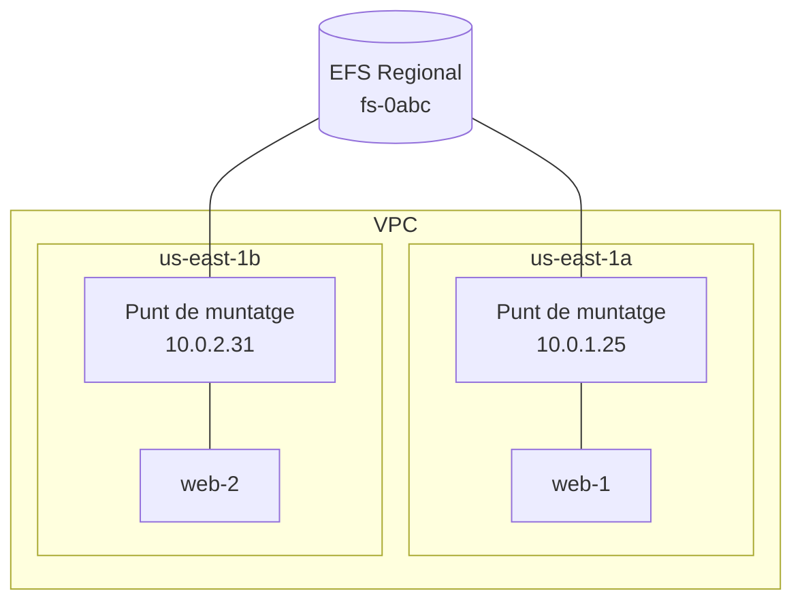
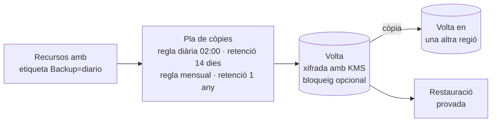

# UD03 · Blocs i fitxers en xarxa

## Resum del tema

Un **volum de blocs** és un disc virtual que es connecta a una màquina; un **sistema de fitxers en xarxa** és una carpeta que munten moltes màquines alhora. En AWS són **EBS** i **EFS** (i la família **FSx** per a casos especials). Tots dos s'administren amb el mateix esquema de la unitat anterior: classe i regió, xifratge, accés i auditoria, muntatge, canvis durant la seua vida i còpies.



### Objectius d'aprenentatge

- Triar el tipus de volum EBS o la classe d'EFS segons el rendiment, el patró d'accés, la durabilitat i el cost.
- Crear volums i sistemes de fitxers **xifrats** amb KMS mitjançant IaC.
- Muntar-los correctament (persistents, en mode lectura o escriptura, des dels orígens autoritzats).
- Ampliar-los, canviar el seu tipus o classe, desmuntar-los i esborrar-los sense perdre dades.
- Protegir-los amb instantànies, replicació i AWS Backup, i comprovar que es poden restaurar.

---

## 1. Amazon EBS: discos per a instàncies

Un volum EBS és un disc en xarxa que es connecta a **una instància EC2 de la mateixa zona de disponibilitat**. Les dades es repliquen dins de la zona, de manera que sobreviuen a una fallada de maquinari, però **no** a la pèrdua de la zona: per a això estan les instantànies.

### 1.1 Tipus de volum (CA RA3.a)

| Tipus | Mitjà | Pensat per a | Rendiment (orientatiu) | Comentari |
|---|---|---|---|---|
| **gp3** | SSD | Quasi tot: arrancada, aplicacions, bases de dades xicotetes i mitjanes | 3000 IOPS i 125 MB/s inclosos; ampliables per separat fins a 80 000 IOPS i 2000 MB/s | **Opció per defecte** |
| gp2 | SSD | Generació anterior | IOPS proporcionals a la grandària, amb crèdits de ràfega | Migra a gp3: més barat i previsible |
| **io2 Block Express** | SSD | Bases de dades crítiques, latència molt baixa i constant | Fins a 256 000 IOPS | IOPS aprovisionades (no disponibles en el Learner Lab); admet Multi-Attach |
| **st1** | HDD | Lectures seqüencials grans: logs, big data | Fins a 500 MB/s | No servix com a disc d'arrancada |
| **sc1** | HDD | Dades fredes amb accés seqüencial | Fins a 250 MB/s | El més barat per GB |

> [!NOTE]
> A més d'EBS, algunes instàncies tenen **magatzem d'instància** (*instance store*): discos NVMe físics del mateix servidor, molt ràpids i **efímers**. S'esborren en aturar la instància. Només per a memòries cau i dades temporals.

### 1.2 Xifratge (CA RA3.c)

- Es decidix **en crear** el volum, amb una clau de KMS (la gestionada `aws/ebs` o una de pròpia).
- El xifratge cobrix les dades en repòs, el trànsit entre la instància i el volum i les instantànies.
- Un volum sense xifrar **no es pot xifrar** directament: es fa una instantània, es **copia xifrant-la** i es crea un volum nou a partir de la còpia.
- Es pot activar el **xifratge per defecte** d'EBS en cada regió del compte, perquè ningú cree volums sense xifrar.

```hcl
resource "aws_ebs_encryption_by_default" "on" { enabled = true }

resource "aws_ebs_volume" "logs" {
  availability_zone = "us-east-1a"
  size              = 20
  type              = "gp3"
  iops              = 3000
  throughput        = 125
  encrypted         = true
  kms_key_id        = aws_kms_key.datos.arn
  tags              = { Name = "ta-${var.alumno}-logs" }
}
```

### 1.3 Muntatge (CA RA3.e)

En les instàncies modernes (Nitro) els volums apareixen com a dispositius **NVMe** (`/dev/nvme1n1`), encara que en la consola els connectes com a `/dev/sdf`. El procés en Linux:

```bash
lsblk -o NAME,SIZE,TYPE,FSTYPE,MOUNTPOINT,SERIAL     # el SERIAL contiene el id del volumen (vol0abc...)
sudo mkfs.xfs /dev/nvme1n1                           # SOLO la primera vez: borra el contenido
sudo mkdir -p /datos/logs
sudo mount /dev/nvme1n1 /datos/logs
# Montaje persistente por UUID; nofail evita que la instancia no arranque si falta el volumen
echo "UUID=$(sudo blkid -s UUID -o value /dev/nvme1n1) /datos/logs xfs defaults,nofail 0 2" | sudo tee -a /etc/fstab
sudo mount -a && findmnt /datos/logs
```

El **mode** es tria en muntar: `ro` per a només lectura (per exemple, un volum restaurat que només vols consultar) o `rw`.

### 1.4 Canvis durant la seua vida (CA RA3.f)

Amb **Elastic Volumes** es canvia la **grandària**, el **tipus**, les **IOPS** i el **rendiment** amb el volum connectat i en ús. Després d'ampliar cal **estendre la partició i el sistema de fitxers**:

```bash
aws ec2 modify-volume --volume-id vol-0abc --size 30 --iops 4000
aws ec2 describe-volumes-modifications --volume-id vol-0abc     # optimizing → completed
sudo growpart /dev/nvme0n1 1          # solo si el sistema de ficheros está en una partición
sudo xfs_growfs -d /datos/logs        # XFS (o: sudo resize2fs /dev/nvme1n1 para ext4)
```

Limitacions: **no es pot reduir** un volum (cal crear-ne un altre de més xicotet i copiar) i entre dues modificacions del mateix volum cal esperar unes hores. Per a retirar un volum: desmuntar-lo (`umount` i llevar la línia de `/etc/fstab`), **desconnectar-lo** (*detach*), fer una instantània final si escau i **esborrar-lo**.

### 1.5 Instantànies (CA RA3.g)

Una **instantània** (*snapshot*) és una còpia puntual del volum que es guarda de manera **regional** (en S3, gestionat per AWS). Són **incrementals**: la primera ho copia tot i les següents només els blocs canviats.

| Funció | Per a què |
|---|---|
| Crear volum des d'instantània | Restaurar, clonar, moure a una altra AZ |
| Copiar a una altra regió (xifrant o canviant de clau) | Recuperació davant de desastres; xifrar un volum que no ho estava |
| **Data Lifecycle Manager** / **AWS Backup** | Programar instantànies i la seua retenció |
| **Paperera de reciclatge** (*Recycle Bin*) | Recuperar instantànies esborrades per error durant un temps |
| Nivell d'arxiu | Instantànies que es guarden mesos o anys, més barates |

> [!WARNING]
> Una instantània d'un disc **en ús** és *consistent davant de fallades* (com si se n'haguera anat la llum). Per a una base de dades, atura l'escriptura o usa els mecanismes del motor (UD04). Les instantànies de diversos volums d'una instància es poden coordinar amb *multi-volume snapshots*.

---

## 2. Amazon EFS: carpetes compartides per NFS

EFS és un sistema de fitxers **NFS v4.1** gestionat i **elàstic**: creix i decreix a soles, i pagues pel que ocupa. El poden muntar **milers de clients alhora** (instàncies EC2, contenidors, funcions Lambda, servidors locals a través de VPN).



### 2.1 Tipus, classes i rendiment (CA RA3.a, RA3.b)

| Decisió | Opcions |
|---|---|
| **Tipus de sistema** | **Regional** (dades en diverses AZ; resistix la caiguda d'una zona) o **One Zone** (una AZ; ≈ 47 % més barat, per a dades que es poden regenerar) |
| **Classe d'emmagatzematge** | **Standard** (accés freqüent), **Infrequent Access (IA)** i **Archive**, amb càrrec per lectura en les dues últimes |
| **Política de cicle de vida** | Passar a IA després de N dies sense accés, a Archive després de N dies i tornar a Standard al primer accés |
| **Mode de rendiment** | *General Purpose* (latència més baixa; recomanat) o *Max I/O* (generació anterior) |
| **Mode de throughput** | **Elastic** (escala a soles i pagues el que uses; recomanat), *Provisioned* o *Bursting* |

**Replicació d'EFS**: còpia contínua a un altre sistema de fitxers en una altra regió o en la mateixa, amb un RPO de minuts. La destinació és de **només lectura** fins que es trenca la replicació en una commutació per error.

### 2.2 Accés i seguretat (CA RA3.c, RA3.d, RA3.e)

EFS combina **quatre capes**:

1. **Xarxa**: cada **punt de muntatge** (*mount target*, un per AZ) té una IP en la teua subxarxa i un **grup de seguretat**. Només han de poder entrar per **TCP 2049** els grups de seguretat dels clients autoritzats.
2. **Política del sistema de fitxers** (IAM): per exemple, **exigir TLS** o permetre només lectura a un rol (`elasticfilesystem:ClientWrite`, `ClientRootAccess`, `ClientMount`).
3. **Punts d'accés** (*access points*): forcen un **usuari/grup POSIX** i un **directori arrel** per a cada aplicació. És la manera que l'aplicació A només veja `/plantillas` i ho faça com a `uid=1001`.
4. **Permisos POSIX** dins del sistema de fitxers, com en qualsevol Linux.

El **xifratge en repòs** es tria en crear el sistema (no es pot activar després); el **xifratge en trànsit** s'aconseguix muntant amb l'assistent `amazon-efs-utils` i l'opció `tls`:

```bash
sudo dnf install -y amazon-efs-utils          # Amazon Linux 2023
sudo mount -t efs -o tls,iam,accesspoint=fsap-0123 fs-0abc:/ /srv/plantillas
# /etc/fstab
fs-0abc:/ /srv/plantillas efs _netdev,noresvport,tls,iam,accesspoint=fsap-0123 0 0
```

Sense l'assistent, amb el client NFS estàndard (sense TLS):

```bash
sudo mount -t nfs4 -o nfsvers=4.1,rsize=1048576,wsize=1048576,hard,timeo=600,retrans=2,noresvport \
  fs-0abc.efs.us-east-1.amazonaws.com:/ /srv/plantillas
```

### 2.3 EFS amb OpenTofu

```hcl
resource "aws_efs_file_system" "plantillas" {
  creation_token   = "ta-${var.alumno}-plantillas"
  encrypted        = true
  kms_key_id       = aws_kms_key.datos.arn
  throughput_mode  = "elastic"
  lifecycle_policy { transition_to_ia = "AFTER_30_DAYS" }
  lifecycle_policy { transition_to_primary_storage_class = "AFTER_1_ACCESS" }
  tags = { Name = "ta-${var.alumno}-plantillas" }
}

resource "aws_efs_mount_target" "mt" {
  for_each        = toset(data.aws_subnets.default.ids)
  file_system_id  = aws_efs_file_system.plantillas.id
  subnet_id       = each.value
  security_groups = [aws_security_group.efs.id]
}

resource "aws_efs_access_point" "web" {
  file_system_id = aws_efs_file_system.plantillas.id
  posix_user {
    uid = 1001
    gid = 1001
  }
  root_directory {
    path = "/plantillas"
    creation_info {
      owner_uid   = 1001
      owner_gid   = 1001
      permissions = "750"
    }
  }
}
```

---

## 3. Amazon FSx: quan NFS no és suficient

| Servei | Protocol | Cas d'ús |
|---|---|---|
| FSx for Windows File Server | SMB, integració amb Active Directory | Carpetes compartides de Windows, perfils d'usuari |
| FSx for NetApp ONTAP | NFS, SMB, iSCSI | Migrar cabines NetApp, entorns mixtos, instantànies i clons eficients |
| FSx for OpenZFS | NFS | Migrar servidors ZFS, latència molt baixa |
| FSx for Lustre | Lustre | Càlcul d'altes prestacions, aprenentatge automàtic, enllaçat amb S3 |

---

## 4. Monitorització, observabilitat i auditoria (CA RA3.d)

| Servei | Mètriques clau (CloudWatch) | Què indiquen |
|---|---|---|
| EBS | `VolumeReadOps`, `VolumeWriteOps`, `VolumeQueueLength`, `VolumeThroughputPercentage`, `VolumeIdleTime`, `BurstBalance` (gp2) | Si el volum es queda curt d'IOPS o MB/s |
| EFS | `StorageBytes`, `ClientConnections`, `MeteredIOBytes`, `PercentIOLimit`, `BurstCreditBalance` | Ocupació, clients i saturació |

> [!IMPORTANT]
> Ni EBS ni EFS et diuen **quant d'espai lliure** queda en el sistema de fitxers d'un volum: això ho sap el sistema operatiu. Per a alarmes de «disc ple» instal·la l'**agent de CloudWatch** en la instància (mètrica `disk_used_percent`).

L'**auditoria** de les operacions d'administració (crear, modificar, connectar, esborrar, canviar polítiques) queda en **CloudTrail**. Etiqueta cada volum i sistema de fitxers per a saber a qui pertany i quant costa.

---

## 5. Còpies de seguretat amb AWS Backup (CA RA3.g)

**AWS Backup** centralitza les còpies d'EBS, EFS, RDS, DynamoDB, S3 i altres serveis:



- Un **pla** té **regles** (freqüència, finestra, retenció, còpia a una altra regió).
- L'**assignació** selecciona recursos per **etiqueta** o per identificador.
- Les còpies van a una **volta**, xifrada i, amb **Vault Lock**, immutable.
- Un pla que no s'ha restaurat mai **no és un pla de còpies**: prova la restauració i mesura el temps (RTO).

> [!TIP]
> EFS crea per defecte un pla de **còpies automàtiques diàries** amb retenció de 35 dies. Comprova-ho i decidix si el mantens o el substituïxes pel teu propi pla.

---

## 6. Errors freqüents

| Problema | Causa | Solució |
|---|---|---|
| No puc connectar el volum a la instància | Estan en zones de disponibilitat diferents | Instantània → volum nou en l'AZ correcta |
| He ampliat el volum però `df` mostra el mateix | Falta estendre la partició i el sistema de fitxers | `growpart` + `xfs_growfs`/`resize2fs` |
| La instància no arranca després de llevar un volum | Línia en `/etc/fstab` sense `nofail` | Usa `nofail`; corregix des de la consola sèrie |
| `mount.nfs: Connection timed out` amb EFS | El grup de seguretat no permet TCP 2049 des del client | Regla d'entrada des del grup de seguretat del client |
| `access denied by server` amb EFS | La política exigix TLS o IAM i muntes sense elles | Munta amb `-o tls,iam` |
| He formatat un volum amb dades | `mkfs` sobre un volum restaurat | Comprova amb `lsblk -f` si ja té sistema de fitxers |
| La factura d'EBS no baixa després d'esborrar la instància | Els volums sense `DeleteOnTermination` i les instantànies continuen existint | Revisa volums *available* i instantànies òrfenes |

## 7. Resum

- EBS: disc d'**una** instància en **una** AZ. gp3 per defecte; xifratge en crear; s'amplia en calent però no es reduïx; instantànies incrementals i regionals.
- EFS: carpeta NFS **compartida**, elàstica i regional; classes Standard/IA/Archive amb cicle de vida; seguretat per grup de seguretat, política, punts d'accés i POSIX; TLS amb `amazon-efs-utils`.
- FSx cobrix SMB/Windows, NetApp, ZFS i Lustre.
- L'ocupació del sistema de fitxers es mesura des de dins (agent de CloudWatch).
- AWS Backup programa còpies per etiqueta, les guarda en voltes i les copia a una altra regió; restaurar és part del pla.

## 8. Autoavaluació


- q: "Necessites un disc de 200 GB per a una base de dades amb 6000 IOPS constants i pressupost ajustat. Quin tipus tries?"
  options: ["sc1", "gp3 amb 6000 IOPS aprovisionades", "st1", "Magatzem d'instància"]
  answer: 1
  explain: "gp3 permet pujar les IOPS per separat de la grandària i és més barat que io2 per a este nivell."
- q: "Tens un volum EBS sense xifrar amb dades. Com el xifres?"
  options: ["Amb `modify-volume --encrypted`", "Instantània → còpia xifrada → volum nou", "Activant el xifratge per defecte", "No es pot"]
  answer: 1
  explain: "El xifratge es fixa en crear; el camí és copiar una instantània xifrant-la."
- q: "Amplies un volum de 20 a 30 GB, però `df -h` continua mostrant 20 GB. Què falta?"
  options: ["Reiniciar la instància", "Estendre la partició i el sistema de fitxers", "Esperar 6 hores", "Crear una instantània"]
  answer: 1
  explain: "El disc creix, però el sistema de fitxers no se n'assabenta fins que l'estens."
- q: "Dues instàncies en zones diferents necessiten escriure en la mateixa carpeta. Quin servei?"
  options: ["Un volum gp3 compartit", "EFS Regional amb un punt de muntatge en cada zona", "EFS One Zone", "Una instantània"]
  answer: 1
  explain: "EBS és zonal i d'una instància; EFS Regional es munta des de totes les AZ."
- q: "Quin port ha de permetre el grup de seguretat del punt de muntatge d'EFS?"
  options: ["TCP 22", "TCP 445", "TCP 2049", "UDP 111"]
  answer: 2
  explain: "NFS v4.1 usa TCP 2049."
- q: "Com fas que una aplicació veja només `/plantillas` en EFS i escriga sempre com a `uid=1001`?"
  options: ["Amb un punt d'accés", "Amb un grup de seguretat", "Amb una clau KMS", "Amb el mode Max I/O"]
  answer: 0
  explain: "Els punts d'accés fixen el directori arrel i la identitat POSIX."
- q: "Quina mètrica t'avisa que el sistema de fitxers d'un volum EBS està quasi ple?"
  options: ["VolumeQueueLength", "BurstBalance", "disk_used_percent de l'agent de CloudWatch", "StorageBytes"]
  answer: 2
  explain: "EBS no coneix el contingut del sistema de fitxers; cal mesurar-lo des del sistema operatiu."


## Referències

- Amazon EBS User Guide — <https://docs.aws.amazon.com/ebs/latest/userguide/>
- *Amazon EBS volume types* — <https://docs.aws.amazon.com/ebs/latest/userguide/ebs-volume-types.html>
- Amazon EFS User Guide — <https://docs.aws.amazon.com/efs/latest/ug/>
- *Mounting EFS file systems with amazon-efs-utils* — <https://docs.aws.amazon.com/efs/latest/ug/mounting-fs-mount-helper.html>
- Amazon FSx — <https://aws.amazon.com/fsx/>
- AWS Backup Developer Guide — <https://docs.aws.amazon.com/aws-backup/latest/devguide/>
