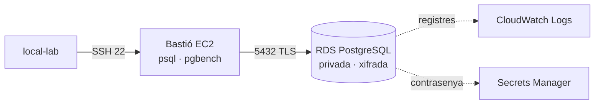

# UD04 · Pràctiques



| Pràctica | Tipus | Nivell | Hores | CA principals |
|---|---|---|--:|---|
| [4.1 RDS PostgreSQL amb OpenTofu](#pràctica-41--rds-postgresql-amb-opentofu) | Guiada | ●●○ | 2,5 | RA4: a, b, c |
| [4.2 Usuaris, TLS i auditoria](#pràctica-42--usuaris-tls-i-auditoria) | Guiada | ●●○ | 2 | RA4: b, c |
| [4.3 Còpies, instantànies i recuperació a un instant](#pràctica-43--còpies-instantànies-i-recuperació-a-un-instant) | Guiada | ●●○ | 2 | RA4: e |
| [4.4 Rèpliques de lectura i Multi-AZ](#pràctica-44--rèpliques-de-lectura-i-multi-az) | Guiada | ●●○ | 2 | RA4: a, d, e |
| [4.5 Mesurar i optimitzar](#pràctica-45--mesurar-i-optimitzar) | Guiada | ●●● | 2,5 | RA4: d, f, g |
| [4.6 DynamoDB: el carret](#pràctica-46--dynamodb-el-carret) | Guiada | ●●○ | 2 | RA4: a, b, c, e, f |
| [4.7 Aurora Serverless v2 davant de RDS](#pràctica-47--aurora-serverless-v2-davant-de-rds) | Repte | ●●● | 1 | RA4: a, d, g |
| [4.8 Les bases de dades de TaquillaAlacant](#pràctica-48--les-bases-de-dades-de-taquillaalacant) | Projecte | ●●● | 2 | RA4: a – g |
| **Total** | | | **16 h** | |

---

## Pràctica 4.1 · RDS PostgreSQL amb OpenTofu



#### Objectiu

Desplegar amb IaC la base de dades de vendes: **privada**, **xifrada** amb clau pròpia, amb **TLS obligatori**, contrasenya en **Secrets Manager**, còpies automàtiques, registres exportats a CloudWatch i un **bastió** per a administrar-la.



#### Desenvolupament

{}

1. **Carpeta `ud04/lab/`** amb este `main.tf`:

    ```hcl
    terraform {
      required_providers {
        aws = { source = "hashicorp/aws", version = "~> 6.0" }
      }
    }

    provider "aws" {
      region = "us-east-1"
      default_tags {
        tags = { Proyecto = "TaquillaAlacant", Alumno = var.alumno, Modulo = "5162" }
      }
    }

    variable "alumno" { type = string }
    variable "mi_ip" { type = string }

    data "aws_vpc" "default" { default = true }
    data "aws_subnets" "default" {
      filter {
        name   = "vpc-id"
        values = [data.aws_vpc.default.id]
      }
      filter {
        name   = "availability-zone"
        values = ["us-east-1a", "us-east-1b", "us-east-1c"]
      }
    }
    data "aws_ssm_parameter" "al2023" {
      name = "/aws/service/ami-amazon-linux-latest/al2023-ami-kernel-default-x86_64"
    }

    resource "aws_kms_key" "bd" {
      description             = "TaquillaAlacant ${var.alumno}: bases de datos"
      enable_key_rotation     = true
      deletion_window_in_days = 7
    }

    # --- Red ---
    resource "aws_security_group" "bastion" {
      name   = "ta-${var.alumno}-bastion"
      vpc_id = data.aws_vpc.default.id
      ingress {
        from_port   = 22
        to_port     = 22
        protocol    = "tcp"
        cidr_blocks = [var.mi_ip]
      }
      egress {
        from_port   = 0
        to_port     = 0
        protocol    = "-1"
        cidr_blocks = ["0.0.0.0/0"]
      }
    }

    resource "aws_security_group" "bd" {
      name   = "ta-${var.alumno}-bd"
      vpc_id = data.aws_vpc.default.id
      ingress {
        description     = "PostgreSQL solo desde el bastion"
        from_port       = 5432
        to_port         = 5432
        protocol        = "tcp"
        security_groups = [aws_security_group.bastion.id]
      }
    }

    resource "aws_db_subnet_group" "bd" {
      name       = "ta-${var.alumno}-bd"
      subnet_ids = data.aws_subnets.default.ids
    }

    # --- Configuración del motor ---
    resource "aws_db_parameter_group" "pg" {
      name   = "ta-${var.alumno}-pg17"
      family = "postgres17"
      parameter {
        name  = "rds.force_ssl"
        value = "1"
      }
      parameter {
        name  = "log_min_duration_statement"
        value = "500"            # registra las sentencias de más de 0,5 s
      }
      parameter {
        name  = "track_io_timing"
        value = "1"
      }
      parameter {
        name         = "shared_preload_libraries"
        value        = "pg_stat_statements,pgaudit"
        apply_method = "pending-reboot"
      }
      parameter {
        name  = "pgaudit.log"
        value = "ddl,role"
      }
    }

    # --- Base de datos ---
    resource "aws_db_instance" "ventas" {
      identifier                      = "ta-${var.alumno}-pg"
      engine                          = "postgres"
      engine_version                  = "17"
      instance_class                  = "db.t4g.micro"
      allocated_storage               = 20
      max_allocated_storage           = 40
      storage_type                    = "gp3"
      storage_encrypted               = true
      kms_key_id                      = aws_kms_key.bd.arn
      db_name                         = "taquilla"
      username                        = "taquilla_admin"
      manage_master_user_password     = true
      db_subnet_group_name            = aws_db_subnet_group.bd.name
      vpc_security_group_ids          = [aws_security_group.bd.id]
      publicly_accessible             = false
      parameter_group_name            = aws_db_parameter_group.pg.name
      multi_az                        = false
      backup_retention_period         = 7
      backup_window                   = "02:00-02:30"
      maintenance_window              = "sun:03:00-sun:04:00"
      auto_minor_version_upgrade      = true
      enabled_cloudwatch_logs_exports = ["postgresql"]
      copy_tags_to_snapshot           = true
      deletion_protection             = false
      skip_final_snapshot             = true
      apply_immediately               = true
    }

    # --- Bastión ---
    resource "aws_instance" "bastion" {
      ami                    = data.aws_ssm_parameter.al2023.value
      instance_type          = "t3.micro"
      key_name               = "vockey"
      iam_instance_profile   = "LabInstanceProfile"
      vpc_security_group_ids = [aws_security_group.bastion.id]
      user_data              = <<-EOF
        #!/bin/bash
        dnf install -y postgresql17 postgresql17-contrib jq
        curl -fsSL -o /etc/pki/rds-global-bundle.pem https://truststore.pki.rds.amazonaws.com/global/global-bundle.pem
      EOF
      tags = { Name = "ta-${var.alumno}-bastion" }
    }

    output "endpoint" { value = aws_db_instance.ventas.address }
    output "secreto" { value = aws_db_instance.ventas.master_user_secret[0].secret_arn }
    output "bastion" { value = aws_instance.bastion.public_ip }
    ```

2. **Desplega** (la base de dades tarda entre 5 i 10 minuts):

    ```bash
    tofu init
    tofu apply -var alumno=$ALUMNO -var mi_ip=$(curl -s ifconfig.me)/32
    ```

3. **Revisa el que s'ha creat** i relaciona-ho amb els criteris:

    ```bash
    aws rds describe-db-instances --db-instance-identifier ta-$ALUMNO-pg --query 'DBInstances[0].{
      Motor:EngineVersion, Clase:DBInstanceClass, AZ:AvailabilityZone, MultiAZ:MultiAZ,
      Cifrado:StorageEncrypted, Clave:KmsKeyId, Publica:PubliclyAccessible,
      Copias:BackupRetentionPeriod, Registros:EnabledCloudwatchLogsExports, Parametros:DBParameterGroups[0].ParameterApplyStatus}'
    ```

    Si `ParameterApplyStatus` és `pending-reboot`, reinicia per a carregar `pgaudit`:

    ```bash
    aws rds reboot-db-instance --db-instance-identifier ta-$ALUMNO-pg
    aws rds wait db-instance-available --db-instance-identifier ta-$ALUMNO-pg
    ```

4. **Connecta't des del bastió** recuperant la contrasenya de Secrets Manager:

    ```bash
    ssh -i labsuser.pem ec2-user@$(tofu output -raw bastion)
    ```

    Dins del bastió (substituïx `ENDPOINT` i `SECRETO` per les eixides d'OpenTofu):

    ```bash
    export PGHOST=ENDPOINT PGDATABASE=taquilla PGUSER=taquilla_admin
    export PGPASSWORD=$(aws secretsmanager get-secret-value --region us-east-1 --secret-id 'SECRETO' \
                        --query SecretString --output text | jq -r .password)
    export PGSSLMODE=verify-full PGSSLROOTCERT=/etc/pki/rds-global-bundle.pem
    psql -c "select version();" -c "show ssl;" -c "show shared_preload_libraries;"
    ```

5. **Comprova que sense TLS no entra**:

    ```bash
    PGSSLMODE=disable psql -c "select 1"
    ```

    ```text
    psql: error: ... no pg_hba.conf entry for host "172.31.x.x", user "taquilla_admin", database "taquilla", no encryption
    ```

6. **Carrega l'esquema i les dades** del projecte:

    ```bash
    curl -fsSLO https://lorenalresusta.github.io/BBDD-Nube/recursos/taquilla/esquema.sql
    curl -fsSLO https://lorenalresusta.github.io/BBDD-Nube/recursos/taquilla/generar_ventas.py
    psql -f esquema.sql
    python3 generar_ventas.py --ventas 200000 --sql > datos.sql
    time psql -q -f datos.sql
    psql -c "select count(*) from venta;"
    ```

7. **Comprova que no és accessible des d'Internet**: des de `local-lab`, `nc -vz -w 5 ENDPOINT 5432` ha d'esgotar el temps.

{}

#### Comprovació

- [ ] La instància està xifrada amb la teua clau, no és pública i té 7 dies de còpies.
- [ ] Connectes amb `verify-full` i sense TLS es rebutja.
- [ ] `shared_preload_libraries` inclou `pg_stat_statements` i `pgaudit`.
- [ ] La taula `venta` té 200 000 files.

#### Problemes habituals

| Símptoma | Causa | Solució |
|---|---|---|
| `InvalidParameterCombination` amb la versió o la classe | La versió `17` o `db.t4g.micro` no està disponible | `aws rds describe-orderable-db-instance-options --engine postgres --engine-version 17 --query 'OrderableDBInstanceOptions[].DBInstanceClass'` |
| Error de permisos amb `manage_master_user_password` | El laboratori no permet Secrets Manager en eixe moment | Substituïx-lo per `password = var.password` i passa la contrasenya amb `TF_VAR_password` (mai en el codi) |
| `psql: command not found` en el bastió | `user_data` encara no ha acabat | Espera un parell de minuts: `sudo cloud-init status --wait` |
| `server certificate ... does not match host name` | Connectes per IP o amb un àlies | Usa el nom del punt d'enllaç |

> [!NOTE]
> **No destruïsques** el laboratori: l'usen les pràctiques 4.2 a 4.5. En acabar la sessió, **atura** la base de dades: `aws rds stop-db-instance --db-instance-identifier ta-$ALUMNO-pg`.

---

## Pràctica 4.2 · Usuaris, TLS i auditoria



#### Objectiu

Aplicar el **mínim privilegi** dins de la base de dades, auditar els canvis d'esquema i de rols, i localitzar les accions d'administració en CloudTrail.

#### Desenvolupament

{}

1. **Crea els rols** de l'aplicació i de l'analista (en el bastió, com a `taquilla_admin`):

    ```sql
    CREATE EXTENSION IF NOT EXISTS pg_stat_statements;
    CREATE EXTENSION IF NOT EXISTS pgaudit;

    CREATE ROLE app_rw LOGIN PASSWORD 'Cambia-Esto-1';
    GRANT CONNECT ON DATABASE taquilla TO app_rw;
    GRANT USAGE ON SCHEMA public TO app_rw;
    GRANT SELECT, INSERT, UPDATE ON ALL TABLES IN SCHEMA public TO app_rw;
    GRANT USAGE ON ALL SEQUENCES IN SCHEMA public TO app_rw;

    CREATE ROLE analista LOGIN PASSWORD 'Cambia-Esto-2';
    GRANT CONNECT ON DATABASE taquilla TO analista;
    GRANT USAGE ON SCHEMA public TO analista;
    GRANT SELECT ON recinto, evento, venta TO analista;

    REVOKE CREATE ON SCHEMA public FROM PUBLIC;
    ```

2. **Comprova els privilegis**:

    ```bash
    PGUSER=analista PGPASSWORD='Cambia-Esto-2' psql -c "select count(*) from venta;"      # OK
    PGUSER=analista PGPASSWORD='Cambia-Esto-2' psql -c "select email from cliente limit 1;" # permission denied
    PGUSER=app_rw PGPASSWORD='Cambia-Esto-1' psql -c "delete from venta where id_venta=1;" # permission denied
    PGUSER=app_rw PGPASSWORD='Cambia-Esto-1' psql -c "create table x(a int);"             # permission denied
    ```

3. **Comprova el xifratge de les connexions** actives:

    ```sql
    SELECT a.usename, s.ssl, s.version, s.cipher
    FROM pg_stat_ssl s JOIN pg_stat_activity a USING (pid)
    WHERE a.usename IS NOT NULL;
    ```

4. **Genera esdeveniments auditables** i busca'ls en CloudWatch Logs:

    ```sql
    CREATE TABLE prueba_auditoria (id int);
    ALTER ROLE analista CONNECTION LIMIT 5;
    DROP TABLE prueba_auditoria;
    ```

    ```bash
    aws logs filter-log-events --log-group-name /aws/rds/instance/ta-$ALUMNO-pg/postgresql \
      --filter-pattern AUDIT --query 'events[].message' --output text | tail -5
    ```

    ```text
    ... LOG:  AUDIT: SESSION,1,1,DDL,CREATE TABLE,,,CREATE TABLE prueba_auditoria (id int);,<not logged>
    ... LOG:  AUDIT: SESSION,2,1,ROLE,ALTER ROLE,,,ALTER ROLE analista CONNECTION LIMIT 5;,<not logged>
    ```

5. **Auditoria d'administració**: modifica la finestra de còpies i localitza l'esdeveniment en CloudTrail.

    ```bash
    aws rds modify-db-instance --db-instance-identifier ta-$ALUMNO-pg --backup-window 03:00-03:30 --apply-immediately
    sleep 120
    aws cloudtrail lookup-events --lookup-attributes AttributeKey=EventName,AttributeValue=ModifyDBInstance \
      --max-results 3 --query 'Events[].[EventTime,Username,EventName]' --output table
    ```

6. **Subscriu-te als esdeveniments** de la instància (reinicis, commutacions, còpies) amb SNS:

    ```bash
    TOPIC=$(aws sns create-topic --name ta-$ALUMNO-bd-eventos --query TopicArn --output text)
    aws sns subscribe --topic-arn $TOPIC --protocol email --notification-endpoint TU_CORREO
    aws rds create-event-subscription --subscription-name ta-$ALUMNO-bd --sns-topic-arn $TOPIC \
      --source-type db-instance --source-ids ta-$ALUMNO-pg \
      --event-categories availability backup failover maintenance notification
    ```

    Confirma la subscripció des del teu correu i reinicia la instància: rebràs l'avís.

{}

#### Comprovació

- [ ] `analista` no veu les dades personals i `app_rw` no pot esborrar ni crear taules.
- [ ] Totes les connexions apareixen amb `ssl = t`.
- [ ] Trobes els teus `CREATE`/`ALTER ROLE` en CloudWatch Logs i el `ModifyDBInstance` en CloudTrail.

---

## Pràctica 4.3 · Còpies, instantànies i recuperació a un instant



#### Objectiu

Recuperar-te d'un **esborrament accidental** amb la recuperació a un instant (PITR), fer instantànies manuals i còpies entre regions, i una exportació lògica. Mesura els temps.

#### Desenvolupament

{}

1. **Instantània manual** de referència:

    ```bash
    aws rds create-db-snapshot --db-instance-identifier ta-$ALUMNO-pg --db-snapshot-identifier ta-$ALUMNO-pg-antes
    aws rds wait db-snapshot-available --db-snapshot-identifier ta-$ALUMNO-pg-antes
    ```

2. **Anota l'hora** i provoca el desastre (en el bastió):

    ```bash
    date -u +%Y-%m-%dT%H:%M:%SZ | tee hora_buena.txt
    sleep 60
    psql -c "select count(*) from venta where canal='taquilla';"
    psql -c "delete from venta where canal='taquilla';"      # ¡ups!
    ```

3. **Consulta l'últim instant restaurable** i restaura **un minut abans de l'esborrament** en una instància nova:

    ```bash
    aws rds describe-db-instances --db-instance-identifier ta-$ALUMNO-pg --query 'DBInstances[0].LatestRestorableTime'
    time aws rds restore-db-instance-to-point-in-time \
      --source-db-instance-identifier ta-$ALUMNO-pg \
      --target-db-instance-identifier ta-$ALUMNO-pg-pitr \
      --restore-time $(cat hora_buena.txt) \
      --db-instance-class db.t4g.micro \
      --db-subnet-group-name ta-$ALUMNO-bd \
      --vpc-security-group-ids $(aws ec2 describe-security-groups --filters Name=group-name,Values=ta-$ALUMNO-bd --query 'SecurityGroups[0].GroupId' --output text) \
      --db-parameter-group-name ta-$ALUMNO-pg17 \
      --no-publicly-accessible
    aws rds wait db-instance-available --db-instance-identifier ta-$ALUMNO-pg-pitr
    ```

    > [!NOTE]
    > Les restauracions de PITR només estan disponibles fins a uns 5 minuts abans del present. Si `hora_buena.txt` és més recent que `LatestRestorableTime`, espera.

4. **Recupera només el que s'ha esborrat** copiant-ho de la instància restaurada a l'original:

    ```bash
    PITR=$(aws rds describe-db-instances --db-instance-identifier ta-$ALUMNO-pg-pitr --query 'DBInstances[0].Endpoint.Address' --output text)
    psql -h $PITR -c "select count(*) from venta where canal='taquilla';"
    psql -h $PITR -c "\copy (select * from venta where canal='taquilla') to 'recuperar.csv' csv"
    psql -c "\copy venta from 'recuperar.csv' csv"
    psql -c "select count(*) from venta where canal='taquilla';"
    ```

5. **Copia la instantània a Oregon** (canvia de clau, perquè les claus de KMS són regionals):

    ```bash
    CUENTA=$(aws sts get-caller-identity --query Account --output text)
    aws rds copy-db-snapshot --region us-west-2 \
      --source-db-snapshot-identifier arn:aws:rds:us-east-1:$CUENTA:snapshot:ta-$ALUMNO-pg-antes \
      --target-db-snapshot-identifier ta-$ALUMNO-pg-dr \
      --kms-key-id alias/aws/rds
    ```

6. **Exportació lògica** amb `pg_dump` (format personalitzat, comprimit) i pujada a S3:

    ```bash
    pg_dump -Fc -f taquilla_$(date +%F).dump
    pg_restore -l taquilla_*.dump | head
    aws s3 cp taquilla_*.dump s3://ta-$ALUMNO-entradas-SUFIJO/copias/bd/
    ```

7. **Neteja** la instància restaurada i la còpia d'Oregon:

    ```bash
    aws rds delete-db-instance --db-instance-identifier ta-$ALUMNO-pg-pitr --skip-final-snapshot
    aws rds delete-db-snapshot --region us-west-2 --db-snapshot-identifier ta-$ALUMNO-pg-dr
    ```

{}

#### Comprovació

- [ ] Les vendes de taquilla tornen a estar en la base de dades original.
- [ ] Has anotat quant va tardar la restauració (RTO) i quantes dades s'haurien pogut perdre (RPO).
- [ ] Hi ha un bolcat `.dump` en S3 i saps restaurar-lo amb `pg_restore`.

---

## Pràctica 4.4 · Rèpliques de lectura i Multi-AZ



#### Objectiu

Crear una **rèplica de lectura**, mesurar-ne el retard i promocionar-la; convertir la instància en **Multi-AZ** i provocar una **commutació per error**.

#### Desenvolupament

{}

1. **Crea la rèplica** en una altra zona:

    ```bash
    aws rds create-db-instance-read-replica --db-instance-identifier ta-$ALUMNO-pg-r1 \
      --source-db-instance-identifier ta-$ALUMNO-pg --availability-zone us-east-1b \
      --db-instance-class db.t4g.micro
    aws rds wait db-instance-available --db-instance-identifier ta-$ALUMNO-pg-r1
    ```

2. **Comprova que és de només lectura** i mesura el retard:

    ```bash
    R1=$(aws rds describe-db-instances --db-instance-identifier ta-$ALUMNO-pg-r1 --query 'DBInstances[0].Endpoint.Address' --output text)
    psql -h $R1 -c "select pg_is_in_recovery(), now() - pg_last_xact_replay_timestamp() as retraso;"
    psql -h $R1 -c "insert into recinto(nombre,aforo) values ('X',1);"     # read-only transaction
    ```

    Genera escriptures en la primària i observa `ReplicaLag` en CloudWatch:

    ```bash
    psql -c "insert into venta (id_evento,id_cliente,canal,entradas,importe)
             select 1+(random()*399)::int, 1+(random()*4999)::int, 'web', 2, 50 from generate_series(1,200000);"
    aws cloudwatch get-metric-statistics --namespace AWS/RDS --metric-name ReplicaLag \
      --dimensions Name=DBInstanceIdentifier,Value=ta-$ALUMNO-pg-r1 \
      --start-time $(date -u -d '-15 min' +%FT%TZ) --end-time $(date -u +%FT%TZ) \
      --period 60 --statistics Maximum --query 'Datapoints[].[Timestamp,Maximum]' --output text | sort
    ```

3. **Promociona la rèplica** (simula que la primària s'ha perdut): passa a ser una instància independent de lectura/escriptura.

    ```bash
    aws rds promote-read-replica --db-instance-identifier ta-$ALUMNO-pg-r1
    aws rds wait db-instance-available --db-instance-identifier ta-$ALUMNO-pg-r1
    psql -h $R1 -c "select pg_is_in_recovery();"      # f
    aws rds delete-db-instance --db-instance-identifier ta-$ALUMNO-pg-r1 --skip-final-snapshot
    ```

4. **Convertix la primària en Multi-AZ** (en OpenTofu: `multi_az = true` i `tofu apply`) i comprova la zona de la standby:

    ```bash
    aws rds describe-db-instances --db-instance-identifier ta-$ALUMNO-pg \
      --query 'DBInstances[0].[MultiAZ,AvailabilityZone,SecondaryAvailabilityZone]'
    ```

5. **Provoca la commutació** i mesura el tall amb un bucle de consultes en el bastió:

    ```bash
    while true; do printf "%s " "$(date +%T)"; psql -tAc "select inet_server_addr();" 2>&1 | head -1; sleep 1; done
    ```

    En un altre terminal:

    ```bash
    aws rds reboot-db-instance --db-instance-identifier ta-$ALUMNO-pg --force-failover
    ```

    Observa quants segons fallen les consultes i com canvia la IP del servidor darrere del mateix punt d'enllaç.

6. **Torna a Single-AZ** (`multi_az = false`) per a estalviar crèdit.

{}

#### Comprovació

- [ ] Has mesurat el `ReplicaLag` i explicat per què la rèplica és asíncrona.
- [ ] La commutació Multi-AZ ha canviat de zona sense canviar el punt d'enllaç; has mesurat el tall.
- [ ] Saps en quin cas usaries cada mecanisme (taula de l'apartat 3 de la teoria).

---

## Pràctica 4.5 · Mesurar i optimitzar



#### Objectiu

Mesurar el rendiment d'insercions, actualitzacions i consultes de TaquillaAlacant, trobar el coll de botella i comprovar amb números l'efecte d'un índex, d'un paràmetre i d'un canvi de classe d'instància.

#### Desenvolupament

{}

1. **Escriu la càrrega de treball** de l'aplicació en fitxers de `pgbench` (en el bastió):

    ```bash
    cat > venta.sql <<'EOF'
    \set ev random(1, 400)
    \set cli random(1, 5000)
    INSERT INTO venta (id_evento, id_cliente, canal, entradas, importe) VALUES (:ev, :cli, 'web', 2, 45.00);
    EOF
    cat > actualiza.sql <<'EOF'
    \set v random(1, 200000)
    UPDATE venta SET entradas = entradas WHERE id_venta = :v;
    EOF
    cat > informe.sql <<'EOF'
    \set d random(0, 1400)
    SELECT canal, count(*), sum(importe) FROM venta
    WHERE fecha_venta >= date '2022-01-01' + :d AND fecha_venta < date '2022-01-01' + :d + 1
    GROUP BY canal;
    EOF
    ```

2. **Línia base**: 4 clients durant 60 s amb el pes de cada operació.

    ```bash
    psql -c "select pg_stat_statements_reset();"
    pgbench -n -c 4 -j 2 -T 60 -P 10 -f venta.sql@5 -f actualiza.sql@3 -f informe.sql@2 | tee base.txt
    ```

    Anota TPS i latència mitjana.

3. **Busca la sentència culpable**:

    ```sql
    SELECT calls, round(mean_exec_time::numeric, 2) AS ms_media, round(total_exec_time::numeric) AS ms_total,
           left(query, 60) AS sentencia
    FROM pg_stat_statements WHERE dbid = (SELECT oid FROM pg_database WHERE datname = 'taquilla')
    ORDER BY total_exec_time DESC LIMIT 5;
    ```

    I el seu pla:

    ```sql
    EXPLAIN (ANALYZE, BUFFERS)
    SELECT canal, count(*), sum(importe) FROM venta
    WHERE fecha_venta >= '2024-06-20' AND fecha_venta < '2024-06-21' GROUP BY canal;
    ```

    Veuràs un `Seq Scan on venta` que llig tota la taula.

4. **Optimització d'esquema**: crea l'índex sense bloquejar les escriptures i repetix.

    ```sql
    CREATE INDEX CONCURRENTLY ix_venta_fecha ON venta (fecha_venta) INCLUDE (canal, importe);
    ANALYZE venta;
    ```

    ```bash
    psql -c "select pg_stat_statements_reset();"
    pgbench -n -c 4 -j 2 -T 60 -P 10 -f venta.sql@5 -f actualiza.sql@3 -f informe.sql@2 | tee indice.txt
    ```

    Compara el pla (`Index Only Scan`), la latència de l'informe i el TPS. Han empitjorat les insercions? Per què?

5. **Observa la càrrega** en **CloudWatch → Database Insights** (o en la pestanya *Monitoring* de la instància): càrrega de la base de dades, esperes principals i sentències més costoses durant cada prova. Fes una captura de cadascuna.

6. **Optimització de configuració**: crea un paràmetre dinàmic més generós per a les ordenacions i compara un informe amb ordenació:

    ```bash
    aws rds modify-db-parameter-group --db-parameter-group-name ta-$ALUMNO-pg17 \
      --parameters "ParameterName=work_mem,ParameterValue=16384,ApplyMethod=immediate"
    ```

    ```sql
    EXPLAIN (ANALYZE) SELECT * FROM venta ORDER BY importe DESC LIMIT 1000 OFFSET 50000;
    -- Busca "Sort Method: external merge  Disk" antes y "quicksort  Memory" después
    ```

7. **Canvi de cicle de vida**: escala la instància a `db.t4g.small`, mesura quant dura el tall i repetix la prova de càrrega.

    ```bash
    aws rds modify-db-instance --db-instance-identifier ta-$ALUMNO-pg --db-instance-class db.t4g.small --apply-immediately
    ```

    Després torna a `db.t4g.micro`.

{}

#### Comprovació

- [ ] Tens una taula amb TPS i latència de: línia base, amb índex i amb la classe major.
- [ ] El pla de l'informe passa de `Seq Scan` a `Index Only Scan`.
- [ ] Saps justificar quin dels tres canvis té millor relació millora/cost.

---

## Pràctica 4.6 · DynamoDB: el carret



#### Objectiu

Crear la taula del carret amb IaC (xifrada amb clau pròpia, sota demanda, TTL i PITR), treballar amb elements i consultes, i recuperar la taula després d'un error.

#### Desenvolupament

{}

1. **Afig la taula** al `main.tf` del laboratori (el bloc `aws_dynamodb_table` de la teoria, apartat 10) i aplica-ho.

2. **Inserix elements** (la caducitat, en temps Unix, d'ací a 30 minuts):

    ```bash
    T=ta-$ALUMNO-carrito; CADUCA=$(( $(date +%s) + 1800 ))
    for ev in 0042 0107; do
      aws dynamodb put-item --table-name $T --item '{
        "PK":{"S":"CARRITO#s-abc"}, "SK":{"S":"EVENTO#'$ev'"},
        "entradas":{"N":"2"}, "precio":{"N":"45.00"}, "caduca":{"N":"'$CADUCA'"}}'
    done
    ```

3. **Consulta** el carret d'una sessió i compara la consistència i el consum:

    ```bash
    aws dynamodb query --table-name $T --key-condition-expression "PK = :pk" \
      --expression-attribute-values '{":pk":{"S":"CARRITO#s-abc"}}' --return-consumed-capacity TOTAL
    aws dynamodb query --table-name $T --key-condition-expression "PK = :pk" --consistent-read \
      --expression-attribute-values '{":pk":{"S":"CARRITO#s-abc"}}' --return-consumed-capacity TOTAL
    ```

4. **Actualització condicional** (no es pot baixar de 0 entrades):

    ```bash
    aws dynamodb update-item --table-name $T --key '{"PK":{"S":"CARRITO#s-abc"},"SK":{"S":"EVENTO#0042"}}' \
      --update-expression "SET entradas = entradas - :uno" --condition-expression "entradas >= :uno" \
      --expression-attribute-values '{":uno":{"N":"1"}}' --return-values UPDATED_NEW
    ```

5. **Càrrega massiva** amb un xicotet script i observa les mètriques `ConsumedWriteCapacityUnits` i `SuccessfulRequestLatency` en CloudWatch:

    ```bash
    sudo dnf install -y python3-boto3
    export ALUMNO=lmartinez        # en el bastión también
    python3 - <<'EOF'
    import boto3, time, random, os
    t = boto3.resource("dynamodb", region_name="us-east-1").Table(f"ta-{os.environ['ALUMNO']}-carrito")
    with t.batch_writer() as b:
        for i in range(5000):
            b.put_item(Item={"PK": f"CARRITO#s-{i:05d}", "SK": f"EVENTO#{random.randint(1,400):04d}",
                             "entradas": random.randint(1, 6), "caduca": int(time.time()) + 1800})
    print("ok")
    EOF
    ```

6. **Recuperació a un instant**: anota l'hora, esborra els elements d'una sessió i restaura la taula en una altra de nova.

    ```bash
    HORA=$(date -u +%s); sleep 60
    aws dynamodb delete-item --table-name $T --key '{"PK":{"S":"CARRITO#s-abc"},"SK":{"S":"EVENTO#0107"}}'
    aws dynamodb describe-continuous-backups --table-name $T \
      --query 'ContinuousBackupsDescription.PointInTimeRecoveryDescription'
    aws dynamodb restore-table-to-point-in-time --source-table-name $T \
      --target-table-name $T-restaurada --restore-date-time $HORA
    aws dynamodb wait table-exists --table-name $T-restaurada
    aws dynamodb get-item --table-name $T-restaurada --key '{"PK":{"S":"CARRITO#s-abc"},"SK":{"S":"EVENTO#0107"}}'
    ```

    > [!NOTE]
    > La taula restaurada **no** hereta la configuració de TTL, les etiquetes, les alarmes ni les polítiques: cal tornar a aplicar-les. Amb IaC és immediat.

7. **Neteja** la taula restaurada: `aws dynamodb delete-table --table-name $T-restaurada`.

{}

#### Comprovació

- [ ] La taula usa la teua clau KMS, mode sota demanda, TTL i PITR (`describe-table` i `describe-continuous-backups`).
- [ ] La lectura fortament consistent consumix el doble de capacitat que l'eventual.
- [ ] Has recuperat l'element esborrat des de la taula restaurada.

#### Ampliació

Convertix la taula en **taula global** amb una rèplica en `us-west-2` i comprova el temps que tarda a aparéixer allí un element escrit en `us-east-1`.

---

## Pràctica 4.7 · Aurora Serverless v2 davant de RDS



#### Enunciat

Crea un clúster **Aurora PostgreSQL Serverless v2** (capacitat mínima 0,5 ACU i màxima 2 ACU, o la que permeta el laboratori), xifrat amb la teua clau, i carrega les mateixes dades que en RDS.

1. Repetix la prova de `pgbench` de la pràctica 4.5 i observa la mètrica `ServerlessDatabaseCapacity`.
2. Afig una instància lectora i comprova el retard de rèplica (`AuroraReplicaLag`). Compara'l amb el `ReplicaLag` de RDS.
3. Estima el cost mensual dels dos models per a TaquillaAlacant, sabent que hi ha pics de càrrega molt forts en obrir la venda dels grans concerts i poca activitat la resta del temps.
4. Conclou quin model recomanaries i per què.

Destruïx el clúster en acabar: consumix crèdit encara que no l'uses si la capacitat mínima és major que 0.

---

## Pràctica 4.8 · Les bases de dades de TaquillaAlacant



#### Requisits

- **RDS PostgreSQL** desplegada amb OpenTofu, amb les decisions justificades de **regió de producció**, **Multi-AZ** i **rèplica** (en el laboratori pots deixar-les desactivades, però el codi ha de permetre activar-les amb una variable).
- Xifratge amb clau pròpia, TLS obligatori, contrasenya en Secrets Manager, xarxa privada.
- Rols `app_rw`, `analista` i `copias` (només lectura per a `pg_dump`) creats amb un script SQL idempotent.
- `pgaudit` per a DDL i rols; registres exportats a CloudWatch Logs amb retenció de 30 dies.
- **Alarmes** de CloudWatch amb notificació per SNS: CPU > 80 % durant 10 minuts, `FreeStorageSpace` < 2 GB i `DatabaseConnections` > 50.
- **Còpies**: retenció de 7 dies, instantània setmanal copiada a una altra regió i bolcat `pg_dump` setmanal a S3 amb un script.
- **Optimització**: la taula `venta` **particionada per mes** (`PARTITION BY RANGE (fecha_venta)`) amb el seu índex, i una comparació amb `EXPLAIN` davant de la taula sense particionar.
- **DynamoDB** del carret amb TTL, PITR i xifratge amb clau pròpia.
- **Informe** amb: taula de criteris RA4.a – g i com es complixen; RPO i RTO mesurats; cost mensual estimat en producció.

#### Comprovació

- [ ] `tofu apply` ho crea tot des de zero, incloses les alarmes.
- [ ] Una restauració PITR documentada i cronometrada.
- [ ] Les alarmes salten en una prova controlada (per exemple, obrint 60 connexions amb `pgbench -c 60`).
