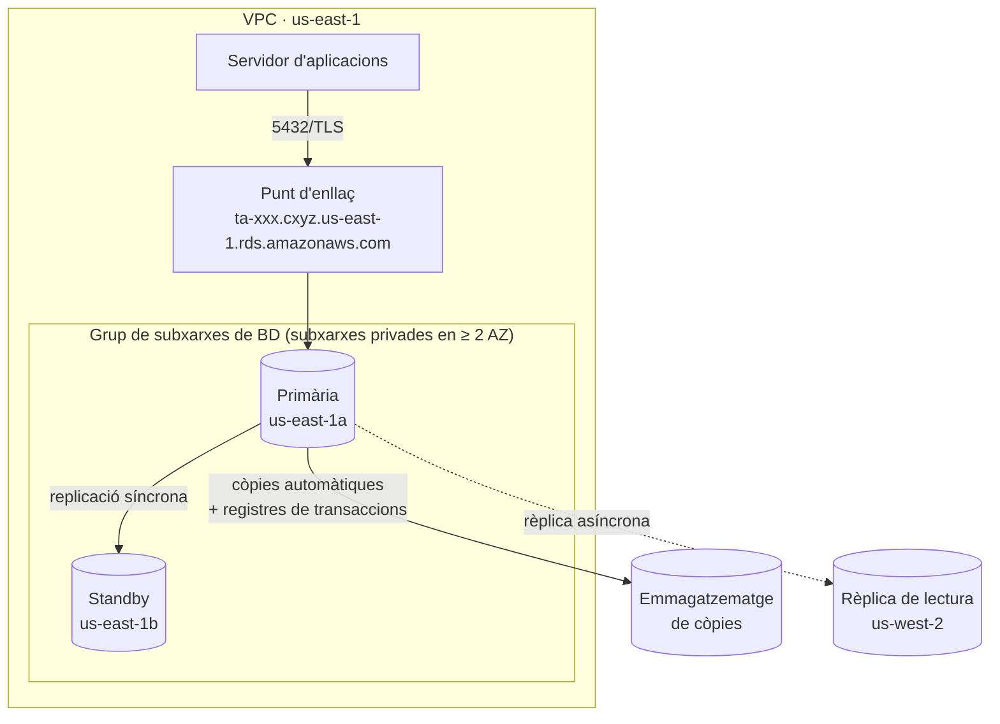

# UD04 · Bases de dades administrades

## Resum del tema

En un centre de dades propi, administrar una base de dades és instal·lar el motor, aplicar-li pegats, vigilar els discos, programar còpies i muntar l'alta disponibilitat. En el núvol el proveïdor s'encarrega de bona part d'eixe treball, però **no de tot**: tu continues decidint la regió, la grandària, el xifratge, qui hi accedix, quant de temps es guarden les còpies, com es vigila i com s'optimitza. Esta unitat tracta exactament d'això.



### Objectius d'aprenentatge

- Triar entre base de dades autogestionada, administrada o *serverless*, i entre motor relacional i NoSQL.
- Desplegar una base de dades amb IaC amb la regió, la replicació i el xifratge adequats.
- Controlar la xarxa, els usuaris, els privilegis i l'auditoria.
- Aplicar canvis de grandària, de configuració i de versió amb el mínim tall.
- Configurar còpies automàtiques, instantànies i recuperació a un instant, i provar-les.
- Mesurar el rendiment d'insercions, actualitzacions i consultes, i aplicar optimitzacions senzilles.

---

## 1. Tres maneres de tindre una base de dades en el núvol

| | **Autogestionada** (en EC2) | **Administrada** (RDS, Aurora) | **Serverless** (DynamoDB, Aurora Serverless v2, Aurora DSQL) |
|---|---|---|---|
| Instal·lar i aplicar pegats al SO i al motor | Tu | Proveïdor (tu tries la finestra) | Proveïdor |
| Còpies, PITR, rèpliques | Tu | Configures; el proveïdor executa | Configures; el proveïdor executa |
| Alta disponibilitat | La muntes tu | Una opció (Multi-AZ) | Inclosa |
| Capacitat | Tries la màquina | Tries la classe d'instància | Escala a soles; pagues per ús |
| Control total del motor | Sí | Limitat (sense accés al SO) | Molt limitat |
| Quan | Motor o versió no suportats, requisits molt especials | La majoria de bases de dades relacionals | Càrrega variable o imprevisible; escala massiva |

### 1.1 Motors disponibles

| Família | AWS | Azure | Google Cloud |
|---|---|---|---|
| Relacional estàndard | **RDS** per a PostgreSQL, MySQL, MariaDB, Oracle, SQL Server, Db2 | Azure Database for PostgreSQL/MySQL, Azure SQL | Cloud SQL |
| Relacional nativa del núvol | **Aurora** (compatible amb MySQL i PostgreSQL), Aurora DSQL | Azure SQL Hyperscale | AlloyDB, Spanner |
| Clau-valor i documents | **DynamoDB**, DocumentDB | Cosmos DB | Firestore, Bigtable |
| En memòria | ElastiCache / MemoryDB (Valkey, Redis OSS) | Azure Cache for Redis | Memorystore |
| Grafs, sèries temporals… | Neptune, Timestream, Keyspaces | Cosmos DB (API Gremlin, Cassandra) | — |

> [!NOTE]
> **Aurora** separa el còmput de l'emmagatzematge: les dades es guarden en un volum distribuït amb **sis còpies en tres zones** que creix a soles, i les rèpliques llegixen del mateix volum, per la qual cosa el retard de rèplica és molt baix. És més cara per hora que RDS, però oferix més rendiment i disponibilitat.

---

## 2. Anatomia d'una instància de RDS



| Element | Què decidixes |
|---|---|
| **Motor i versió** | PostgreSQL 17, MySQL 8.4… i si s'actualitzen a soles les versions menors |
| **Classe d'instància** | CPU i memòria: `db.t4g.micro` (proves), `db.m7g.large` (producció)… |
| **Emmagatzematge** | gp3 o io2, grandària, IOPS i **autoescalat d'emmagatzematge** |
| **Grup de subxarxes** | En quines subxarxes (i zones) pot viure la instància |
| **Grup de paràmetres** | La configuració del motor (`postgresql.conf`) |
| **Grup d'opcions** | Funcions extra en alguns motors (Oracle, SQL Server, MySQL) |
| **Punt d'enllaç** | El nom DNS al qual es connecta l'aplicació; no canvia encara que canvie la màquina |

---

## 3. Regió i replicació (CA RA4.a)

| Opció | Com funciona | Protegix de | RPO / RTO típics | Es pot llegir de la còpia |
|---|---|---|---|---|
| **Single-AZ** | Una instància | Fallada de disc (l'emmagatzematge està replicat en l'AZ) | Còpies: minuts / restaurar: 10 – 30 min o més | — |
| **Multi-AZ (instància)** | Standby **síncrona** en una altra AZ; commutació automàtica del DNS | Caiguda de la instància o de l'AZ | 0 / 1 – 2 min | No |
| **Multi-AZ (clúster de BD)** | Escriptora + **dues** standby llegibles en tres AZ | Igual, commutació més ràpida | 0 / < 1 min | Sí |
| **Rèplica de lectura** | Còpia **asíncrona**, en la mateixa regió o en una altra; es pot **promocionar** | Sobrecàrrega de lectures; desastre regional (si és entre regions) | Segons de retard / minuts en promocionar | Sí |
| **Aurora Global Database** | Clúster secundari en una altra regió amb retard típic < 1 s | Desastre regional | ≈ 1 s / ≈ 1 min | Sí |

Criteris per a decidir: **residència** (les rèpliques entre regions mouen dades personals a un altre país), **latència** dels usuaris, **RPO/RTO** exigits i **cost** (Multi-AZ duplica, aproximadament, el preu de la instància i de l'emmagatzematge; les rèpliques entre regions afigen transferència).

---

## 4. Xifratge (CA RA4.b)

- **En repòs**: amb una clau de KMS que es tria **en crear** la instància. Xifra l'emmagatzematge, les còpies automàtiques, les instantànies, els registres i les rèpliques. Per a xifrar una base de dades que no ho estava: instantània → **còpia xifrada** → restaurar en una instància nova → canviar l'aplicació de punt d'enllaç.
- **En trànsit**: TLS entre el client i la base de dades. En RDS per a PostgreSQL s'**obliga** amb el paràmetre `rds.force_ssl = 1` (activat per defecte des de PostgreSQL 15). El client ha de validar el certificat del servidor amb el **paquet de CA de RDS** (`sslmode=verify-full`).
- **Secrets**: la contrasenya de l'usuari mestre no ha d'estar en el codi ni en l'estat d'IaC. RDS pot **gestionar-la en AWS Secrets Manager** i rotar-la.

```hcl
resource "aws_db_instance" "ventas" {
  identifier                  = "ta-${var.alumno}-pg"
  engine                      = "postgres"
  engine_version              = "17"
  instance_class              = "db.t4g.micro"
  allocated_storage           = 20
  max_allocated_storage       = 50           # autoescalado de almacenamiento
  storage_type                = "gp3"
  storage_encrypted           = true
  kms_key_id                  = aws_kms_key.bd.arn
  username                    = "taquilla_admin"
  manage_master_user_password = true         # contraseña en Secrets Manager
  db_name                     = "taquilla"
  db_subnet_group_name        = aws_db_subnet_group.bd.name
  vpc_security_group_ids      = [aws_security_group.bd.id]
  publicly_accessible         = false
  parameter_group_name        = aws_db_parameter_group.pg.name
  multi_az                    = false
  backup_retention_period     = 7
  backup_window               = "02:00-02:30"
  maintenance_window          = "sun:03:00-sun:04:00"
  enabled_cloudwatch_logs_exports = ["postgresql"]
  deletion_protection         = false        # true en producción
  skip_final_snapshot         = true         # false en producción
}
```

---

## 5. Accés, seguretat, monitorització i auditoria (CA RA4.c)

### 5.1 Xarxa

- La base de dades va en **subxarxes privades** i amb `publicly_accessible = false`.
- El seu **grup de seguretat** només accepta el port del motor (5432, 3306…) **des del grup de seguretat de l'aplicació**, mai des de `0.0.0.0/0`.
- Per a administrar-la des de fora: un **bastió** amb túnel SSH, **AWS Systems Manager Session Manager** o una VPN (UD06).

### 5.2 Usuaris i privilegis

L'usuari mestre és per a administrar, **no** per a l'aplicació. Es creen rols amb el **mínim privilegi**:

```sql
CREATE ROLE app_rw LOGIN PASSWORD '...';
GRANT CONNECT ON DATABASE taquilla TO app_rw;
GRANT USAGE ON SCHEMA public TO app_rw;
GRANT SELECT, INSERT, UPDATE ON ALL TABLES IN SCHEMA public TO app_rw;
GRANT USAGE ON ALL SEQUENCES IN SCHEMA public TO app_rw;

CREATE ROLE analista LOGIN PASSWORD '...';
GRANT CONNECT ON DATABASE taquilla TO analista;
GRANT USAGE ON SCHEMA public TO analista;
GRANT SELECT ON evento, recinto, venta TO analista;     -- sin acceso a cliente (datos personales)
```

Alternativa a les contrasenyes: **autenticació d'IAM**, en què l'aplicació demana un testimoni temporal amb el seu rol (`aws rds generate-db-auth-token`) i l'usuari de la base de dades té el rol `rds_iam`.

### 5.3 Monitorització i observabilitat

| Ferramenta | Què dona |
|---|---|
| **Mètriques de CloudWatch** | `CPUUtilization`, `FreeableMemory`, `FreeStorageSpace`, `DatabaseConnections`, `ReadIOPS`/`WriteIOPS`, `ReadLatency`/`WriteLatency`, `ReplicaLag` |
| **CloudWatch Database Insights** | Càrrega de la base de dades per esperes, consultes SQL i usuaris. Substituïx la consola de Performance Insights, retirada en 2026 |
| **Supervisió millorada** (*Enhanced Monitoring*) | Mètriques del sistema operatiu cada pocs segons (requerix un rol IAM) |
| **Registres del motor** exportats a CloudWatch Logs | Errors, consultes lentes (`log_min_duration_statement`), connexions |
| **Esdeveniments de RDS** | Commutacions, còpies, reinicis, emmagatzematge quasi ple; es poden enviar a SNS |

### 5.4 Auditoria

- **CloudTrail**: qui va crear, modificar, aturar o esborrar la instància, va canviar paràmetres o va restaurar còpies.
- **Dins del motor**: en PostgreSQL, l'extensió **`pgaudit`** registra sentències DDL, canvis de rols o lectures de taules concretes; en MySQL/MariaDB, el plugin d'auditoria. Els registres s'exporten a CloudWatch Logs.
- En Aurora (i en Oracle i SQL Server) existix a més **Database Activity Streams**, un flux d'auditoria que ni tan sols l'administrador de la base de dades pot manipular.

---

## 6. Cicle de vida (CA RA4.d)

| Canvi | Com | Impacte |
|---|---|---|
| Ampliar emmagatzematge | Modificar grandària (o autoescalat) | Sense tall; **no** es pot reduir |
| Canviar classe d'instància | Modificar → aplicar ja o en la finestra de manteniment | Tall de minuts; amb Multi-AZ, només la commutació |
| Canviar paràmetres | Grup de paràmetres | Dinàmics: al moment; estàtics: després de reiniciar (`pending-reboot`) |
| Actualitzar versió menor | Automàtic en la finestra o manual | Reinici breu |
| Actualitzar versió major | Manual; millor amb **Blue/Green Deployments** | Amb Blue/Green, tall de menys d'un minut en canviar |
| Aturar | `stop-db-instance` | Pagues només emmagatzematge; **torna a arrancar a soles als 7 dies** |
| Esborrar | Amb instantània final i sense protecció contra l'esborrament | Les còpies automàtiques s'esborren llevat que les conserves |

> [!TIP]
> Els canvis fets amb `--apply-immediately` s'apliquen al moment; sense eixa opció esperen la **finestra de manteniment**. En producció, programa els canvis en la finestra i comunica'ls.

---

## 7. Còpies de seguretat i recuperació (CA RA4.e)

| Mecanisme | Què és | Retenció | Restauració |
|---|---|---|---|
| **Còpies automàtiques** | Instantània diària en la finestra de còpies + registres de transaccions cada pocs minuts | 1 – 35 dies | **A qualsevol instant** (PITR) del període, amb granularitat de segons i fins a ≈ 5 min abans del present |
| **Instantànies manuals** | Còpia completa sota demanda | Fins que les esborres | Al moment de la instantània |
| **Còpia d'instantànies / rèplica de còpies automàtiques entre regions** | Còpies en una altra regió (o compte) | La que fixes | En l'altra regió |
| **AWS Backup** | Plans centralitzats (UD03) | La del pla | Igual que les anteriors |
| **Exportació lògica** (`pg_dump`, `mysqldump`) | Fitxer SQL o personalitzat | La que fixes | En qualsevol PostgreSQL, també fora d'AWS |
| **Exportar instantània a S3** | Fitxers Parquet | La del bucket | Per a analítica (UD07), no per a restaurar |

> [!IMPORTANT]
> **Restaurar sempre crea una instància nova** amb un altre punt d'enllaç. La recuperació completa inclou apuntar l'aplicació a la nova instància (o canviar el nom de les instàncies) i comprovar les dades. Mesura quant tarda tot: eixe és el teu RTO real.

---

## 8. Monitoritzar el rendiment (CA RA4.f)

Per a mesurar **insercions, actualitzacions i consultes** es combinen tres nivells:

1. **Infraestructura** (CloudWatch): la instància està al límit de CPU, memòria, IOPS o connexions? La latència d'escriptura puja?
2. **Base de dades** (Database Insights): en què espera la base de dades? Quines sentències generen més càrrega?
3. **Sentència** (motor): `pg_stat_statements` i `EXPLAIN (ANALYZE, BUFFERS)`.

```sql
-- Las 5 sentencias que más tiempo total consumen
SELECT calls, round(total_exec_time) AS ms_total, round(mean_exec_time, 2) AS ms_media,
       rows, left(query, 70) AS sentencia
FROM pg_stat_statements
ORDER BY total_exec_time DESC
LIMIT 5;
```

Per a generar càrrega reproduïble s'usa **`pgbench`**, que mesura transaccions per segon (TPS) i latència mitjana amb un nombre donat de clients. Mesurar abans i després de cada canvi és l'única manera de saber si una optimització ha funcionat.

---

## 9. Optimitzacions senzilles (CA RA4.g)

| Nivell | Optimització | Exemple |
|---|---|---|
| **Consulta / esquema** | Crear l'índex que falta | `CREATE INDEX CONCURRENTLY ix_venta_fecha ON venta (fecha_venta);` |
| | Tipus de dades adequats | `NUMERIC(8,2)` per a imports, `timestamptz` per a dates, `smallint` per a comptadors xicotets |
| | Particionament per data de taules molt grans | `venta` particionada per mes: les consultes d'un mes llegixen una partició i esborrar un any és `DROP` |
| **Distribució de les dades** | Separar lectures | Informes contra una **rèplica de lectura** |
| | Dades calentes fora de la BD | Sessions i carrets en DynamoDB o ElastiCache |
| **Configuració** | Paràmetres de memòria | `work_mem` per a ordenacions, `shared_buffers`, `effective_cache_size` |
| | Connexions | **RDS Proxy** o PgBouncer per a reutilitzar connexions |
| **Infraestructura** | Escalar | Classe d'instància major; més IOPS en gp3; Graviton (`t4g`, `m7g`) per preu/rendiment |

> [!WARNING]
> Escalar la màquina és el més fàcil i el més car. Abans, mira si el problema és una consulta sense índex: sovint un índex convertix una consulta de segons en mil·lisegons sense cost extra.

---

## 10. DynamoDB: NoSQL serverless

DynamoDB és una base de dades **clau-valor i de documents**, totalment gestionada, amb latència de mil·lisegons d'un dígit a qualsevol escala. No hi ha instàncies: hi ha **taules**.

| Concepte | Descripció |
|---|---|
| **Element** | Una «fila» amb atributs lliures; màxim 400 KB |
| **Clau de partició** (PK) | Decidix en quina partició física va l'element; ha de repartir bé la càrrega |
| **Clau d'ordenació** (SK) | Opcional; ordena els elements d'una mateixa PK i permet consultes per rang |
| **Índexs secundaris** | GSI (una altra PK/SK, consistència eventual) i LSI (mateixa PK, una altra SK) |
| **Mode de capacitat** | **Sota demanda** (pagues per petició; recomanat per a començar) o **aprovisionat** (RCU/WCU amb autoescalat) |
| **TTL** | Atribut amb una data de caducitat; DynamoDB esborra l'element sense cost |
| **Lectures** | Eventualment consistents (per defecte, meitat de preu) o fortament consistents |

Disseny per al carret de TaquillaAlacant:

| PK | SK | Atributs |
|---|---|---|
| `CARRITO#<id_sesion>` | `EVENTO#0042` | `entradas = 2`, `precio = 45.00`, `caduca = 1795000000` (TTL) |
| `CARRITO#<id_sesion>` | `EVENTO#0107` | `entradas = 1`, … |
| `COLA#0042` | `2026-06-19T20:00:01.123#<id_sesion>` | `estado = esperando` |

Administració segons els criteris del RA4:

- **Regió i replicació**: una taula és regional (dades en tres AZ). Les **taules globals** la repliquen en diverses regions amb escriptura en totes.
- **Xifratge**: sempre actiu; amb clau propietat d'AWS, gestionada per AWS o **del client** (KMS).
- **Accés**: polítiques IAM que poden limitar per clau (`dynamodb:LeadingKeys`); punts d'enllaç de VPC; auditoria amb CloudTrail (esdeveniments de dades opcionals).
- **Còpies**: **PITR** (recuperació a qualsevol segon dels últims 1 a 35 dies, configurable) i còpies sota demanda o amb AWS Backup. Restaurar crea una taula nova.
- **Monitorització**: `ConsumedReadCapacityUnits`, `ConsumedWriteCapacityUnits`, `ThrottledRequests`, `SuccessfulRequestLatency`; **Contributor Insights** mostra les claus més usades (particions calentes).

```hcl
resource "aws_dynamodb_table" "carrito" {
  name         = "ta-${var.alumno}-carrito"
  billing_mode = "PAY_PER_REQUEST"
  hash_key     = "PK"
  range_key    = "SK"

  attribute {
    name = "PK"
    type = "S"
  }
  attribute {
    name = "SK"
    type = "S"
  }

  ttl {
    attribute_name = "caduca"
    enabled        = true
  }
  point_in_time_recovery { enabled = true }
  server_side_encryption {
    enabled     = true
    kms_key_arn = aws_kms_key.bd.arn
  }
}
```

---

## 11. Errors freqüents

| Problema | Causa | Solució |
|---|---|---|
| `could not connect to server: Connection timed out` | Grup de seguretat o base de dades no pública (com ha de ser) | Connecta des de la VPC, per bastió o VPN |
| `no pg_hba.conf entry ... no encryption` | `rds.force_ssl = 1` i el client no usa TLS | `sslmode=require` o, millor, `verify-full` amb el paquet de CA |
| La instància ha tornat a encendre's a soles | Una instància aturada arranca als 7 dies | Destruïx-la si no la necessites |
| El canvi de paràmetre no s'aplica | Paràmetre estàtic: `pending-reboot` | Reinicia en la finestra de manteniment |
| He restaurat i l'aplicació continua veient les dades dolentes | La restauració crea **una altra** instància | Canvia el punt d'enllaç de l'aplicació |
| `ProvisionedThroughputExceededException` en DynamoDB | Capacitat insuficient o partició calenta | Sota demanda, autoescalat o millor clau de partició |
| La factura inclou còpies que no esperava | Instantànies manuals antigues | Política de retenció i neteja |

## 12. Resum

- RDS i Aurora per al que és relacional; DynamoDB per a clau-valor a gran escala. El proveïdor opera, però tu decidixes i configures.
- Multi-AZ dona alta disponibilitat (síncrona); les rèpliques de lectura donen escalat de lectures i recuperació davant de desastres (asíncrones).
- Xifratge en crear amb KMS, TLS obligatori i contrasenyes en Secrets Manager.
- Xarxa privada, mínim privilegi, auditoria amb CloudTrail i `pgaudit`, mètriques, registres i Database Insights.
- Còpies automàtiques amb PITR, instantànies manuals i còpies entre regions; restaurar crea una instància nova.
- Mesura amb `pg_stat_statements`, `EXPLAIN` i `pgbench` abans d'optimitzar; primer índexs i esquema, després configuració, i la màquina, l'últim.

## 13. Autoavaluació


- q: "Necessites que la base de dades de vendes continue funcionant si cau una zona de disponibilitat, sense perdre transaccions. Què configures?"
  options: ["Una rèplica de lectura en una altra regió", "Multi-AZ", "Còpies automàtiques de 35 dies", "Una classe d'instància major"]
  answer: 1
  explain: "Multi-AZ manté una standby síncrona en una altra AZ i commuta automàticament (RPO 0)."
- q: "Com xifres una instància de RDS que es va crear sense xifrar?"
  options: ["Modificant `storage_encrypted`", "Instantània → còpia xifrada → restaurar en una instància nova", "Activant `rds.force_ssl`", "No es pot"]
  answer: 1
  explain: "El xifratge en repòs es decidix en crear; es migra a través d'una còpia xifrada d'una instantània."
- q: "A les 11:47 algú executa un `DELETE` sense `WHERE`. Tens còpies automàtiques de 7 dies. Què fas?"
  options: ["Restaurar l'última instantània diària sobre la instància actual", "Restaurar a les 11:46 (PITR) en una instància nova i recuperar les dades", "Promocionar la standby de Multi-AZ", "Res: Multi-AZ ho evita"]
  answer: 1
  explain: "PITR permet tornar a un instant concret; crea una instància nova. Multi-AZ replica també el DELETE."
- q: "Quina ferramenta mostra quines sentències SQL consumixen més temps en PostgreSQL?"
  options: ["`pg_stat_statements`", "`FreeStorageSpace`", "CloudTrail", "El grup de subxarxes"]
  answer: 0
  explain: "pg_stat_statements acumula crides, temps total i mitjà per sentència normalitzada."
- q: "Una consulta per `fecha_venta` fa un `Seq Scan` sobre 5 milions de files. Quina és l'optimització més senzilla i barata?"
  options: ["Passar a una instància el doble de gran", "Crear un índex sobre `fecha_venta`", "Activar Multi-AZ", "Augmentar la retenció de còpies"]
  answer: 1
  explain: "Un índex adequat sol resoldre-ho sense cost d'infraestructura."
- q: "En DynamoDB vols que els carrets s'esborren a soles als 30 minuts. Què uses?"
  options: ["Un treball programat que esborre", "TTL sobre un atribut amb la data de caducitat", "PITR", "Una rèplica global"]
  answer: 1
  explain: "El TTL esborra els elements caducats sense consumir capacitat d'escriptura."
- q: "Atures una instància de RDS per a estalviar i te n'oblides. Què passa?"
  options: ["Queda aturada indefinidament", "S'esborra als 7 dies", "Torna a arrancar a soles als 7 dies", "Es convertix en Serverless"]
  answer: 2
  explain: "RDS arranca automàticament les instàncies aturades als 7 dies per a aplicar el manteniment."


## Referències

- Amazon RDS User Guide — <https://docs.aws.amazon.com/AmazonRDS/latest/UserGuide/>
- *Multi-AZ deployments* i *Read replicas* — <https://docs.aws.amazon.com/AmazonRDS/latest/UserGuide/Concepts.MultiAZ.html>
- *Using SSL/TLS to encrypt a connection to a DB instance* — <https://docs.aws.amazon.com/AmazonRDS/latest/UserGuide/UsingWithRDS.SSL.html>
- *Backing up, restoring and exporting data* — <https://docs.aws.amazon.com/AmazonRDS/latest/UserGuide/CHAP_CommonTasks.BackupRestore.html>
- CloudWatch Database Insights — <https://docs.aws.amazon.com/AmazonCloudWatch/latest/monitoring/Database-Insights.html>
- PostgreSQL: `pg_stat_statements`, `EXPLAIN`, `pgbench` — <https://www.postgresql.org/docs/current/>
- Amazon DynamoDB Developer Guide — <https://docs.aws.amazon.com/amazondynamodb/latest/developerguide/>
