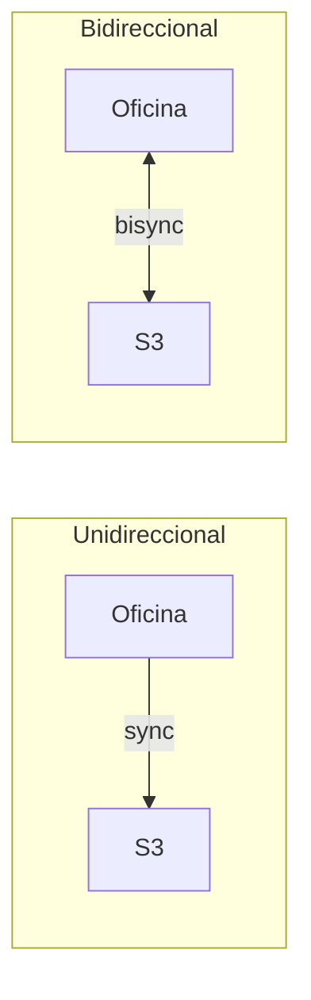

# UD05 · Transferir i sincronitzar dades

## Resum del tema

Moure dades pareix trivial (`cp` i ja està) fins que són 30 GB per una línia d'oficina, milions de fitxers xicotets, una base de dades que no pot aturar-se o un soci que només sap usar SFTP. Esta unitat et dona el catàleg d'opcions i un mètode per a triar, assegurar, automatitzar i vigilar cada transferència.



### Objectius d'aprenentatge

- Triar l'opció de transferència o sincronització segons el volum, la latència, la freqüència i la seguretat.
- Calcular tots els costos d'una transferència.
- Configurar connexions xifrades, privades i eficients.
- Preparar una transferència fora de línia amb xifratge i control d'integritat.
- Sincronitzar en un sentit o en tots dos de manera automàtica i desatesa.
- Importar i exportar bases de dades i comprovar que el resultat és íntegre.

---

## 1. Quatre situacions diferents

| Situació | Exemple en TaquillaAlacant | Què importa |
|---|---|---|
| **Migració inicial** (una vegada, molt de volum) | Pujar els 30 GB de la carpeta de l'oficina i la base de dades antiga | Temps total, cost, verificació |
| **Sincronització contínua** | El que s'escaneja en la taquilla ha d'estar en S3 en menys de 15 minuts | Automatització, latència, conflictes |
| **Intercanvi amb tercers** | La promotora d'un concert envia cada dia un CSV per SFTP | Protocol, credencials, aïllament |
| **Base de dades** | Passar de PostgreSQL local a RDS amb el mínim tall | Consistència, temps d'aturada, validació |

---

## 2. El catàleg (CA RA5.a)

| Ferramenta | Tipus | Sentit | Quan |
|---|---|---|---|
| **AWS CLI** (`aws s3 cp/sync`) | Per xarxa, client | Uni | Volums xicotets i mitjans; scripts |
| **rclone** | Per xarxa, client | Uni i **bidireccional** (`bisync`) | Sincronitzar amb S3 i amb més de 70 proveïdors; xifratge del costat del client |
| **S3 Transfer Acceleration** | Per xarxa, xarxa global d'AWS | Uni | Clients lluny de la regió del bucket |
| **AWS DataSync** | Servei gestionat amb agent | Uni (per tasca) | Grans volums des de NFS, SMB, HDFS, altres buckets o altres núvols; programat i verificat |
| **AWS Transfer Family** | Servidor SFTP/FTPS/FTP/AS2 gestionat | Entrada i eixida | Socis que usen protocols clàssics; escriu en S3 o EFS |
| **AWS Storage Gateway** | Passarel·la híbrida | Continu | Aplicacions locals que veuen una carpeta o un disc recolzat en el núvol (UD06) |
| **AWS DMS** | Migració de bases de dades | Càrrega completa + **CDC** | Migrar o replicar bases de dades amb poc tall, fins i tot entre motors diferents |
| **Ferramentes del motor** | `pg_dump`/`pg_restore`, `\copy`, replicació lògica, `mysqldump` | Uni | Exportar i importar bases de dades |
| **Importació/exportació de S3** | `aws_s3` en RDS PostgreSQL, *Import from S3* de DynamoDB, *Export to S3* | Uni | Carregar CSV/Parquet des de S3 o bolcar a S3 |
| **AWS Data Transfer Terminal** | **Física**: portes els teus discos a una instal·lació d'AWS | Entrada | Desenes de TB o més amb poca amplada de banda |

> [!NOTE]
> Durant anys l'opció física d'AWS van ser els dispositius **Snowball**, que t'enviaven per missatgeria. Des de novembre de 2025 **Snowball Edge ja no està disponible per a clients nous**; AWS recomana DataSync per xarxa, els **Data Transfer Terminal** o solucions de socis.

### 2.1 Per xarxa o en disc?

El temps per xarxa és fàcil d'estimar:

```text
hores ≈ (GB × 8) / (Mbps × ús × 3,6)          ús = fracció de la línia disponible (0,8 = 80 %)
```

| Volum | 100 Mbps al 80 % | 1 Gbps al 80 % |
|---|---|---|
| 30 GB | ≈ 50 min | ≈ 5 min |
| 1 TB | ≈ 28 h | ≈ 2,8 h |
| 50 TB | ≈ 58 dies | ≈ 6 dies |

Si la transferència per xarxa tarda més d'una setmana o satura la línia que usa el negoci, valora la via física o una connexió dedicada (UD06).

---

## 3. El que costa moure dades (CA RA5.b)

| Concepte | Regla general en AWS (consulta sempre les tarifes) |
|---|---|
| Entrada des d'Internet | **Gratis** |
| Eixida a Internet | Es paga per GB, amb una franja gratuïta mensual |
| Entre regions | Es paga per GB en l'origen |
| Entre zones de la mateixa regió | Es paga per GB en cada sentit |
| Dins de la mateixa AZ per IP privada | Gratis |
| Peticions a S3 | `sync` fa `LIST` i `HEAD`/`PUT` per objecte: milions de fitxers xicotets = milions de peticions |
| Serveis | DataSync (per GB copiat), Transfer Family (per hora de servidor i per GB), DMS (per hora d'instància), Transfer Acceleration (per GB) |
| Punts d'enllaç d'interfície i NAT Gateway | Per hora i per GB processat |

> [!TIP]
> El **punt d'enllaç de VPC de tipus gateway per a S3** és **gratis** i evita que el trànsit de les teues instàncies cap a S3 passe per un NAT Gateway, que cobra per GB. És de les primeres coses que es configuren en una VPC amb molt de trànsit cap a S3.

---

## 4. Connexions segures i eficients (CA RA5.c)

**Segures**:

- Tot per **TLS** (HTTPS, SFTP, FTPS, TLS de la base de dades). Força HTTPS amb la política del bucket (UD02).
- Credencials **temporals** i de **mínim privilegi**: un rol que només pot fer `s3:PutObject` en `oficina/*` és millor que unes claus d'administrador en un script.
- Trànsit **privat** quan l'origen està en AWS: punts d'enllaç de VPC; des de l'oficina, VPN o connexió dedicada (UD06).

**Eficients**:

| Ajust | Ferramenta | Efecte |
|---|---|---|
| Peticions en paral·lel | `aws configure set default.s3.max_concurrent_requests 20` · `rclone --transfers 16` | Aprofita l'amplada de banda amb molts fitxers |
| Grandària de part en multipart | `default.s3.multipart_chunksize 64MB` | Menys peticions amb fitxers grans |
| Empaquetar fitxers xicotets | `tar` + `zstd` abans de pujar | Menys peticions i menys cost |
| Comprimir | `zstd`, `gzip` | Menys GB transferits (si les dades no estan ja comprimides) |
| Limitar l'amplada de banda | `rclone --bwlimit "08:00,10M 20:00,off"` · límit de la tasca de DataSync | No saturar la línia en horari laboral |
| Transferir només el que canvia | `sync` en compte de `cp` | Menys temps i peticions |

---

## 5. Transferències fora de línia (CA RA5.d)

Quan les dades viatgen en un disc, la seguretat depén de tu:

1. **Xifra** el disc o el contenidor (LUKS en Linux, BitLocker en Windows, VeraCrypt multiplataforma) amb una clau robusta que **no viatja amb el disc**.
2. Genera un **manifest d'integritat** amb el hash de cada fitxer (`sha256sum`) abans d'eixir; es comprova en arribar.
3. Documenta la **cadena de custòdia**: qui el lliura, quan, a qui, amb quin precinte.
4. En acabar, **esborra de manera segura** el disc (o destruïx-lo) i conserva el registre.

```bash
find datos/ -type f -print0 | sort -z | xargs -0 sha256sum > MANIFIESTO.sha256
sha256sum -c MANIFIESTO.sha256 --quiet && echo "Integridad correcta"
```

---

## 6. Visibilitat, accés, monitorització i auditoria (CA RA5.e, RA5.h)

| Necessitat | Com |
|---|---|
| Qui pot transferir | Rols/usuaris dedicats per procés; polítiques limitades a un prefix; en Transfer Family, un usuari per soci amb el seu directori |
| Què s'ha transferit | Registres de la ferramenta (`rclone --log-file`, informes de tasca de DataSync), esdeveniments de dades de CloudTrail, registres d'accés de S3 |
| Si ha anat bé | Codi d'eixida del procés, mètriques (`BytesTransferred`, `FilesVerified` en DataSync), alarmes |
| Que les dades són idèntiques | Sumes de comprovació (*checksums*) d'extrem a extrem |

### 6.1 Integritat

- S3 calcula i guarda una **suma de comprovació** de cada objecte. La CLI i els SDK recents envien per defecte una suma **CRC** que S3 verifica en rebre; en pots demanar d'altres (`--checksum-algorithm SHA256`) i consultar-les després amb `get-object-attributes`.
- L'**ETag** només coincidix amb el MD5 del fitxer en pujades d'una sola part sense xifratge KMS: **no** l'uses com a suma de comprovació general.
- `rclone check` i `rclone sync --checksum` comparen per hash; **DataSync** verifica les dades transferides al final de cada tasca.
- En bases de dades: recompte de files per taula, sumes de control (`sum(importe)`), comparació d'un `md5` de les files ordenades.

> [!IMPORTANT]
> Una sincronització **desatesa** ha d'**avisar quan falla**. Si ningú mira els registres, el dia que es necessiten les dades descobriràs que fa tres setmanes que no es copien. Tota tasca programada acaba amb una comprovació i una alarma.

---

## 7. Sincronització (CA RA5.f)

| Mode | Ferramenta | Comportament |
|---|---|---|
| **Copiar** | `aws s3 cp --recursive`, `rclone copy` | Puja el que és nou o ha canviat; mai esborra en la destinació |
| **Espill unidireccional** | `aws s3 sync --delete`, `rclone sync` | La destinació queda **igual** que l'origen, **esborrant** el que sobra |
| **Bidireccional** | `rclone bisync` | Els canvis de cada costat passen a l'altre; cal resoldre **conflictes** |



> [!CAUTION]
> `sync --delete` i `rclone sync` **esborren** en la destinació. Si l'origen es buida per error (un disc que no s'ha muntat, una ruta mal escrita), la destinació també es buidarà. Prova sempre abans amb `--dryrun`/`--dry-run`, tin **versionat** en el bucket i usa límits com `rclone --max-delete 50`.

**Automatitzar** es fa amb el planificador del sistema (`cron` o, millor, **temporitzadors de systemd**, que registren l'eixida en el diari i permeten veure l'última execució), amb la programació de DataSync o amb esdeveniments (una pujada a S3 que llança un procés). Un bon script desatés:

- Usa un **bloqueig** per a no executar-se dues vegades alhora (`flock`).
- Registra l'inici, el final, el que s'ha transferit i els errors.
- Retorna un **codi d'eixida** diferent de 0 si alguna cosa falla.
- **Avisa** (correu, SNS, mètrica personalitzada en CloudWatch) quan falla o quan fa massa temps que no s'executa.

---

## 8. Importar i exportar bases de dades (CA RA5.g)

| Necessitat | Ferramenta | Notes |
|---|---|---|
| Còpia lògica completa | `pg_dump -Fc` → `pg_restore -j 4` | Funciona entre versions i fora d'AWS; necessita tall o consistència d'una transacció |
| Taules soltes en CSV | `\copy taula TO/FROM 'fitxer.csv' CSV HEADER` | Des del client, sense permisos de servidor |
| CSV des de S3 a RDS PostgreSQL | Extensió `aws_s3` (`aws_s3.table_import_from_s3`) | La instància necessita un rol amb accés al bucket |
| Migració amb poc tall | **AWS DMS** (càrrega completa + CDC) o **replicació lògica** de PostgreSQL | Es canvia l'aplicació quan la destinació està al dia |
| Bolcar instantània a S3 | *Export snapshot to S3* | Parquet, per a analítica |
| DynamoDB | *Import from S3* (crea taula nova) i *Export to S3* (usa PITR) | Sense consumir capacitat de la taula |

El procediment supervisat d'una migració sempre té les mateixes fases: **preparar** (esquema, rols, extensions en la destinació) → **congelar** o capturar canvis → **exportar** → **transferir** → **importar** → **validar** (recomptes, sumes, consultes de prova) → **canviar** l'aplicació → **vigilar**.

---

## 9. Errors freqüents

| Problema | Causa | Solució |
|---|---|---|
| La destinació s'ha buidat | `sync --delete` amb l'origen buit o mal muntat | `--dryrun`, `--max-delete`, versionat, comprovar l'origen abans |
| La sincronització és lentíssima | Milions de fitxers xicotets, poca concurrència | Més concurrència, empaquetar, DataSync |
| La factura de peticions es dispara | `sync` cada minut sobre un arbre enorme | Menys freqüència, sincronització per esdeveniments o DataSync incremental |
| `bisync` es nega a continuar | Massa canvis o esborraments des de l'última execució (protecció) | Revisar i forçar amb `--resync` només quan sàpies per què |
| `pg_restore` falla amb errors de propietari | Rols que no existixen en RDS | `--no-owner --no-privileges` i aplicar els permisos després |
| L'script programat fa dies que falla | Ningú mira els registres | Alarma per fallada i per «no ha acabat bé en 24 h» |

## 10. Resum

- Tria la ferramenta per la situació: CLI i rclone per al que és habitual, DataSync per a volums grans i programats, Transfer Family per a socis, DMS o les ferramentes del motor per a bases de dades i transferència física quan la xarxa no dona per a més.
- L'entrada és gratis; l'eixida, entre regions i entre zones, no. Les peticions també compten.
- TLS, credencials mínimes i temporals, trànsit privat; concurrència, multipart, compressió i límits d'amplada de banda.
- En els discos: xifratge, manifest de hashes i cadena de custòdia.
- Sincronitzar desatés exigix bloqueig, registres, codi d'eixida, comprovació d'integritat i alarma.

## 11. Autoavaluació


- q: "Has de pujar 40 TB amb una línia de 100 Mbps que l'oficina necessita en horari laboral. Quina opció valores primer?"
  options: ["`aws s3 sync` sense límits", "Una transferència física (Data Transfer Terminal o soci) o una connexió dedicada", "Transfer Acceleration", "rclone bisync"]
  answer: 1
  explain: "40 TB a 100 Mbps són més de 40 dies de línia saturada; la via física o un enllaç dedicat són més raonables."
- q: "Quin trànsit **no** es cobra normalment en AWS?"
  options: ["Eixida a Internet", "Entrada des d'Internet", "Entre regions", "Entre zones de disponibilitat"]
  answer: 1
  explain: "L'entrada de dades és gratuïta; l'eixida i el trànsit entre regions o zones, no."
- q: "Quina orde deixa el bucket idèntic a la carpeta local, esborrant el que sobra?"
  options: ["`aws s3 cp --recursive`", "`aws s3 sync --delete`", "`rclone copy`", "`aws s3 mv`"]
  answer: 1
  explain: "sync --delete fa un espill; per això cal provar-lo abans amb --dryrun."
- q: "Per què no has d'usar l'ETag com a suma de comprovació general?"
  options: ["Perquè canvia cada dia", "Perquè en pujades multipart o amb SSE-KMS no és el MD5 del fitxer", "Perquè S3 no el retorna", "Perquè és secret"]
  answer: 1
  explain: "Usa les sumes de comprovació de S3 (CRC, SHA) o ferramentes com rclone check."
- q: "Una promotora només pot enviar fitxers per SFTP. Quin servei uses?"
  options: ["DataSync", "AWS Transfer Family", "DMS", "Storage Gateway"]
  answer: 1
  explain: "Transfer Family oferix SFTP/FTPS/FTP/AS2 gestionats sobre S3 o EFS."
- q: "En restaurar un `pg_dump` en RDS apareixen errors de propietari. Què fas?"
  options: ["Restaurar com a superusuari `postgres`", "Usar `--no-owner --no-privileges` i assignar permisos després", "Canviar a MySQL", "Desactivar TLS"]
  answer: 1
  explain: "En RDS no eres superusuari; es restaura sense propietaris i s'apliquen els permisos amb els teus rols."


## Referències

- AWS CLI: *s3 sync* i configuració de S3 — <https://docs.aws.amazon.com/cli/latest/topic/s3-config.html>
- rclone: S3 i bisync — <https://rclone.org/s3/> · <https://rclone.org/bisync/>
- AWS DataSync — <https://docs.aws.amazon.com/datasync/latest/userguide/>
- AWS Transfer Family — <https://docs.aws.amazon.com/transfer/latest/userguide/>
- AWS Data Transfer Terminal — <https://aws.amazon.com/data-transfer-terminal/>
- *Checking object integrity in Amazon S3* — <https://docs.aws.amazon.com/AmazonS3/latest/userguide/checking-object-integrity.html>
- *Importing data from Amazon S3 into RDS for PostgreSQL* — <https://docs.aws.amazon.com/AmazonRDS/latest/UserGuide/USER_PostgreSQL.S3Import.html>
- AWS DMS — <https://docs.aws.amazon.com/dms/latest/userguide/>
