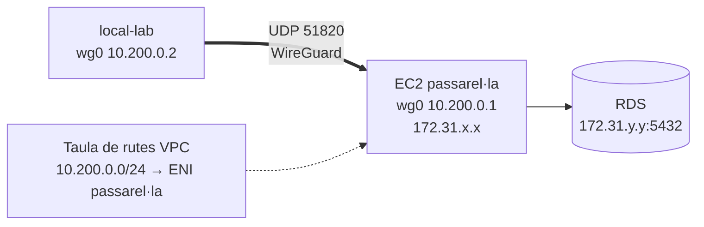

# UD06 · Pràctiques



| Pràctica | Tipus | Nivell | Hores | CA principals |
|---|---|---|--:|---|
| [6.1 Túnels SSH](#pràctica-61--túnels-ssh) | Guiada | ●○○ | 1 | RA6: c |
| [6.2 VPN WireGuard entre l'oficina i la VPC](#pràctica-62--vpn-wireguard-entre-loficina-i-la-vpc) | Guiada | ●●● | 2,5 | RA6: b, c, d |
| [6.3 Replicació lògica del núvol a l'oficina](#pràctica-63--replicació-lògica-del-núvol-a-loficina) | Guiada | ●●● | 2 | RA6: e, g |
| [6.4 S3 en l'oficina amb Garage](#pràctica-64--s3-en-loficina-amb-garage) | Guiada | ●●○ | 1 | RA6: e, f |
| [6.5 Infraestructura híbrida verificada](#pràctica-65--infraestructura-híbrida-verificada) | Projecte | ●●● | 1,5 | RA6: a – g |
| **Total** | | | **8 h** | |

> [!NOTE]
> Necessites la base de dades RDS i el bastió de la UD04 (`ud04/lab/`). Pla d'adreçament de les pràctiques:
>
> | Xarxa | Rang |
> |---|---|
> | VPC per defecte | `172.31.0.0/16` |
> | Túnel WireGuard | `10.200.0.0/24` (passarel·la `.1`, oficina `.2`) |
> | Docker en `local-lab` | `172.17.0.0/16` (no s'anuncia: ix per NAT de la mateixa màquina) |

---

## Pràctica 6.1 · Túnels SSH



#### Objectiu

Accedir a la base de dades privada des de l'oficina **sense obrir-la a Internet**, amb un reenviament de ports SSH, i entendre'n els límits.

#### Desenvolupament

{}

1. **Reenviament local**: el port 15432 de `local-lab` arriba al 5432 de RDS a través del bastió.

    ```bash
    BASTION=$(cd ud04/lab && tofu output -raw bastion)
    RDS=$(cd ud04/lab && tofu output -raw endpoint)
    ssh -i labsuser.pem -N -L 15432:$RDS:5432 ec2-user@$BASTION &
    ```

2. **Connecta't** com si la base de dades estiguera en local. Amb `verify-full` cal indicar el nom real del servidor; com que connectes a `localhost`, usa `require` i entén per què és menys segur:

    ```bash
    curl -fsSLo rds-ca.pem https://truststore.pki.rds.amazonaws.com/global/global-bundle.pem
    PGPASSWORD=... psql "host=localhost port=15432 dbname=taquilla user=analista sslmode=require" -c "select count(*) from venta;"
    ```

3. **Comprova** des del bastió que la connexió a RDS ix de la seua IP privada (`select inet_client_addr();`).

4. **Tanca** el túnel (`kill %1`) i comprova que la connexió deixa de funcionar.

5. **Reflexiona** en les teues notes: què passa si cau la sessió SSH? Servix per a una replicació contínua? Qui pot usar el port 15432 de `local-lab`?

{}

#### Comprovació

- [ ] Has consultat RDS des de `local-lab` sense que RDS siga pública.
- [ ] Saps explicar per què un túnel SSH servix per a administrar però no com a enllaç permanent.

---

## Pràctica 6.2 · VPN WireGuard entre l'oficina i la VPC



#### Objectiu

Unir la xarxa de l'oficina (`local-lab`) amb la VPC mitjançant una **VPN xifrada i encaminada** (sense NAT), de manera que `local-lab` arribe a la IP privada de RDS i els recursos de la VPC arriben a l'oficina.



#### Desenvolupament

{}

1. **Genera les claus** dels dos extrems en `local-lab`:

    ```bash
    mkdir -p ~/wg && cd ~/wg && umask 077
    wg genkey | tee oficina.key | wg pubkey > oficina.pub
    wg genkey | tee nube.key    | wg pubkey > nube.pub
    ```

2. **Afig la passarel·la** al laboratori de la UD04 (`ud04/lab/vpn.tf`):

    ```hcl
    variable "wg_nube_key" {
      type      = string
      sensitive = true
    }
    variable "wg_oficina_pub" { type = string }

    data "aws_route_table" "principal" {
      vpc_id = data.aws_vpc.default.id
      filter {
        name   = "association.main"
        values = ["true"]
      }
    }

    resource "aws_security_group" "vpn" {
      name   = "ta-${var.alumno}-vpn"
      vpc_id = data.aws_vpc.default.id
      ingress {
        description = "WireGuard desde la oficina"
        from_port   = 51820
        to_port     = 51820
        protocol    = "udp"
        cidr_blocks = [var.mi_ip]
      }
      ingress {
        description = "Trafico de la VPC hacia la oficina"
        from_port   = 0
        to_port     = 0
        protocol    = "-1"
        cidr_blocks = [data.aws_vpc.default.cidr_block]
      }
      egress {
        from_port   = 0
        to_port     = 0
        protocol    = "-1"
        cidr_blocks = ["0.0.0.0/0"]
      }
    }

    resource "aws_instance" "vpn" {
      ami                    = data.aws_ssm_parameter.al2023.value
      instance_type          = "t3.micro"
      key_name               = "vockey"
      vpc_security_group_ids = [aws_security_group.vpn.id]
      source_dest_check      = false            # imprescindible para enrutar
      user_data              = <<-EOF
        #!/bin/bash
        dnf install -y wireguard-tools
        echo "net.ipv4.ip_forward = 1" > /etc/sysctl.d/90-wg.conf && sysctl --system
        cat > /etc/wireguard/wg0.conf <<WG
        [Interface]
        Address = 10.200.0.1/24
        ListenPort = 51820
        PrivateKey = ${var.wg_nube_key}

        [Peer]
        # oficina
        PublicKey = ${var.wg_oficina_pub}
        AllowedIPs = 10.200.0.2/32
        WG
        chmod 600 /etc/wireguard/wg0.conf
        systemctl enable --now wg-quick@wg0
      EOF
      tags = { Name = "ta-${var.alumno}-vpn" }
    }

    # La VPC envía a la pasarela el tráfico destinado a la oficina
    resource "aws_route" "a_oficina" {
      route_table_id         = data.aws_route_table.principal.id
      destination_cidr_block = "10.200.0.0/24"
      network_interface_id   = aws_instance.vpn.primary_network_interface_id
    }

    # RDS acepta conexiones desde la oficina
    resource "aws_vpc_security_group_ingress_rule" "bd_desde_oficina" {
      security_group_id = aws_security_group.bd.id
      cidr_ipv4         = "10.200.0.0/24"
      from_port         = 5432
      to_port           = 5432
      ip_protocol       = "tcp"
      description       = "PostgreSQL desde la oficina por la VPN"
    }

    output "vpn_ip" { value = aws_instance.vpn.public_ip }
    ```

    ```bash
    cd ud04/lab
    tofu apply -var alumno=$ALUMNO -var mi_ip=$(curl -s ifconfig.me)/32 \
      -var wg_nube_key="$(cat ~/wg/nube.key)" -var wg_oficina_pub="$(cat ~/wg/oficina.pub)"
    ```

    > [!WARNING]
    > La clau privada de la passarel·la queda en l'estat d'OpenTofu i en les dades d'usuari de la instància. En producció es guardaria en Secrets Manager o en Parameter Store i la instància la llegiria en arrancar.

3. **Configura l'oficina** (`/etc/wireguard/wg0.conf` en `local-lab`):

    ```ini
    [Interface]
    Address = 10.200.0.2/24
    PrivateKey = <contingut de ~/wg/oficina.key>
    MTU = 1380

    [Peer]
    # passarel·la en AWS
    PublicKey = <contingut de ~/wg/nube.pub>
    Endpoint = <vpn_ip>:51820
    AllowedIPs = 10.200.0.0/24, 172.31.0.0/16
    PersistentKeepalive = 25
    ```

    ```bash
    sudo chmod 600 /etc/wireguard/wg0.conf
    sudo systemctl enable --now wg-quick@wg0
    ```

4. **Verifica la disponibilitat** de l'enllaç (CA RA6.b):

    ```bash
    sudo wg show                       # latest handshake: hace pocos segundos; transfer: datos en ambos sentidos
    ping -c 3 10.200.0.1
    ip route get 172.31.0.10           # sale por wg0
    ```

5. **Arriba a RDS per la seua IP privada**, ara amb `verify-full` perquè uses el nom real:

    ```bash
    getent hosts $RDS                  # IP 172.31.x.x
    psql "host=$RDS dbname=taquilla user=analista sslmode=verify-full sslrootcert=rds-ca.pem" -c "select inet_client_addr();"
    ```

    `inet_client_addr()` retorna `10.200.0.2`: no hi ha NAT, la VPC veu la IP real de l'oficina.

6. **Comprova el sentit contrari**: des del bastió, `ping -c 3 10.200.0.2`. (Si `local-lab` té tallafocs, permet ICMP des de `wg0`).

7. **Observa el trànsit** amb els **registres de flux de VPC** de la interfície de la passarel·la (CloudWatch Logs o S3) i localitza les connexions UDP 51820 i les de `10.200.0.2` cap al 5432.

8. **Prova una fallada**: atura WireGuard en l'oficina (`sudo systemctl stop wg-quick@wg0`), comprova què passa amb `psql` i torna a alçar-lo.

{}

#### Comprovació

- [ ] `wg show` mostra un *handshake* recent i trànsit en tots dos sentits.
- [ ] `psql` des de l'oficina a RDS funciona amb `verify-full` i RDS veu `10.200.0.2`.
- [ ] El bastió fa `ping` a l'oficina.

#### Problemes habituals

| Símptoma | Causa | Solució |
|---|---|---|
| Sense *handshake* | Port UDP 51820 tancat o la teua IP pública ha canviat | Revisa el grup de seguretat i `mi_ip` |
| *Handshake* però sense arribar a RDS | Falta la ruta en la VPC, `source_dest_check` actiu o regla del grup de seguretat | Revisa els tres recursos |
| `psql` es queda penjat en fer consultes grans | MTU | Baixa `MTU` a 1340 en els dos extrems |
| Després de reiniciar la sessió del laboratori no hi ha túnel | La IP pública de la passarel·la canvia en aturar i arrancar | Actualitza `Endpoint` o usa una IP elàstica |

---

## Pràctica 6.3 · Replicació lògica del núvol a l'oficina



#### Objectiu

Que la taquilla física tinga en el seu PostgreSQL local una **còpia de només lectura** de recintes, esdeveniments i vendes amb **segons** de retard, sense les dades personals dels clients, i **vigilar** el retard.

#### Desenvolupament

{}

1. **Activa la replicació lògica** en RDS (paràmetre estàtic: requerix reinici):

    ```bash
    aws rds modify-db-parameter-group --db-parameter-group-name ta-$ALUMNO-pg17 \
      --parameters "ParameterName=rds.logical_replication,ParameterValue=1,ApplyMethod=pending-reboot"
    aws rds reboot-db-instance --db-instance-identifier ta-$ALUMNO-pg
    aws rds wait db-instance-available --db-instance-identifier ta-$ALUMNO-pg
    ```

    (Afig també el paràmetre a `aws_db_parameter_group` en el codi per a no crear deriva.)

2. **En RDS** (com a `taquilla_admin`), crea l'usuari de replicació i la publicació **sense la taula de clients**:

    ```sql
    SHOW wal_level;                                   -- logical
    CREATE ROLE repl_oficina LOGIN PASSWORD 'Repl-Oficina-1';
    GRANT rds_replication TO repl_oficina;
    GRANT SELECT ON recinto, evento, venta TO repl_oficina;
    CREATE PUBLICATION pub_taquilla FOR TABLE recinto, evento, venta;
    ```

3. **En l'oficina**, crea el subscriptor amb l'esquema buit (sense les dades d'exemple d'`esquema.sql`):

    ```bash
    docker run -d --name taquilla-local -e POSTGRES_PASSWORD=local -p 127.0.0.1:5434:5432 postgres:17
    sleep 5
    pg_dump "host=$RDS dbname=taquilla user=taquilla_admin sslmode=verify-full sslrootcert=rds-ca.pem" \
      --schema-only --no-owner -t recinto -t evento -t cliente -t venta > esquema_rds.sql
    psql "host=127.0.0.1 port=5434 user=postgres password=local" -c "create database taquilla;"
    psql "host=127.0.0.1 port=5434 dbname=taquilla user=postgres password=local" -f esquema_rds.sql
    ```

    > [!NOTE]
    > Es crea també `cliente` (buida) perquè `venta` té una clau forana cap a ella. Els processos de replicació no comproven eixes claus en el subscriptor, així que les vendes arriben encara que els clients no.

4. **Subscriu-te** (la connexió ix del contenidor, creua la VPN i arriba a la IP privada de RDS):

    ```sql
    -- en taquilla-local
    CREATE SUBSCRIPTION sub_taquilla
      CONNECTION 'host=RDS_ENDPOINT dbname=taquilla user=repl_oficina password=Repl-Oficina-1 sslmode=require'
      PUBLICATION pub_taquilla;
    SELECT count(*) FROM venta;
    ```

5. **Mesura la latència** de replicació: inserix en RDS i mira quan arriba (exporta abans `PGPASSWORD` amb la contrasenya de `taquilla_admin`).

    ```bash
    for i in 1 2 3 4 5; do
      psql "host=$RDS dbname=taquilla user=taquilla_admin sslmode=require" -qtAc \
        "insert into venta(id_evento,id_cliente,canal,entradas,importe) values (1,1,'web',1,10) returning id_venta" > /tmp/id
      t0=$(date +%s.%N)
      until [ "$(psql 'host=127.0.0.1 port=5434 dbname=taquilla user=postgres password=local' -qtAc \
               "select count(*) from venta where id_venta=$(cat /tmp/id)")" = "1" ]; do sleep 0.1; done
      echo "venta $(cat /tmp/id): $(awk "BEGIN{print $(date +%s.%N) - $t0}") s"
    done
    ```

6. **Monitoritza** en els dos extrems:

    ```sql
    -- RDS (publicador): retraso de cada ranura
    SELECT slot_name, active,
           pg_size_pretty(pg_wal_lsn_diff(pg_current_wal_lsn(), confirmed_flush_lsn)) AS retraso_wal
    FROM pg_replication_slots;
    -- oficina (suscriptor)
    SELECT subname, received_lsn, latest_end_lsn, last_msg_receipt_time FROM pg_stat_subscription;
    ```

    I en CloudWatch, la mètrica **`OldestReplicationSlotLag`** de la instància. Crea una alarma si supera 100 MB.

7. **Simula un tall** de la VPN 5 minuts mentre fas insercions en RDS. Observa com creix el retard de la ranura i com es posa al dia en tornar el túnel.

8. **Neteja** correctament (l'orde és important!):

    ```sql
    -- oficina
    DROP SUBSCRIPTION sub_taquilla;          -- borra también la ranura en RDS si hay conexión
    -- RDS: comprueba que no queda ninguna ranura
    SELECT slot_name FROM pg_replication_slots;
    -- si quedara: SELECT pg_drop_replication_slot('sub_taquilla');
    ```

{}

#### Comprovació

- [ ] L'oficina rep vendes noves en segons i **no** té dades de clients.
- [ ] Has mesurat la latència i el retard durant un tall.
- [ ] En acabar no queda cap ranura de replicació en RDS.

---

## Pràctica 6.4 · S3 en l'oficina amb Garage



#### Objectiu

Muntar en l'oficina un emmagatzematge d'objectes **compatible amb S3** i sincronitzar-lo amb el bucket d'AWS usant la mateixa ferramenta en els dos costats.

#### Desenvolupament

{}

1. **Configura i arranca Garage** (consulta la versió més recent en la seua web i ajusta l'etiqueta):

    ```bash
    mkdir -p ~/garage && cd ~/garage
    cat > garage.toml <<EOF
    metadata_dir = "/var/lib/garage/meta"
    data_dir = "/var/lib/garage/data"
    db_engine = "sqlite"
    replication_factor = 1
    rpc_bind_addr = "[::]:3901"
    rpc_public_addr = "127.0.0.1:3901"
    rpc_secret = "$(openssl rand -hex 32)"

    [s3_api]
    s3_region = "garage"
    api_bind_addr = "[::]:3900"
    root_domain = ".s3.garage.localhost"

    [admin]
    api_bind_addr = "[::]:3903"
    admin_token = "$(openssl rand -base64 32)"
    EOF
    docker run -d --name garage --restart unless-stopped -p 127.0.0.1:3900:3900 \
      -v $PWD/garage.toml:/etc/garage.toml -v garage-meta:/var/lib/garage/meta -v garage-data:/var/lib/garage/data \
      dxflrs/garage:v2.3.0
    ```

2. **Inicialitza** el node, crea el bucket i una clau d'accés:

    ```bash
    alias garage="docker exec garage /garage"
    NODO=$(garage status | awk '/NO ROLE ASSIGNED/ {print $1}')
    garage layout assign -z oficina -c 20G $NODO
    garage layout apply --version 1
    garage bucket create escaneos
    garage key create oficina-sync
    garage bucket allow --read --write --owner escaneos --key oficina-sync
    garage key info oficina-sync --show-secret        # apunta Key ID y Secret key
    ```

3. **Usa'l amb les ferramentes de sempre**:

    ```bash
    cat >> ~/.config/rclone/rclone.conf <<'EOF'

    [garage]
    type = s3
    provider = Other
    endpoint = http://127.0.0.1:3900
    region = garage
    access_key_id = GKxxxxxxxx
    secret_access_key = xxxxxxxx
    EOF
    rclone copy ~/oficina/escaneos garage:escaneos -P
    AWS_ACCESS_KEY_ID=GKxxxx AWS_SECRET_ACCESS_KEY=xxxx aws --endpoint-url http://127.0.0.1:3900 --region garage s3 ls s3://escaneos | head
    ```

4. **Sincronitza l'oficina amb el núvol** de servidor S3 a servidor S3:

    ```bash
    rclone sync garage:escaneos aws:$BUCKET/oficina/garage-escaneos --checksum --transfers 16 -P
    rclone check garage:escaneos aws:$BUCKET/oficina/garage-escaneos
    ```

5. **Exportació manual supervisada** (CA RA6.f): exporta un llistat signat del que s'ha transferit per al registre de l'oficina.

    ```bash
    rclone lsjson aws:$BUCKET/oficina/garage-escaneos --hash --files-only > exportacion_$(date +%F).json
    sha256sum exportacion_*.json > exportacion.sha256
    ```

{}

#### Comprovació

- [ ] La CLI d'AWS i rclone funcionen contra Garage canviant només el punt d'enllaç.
- [ ] `rclone check` entre Garage i S3 no troba diferències.

---

## Pràctica 6.5 · Infraestructura híbrida verificada



#### Requisits

1. **Documentació de referència** en `ud06/README.md`: diagrama (Mermaid), pla d'adreçament, inventari, ports i protocols, fluxos de dades amb la seua latència màxima i els paràmetres de seguretat.
2. **Script `verificar.sh`** que comprove **automàticament** que la realitat coincidix amb la documentació i retorne un resum OK/KO i un codi d'eixida. Com a mínim:
    - `tofu plan -detailed-exitcode` sense canvis (sense deriva).
    - Túnel WireGuard amb *handshake* de menys de 3 minuts.
    - RDS accessible per la VPN amb TLS i **no** accessible des d'Internet.
    - Grup de seguretat de RDS sense `0.0.0.0/0`.
    - Subscripció de replicació activa i retard menor que el documentat.
    - Última sincronització Garage → S3 correcta fa menys del que s'ha documentat.
3. **Monitorització centralitzada**: les mètriques personalitzades (`SyncOK`, retard de replicació, estat del túnel) publicades en CloudWatch des de l'oficina i un **tauler** (*dashboard*) amb totes elles, més les alarmes corresponents.
4. **Procediments** escrits i provats d'importació/exportació manual per a quan la sincronització automàtica no estiga disponible.
5. **Comparativa raonada** amb una Site-to-Site VPN gestionada i amb Direct Connect per a l'oficina real de TaquillaAlacant (disponibilitat a Alacant/Madrid, cost mensual, amplada de banda).

#### Comprovació

- [ ] `verificar.sh` retorna tot OK i detecta una fallada provocada (per exemple, obrir el grup de seguretat a `0.0.0.0/0` a mà).
- [ ] El tauler de CloudWatch mostra els tres indicadors amb dades reals.
- [ ] La documentació coincidix amb el que s'ha desplegat.

#### Neteja

Elimina la subscripció i la ranura (pràctica 6.3), atura WireGuard en l'oficina i destruïx la passarel·la: `tofu destroy` del laboratori si has acabat amb les bases de dades.
