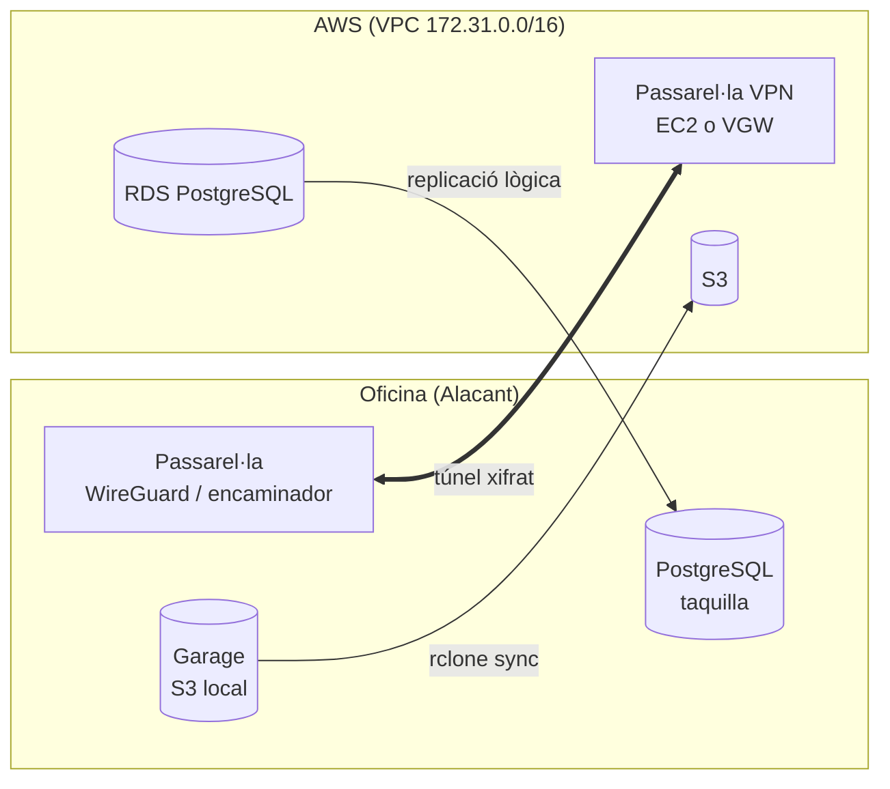

# UD06 · Núvol híbrid

## Resum del tema

Una **infraestructura de dades híbrida** combina sistemes locals (l'oficina, un centre de dades propi) amb serveis del proveïdor, connectats de manera segura i amb les dades sincronitzades. Administrar-la és més difícil que administrar cada part per separat: hi ha més peces, més xarxa, més punts de fallada i més llocs on una configuració pot no coincidir amb el que diu la documentació.



### Objectius d'aprenentatge

- Descriure arquitectures híbrides de dades i els seus motius.
- Verificar que una configuració desplegada coincidix amb la seua documentació de referència.
- Comprovar la disponibilitat de connexions segures avançades i configurar SSH, VPN o xarxes privades.
- Triar el mecanisme de sincronització segons la latència exigida.
- Monitoritzar i auditar el recorregut complet de les dades, de l'oficina al núvol i a la inversa.

---

## 1. Per què híbrid?

| Motiu | Exemple |
|---|---|
| **Latència local** | La taquilla física ha de vendre encara que caiga Internet |
| **Normativa o contractes** | Certes dades s'han de quedar en les instal·lacions |
| **Inversió existent** | Servidors i cabines que s'estan amortitzant |
| **Migració gradual** | Moure un sistema cada trimestre en compte de tot de colp |
| **Recuperació davant de desastres** | Còpies del que és local en el núvol, o del núvol en local |
| **Procés en la vora** | Sensors o càmeres que generen més dades de les que es poden pujar |

---

## 2. Documentació de referència i verificació (CA RA6.a)

Una infraestructura híbrida ha d'estar **documentada** i la documentació ha de **coincidir amb la realitat**. La documentació de referència inclou:

- **Diagrama** de xarxa i de fluxos de dades (què va d'on a on, amb quin protocol i cada quant).
- **Pla d'adreçament**: rangs de l'oficina i de la VPC **sense solapar-se**.
- **Inventari**: recursos, versions, ports, responsables.
- **Paràmetres de seguretat**: algorismes de xifratge, ports oberts, qui hi accedix.
- **Requisits de sincronització**: latència màxima, RPO, finestres.

Maneres de **verificar** que el que s'ha implementat coincidix:

| Mètode | Què detecta |
|---|---|
| `tofu plan` sobre la IaC | **Deriva** (*drift*): canvis fets a mà fora del codi |
| **AWS Config** amb regles | Recursos que incomplixen una regla (volum sense xifrar, grup de seguretat obert…) |
| Scripts de verificació | Comparen valors reals (`describe-*`, `wg show`, `psql`) amb els esperats i retornen OK/KO |
| Llistes de comprovació | El que no es pot automatitzar (precintes, accessos físics) |
| Proves funcionals | Que les dades arriben de veritat d'un costat a l'altre en el temps previst |

> [!TIP]
> Tracta la documentació com a codi: guarda-la en el mateix repositori que la IaC i els scripts de verificació, i revisa-la en cada canvi. Un script `verificar.sh` que s'executa cada dia i avisa si alguna cosa ha canviat val més que un PDF perfecte que ningú llig.

---

## 3. Connectivitat (CA RA6.b, RA6.c)

| Opció | Xifratge | Amplada de banda | Cost | Quan |
|---|---|---|---|---|
| **Túnel SSH** (reenviament de ports) | Sí (SSH) | Limitada | Quasi nul | Administració puntual, proves |
| **VPN de programari** (WireGuard, OpenVPN, strongSwan en una instància) | Sí | La que done la instància | Instància + transferència | Laboratoris, oficines xicotetes, quan el proveïdor gestionat no està disponible |
| **AWS Site-to-Site VPN** | Sí (IPsec, **dos túnels** redundants) | De l'orde d'1,25 Gbps per túnel | Per hora de connexió + transferència | L'estàndard per a unir una seu amb la VPC |
| **AWS Client VPN** | Sí (TLS) | Per usuari | Per hora i per connexió | Usuaris remots individuals |
| **AWS Direct Connect** | **No per defecte** (enllaç privat); s'afig MACsec o VPN damunt | 1, 10, 100 Gbps (o menys amb connexions allotjades de socis) | Port + transferència (més barata) | Molt de volum, latència estable, requisits de xarxa privada |
| **PrivateLink / punts d'enllaç de VPC** | Trànsit privat dins d'AWS | — | Per hora i per GB (interfície) | Accedir a serveis (S3, KMS…) sense eixir a Internet, també des de l'oficina a través de la VPN |

### 3.1 Verificar la disponibilitat (CA RA6.b)

Abans de dissenyar amb una connexió «avançada» cal comprovar que **existix i funciona**:

- **Direct Connect**: hi ha una **ubicació** a prop? (a Espanya n'hi ha a Madrid) Algun soci oferix una connexió allotjada fins a l'oficina? Terminis d'instal·lació?
- **Site-to-Site VPN**: l'oficina té una **IP pública fixa** i un equip compatible amb IPsec/IKEv2? En la consola, l'**estat de cada túnel** (`UP`/`DOWN`) i la mètrica `TunnelState` de CloudWatch.
- **VPN de programari**: `wg show` (últim *handshake*), `ping`/`mtr` a través del túnel, MTU correcta.
- Sempre: **rangs IP sense solapament** i rutes en tots dos sentits.

> [!NOTE]
> En el Learner Lab, `local-lab` està darrere del NAT de VirtualBox i del teu encaminador, sense IP pública fixa. Per això en les pràctiques el túnel l'inicia **l'oficina** cap a una instància EC2 amb WireGuard: és la mateixa idea que una Site-to-Site VPN, però funcionant des de qualsevol xarxa.

### 3.2 Encaminament

Perquè els dos costats es vegen **sense NAT**, cada costat necessita una **ruta** cap al rang de l'altre a través de la passarel·la:

- En la VPC: una entrada en la **taula de rutes** `10.200.0.0/24 → interfície de la instància VPN` (i desactivar la **comprovació d'origen/destinació** d'eixa instància).
- En l'oficina: la ruta cap a `172.31.0.0/16` pel túnel (WireGuard la crea amb `AllowedIPs`).
- Els **grups de seguretat** dels recursos d'AWS han d'acceptar el trànsit des del rang de l'oficina, només en els ports necessaris.

---

## 4. Emmagatzematge híbrid

| Servei | El que veu l'oficina | On són les dades | Ús |
|---|---|---|---|
| **S3 File Gateway** | Carpeta NFS o SMB, amb memòria cau local | Objectes en S3 | Portar fitxers a S3 sense canviar les aplicacions; còpies |
| **Volume Gateway** | Disc iSCSI (en memòria cau o emmagatzemat) | S3 + instantànies d'EBS | Còpies de servidors locals |
| **Tape Gateway** | Biblioteca de cintes virtual | S3 / Glacier | Substituir cintes sense canviar el programari de còpies |
| **AWS Outposts** | Bastidors d'AWS en el teu centre de dades | Local | Serveis d'AWS amb latència local |
| **Emmagatzematge S3 local** (Garage, Ceph…) | API S3 en l'oficina | Local, sincronitzable amb S3 | Les mateixes ferramentes en els dos costats |

Equivalents en altres proveïdors: Azure File Sync, Azure Arc i Azure Local; Google Distributed Cloud.

---

## 5. Bases de dades híbrides

| Mecanisme | Latència | Sentit | Notes |
|---|---|---|---|
| **Replicació lògica de PostgreSQL** (publicació/subscripció) | Segons | Triat per taules | Nativa; RDS pot publicar o subscriure's (`rds.logical_replication = 1`) |
| **Replicació de MySQL/MariaDB** (binlog) | Segons | Origen → rèplica | Rèplica externa de RDS o RDS com a rèplica |
| **AWS DMS amb CDC** | Segons a minuts | Origen → destinació, fins i tot entre motors | Necessita una instància de replicació |
| **Exportació/importació programada** | Hores | Un | `pg_dump`, CSV, la UD05 |

> [!WARNING]
> Una **ranura de replicació** (*replication slot*) que ningú consumix **reté el WAL** en l'origen i omple l'emmagatzematge. Si apagues l'oficina o esborres la subscripció, **elimina la ranura** en el publicador i vigila la mètrica `OldestReplicationSlotLag` de RDS.

---

## 6. Seguretat, monitorització i auditoria d'extrem a extrem (CA RA6.d)

| Capa | Seguretat | Monitorització | Auditoria |
|---|---|---|---|
| Xarxa | Xifratge del túnel; grups de seguretat mínims; rangs concrets | Estat del túnel, latència, pèrdua | Registres de flux de VPC (*VPC Flow Logs*) |
| Accés | Credencials per procés, mínim privilegi, rotació | Fallades d'autenticació | CloudTrail, registres del motor |
| Dades | TLS a més del túnel (defensa en profunditat), xifratge en repòs en els dos costats | Retard de replicació, última sincronització | `pgaudit`, registres de rclone/DataSync |
| Sistemes locals | Pegats, còpies, accés físic | **Agent de CloudWatch** en els servidors locals per a centralitzar mètriques i registres | Registre centralitzat |

---

## 7. Sincronització segons la latència (CA RA6.e, RA6.f, RA6.g)

| Requisit de latència | Mecanisme recomanat |
|---|---|
| Segons | Replicació de la base de dades (lògica, binlog, DMS CDC) |
| Minuts | Sincronització programada freqüent (rclone, DataSync cada hora), esdeveniments de S3 |
| Hores | Exportació/importació nocturna supervisada |
| Sota demanda | Importació o exportació manual amb el seu procediment i validació |

Cada mecanisme necessita la seua **monitorització**: retard de la rèplica (`pg_stat_subscription`, `ReplicaLag`), hora de l'última sincronització correcta (mètrica personalitzada, com en la UD05), resultat de cada importació manual (registre signat per qui la fa) i una alarma si se supera la latència compromesa.

---

## 8. Errors freqüents

| Problema | Causa | Solució |
|---|---|---|
| El túnel està alçat però no hi ha trànsit | Falta la ruta de tornada en la VPC o la comprovació d'origen/destinació està activa | Ruta en la taula de la VPC i `source_dest_check = false` |
| Funciona `ping` però no `psql` | El grup de seguretat de RDS no admet el rang de l'oficina | Regla 5432 des de `10.200.0.0/24` |
| Connexions que es pengen amb paquets grans | MTU del túnel | Baixar la MTU de la interfície del túnel (1380 – 1420) |
| Els rangs se solapen | L'oficina usa `172.31.x.x` com la VPC per defecte | Planificar l'adreçament abans; renumerar un costat |
| L'emmagatzematge de RDS s'omple a soles | Ranura de replicació sense consumidor | Eliminar la ranura; alarma sobre `OldestReplicationSlotLag` |
| La documentació diu una cosa i la consola una altra | Canvis manuals | `tofu plan` i scripts de verificació periòdics |

## 9. Resum

- Híbrid = local + núvol, connectats i sincronitzats. Més peces, més necessitat de documentació verificable.
- Connectivitat: SSH per al que és puntual, VPN (gestionada o de programari) per a unir seus, Direct Connect per a volum i estabilitat; sempre xifrat i amb rutes en tots dos sentits.
- Passarel·les d'emmagatzematge i S3 local per a fitxers; replicació lògica o DMS per a bases de dades.
- Tria la sincronització per la latència exigida i vigila cada mecanisme amb la seua mètrica i la seua alarma.
- Verifica la configuració contra la referència de manera automàtica i periòdica.

## 10. Autoavaluació


- q: "Quina opció de connectivitat **no** xifra el trànsit per si mateixa?"
  options: ["Site-to-Site VPN", "WireGuard", "Direct Connect", "Túnel SSH"]
  answer: 2
  explain: "Direct Connect és un enllaç privat; per a xifrar s'usa MACsec o una VPN per damunt."
- q: "El túnel WireGuard està actiu, l'oficina arriba a la instància VPN però no a RDS. Què és el més probable?"
  options: ["El certificat de RDS", "Falta la ruta cap a l'oficina en la VPC o la regla del grup de seguretat de RDS", "La clau KMS", "La grandària de la instància"]
  answer: 1
  explain: "RDS ha de poder respondre (ruta de tornada) i acceptar l'origen (grup de seguretat)."
- q: "Com detectes que algú ha canviat a mà un grup de seguretat definit en OpenTofu?"
  options: ["Amb `tofu plan`", "Amb `pg_dump`", "Amb `rclone check`", "No es pot"]
  answer: 0
  explain: "plan compara l'estat real amb el codi i mostra la deriva."
- q: "La taquilla necessita veure les vendes de la web amb menys de 10 segons de retard. Quin mecanisme tries?"
  options: ["Exportació nocturna", "rclone cada hora", "Replicació lògica de PostgreSQL", "Transferència física"]
  answer: 2
  explain: "Només la replicació de la base de dades dona latències de segons."
- q: "Has esborrat la subscripció en l'oficina però no la ranura en RDS. Què passarà?"
  options: ["Res", "RDS retindrà WAL i l'emmagatzematge anirà creixent", "S'esborrarà la base de dades", "Es desactivarà el xifratge"]
  answer: 1
  explain: "La ranura impedix alliberar el WAL que el subscriptor no ha confirmat."


## Referències

- AWS Site-to-Site VPN — <https://docs.aws.amazon.com/vpn/latest/s2svpn/>
- AWS Direct Connect i ubicacions — <https://aws.amazon.com/directconnect/locations/>
- AWS Storage Gateway — <https://docs.aws.amazon.com/storagegateway/>
- WireGuard — <https://www.wireguard.com/quickstart/>
- PostgreSQL: *Logical Replication* — <https://www.postgresql.org/docs/current/logical-replication.html>
- *Logical replication for RDS for PostgreSQL* — <https://docs.aws.amazon.com/AmazonRDS/latest/UserGuide/PostgreSQL.Concepts.General.FeatureSupport.LogicalReplication.html>
- AWS Config — <https://docs.aws.amazon.com/config/latest/developerguide/>
