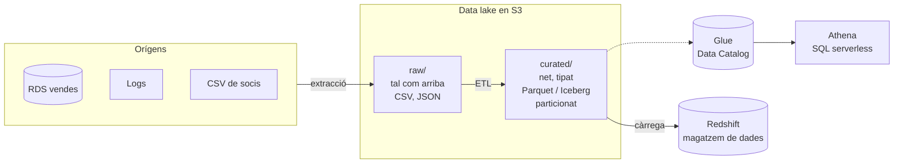

# UD07 · Analítica de dades (OLAP)

## Resum del tema

Una base de dades **OLTP** (la de vendes) està pensada per a moltes transaccions xicotetes: inserir una venda, consultar un esdeveniment. Un sistema **OLAP** està pensat per a poques consultes enormes: sumar cinc anys de vendes per mes, canal i recinte. En el núvol, el normal és separar els dos mons: les dades s'**extrauen**, es **transformen** i es **carreguen** (ETL) en un *data lake* o en un magatzem de dades, i allí s'analitzen. El teu treball com a administrador és el de sempre: regió, xifratge, accés, retenció i organització de les dades, supervisió dels processos, còpies i rendiment.



### Objectius d'aprenentatge

- Distingir OLTP i OLAP, data lake, magatzem de dades i *lakehouse*.
- Conéixer els formats i serveis analítics: Parquet, Iceberg, Glue, Athena, Redshift.
- Configurar el xifratge i els permisos d'un sistema analític mitjançant IaC.
- Configurar la retenció, el particionament i la compactació equilibrant disponibilitat i cost.
- Supervisar les càrregues i transformacions, i monitoritzar el rendiment i l'espai.
- Protegir les dades analítiques amb replicació i còpies.

---

## 1. OLTP davant d'OLAP

| | OLTP (RDS, DynamoDB) | OLAP (Athena, Redshift, BigQuery…) |
|---|---|---|
| Operacions | Moltes, xicotetes, de lectura i escriptura | Poques, enormes, quasi només lectura |
| Dades per consulta | Unes files | Milions o milers de milions de files |
| Model | Normalitzat (3FN) | Desnormalitzat: **fets** i **dimensions** (estrela) |
| Emmagatzematge | Per files | **Per columnes** |
| Objectiu | Latència baixa i consistència | Rendiment de lectura i cost per consulta |

Executar informes pesats sobre la base de dades OLTP competix amb les vendes. Per això les dades es copien a un sistema analític, amb un retard acceptable (hores, minuts).

### 1.1 Data lake, magatzem de dades i lakehouse



| Concepte | Què és | En AWS |
|---|---|---|
| **Data lake** | Fitxers en emmagatzematge d'objectes, en brut i transformats, amb un catàleg | S3 + Glue Data Catalog |
| **Magatzem de dades** (*data warehouse*) | Base de dades columnar amb emmagatzematge propi, molt optimitzada | Redshift |
| **Lakehouse** | Data lake amb **formats de taula** (Iceberg) que afigen transaccions, esborraments i versions | S3 + Iceberg (S3 Tables) + Athena/Redshift |

Equivalents: Azure Data Lake Storage + Synapse/Fabric; Google Cloud Storage + BigQuery.

---

## 2. Formats: per què Parquet

| Format | Organització | Compressió | Llig només les columnes necessàries | Tipus |
|---|---|---|---|---|
| CSV | Files, text | Cap o del fitxer sencer | No | No |
| JSON | Files, text | Ídem | No | Parcials |
| **Parquet** | **Columnes**, binari, per blocs | Per columna (Snappy, ZSTD) | **Sí** | Sí, amb estadístiques mín./màx. per bloc |

Amb Parquet, una consulta que suma `importe` per `canal` llig **dues columnes** de dotze, i pot **saltar-se** blocs sencers gràcies a les estadístiques. En serveis que cobren per dades llegides (Athena), això són diners.

**Apache Iceberg** és un **format de taula** per damunt de Parquet: guarda metadades amb la llista de fitxers de cada versió de la taula. Aporta `INSERT`, `UPDATE`, `DELETE` i `MERGE` transaccionals, **viatge en el temps** (consultar la taula com estava ahir), evolució de l'esquema i del particionament, i operacions de **compactació** i **neteja** de versions. **S3 Tables** és un tipus de bucket de S3 que gestiona taules Iceberg i fa la compactació automàticament.

---

## 3. Els serveis analítics

| Servei | Què fa | Com cobra (orientatiu) |
|---|---|---|
| **Glue Data Catalog** | Metadades: bases de dades, taules, columnes, particions, ubicació en S3 | Per objecte emmagatzemat i petició (franja gratuïta àmplia) |
| **Glue Crawler** | Recorre S3 i inferix taules i particions | Per temps d'execució (DPU-hora) |
| **Glue ETL** | Treballs Spark o Python per a transformar | Per DPU-hora |
| **Athena** | SQL *serverless* (motor Trino) sobre S3 | Per **TB escanejat** (amb mínim per consulta) o capacitat reservada |
| **Redshift** | Magatzem de dades: aprovisionat (nodes RA3) o *Serverless* (RPU) | Per hora de node o per RPU-hora; emmagatzematge gestionat a banda |
| **Lake Formation** | Permisos fins (taula, columna, fila) sobre el catàleg | Sense cost addicional pels permisos |

---

## 4. Regió i replicació (CA RA7.a)

- El llac, el catàleg, el grup de treball d'Athena i el seu bucket de **resultats** han d'estar en la **mateixa regió**: consultar dades d'una altra regió afig latència i cost de transferència.
- La residència de les dades personals s'aplica igual que en OLTP: si el llac té codis postals o correus de clients, va en una regió europea.
- **Replicació**: el llac (S3) amb CRR; Redshift amb **còpia d'instantànies entre regions**; el catàleg, recreant-lo amb IaC o exportant-lo.

---

## 5. Xifratge (CA RA7.b)

| Element | Com es xifra |
|---|---|
| Dades del llac (S3) | SSE-KMS amb clau pròpia en els buckets `raw` i `curated` (UD02) |
| **Resultats d'Athena** | Configuració del **grup de treball** (`SSE_KMS` + clau), **forçada** perquè ningú la canvie |
| Glue Data Catalog | *Data Catalog settings*: xifratge de metadades i de contrasenyes de connexions amb KMS |
| Treballs de Glue | *Security configuration*: xifratge del que escriuen en S3, dels registres de CloudWatch i dels marcadors |
| Redshift | Xifratge del clúster o de l'espai de noms amb KMS; TLS obligatori (`require_ssl`) |

```hcl
resource "aws_athena_workgroup" "analistas" {
  name = "ta-${var.alumno}-analistas"
  configuration {
    enforce_workgroup_configuration    = true
    publish_cloudwatch_metrics_enabled = true
    bytes_scanned_cutoff_per_query     = 1073741824        # 1 GB por consulta como máximo
    result_configuration {
      output_location = "s3://${aws_s3_bucket.resultados.bucket}/athena/"
      encryption_configuration {
        encryption_option = "SSE_KMS"
        kms_key_arn       = aws_kms_key.lago.arn
      }
    }
  }
  force_destroy = true
}
```

---

## 6. Visibilitat, accés, monitorització i auditoria (CA RA7.c)

**Perfils** típics i què poden fer:

| Perfil | Permisos |
|---|---|
| Enginyeria de dades | Escriure en `raw/` i `curated/`, crear taules, executar treballs d'ETL |
| Analistes | Consultar `curated` des del **seu grup de treball**, sense columnes de dades personals |
| Direcció | Veure els taulers (QuickSight o una altra ferramenta) |
| Auditoria | Llegir registres de CloudTrail i del llac |

Ferramentes:

- **Polítiques IAM** sobre S3, Glue i Athena (per exemple, `athena:StartQueryExecution` només en el grup de treball `analistas`).
- **Lake Formation** per a donar permisos a nivell de **columna** o **fila** sense crear vistes ni còpies.
- **Grups de treball d'Athena**: separen usuaris, forcen el xifratge de resultats, limiten les dades escanejades per consulta i publiquen mètriques.
- **CloudTrail** registra qui va executar cada consulta (`StartQueryExecution`) i qui va canviar el catàleg; Redshift té el seu propi **registre d'auditoria** (connexions, usuaris, sentències).

---

## 7. Retenció, particionament i compactació (CA RA7.d)

### 7.1 Particionament

Particionar és organitzar els fitxers en carpetes segons una columna, perquè les consultes **només llegisquen** les carpetes necessàries:

```text
s3://ta-lmartinez-lago-7f3a/curated/ventas/anio=2024/mes=6/part-00000.zstd.parquet
s3://ta-lmartinez-lago-7f3a/curated/ventas/anio=2024/mes=7/part-00000.zstd.parquet
```

```sql
-- Llig només juny de 2024 (poda de particions)
SELECT canal, sum(importe) FROM ventas_parquet WHERE anio = 2024 AND mes = 6 GROUP BY canal;
```

Regles: particiona per les columnes per les quals **més es filtra** (normalment la data); evita particions massa xicotetes (molts fitxers de pocs KB) o massa nombroses (desenes de milers). Amb **projecció de particions** Athena calcula les particions sense consultar el catàleg; amb Iceberg el particionament és **ocult** (`PARTITIONED BY (month(fecha_venta))`) i no cal posar `anio`/`mes` en les consultes.

### 7.2 Compactació

Les càrregues freqüents generen **molts fitxers xicotets**, que fan les consultes lentes (cada fitxer és una petició i una arrancada) i cares. **Compactar** és reescriure'ls en pocs fitxers grans (de 128 MB a 1 GB):

- Taules Iceberg en Athena: `OPTIMIZE taula REWRITE DATA USING BIN_PACK`.
- Taules Hive/Parquet: reescriure la partició amb `INSERT`/CTAS o amb un treball de Glue.
- S3 Tables: automàtica.

### 7.3 Retenció

Equilibrar **disponibilitat de les dades** i **cost**:

| Zona | Retenció típica | Mecanisme |
|---|---|---|
| `raw/` | 30 – 90 dies (es pot regenerar des de l'origen) | Cicle de vida de S3: esborrament o pas a Glacier |
| `curated/` | Els anys que exigisca el negoci o la llei | Esborrar particions antigues; Glacier Instant Retrieval per a anys poc consultats |
| Versions d'Iceberg | Dies | `VACUUM` amb `vacuum_max_snapshot_age_seconds` |
| Resultats d'Athena | Dies | Cicle de vida del bucket de resultats |
| Instantànies de Redshift | Segons el RPO | Retenció d'instantànies automàtiques i manuals |

---

## 8. Supervisar l'ETL (CA RA7.e)

Una càrrega que falla en silenci produïx **informes equivocats**, que és pitjor que no tindre informes. Supervisar és:

| Què | On |
|---|---|
| Estat de cada execució (correcta, fallida, temps esgotat) | Consola de Glue (*Job runs*), historial de consultes d'Athena, `aws glue get-job-runs`, `aws athena get-query-execution` |
| Temps d'execució i dades processades | Mètriques de Glue i Athena en CloudWatch (`TotalExecutionTime`, `ProcessedBytes`) |
| Registres i errors | CloudWatch Logs (`/aws-glue/jobs/output`, `/aws-glue/jobs/error`) |
| Alertes | Regles d'**EventBridge** sobre el canvi d'estat (`FAILED`, `TIMEOUT`) → SNS |
| Qualitat de les dades | Recomptes i sumes de control abans i després (com en la UD05); **Glue Data Quality** |

I en la configuració de cada procés: **temps màxim** (*timeout*), **reintents** limitats, **marcadors** (*job bookmarks*) per a processar només el que és nou, i una execució **idempotent** (repetir-la no duplica dades).

---

## 9. Replicació i còpies (CA RA7.f)

| Element | Protecció |
|---|---|
| Fitxers del llac | **Versionat** de S3, **replicació** a una altra regió, AWS Backup per a S3 |
| Taules Iceberg | **Viatge en el temps** (fins que `VACUUM` esborra les versions) + versionat de S3 |
| Catàleg de Glue | Definit en **IaC** (es recrea) o exportat periòdicament (`get-tables`) |
| Redshift | Instantànies automàtiques (retenció configurable), manuals i **còpia entre regions** |
| Codi d'ETL i consultes | Repositori Git |

---

## 10. Rendiment i espai (CA RA7.g)

- **Athena**: dades escanejades i temps de cada consulta (historial i mètriques del grup de treball); `EXPLAIN ANALYZE` mostra quines fases tarden i quant llegixen. Si una consulta escaneja molt: és Parquet? Filtra per la partició? Selecciona només les columnes necessàries?
- **Espai**: grandària de cada prefix del llac (S3 Storage Lens, `aws s3 ls --summarize`), nombre de fitxers per partició (fitxers xicotets), creixement mensual.
- **Redshift**: `PercentageDiskSpaceUsed`, durada de les consultes, cues de WLM, taules sense ordenar o amb estadístiques antigues (`SVV_TABLE_INFO`).

> [!TIP]
> En local, **DuckDB** llig Parquet (i CSV) amb SQL i és ideal per a provar el particionament i la compressió abans de pagar per escanejar dades en el núvol.

---

## 11. Errors freqüents

| Problema | Causa | Solució |
|---|---|---|
| La consulta d'Athena escaneja tot el llac | CSV, sense particions o sense filtrar per elles | Parquet, particionament i `WHERE` sobre la partició |
| `HIVE_PARTITION_SCHEMA_MISMATCH` o taula buida | Particions no registrades en el catàleg | `MSCK REPAIR TABLE`, rastrejador o projecció de particions |
| Consultes cada vegada més lentes | Fitxers xicotets per càrregues freqüents | Compactar |
| Un analista veu correus de clients | Permisos per taula, no per columna | Lake Formation o una taula/vista sense eixes columnes |
| L'ETL «funciona» però falten dades | Sense validació ni alertes | Recomptes de control i regla d'EventBridge |
| El llac creix sense control | `raw/` sense retenció, versions d'Iceberg sense `VACUUM` | Cicle de vida i `VACUUM` programat |

## 12. Resum

- OLTP per a operar, OLAP per a analitzar; se separen per a no competir.
- Data lake (S3 + Glue + Athena) o magatzem de dades (Redshift); Iceberg unix tots dos mons.
- Parquet i particionament reduïxen dades llegides, temps i cost; compactar evita els fitxers xicotets.
- Xifratge del llac, dels resultats i del catàleg amb KMS mitjançant IaC; permisos per perfil amb IAM, grups de treball i Lake Formation.
- Supervisar l'ETL: estat, temps, registres, alertes i validació de dades.
- Còpies: versionat i replicació del llac, catàleg com a codi, instantànies de Redshift.

## 13. Autoavaluació


- q: "Per què una consulta sobre Parquet sol escanejar moltes menys dades que sobre CSV?"
  options: ["Perquè Parquet no guarda totes les files", "Perquè és columnar, comprimit i té estadístiques per bloc", "Perquè Athena no cobra per Parquet", "Perquè està xifrat"]
  answer: 1
  explain: "Només llig les columnes que necessita i pot saltar-se blocs gràcies a les estadístiques."
- q: "Les vendes estan particionades per `anio` i `mes`. Quina consulta aprofita el particionament?"
  options: ["`WHERE year(fecha_venta) = 2024`", "`WHERE anio = 2024 AND mes = 6`", "`ORDER BY fecha_venta`", "`SELECT *`"]
  answer: 1
  explain: "El filtre ha d'anar sobre les columnes de partició (en taules Hive) per a podar carpetes."
- q: "On es força que els resultats d'Athena es guarden xifrats amb la teua clau?"
  options: ["En cada consulta", "En la configuració del grup de treball, amb l'opció de forçar-la", "En Glue Crawler", "En CloudTrail"]
  answer: 1
  explain: "El grup de treball definix la ubicació i el xifratge dels resultats i pot impedir que els usuaris els canvien."
- q: "Una taula Iceberg rep un INSERT cada 5 minuts i les consultes són cada vegada més lentes. Què fas?"
  options: ["Passar a CSV", "`OPTIMIZE ... REWRITE DATA USING BIN_PACK` i `VACUUM` periòdics", "Llevar el particionament", "Canviar de regió"]
  answer: 1
  explain: "Compactar reunix els fitxers xicotets; VACUUM elimina versions antigues."
- q: "Com t'assabentes que un treball de Glue ha fallat esta nit?"
  options: ["Mirant la consola pel matí", "Regla d'EventBridge sobre l'estat FAILED que avisa per SNS", "Amb S3 Storage Lens", "No cal"]
  answer: 1
  explain: "Les alertes automàtiques són part de la supervisió de l'ETL."
- q: "Què protegix el catàleg de Glue davant d'un esborrament accidental?"
  options: ["El versionat de S3", "Tindre'l definit en IaC o exportat periòdicament", "Les instantànies de Redshift", "Res"]
  answer: 1
  explain: "El catàleg són metadades fora de S3: es protegix recreant-lo des del codi o des d'una exportació."


## Referències

- Amazon Athena User Guide — <https://docs.aws.amazon.com/athena/latest/ug/>
- *Partitioning data in Athena* i *Partition projection* — <https://docs.aws.amazon.com/athena/latest/ug/partitions.html>
- *Using Apache Iceberg tables* en Athena (`OPTIMIZE`, `VACUUM`) — <https://docs.aws.amazon.com/athena/latest/ug/querying-iceberg.html>
- AWS Glue — <https://docs.aws.amazon.com/glue/latest/dg/>
- Amazon S3 Tables — <https://docs.aws.amazon.com/AmazonS3/latest/userguide/s3-tables.html>
- Amazon Redshift Management Guide — <https://docs.aws.amazon.com/redshift/latest/mgmt/>
- AWS Lake Formation — <https://docs.aws.amazon.com/lake-formation/latest/dg/>
- Apache Parquet — <https://parquet.apache.org/> · Apache Iceberg — <https://iceberg.apache.org/> · DuckDB — <https://duckdb.org/docs/>
